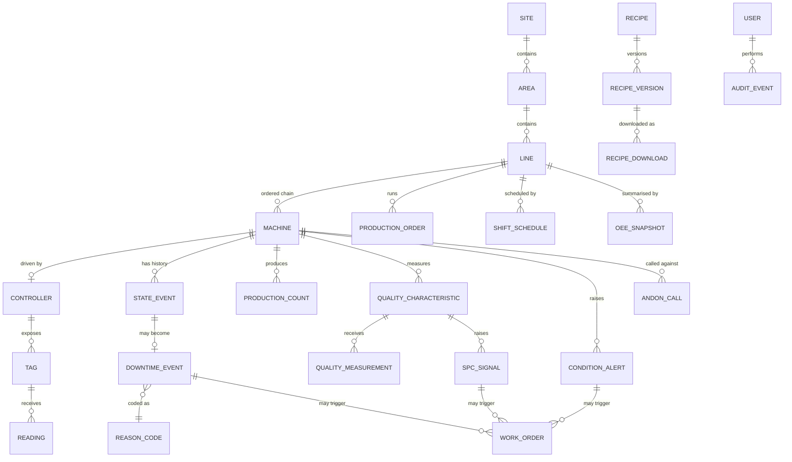

# Capstone Project Requirements: Production-Line OEE & Condition-Monitoring Platform ("LineSight")

## Honeywell Software Engineering Teams — Capstone Brief (Industrial Automation)

---

## Document Revision

| Version | Date | Notes |
|---|---|---|
| 1.0 | 2026-10-16 | Initial full-stack capstone requirements — Industrial Automation (discrete manufacturing) use case. |

---

## Table of Contents

1. [Overview](#1-overview)
2. [Scenario](#2-scenario)
3. [Relationship to Real Plant-Floor Systems](#3-relationship-to-real-plant-floor-systems)
4. [Learning Objectives](#4-learning-objectives)
5. [System Architecture](#5-system-architecture)
6. [Domain Model](#6-domain-model)
7. [Functional Requirements](#7-functional-requirements)
8. [Non-Functional Constraints](#8-non-functional-constraints)
9. [External Interface Contracts](#9-external-interface-contracts)
10. [Acceptance Criteria](#10-acceptance-criteria)
11. [Test Strategy Requirements](#11-test-strategy-requirements)
12. [Agentic / MCP Requirement](#12-agentic--mcp-requirement)
13. [SDLC Deliverables & Repository Structure](#13-sdlc-deliverables--repository-structure)
14. [Module Build Map](#14-module-build-map)
15. [Grading Rubric / Definition of Done](#15-grading-rubric--definition-of-done)
16. [Stretch Goals (Optional)](#16-stretch-goals-optional)
---

## 1. Overview

This capstone brings together everything practiced across the 12-module AI Champions
Programme — GitHub Copilot fluency, prompt and context engineering, spec-driven
development, the complete SDLC (greenfield **and** brownfield), test strategy with
Testcontainers and end-to-end validation, MCP-enabled agentic workflows, PR-quality
automation with LLM-as-Judge, studio-style workflows for non-technical roles,
code-based agents with simple RAG, Agent Prism observability, and token economics /
ROI — and applies it to a single, coherent, full-stack system: a **production-line
performance and machine-health platform** for a discrete-manufacturing plant, built as
a REST API + relational database + web frontend.

**LineSight** is a plant-floor companion layer that sits *above* the PLCs and SCADA on
a set of packaging / assembly lines. It does not run the machines. It ingests machine
state, production counters, and condition signals from the line's PLCs; derives
downtime and **OEE** (Availability × Performance × Quality); tracks quality with
**statistical process control**; watches machine health for early signs of failure;
manages **recipes** (product parameter sets) under change control and downloads
approved ones to the line; runs **andon** calls from operators; and turns downtime,
quality deviations, and condition alerts into maintenance work. Today all of this lives
in paper shift sheets, spreadsheets, and tribal knowledge.

Where the PlantWatch capstone is built around *process-alarm management* (continuous
process, ISA-18.2) and the ZoneIQ capstone around *building HVAC fleets*, LineSight is
the **discrete-manufacturing** case: the central problem is not "is a value past a
limit" but "where did the production time go, and what do we change to get it back".

Like the programme's running lab application, this is a **host-runnable** system —
PostgreSQL in a container, one backend (.NET / Python / Java) behind a shared REST
contract, and a React frontend. No real plant or PLC is required: machine data arrives
from a deterministic **simulated line feed**, the line's controller is a **simulated
OPC UA server**, and the external systems LineSight integrates with (ERP/MES order
source, CMMS, SOP store) are exercised through **mock MCP servers**, the same way the
lab application's integrations are tested.

This document is the capstone's top-level specification. It is deliberately more
complete than the `spec.md` for a single module — but every functional requirement in
Section 7 must still be decomposed into its own `spec.md → plan.md → tasks.md` chain
before implementation, exactly as practiced in Modules 04 and 05.

---

## 2. Scenario

> **LINESIGHT-CAPSTONE** — A consumer-goods plant runs several packaging lines. Each
> line is a chain of machines — filler, capper, labeler, case packer, palletizer —
> joined by conveyors, each driven by a PLC that exposes its state and counters over
> OPC UA. Lines run several products a week; each product has a recipe (fill volume,
> cap torque, line speed, label offset).
>
> Today the plant's performance picture is a whiteboard and an end-of-shift Excel
> sheet. Operators log stoppages on paper with free-text reasons ("jam", "waiting",
> "other"), so nobody can say whether the biggest loss is changeovers, micro-stops at
> the capper, or starved upstream machines. OEE is calculated monthly by hand, with
> different people using different ideal speeds. Quality checks are recorded but never
> charted, so drift is noticed only when a pallet is rejected. Bearings on the
> palletizer failed twice last quarter with no warning. Recipe changes are made at the
> HMI by whoever is on shift, with no review and no record of who changed a torque
> setting or why.
>
> You are building **LineSight**: the platform that gives the plant a live, trustworthy
> line-performance view, ingests and retains recent machine data, derives downtime and
> OEE from machine state, enforces consistent reason coding, charts quality with SPC,
> raises early condition warnings, runs andon escalation, governs recipe changes
> through a review-and-approval flow before anything is downloaded to a line, and turns
> losses into tracked maintenance work.

This is deliberately under-specified in the same way the lab features were: it names
the problem and the constraints, not the design. Framing the problem, modelling the
domain, designing the API and the OEE / state-derivation logic — that is the capstone
work, not a given.

---

## 3. Relationship to Real Plant-Floor Systems

LineSight is a **companion system**, not a replacement for any part of the automation
stack. Being precise about what it is and is not is part of the architecture
deliverable.

| Concern | Real plant-floor system | LineSight |
|---|---|---|
| Machine control, motion, interlocks | PLC / machine controller | Never writes to the control logic; the **only** write path is a governed recipe download (LS-10) |
| Safety functions (e-stop, guarding, light curtains) | Safety PLC / safety relay (SIL/PL-rated) | Out of scope entirely; LineSight never reads or writes safety I/O and must not be described as safety-related |
| Visualisation & local operation | HMI / SCADA | LineSight is a supervisory *analytics and workflow* view, not an operator control screen |
| Production orders, BOM, genealogy | MES / ERP | Imports orders via a mock MCP tool; keeps only what OEE and recipes need |
| Long-term history | Historian / data lake | Stores only recent readings and **rolled-up** KPI snapshots |
| Maintenance execution | CMMS (spares, planning, scheduling) | Creates and tracks work orders; hands them to a CMMS via MCP (Module 07) |

**Standards it is informed by:** ISA-95 (Site → Area → Line → Machine hierarchy),
ISA-88 (recipe / procedure separation), PackML / ISA-TR88.00.02 (machine state model),
ISO 22400 (manufacturing KPIs, including OEE), ISO 20816 / ISO 10816 (machine vibration
severity), OPC UA (information-model access), and the AIAG / Western Electric rules for
SPC. These inform the model; the capstone does not claim compliance.

### How this differs from the sibling capstones

| Dimension | ZoneIQ (HVAC) | PlantWatch (process) | **LineSight (discrete mfg)** |
|---|---|---|---|
| Core question | Is the building comfortable / healthy? | Which process values are in alarm? | **Where did production time go?** |
| Central engine | Comfort/IAQ evaluation + optimizer | Alarm limits + on/off-delay + deadband | **State → downtime → OEE; SPC rules** |
| Field protocol | Modbus / BACnet registers | Historian tags | **OPC UA node IDs** |
| Write path | Supervisory setpoints / commands | None (read-only) | **Recipe download, two-person approved** |
| Time model | Snapshots | Threshold crossings | **Durations, shifts, counters (rollover/reset)** |
| Predictive element | — | — | **Vibration trend → early condition alert** |

---

## 4. Learning Objectives

By the end of the capstone, you will have demonstrated, on one system:

1. **Copilot Enterprise fluency** (Module 02) — chat, inline, explanation, refactor,
   test generation, debugging, agent mode, and the repository-customization layer
   (`.github/` instructions, prompts, chat modes, skills) applied to real feature
   work.
2. **Context engineering** (Module 03) — deliberately selected, layered, compressed,
   task-scoped context, with token usage recorded and inflation anti-patterns
   avoided.
3. **Spec-driven development at system scale** (Module 04) — decomposing one
   capstone-level problem into multiple module-level `spec.md → plan.md → tasks.md`
   chains, each independently implementable, testable, and traceable, and absorbing a
   requirement change through the spec first.
4. **The complete SDLC, greenfield and brownfield** (Module 05) — problem framing,
   architecture and API design, implementation, CI quality gates, and release
   readiness for greenfield features; plus repository archaeology, change-impact
   analysis, and minimal-change / regression-safe evolution for a brownfield change.
5. **A real test strategy** (Module 06) — specification-to-test traceability, unit +
   integration + contract + boundary/negative + E2E tests, **Testcontainers** for the
   database and the simulated line feed, and a deliberately injected defect proven
   caught.
6. **MCP-enabled agentic engineering** (Module 07) — at least one governed
   MCP-connected workflow and one packaged reusable skill used to build, test, or
   operate this platform, with tool permissions, context boundaries, approvals, and
   failure handling designed, not just its output.
7. **PR-quality automation** (Module 08) — spec-compliance, standards, security,
   test-evidence and regression-risk checks plus an LLM-as-Judge rubric and a
   human-escalation gate, applied to a safety- or quality-relevant change.
8. **Studio-style workflow authoring** (Module 09) — a non-technical role authoring an
   agent-assisted workflow in Atlassian Rovo Studio, grounded on Jira / Confluence,
   with an approval flow and permission boundaries, handed to engineering.
9. **Code-based agents and simple RAG** (Module 10) — at least one assistant agent
   built in code with the Copilot SDK, grounded by a simple retrieval flow over the
   plant's SOP / work-instruction documents, with an explicit tool allow-list.
10. **Observability, ROI and governance** (Module 11) — Agent Prism traces, failure
    patterns, drift, and token/cost signals for this platform's assistant agents,
    related to product KPIs; a before/after ROI model against the Module 01 baseline;
    and a governance decision rule.
11. **Adoption judgment** (Module 12) — a 30/60/90-day roadmap for taking this way of
    working to other Honeywell engineering teams, plus an honest release-readiness
    self-audit.

---

## 5. System Architecture

Follow the programme-wide layered model used throughout the lab application, extended
with an ingestion layer:

```
┌─────────────────────────────────────────────────────────────────────┐
│  React Frontend                                                       │
│  components/ (presentational) → pages/ (state + fetch) → services/    │
│  (all HTTP in one place)                                              │
└───────────────────────────────┬─────────────────────────────────────┘
                                │  REST (JSON)
┌───────────────────────────────▼─────────────────────────────────────┐
│  Controller / Router Layer                                            │
│  translate HTTP <-> domain, map errors to status codes                │
└───────────────────────────────┬─────────────────────────────────────┘
┌───────────────────────────────▼─────────────────────────────────────┐
│  Service Layer                                                        │
│  validation, business rules: state derivation, downtime, OEE engine,  │
│  SPC rules, condition scoring, andon, recipe governance, access ctrl  │
└──────────────┬─────────────────────────────────┬────────────────────┘
               │                                 │
┌──────────────▼──────────────┐   ┌──────────────▼────────────────────┐
│  Repository Layer            │   │  Ingestion / Device-Adapter Layer │
│  ALL database access         │   │  telemetry ingest endpoint;       │
│                              │   │  OPC UA adapter mapping a machine │
│                              │   │  node map <-> platform tags;      │
│                              │   │  recipe download; outbound MCP    │
│                              │   │  surface (ERP, CMMS, SOP)         │
└──────────────┬──────────────┘   └──────────────┬────────────────────┘
               │                                 │
┌──────────────▼─────────────────────────────────▼────────────────────┐
│  PostgreSQL + simulated line feed / simulated OPC UA server + mock   │
│  MCP servers.   Schema owned once in database/schema.sql             │
└─────────────────────────────────────────────────────────────────────┘
```

### Layering rules

1. **Repository is the only place SQL lives.** Controllers and the adapter layer
   never touch the database directly.
2. **The OEE engine, state-derivation, SPC rules, and condition scoring live in the
   Service layer and know nothing about HTTP or transport.** They are **pure
   functions** of domain objects (a state-event sequence, a counter series, a
   measurement subgroup) and an **injected "now"** — no request objects, no OPC UA
   framing, no clock reads.
3. **The device adapter does not mutate domain state directly.** Inbound: it
   translates OPC UA node values into a validated telemetry batch and hands it to the
   Service layer. Outbound: it translates an **approved** recipe version into node
   writes. It never downloads anything the recipe-governance flow has not released.
4. **The telemetry ingestion contract, the OPC UA node-map, and the external-system
   contracts are documented contracts** (Section 9), not side effects of the
   implementation.
5. **Events are a cross-cutting concern** with their own code ranges per category
   (downtime / quality / condition / comms / andon) so a code identifies its source at
   a glance.
6. **KPIs are derived, not stored as truth.** Raw state events and counters are the
   source of truth; OEE snapshots are reproducible from them. A recomputation over the
   same inputs must return the same numbers.

Decide, and defend in your architecture doc, whether machine data is **pushed** by the
line feed to an ingestion endpoint, **pulled** by a platform poller from the simulated
OPC UA server, or both behind a common adapter interface — and whether state is
**reported by the machine** or **derived by the platform** from raw signals. An
undefended choice is not acceptable.

---

## 6. Domain Model

Entities and their load-bearing fields — intent, not DDL. The schema is authored once
in `database/schema.sql`; schema changes are new numbered files under
`database/migrations/`.

| Entity | Key fields | Notes |
|---|---|---|
| **Site → Area → Line → Machine** | name, code, parent; Machine: type (filler / capper / labeler / case-packer / palletizer / conveyor / other), criticality (A/B/C), position in line, ideal rate | ISA-95 hierarchy. A Line is an ordered chain of Machines; a Machine is the smallest tracked unit. |
| **Controller (PLC)** | serial, model, protocol (`opcua`), firmware, parent Machine, commissioning state, last-seen | One per Machine in the base build. |
| **Tag** | controller, key (e.g. `machine_state`, `good_count`, `reject_count`, `line_speed`, `vib_rms`, `motor_temp`, `fault_code`, `recipe_id`), engineering unit, data type + scaling, direction (telemetry / command), OPC UA node mapping | Platform-side representation of a machine node-map row. Built spec-first in Module 04. |
| **Reading** | Tag, value, quality (good / uncertain / bad), source timestamp, received timestamp | Bulk-ingested. Short retention. A non-good reading is stored but never drives state, OEE, SPC, or condition scoring. |
| **StateEvent** | Machine, state (PackML-informed: `execute`, `idle`, `starved`, `blocked`, `held`, `stopped`, `aborted`, `changeover`, `maintenance`), started-at, ended-at | Derived from the `machine_state` tag. Closed intervals are immutable; the open interval is the current state. |
| **DowntimeEvent** | Machine, StateEvent link, start, end, class (planned / unplanned), reason code, coded-by, coded-at, note | A stoppage ≥ a configured minimum duration. Shorter ones are **micro-stops**, counted but not reason-coded individually. May be **split** into sub-events with different reasons. |
| **ReasonCode** | code, name, parent, class (planned / unplanned), OEE loss category (availability / performance / quality) | Controlled hierarchy (e.g. *Unplanned → Mechanical → Jam*). Free text alone is not a reason. |
| **ProductionOrder** | order no., product/SKU, Line, target quantity, ideal cycle time (or rate), planned start/end, status | Imported from the mock ERP/MES (LS-06). |
| **ShiftSchedule** | Line, shift name, start/end, planned-production time, planned breaks | Defines the denominator for Availability. |
| **ProductionCount** | Machine, interval, good count, reject count, order | Derived from counter deltas (handles reset and rollover — LS-03). |
| **OEESnapshot** | scope (machine / line / area), period, planned time, run time, ideal vs actual output, good/total counts, Availability, Performance, Quality, OEE, data-quality flags | Reproducible from raw events/counters. |
| **QualityCharacteristic** | Line/Machine, name, unit, target, LSL / USL, subgroup size, chart type (individuals / X̄-R) | The thing being charted (e.g. fill weight). |
| **QualityMeasurement** | characteristic, subgroup, values, measured-at, measured-by / auto | Manual or sensor-fed. |
| **SpcSignal** | characteristic, rule (Western Electric 1–4), measurement(s), raised-at, state (open / acknowledged / resolved) | Control-chart rule violation. |
| **ConditionAlert** | Machine, tag, kind (threshold / trend), severity (watch / warning / critical), value, trend slope, raised-at, state | Condition-monitoring output (e.g. vibration zone, rising-trend). |
| **AndonCall** | Machine/Line, type (maintenance / quality / material / supervisor), raised-by, raised-at, answered-at, resolved-at, escalation level | Operator help call with timed escalation. |
| **Recipe → RecipeVersion** | Recipe: name, product, Line type. Version: number, parameter set (key → value + unit), state (draft / in-review / approved / released / retired), authored-by, reviewed-by, approved-by | Versioned and immutable once approved. ISA-88-style: recipe is data, not code. |
| **RecipeDownload** | RecipeVersion, Machine/Line, state (requested / dispatched / confirmed / failed), requested-by, approved-by, dispatched-at, echo comparison | The single governed write path to the controller. |
| **WorkOrder** | title, description, priority, status (open / in-progress / done / cancelled), assigned team, linked Machine, linked DowntimeEvent / ConditionAlert / SpcSignal, raised-by, closed-at | Created from downtime, a condition alert, an SPC signal, an andon call, or directly. |
| **AuditEvent** | actor, action, entity type + id, before / after snapshot, timestamp | Immutable. Every recipe state change and download, every reason-code edit, every limit/spec change, every alert/andon transition. |
| **User / Role** | name, role | Role drives access control. No external IdP in the base build. |

### Machine-state → OEE-loss mapping (indicative — Module 05 pins the exact set)

```
 state          counts toward            OEE factor affected
 ─────────────  ───────────────────────  ───────────────────────────────
 execute        run time                 (Performance, Quality evaluated)
 starved/blocked unplanned stop (flow)   Availability  (upstream/downstream loss)
 held/stopped   unplanned stop           Availability
 aborted        unplanned stop (fault)   Availability
 changeover     planned stop             Availability (if included) / excluded
 maintenance    planned stop             excluded from planned production time
 idle           outside scheduled time   excluded
 execute @ < ideal speed                 Performance loss
 execute but rejects                     Quality loss
```

> Which states are **planned** vs **unplanned**, and whether changeover counts against
> OEE or is excluded, is a **policy decision** the team must make, justify, and record.
> Two reasonable teams will differ; an undocumented choice is not acceptable.

### Entity relationships



---

## 7. Functional Requirements

Each requirement becomes its own `spec.md` before implementation. IDs are for
traceability; extend the numbering as sub-requirements emerge. The parenthetical
`↔ HFP-nn` / `↔ PW-nn` notes the structurally parallel requirement in the ZoneIQ (HVAC)
and PlantWatch use cases, for teams comparing the three.

### LS-01 — Plant, Line & Machine Model *(↔ HFP-01 / PW-01)*
Keep the plant hierarchy and machine inventory current.
- CRUD Site / Area / Line / Machine / Controller; a Machine belongs to exactly one
  Line; a Line to exactly one Area; a Controller to exactly one Machine.
- A Machine carries type, criticality (A/B/C), ideal rate, and its position in the
  line (positions are unique and contiguous per Line).
- List and filter machines and controllers by Line, type, criticality, commissioning
  state, and health.
- Deleting a Line or Area with children is refused.

### LS-02 — Tag Catalogue & Node Map *(↔ HFP-02 / PW-02)*
Model each controller's telemetry and command tags on the platform side.
- CRUD Tag rows under a Controller: key, engineering unit, data type + scaling,
  direction (telemetry / command), and the OPC UA node mapping (namespace, node id).
- Tag keys come from a controlled vocabulary; a tag is unique per (controller, key);
  engineering units come from an approved list (introduced as a change-control
  exercise in Module 04).
- The tag set for a controller must be consistent with a declared **machine profile**
  (a named, versioned node-map, e.g. `packaging-machine-v1`) — reject a catalogue that
  omits a required tag or contradicts the profile's scaling.

### LS-03 — Machine-Data Ingestion *(↔ HFP-03 / PW-03)*
Accept machine data from the simulated line feed.
- Bulk `POST` of readings keyed by controller serial + tag key: `{ value, quality,
  timestamp }`.
- Reject a reading for an unknown controller or tag, and a reading older than a
  configured staleness window. Handle **out-of-order** and **duplicate** timestamps
  deterministically (state which wins and why).
- **Counters:** `good_count` / `reject_count` are cumulative PLC counters. Derive
  production from deltas, correctly handling **counter reset** (PLC restart) and
  **rollover** (wrap at the register width); a negative delta must never become negative
  production.
- Store `quality`; only `good` readings drive state, OEE, SPC, and condition scoring.
- Retain only recent raw readings (bounded window); older readings are purged while
  derived events and rollups are kept.
- Update controller `last-seen`; absence of data past a threshold raises a comms event.

### LS-04 — Machine State & Downtime Tracking *(↔ HFP-06 / PW-05)*
Turn the state signal into a trustworthy record of where time went.
- Derive `StateEvent` intervals from `machine_state` readings; the interval chain per
  machine must have **no gaps and no overlaps**.
- A stoppage at or above a configured minimum duration becomes a `DowntimeEvent`;
  shorter ones are counted as **micro-stops** (count + total time per machine/period)
  but not individually coded.
- Operators/supervisors **code** a downtime event with a ReasonCode from the controlled
  hierarchy; free text is a note, never a substitute. Allow **splitting** one event into
  several coded parts that sum exactly to the original duration.
- List uncoded downtime (ageing), filter by machine / line / class / reason / period.
- Coding changes are audited (who, when, from → to).

### LS-05 — OEE Engine *(↔ HFP-05 / PW-05)*
Compute OEE reproducibly from state and counters.
- **Availability** = run time ÷ planned production time; **Performance** = actual
  output ÷ ideal output for the run time (at the order's ideal cycle time/rate);
  **Quality** = good count ÷ total count; **OEE** = A × P × Q.
- Planned production time comes from the ShiftSchedule minus planned breaks/stops per
  the documented policy (Section 6).
- Compute at Machine, Line (state the aggregation rule — e.g. bottleneck-based vs
  simple product — and justify it), and Area scope, for a shift, day, or arbitrary
  range.
- Define and test the awkward cases explicitly: zero planned time, zero output,
  Performance above 100 % (cap and flag, or reject the data — decide), a shift that
  spans a product change, missing data (flag the snapshot as low-quality rather than
  silently reporting a number).
- The OEE function is **pure**: same inputs → same outputs; no HTTP, no SQL, no clock
  reads beyond an injected "now". A recomputation must reproduce a stored snapshot.

### LS-06 — Production Orders & Shift Schedules *(↔ new)*
Give OEE its context.
- Import production orders from the mock ERP/MES via an MCP tool (read); keep SKU,
  target quantity, ideal rate, and planned window. Imported data is validated, never
  trusted.
- CRUD ShiftSchedule per Line with planned breaks; reject overlapping or contradictory
  shifts.
- Associate the running order with a Line over time (an order change is a recorded
  event); OEE for an interval uses the ideal rate of the order that was running.
- Track order progress (good count vs target) and projected completion.

### LS-07 — Quality & SPC *(↔ new)*
Chart quality so drift is seen before a pallet is rejected.
- CRUD QualityCharacteristic with target, LSL/USL, subgroup size, chart type; reject
  inverted specs (LSL ≥ USL) and a target outside spec.
- Accept QualityMeasurements (manual entry or sensor-fed) and compute chart statistics
  (mean, range, control limits from a documented baseline).
- Evaluate **Western Electric** rules (at minimum: 1 point beyond 3σ; 2 of 3 beyond 2σ
  same side; 4 of 5 beyond 1σ same side; 8 consecutive on one side of the centre line)
  and raise `SpcSignal`s. Compute **Cp/Cpk** for a window and refuse to report it on
  too few points.
- Distinguish *out of control* (process signal) from *out of spec* (product signal) —
  they are different events with different responses.
- The SPC rule evaluator is **pure** and independently unit-testable.

### LS-08 — Condition Monitoring & Early Warning *(↔ new)*
Catch degradation before it becomes downtime.
- For configured tags (vibration RMS, motor temperature, motor current), evaluate
  against severity zones (e.g. ISO 20816-style *good / acceptable / warning / critical*)
  with deadband/hysteresis so a value hovering at a boundary does not flap.
- Compute a short-window **trend** (e.g. least-squares slope) and raise a *trend* alert
  when a value is within spec but rising faster than a configured rate, or is projected
  to cross a limit within a configured horizon. State the model's limits honestly; this
  is a **screening heuristic, not a remaining-useful-life prediction**.
- Alert lifecycle: open → acknowledged → resolved; no duplicate open alert per
  (machine, tag, kind); a `bad`-quality or stale series raises a data-quality note, not
  a false "all clear".
- Link an alert to a WorkOrder; closing the WorkOrder does not silently close the alert.

### LS-09 — Andon & Escalation *(↔ new)*
Get the right person to the line fast, and prove it happened.
- An operator raises an AndonCall (maintenance / quality / material / supervisor)
  against a machine or line.
- Unanswered calls **escalate** on a configured timer (operator → team lead →
  supervisor → manager); acknowledge and resolve are separate recorded steps.
- A machine entering a long unplanned stop with no open andon prompts the operator to
  raise one (surface the prompt; do not auto-raise).
- Report response time (raised → answered) and resolution time by type, line, and
  shift.

### LS-10 — Recipe Management & Governed Download *(↔ HFP-07 / HFP-08)*
The only write path to a controller — treat it as safety- and quality-relevant.
- CRUD Recipes and **versioned** parameter sets. A RecipeVersion moves **draft →
  in-review → approved → released**; once approved it is **immutable** (changes create
  a new version).
- Each parameter has a documented engineering range per machine profile; an
  out-of-range value is rejected (or clamped with the clamp recorded) — decide and
  justify.
- **Two-person rule:** the author cannot approve their own version. Approval requires
  the Quality Engineer or Process/Controls Engineer role as configured.
- **Download** (request → dispatch → confirm/fail) through the device adapter, only for
  a **released** version, only to a machine whose current state **permits it** (e.g.
  `idle` or `changeover`, never `execute`), and only for a compatible machine profile.
  After dispatch the adapter reads the nodes back and compares to the intended values;
  a mismatch marks the download **failed** and raises an event. A failed download leaves
  the machine on its last-known-good recipe.
- The adapter never dispatches an unapproved, unreleased, or retired version. Every
  state change is audited with before/after.

### LS-11 — Maintenance Work Orders *(↔ HFP-10 / PW-08)*
Close the loop from loss to maintenance.
- Create a WorkOrder from a DowntimeEvent, ConditionAlert, SpcSignal, AndonCall, or a
  Machine directly; carry the links.
- Fields: title, description, priority, assigned team, status (open → in-progress →
  done / cancelled); record who closed it and when.
- Push approved work orders to the mock CMMS via MCP and keep status in sync; a failure
  leaves the local WorkOrder `sync-pending`, never lost.
- Compute **MTBF** and **MTTR** per machine from downtime and work-order data, stating
  how repeat failures are identified.

### LS-12 — Line Dashboards & KPIs *(↔ HFP-11 / PW-07)*
Give the plant the live view it lacks today.
- **Line board:** each machine's current state (colour-coded) in line order, current
  order and recipe, live speed vs ideal, running OEE for the shift, open andon calls,
  open alerts.
- **Plant view:** OEE and its A/P/Q breakdown per line for the shift/day/week; trend vs
  target.
- **Loss analysis:** downtime **Pareto** by reason code (with an explicit
  "uncoded" bar), micro-stop counts, top-N bad-actor machines, changeover time vs
  target.
- **Reliability:** MTBF, MTTR, andon response time, condition alerts by severity,
  SPC signals per characteristic.
- Every KPI shows its **period, scope, and data-quality flag**; a number built on
  incomplete data is labelled as such.

### LS-13 — Audit, Access Control & Traceability *(↔ HFP-12 / PW-11)*
Nothing quality- or safety-relevant happens without a record, and roles gate the risky
actions.
- Append an AuditEvent for every recipe state change and download, every reason-code
  assignment/edit, every quality-spec or condition-limit change, every alert/andon/SPC
  state transition, and every denied action.
- Query the audit trail by machine, line, recipe, user, action type, and time range.
  Audit events are never edited or deleted through the API.
- Roles: Plant Manager, Production Supervisor, Line Operator, Maintenance Technician,
  Quality Engineer, Process/Controls Engineer, Viewer. Viewer is strictly read-only.
- Safety/quality-relevant actions (recipe approval, recipe download, spec and limit
  edits, reason-code taxonomy edits) are allowed only for the owning role; recipe
  approval additionally enforces the two-person rule. Every denied action is audited.

### LS-14 — Assistant Agents *(↔ HFP-13 / PW-13)*
The AI features the programme observes and governs.
- **Downtime-triage assistant** — given an uncoded or recurring downtime event, pulls
  the machine's state/fault history and recent counters, checks the machine's condition
  alerts and recent recipe changes, retrieves the relevant SOP / work instruction (RAG
  over the document set), proposes a **ranked reason code** with the evidence it used,
  and drafts a WorkOrder **for human approval**. It never codes, acknowledges,
  resolves, or closes anything itself.
- **Quality-deviation assistant** — given an `SpcSignal`, correlates it with the
  machine's recent state, recipe version/change, and condition data, summarises the
  likely cause and urgency, and drafts a non-conformance note + WorkOrder for review.
  It never changes a spec, a recipe, or a download.
- "Good behaviour" for both: grounded only in real LineSight data and retrieved
  documents, cites the event / tag / SOP it used, says "insufficient evidence" rather
  than guessing a cause, stays within its tool permissions, and hands every state
  change to a human. These are the agents monitored in Module 11.

---

## 8. Non-Functional Constraints

Fixed for the whole programme — see `.github/copilot-instructions.md` and the module
guides under `guides/`.

- **Three layers, no skipping:** Controller/Router → Service → Repository (no business
  rules or SQL in controllers; no HTTP or SQL in services; no validation in
  repositories). React: `components/` → `pages/` → `services/`.
- **Schema owned once**, in `database/schema.sql`. No EF migrations, no
  `create_all()`, no `ddl-auto` other than `none`. Schema changes are new numbered
  files under `database/migrations/`.
- **Error contract:** `404` for a missing id; `422` for an invalid request body
  (missing required field, unknown enum, out-of-range recipe parameter that cannot be
  clamped, inverted spec limits, overlapping shifts, split not summing to the original
  duration). No other invented codes on CRUD. State-machine violations (e.g. approving
  your own recipe, downloading to a running machine) are rejected with a documented,
  single, consistent code — decide and record it in `CONTRACTS.md`.
- **Timestamps** (`created_at` / `updated_at`, `received_at`) are database-set, never
  client-set. A reading's `source timestamp` is client-supplied by design.
- **Time handling:** all stored times are UTC; shift boundaries are evaluated in the
  line's configured time zone, including **daylight-saving transitions** (a 23- or
  25-hour day must not corrupt planned time).
- **Cross-backend parity:** the .NET, Python, and Java backends expose every feature
  identically and return byte-identical JSON for the same request (timestamp key
  casing aside).
- **Tests-first:** every new endpoint gets a test in the same layer before it is
  "done".
- **Determinism:** the simulated line feed, the simulated OPC UA server, and the mock
  MCP servers must be fully deterministic — no wall-clock or real-network dependence
  in test runs.
- **`.env` discipline:** no direct reading of `.env` / secrets; use the framework
  config system. `.env` is git-ignored; copying `.env.example` is a deliberate step.
- **Measured every module** against: implementation cycle time, quality / regression
  risk, PR review time, testing effort, token usage, AI cost.

---

## 9. External Interface Contracts

Design and document your own concrete contracts as part of the architecture
deliverable. The tables below are **starting skeletons**, not answer keys. A contract
change is versioned and reflected in the traceability matrix, exactly as Module 04
treats an interface-contract change.

### 9.1 Machine-data ingestion API (line feed → platform)

`POST /api/ingest/readings` — JSON, bulk.

```jsonc
{
  "controllerSerial": "PLC-FILL-02",
  "readings": [
    { "tagKey": "machine_state", "value": "execute", "quality": "good", "timestamp": "2026-10-16T08:15:02Z" },
    { "tagKey": "good_count",    "value": 48213,     "quality": "good", "timestamp": "2026-10-16T08:15:02Z" },
    { "tagKey": "reject_count",  "value": 87,        "quality": "good", "timestamp": "2026-10-16T08:15:02Z" },
    { "tagKey": "vib_rms",       "value": 3.4,       "quality": "good", "timestamp": "2026-10-16T08:15:02Z" }
  ]
}
```

| Response | Meaning |
|---|---|
| `202 Accepted` + per-reading result list | batch received; some readings may be individually rejected (unknown tag, stale, duplicate) with a reason |
| `404` | unknown `controllerSerial` |
| `422` | malformed body, empty `readings`, unknown `quality` value, state value not in the machine profile's enum |

### 9.2 OPC UA node map (platform adapter ↔ controller)

The adapter maps a machine profile's OPC UA nodes to platform Tag keys. This is the
**field-side contract**: pin it with contract tests. A reference node-map for
`packaging-machine-v1` is below; teams define the authoritative version in
`docs/CONTRACTS.md`.

| Tag key | Node (browse name) | Data / scaling | Direction | Range / envelope (command only) |
|---|---|---|---|---|
| `machine_state` | `Machine/State/Current` | UInt16 enum (PackML-informed) | telemetry | — |
| `good_count` | `Counters/Good` | UInt32 cumulative | telemetry | — |
| `reject_count` | `Counters/Reject` | UInt32 cumulative | telemetry | — |
| `line_speed` | `Process/SpeedActual` | Float, units/min | telemetry | — |
| `vib_rms` | `Condition/VibrationRMS` | Float, mm/s | telemetry | — |
| `motor_temp` | `Condition/MotorTemp` | Int16 ×0.1 °C | telemetry | — |
| `fault_code` | `Machine/Fault/Code` | UInt16 | telemetry | — |
| `recipe_id` | `Recipe/ActiveId` | String | telemetry + command | must match a released version |
| `recipe_speed_setpoint` | `Recipe/SpeedSetpoint` | Float, units/min | command | clamp/reject to machine envelope |
| `recipe_fill_volume` | `Recipe/FillVolume` | Float, mL | command | per-profile range |
| `recipe_cap_torque` | `Recipe/CapTorque` | Float, N·m | command | per-profile range |

> The state enum, counter width (hence rollover point), and the writable-state
> precondition for recipe writes are part of the profile and must be documented, not
> assumed.

### 9.3 Recipe download (platform → controller)

`POST /api/recipes/{id}/versions/{v}/downloads` creates a request; `/approve`,
`/dispatch` move it forward; the adapter writes the nodes and reads them back.
A write to a machine in a disallowed state, of an unreleased version, or of an
out-of-range value is rejected before any node write occurs. The read-back comparison
result is stored on the download and in the audit event.

### 9.4 ERP / MES order import (read, via MCP — Module 07)

- `listOrders({ line, from, to })` → production orders (SKU, quantity, ideal rate,
  window). Read-only; imported records are validated, never trusted.

### 9.5 CMMS work-order integration (read/write, via MCP — Module 07)

- `createWorkOrder({ machineTag, title, description, priority })` → external id.
  Called only after human approval; the id is stored locally.
- `getWorkOrderStatus({ externalId })` → status. Polled to keep state in sync.
- A failure leaves the local WorkOrder `sync-pending`, never lost; writes are
  rate-limited and audited.

### 9.6 SOP / work-instruction lookup (read, via MCP/RAG — Modules 07 & 10)

- `lookupSop({ machineType | reasonCode | alarmKind })` → document reference + excerpt.
- Read-only; results are cited by the assistant agents (LS-14), never treated as
  authoritative action.

---

## 10. Acceptance Criteria

- [ ] A documented top-level architecture (layer diagram + module responsibility
      table + the contracts in Section 9 + the domain model + the state/loss policy
      decision) exists **before** implementation began.
- [ ] Each functional requirement in Section 7 has its own `spec.md`, reviewed
      `plan.md`, and ordered `tasks.md`, written before its implementation existed.
- [ ] The full system builds and its test suites run green across the chosen
      backend(s) and the frontend, in CI, with warnings/lint treated as blocking.
- [ ] The OEE engine reproduces hand-calculated A, P, Q, and OEE for a published
      reference scenario (including a planned break, a micro-stop burst, and a reject
      run) — proven by tests with the arithmetic shown, not claimed.
- [ ] The ingestion path handles counter **reset** and **rollover** without negative or
      inflated production, proven by a test that feeds each sequence.
- [ ] State intervals have no gaps or overlaps for an out-of-order, duplicated, and
      stale-timestamp feed — proven by tests.
- [ ] A downtime split that does not sum to the original duration is rejected with
      `422`; uncoded downtime is visible and counted as such on the Pareto.
- [ ] A rising-but-in-spec vibration series raises a *trend* alert before any threshold
      alert, and a value hovering at a zone boundary does not flap — each proven by a
      test.
- [ ] Each Western Electric rule is triggered by a crafted measurement sequence and
      not triggered by a near-miss sequence; out-of-control and out-of-spec are raised
      as distinct events.
- [ ] An unreleased, unapproved, self-approved, out-of-range, or wrong-profile recipe
      is never downloaded; a download to a machine in `execute` is refused; a read-back
      mismatch marks the download failed and leaves the last-known-good recipe — each
      proven by a test against the simulated OPC UA server.
- [ ] The adapter round-trips every tag in the `packaging-machine-v1` profile against
      the simulated server, and a **contract test** fails if the mapping drifts from the
      documented node map.
- [ ] The brownfield change (Module 05) is delivered with an archaeology note,
      change-impact analysis, and a regression report showing the pre-existing test
      suite still green and unmodified.
- [ ] A specification-to-test traceability matrix exists; every functional
      requirement maps to at least one test.
- [ ] At least one MCP tool / reusable skill / agent-assisted workflow was used in
      building or operating the platform, documented with its permission and context
      boundary (Section 12).
- [ ] An LLM-as-Judge PR gate ran on the quality-/safety-relevant change, with
      captured evidence and a human-escalation decision recorded (Module 08).
- [ ] Agent Prism monitoring exists for at least one assistant agent, with traces and
      a token/cost view related to a product KPI (Module 11).
- [ ] A completed release-readiness self-audit and a 30/60/90-day adoption roadmap
      exist (Module 12).

---

## 11. Test Strategy Requirements

Following Module 06, the test strategy document must cover:

1. **Traceability matrix** — every requirement ID from Section 7 mapped to the
   test(s) that prove it.
2. **Unit tests** — state-interval derivation, counter delta/reset/rollover, the OEE
   function, Western Electric rule evaluation, Cp/Cpk, condition zones + trend slope,
   recipe range validation, andon escalation timing — each in isolation, with the
   database and adapter mocked and "now" injected.
3. **Integration tests on Testcontainers** — real PostgreSQL: ingestion → state
   intervals → downtime event → coded → OEE snapshot; measurements → SPC signal →
   work order; recipe draft → review → approve → release → download → confirm.
4. **Contract tests** — the OPC UA adapter pinned to the `packaging-machine-v1` node
   map; the ingestion API pinned to its documented request/response shape; the ERP,
   CMMS, and SOP MCP tools pinned to their documented signatures; cross-backend
   response parity.
5. **Boundary & negative tests** — counter reset/rollover, negative delta, duplicate
   and out-of-order timestamps, stale readings, unknown controller/tag, `bad` quality,
   zero planned time, Performance > 100 %, DST-day shift, inverted spec limits,
   too-few-points Cpk, self-approved recipe, download to a running machine,
   read-back mismatch, split not summing — each with a dedicated test.
6. **End-to-end** — a browser-level (or API-level) walkthrough of the primary
   journeys: machine stops → downtime appears uncoded on the board → reason coded →
   Pareto and OEE update; SPC drift → signal → work order; recipe authored → approved
   by a second person → downloaded → confirmed.
7. **Regression protection** — the brownfield change must leave every pre-existing
   test green and unmodified (Module 05 discipline); an injected defect in the OEE
   availability / counter-rollover logic must be caught by the suite and the catch
   demonstrated.

---

## 12. Agentic / MCP Requirement

Per Module 07, incorporate at least one governed MCP-connected workflow **and** one
packaged reusable skill, and document what you used, what it did, and where you drew
the permission / context boundary:

- **MCP servers / tools** connected to resources relevant to this platform — an ERP/MES
  order source (read), a CMMS / work-order system (read-write behind approval), an
  SOP / work-instruction store (read), a node-map linter, or the test runner exposed as
  a tool.
- **A reusable skill** in the style of the programme's skill templates — e.g. a
  "node-map ↔ tag-catalogue consistency checker", an "OEE-formula auditor" that
  re-derives published OEE from raw events, a "traceability-matrix auditor", or a
  "spec-compliance PR reviewer".
- The **downtime-triage** and **quality-deviation** assistants (LS-14) must be built as
  governed agents (Modules 07 and 10): explicit tool allow-list, read-only access to
  platform data, retrieval limited to the approved document set, a hard stop before any
  state change, and defined failure handling (tool timeout, empty retrieval, conflicting
  evidence → "insufficient evidence", not a guess).

"I used Copilot" is not sufficient — name the tool access, permissions, approval
points, and failure handling you configured, and why.

---

## 13. SDLC Deliverables & Repository Structure

Walk the complete SDLC once per functional-requirement group and once at the system
level for integration:

| Stage | System-level artifact |
|---|---|
| Problem framing | Section 2, refined with your own written framing |
| Architecture & interfaces | Layer diagram, module responsibility table, the contracts (Section 9), domain model, state/loss policy decision |
| Specification | Per-requirement `spec.md` / `plan.md` / `tasks.md` |
| Implementation | Backend (`src/…` per layer) + React app + `database/schema.sql` (+ numbered migrations) |
| Test & analysis | `tests/` (unit, integration, contract, boundary, E2E), traceability matrix, coverage report |
| Build & CI/CD | CI pipeline: build, lint, all test suites, schema load, secret scan |
| Release readiness | Release-readiness self-audit signed against Section 10 |

Suggested repository layout (mirrors `labs/module-01/`):

```
capstone/linesight/
├── database/
│   ├── schema.sql          # authoritative
│   ├── seed.sql
│   └── migrations/
├── backend-<dotnet|python|java>/
│   └── (controllers/routers, services, repositories, ingestion + OPC UA adapter, tests)
├── frontend/
│   └── src/ (components/, pages/, services/, constants.js)
├── line-sim/               # deterministic line feed + simulated OPC UA server + mock MCP (ERP, CMMS, SOP)
├── sop-docs/               # small approved document set for the RAG flow (Module 10)
├── specs/
│   ├── LS-01-plant-line-machine-model/{spec,plan,tasks}.md
│   ├── LS-02-tag-catalogue-node-map/{spec,plan,tasks}.md
│   └── ...                 # one folder per requirement
├── docs/
│   ├── ARCHITECTURE.md
│   ├── CONTRACTS.md        # ingestion API, OPC UA node map, recipe download, MCP tools
│   ├── OEE_POLICY.md       # planned/unplanned mapping, aggregation rule, edge-case decisions
│   ├── TRACEABILITY.md
│   └── RELEASE_READINESS.md
└── .github/                # instructions, prompts, chat modes, skills, CI
```

---

## 14. Module Build Map

The 12-module incremental sequence — which thin vertical slice each module adds to the
same codebase. (The module numbering follows the current `guides/` set: 09 Rovo Studio,
10 Copilot SDK + RAG, 11 observability / ROI / governance, 12 capstone.)

- **01** Site → Area → Line → Machine hierarchy + machine registry (full-stack skeleton)
- **02** Copilot customization layer; small feature on the machine list
- **03** context engineering; `GET /api/lines/{id}/stats` aggregation
- **04** Tag catalogue + node map, spec-first, with an approved-units change-control
  step
- **05a** ingestion (counters, reset/rollover) + state intervals + downtime + OEE engine
  → release
- **05b** brownfield: add micro-stop classification and downtime splitting to the
  existing downtime service without changing published OEE numbers for existing data
- **06** Testcontainers, node-map contract tests, negative scenarios, E2E, injected
  availability / rollover defect
- **07** MCP: ERP + CMMS + SOP; downtime-triage workflow → drafts work order for
  approval; a reusable OEE-formula-auditor / node-map-consistency skill
- **08** flawed PR on the recipe-approval or OEE logic + LLM-as-Judge + quality-file
  escalation
- **09** Rovo Studio: Quality Engineer authors the SPC-signal → non-conformance →
  work-order workflow
- **10** Copilot SDK downtime-triage agent with RAG over `sop-docs/`, explicit tool
  allow-list
- **11** Agent Prism on the downtime-triage assistant, tied to OEE / uncoded-downtime
  KPIs; ROI vs the Module 01 baseline; governance rule
- **12** capstone integration + 30/60/90-day adoption roadmap

---

## 15. Grading Rubric / Definition of Done

| Dimension | Evidence expected |
|---|---|
| Spec-driven discipline | Every requirement has a spec/plan/tasks chain written *before* its implementation existed; one requirement change absorbed through the spec |
| Architecture integrity | No layering-rule violation in the final codebase; contracts and the OEE policy documented before implementation |
| Functional completeness | All of Section 7 implemented and demonstrable through the UI or API |
| Domain correctness | OEE, counter, SPC, and condition logic match worked reference scenarios; edge-case decisions documented and tested |
| Contract correctness | Adapter matches the node map exactly; contract tests fail on drift; unsafe recipe writes proven refused |
| Test rigor | Traceability matrix complete; unit + integration (Testcontainers) + contract + boundary/negative + E2E all green |
| Brownfield discipline | Archaeology note, change-impact analysis, regression report; pre-existing tests green and unmodified |
| PR quality | LLM-as-Judge gate run on the quality-/safety-relevant change with evidence and an escalation decision |
| Agentic practice | MCP/skill/agent usage documented with explicit permission, context, and failure-handling reasoning |
| Observability | Agent Prism traces + token/cost view for an assistant agent, related to a KPI |
| ROI & adoption judgment | Honest before/after model and 30/60/90-day roadmap; release-readiness self-audit including known gaps |

A capstone that is functionally complete but skips the spec/plan/tasks trail, the
traceability matrix, the brownfield evidence, or the release-readiness self-audit is
**not** done — process evidence is graded as seriously as working code.

---

## 16. Stretch Goals (Optional)

- **Changeover optimisation (SMED)** — break changeovers into steps, track step
  durations, and report the gap to target per product transition.
- **Multi-site** — genuinely multiple Site rows, with every list endpoint scoped by
  site and a site switcher in the UI.
- **Second ingestion transport** — an MQTT / Sparkplug-style bridge alongside the REST
  ingestion endpoint, sharing the same adapter abstraction.
- **Real-time push to the UI** — server-sent events / WebSocket for the live line
  board, with the polling fallback kept.
- **Product genealogy lite** — link a pallet/lot to the recipe version, order, and
  quality measurements in force when it was made, so a quality hold can be scoped.
- **Energy per unit** — a first-order kWh-per-good-unit KPI from motor power tags,
  alongside OEE.
- **Security hardening** — auth on the ingestion endpoint, recipe-download rate
  limiting, source-allowlisting for the line feed, with a documented threat model
  (note the OT/IT boundary explicitly).
