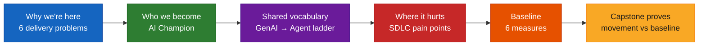
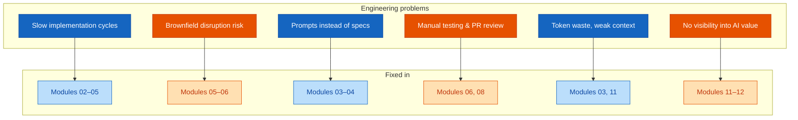
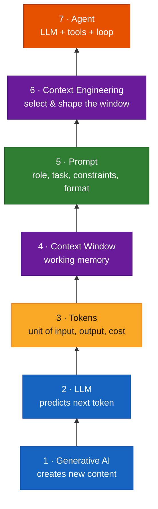
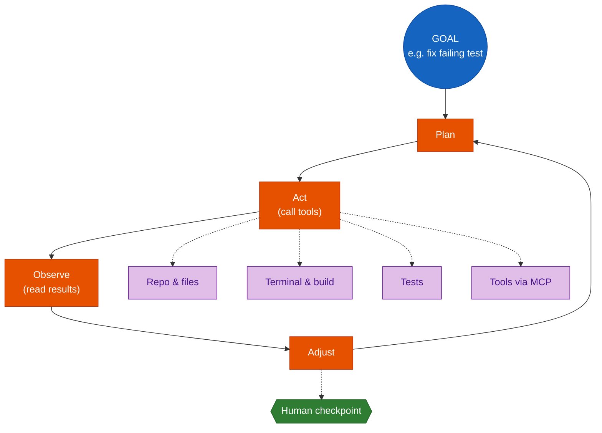
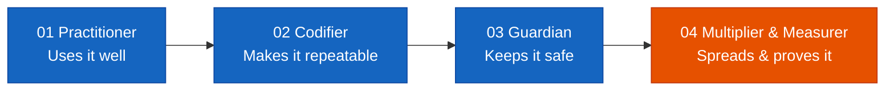
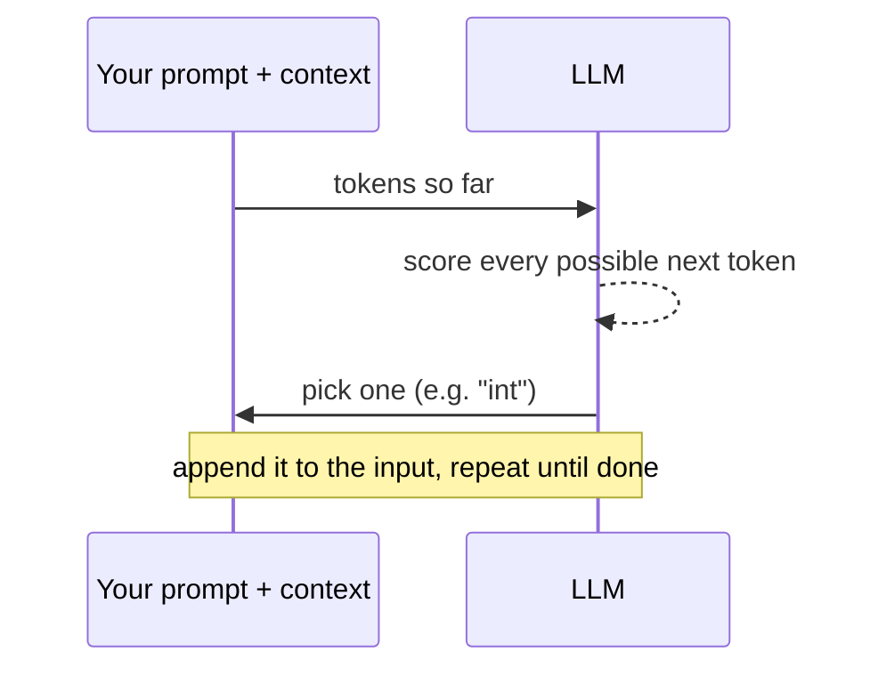
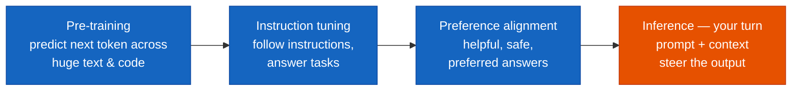
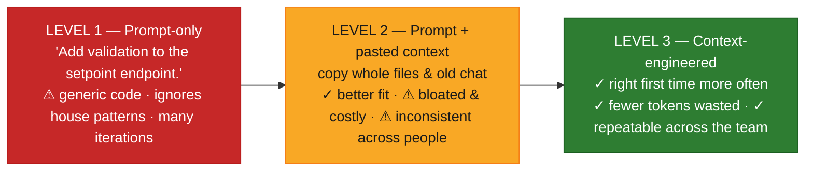
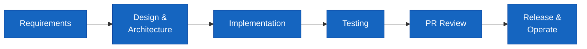

# Module 01 — Course Objectives & GenAI/LLM Concepts Recap — Comprehensive Guide

> **Source:** `presentations/Module01_Course_Objectives_GenAI_LLM_Recap.pdf` (18 slides, 60 min, facilitated discussion, no lab).
> **Audience:** Honeywell Software Engineering teams (IA · BA · PA&T) in the *AI Champions Programme — GitHub Copilot Enterprise, SDD, MCP & Agentic Software Engineering*.
> Where this guide adds material beyond the deck (code snippets, analogies, references), it is marked **[Beyond the deck]**.

---

## Overview

Module 01 does three jobs in one hour:

1. **Frames the programme** — the six engineering problems it exists to solve, and how the 12 modules build on each other.
2. **Defines the AI Champion role** — more than a power user: someone who turns individual skill into governed, measurable team capability.
3. **Sets a shared vocabulary and a baseline** — a seven-rung "concept ladder" from Generative AI up to Agents, then six baseline metrics the capstone will be measured against.

The deck's own framing: *the objectives aren't "learn AI tools" — they're delivery problems.* Every later module assumes the vocabulary and the baseline set here.

### Time budget (from slide 2)

| # | Segment | Minutes | Core question |
|---|---------|--------:|---------------|
| 01 | Programme Objectives & Journey | 8 | What problems are we solving, and in what order? |
| 02 | The AI Champion Role | 7 | What does a Champion do beyond using the tools? |
| 03 | GenAI & LLM Foundations | 12 | How does an LLM work, and what does that imply for code? |
| 04 | Tokens, Context, Prompts & Agents | 13 | What is the concept ladder up to agents? |
| 05 | Current-State Pain Points | 10 | Where does delivery hurt today across the SDLC? |
| 06 | Success Measures & Baseline | 10 | What six numbers will we prove movement against? |

---

## Quick Start

If you read nothing else, keep these seven sentences:

1. **Generative AI creates new content**; discriminative AI picks a label.
2. **An LLM predicts the next token**, at massive scale — output is *probable*, not *verified*.
3. **Tokens** are the unit of input, output, limits and cost.
4. **The context window** is the model's *entire* working memory — it is stateless between calls.
5. **A prompt** has six parts: role, task, context, constraints, examples, output format.
6. **Context engineering** (what goes in the window, and how) is a bigger quality lever than a cleverer prompt.
7. **An agent** is an LLM plus tools plus a loop (plan → act → observe → adjust) toward a goal — more autonomy, so more need for guardrails.

And the one implication that justifies the whole programme: **fluent is not the same as correct**. That is why specs, tests and review sit at the core of the curriculum.

---

## Visual Summary



---

## Architecture

This module has no software architecture — its "architecture" is the **programme structure** and the **conceptual stack** you will engineer on. This section covers both.

### 1. The 12-module journey

Each module assumes the one before it. Module 01 is the first of three **Foundation** modules.

```mermaid
graph LR
    subgraph F["FOUNDATION"]
        M1["1 · Objectives &<br/>GenAI Recap"]
        M2["2 · Copilot<br/>Advanced"]
        M3["3 · Prompt &<br/>Context Eng."]
    end
    subgraph BV["BUILD & VALIDATE"]
        M4["4 · Spec-Driven<br/>Dev (Spec Kit)"]
        M5["5 · SDD to<br/>Full SDLC"]
        M6["6 · Test Strategy<br/>& Validation"]
    end
    subgraph EX["EXTEND WITH TOOLS & AGENTS"]
        M7["7 · MCP & Custom<br/>MCP Server"]
        M8["8 · PR Automation<br/>& LLM-Judge"]
        M9["9 · No-Code Agents<br/>(Rovo)"]
        M10["10 · Code Agents<br/>& Simple RAG"]
    end
    subgraph GV["GOVERN"]
        M11["11 · Observability,<br/>ROI & Gov."]
    end
    subgraph CP["CAPSTONE"]
        M12["12 · Capstone<br/>& Roadmap"]
    end

    M1 --> M2 --> M3 --> M4 --> M5 --> M6 --> M7 --> M8 --> M9 --> M10 --> M11 --> M12

    style M1 fill:#e65100,stroke:#bf360c,color:#fff
    style M2 fill:#1565c0,stroke:#0d47a1,color:#fff
    style M3 fill:#1565c0,stroke:#0d47a1,color:#fff
    style M4 fill:#2e7d32,stroke:#1b5e20,color:#fff
    style M5 fill:#2e7d32,stroke:#1b5e20,color:#fff
    style M6 fill:#2e7d32,stroke:#1b5e20,color:#fff
    style M7 fill:#6a1b9a,stroke:#4a148c,color:#fff
    style M8 fill:#6a1b9a,stroke:#4a148c,color:#fff
    style M9 fill:#6a1b9a,stroke:#4a148c,color:#fff
    style M10 fill:#6a1b9a,stroke:#4a148c,color:#fff
    style M11 fill:#c62828,stroke:#b71c1c,color:#fff
    style M12 fill:#f9a825,stroke:#f57f17,color:#1a1a1a
```



The programme runs **two parallel tracks** through the same lifecycle:

| Track | 1 | 2 | 3 | 4 | 5 | 6 |
|-------|---|---|---|---|---|---|
| **Greenfield** | Frame problem | Specify | Plan & tasks | Implement | Test | Review & release |
| **Brownfield** | Understand repo | Analyse impact | Preserve patterns | Change safely | Protect regressions | Modernise |

### 2. Six problems → owning modules

The deck maps every objective to the modules that fix it:



| Problem | What it looks like | Fixed in |
|---------|--------------------|----------|
| Slow implementation cycles | Repetitive requirements, architecture, coding, test, docs, CI/CD and review work stretches delivery | M02–05 |
| Brownfield disruption risk | AI changes that violate existing patterns, break contracts or introduce regressions | M05–06 |
| Prompts instead of specs | Requirements translated loosely into tasks → inconsistent results from prompt-only work | M03–04 |
| Manual testing & PR review | Review bottlenecks; hard to prove spec compliance, integration behaviour and regression safety | M06, 08 |
| Token waste, weak context | Excessive token use and undisciplined context raise cost and lower quality | M03, 11 |
| No visibility into AI value | Little insight into usage, quality, failure patterns, token economics or ROI | M11–12 |

### 3. The concept ladder (the conceptual stack)

Each rung depends on the one below it. The deck links every rung to the module that deepens it.

```
                                                       ┌─────────────────┐
                                                       │ 7  AGENT        │
                                                       │ LLM + tools +   │
                                                 ┌─────┤ a loop → goal   │
                                                 │ 6   └─────────────────┘
                                                 │ CONTEXT ENGINEERING
                                           ┌─────┤ select & shape what goes in
                                           │ 5   │
                                           │ PROMPT
                                     ┌─────┤ role · task · constraints · format
                                     │ 4   │
                                     │ CONTEXT WINDOW
                               ┌─────┤ the model's whole working memory
                               │ 3   │
                               │ TOKENS
                         ┌─────┤ unit of input, output & cost
                         │ 2   │
                         │ LLM
                   ┌─────┤ predicts the next token, at scale
                   │ 1   │
                   │ GENERATIVE AI
                   │ models that create new content
                   └─────┘
```



| Rung | Deepened in |
|------|-------------|
| 5 Prompt | Module 03 (prompt patterns: decomposition, iteration, verification) |
| 6 Context engineering | Module 03 deep-dive; **powers SDD in Module 04** |
| 7 Agent | Agent mode: M02 · MCP: M07 · Build agents: M09–10 |

### 4. The agent loop



### 5. Today vs target workflow (workshop canvas)

The 10-minute workshop contrasts what typically happens with the AI-assisted, spec-led target:

| TODAY — what typically happens | → | TARGET — AI-assisted, spec-led |
|---|---|---|
| Requirements arrive as tickets and prose | → | Spec with acceptance criteria drives plan & tasks |
| Each engineer prompts ad hoc, from scratch | → | Shared instructions, skills and engineered context |
| Tests written manually after the code | → | Test strategy derived from the spec; mocks & stubs |
| PRs wait in a review queue; checked by eye | → | AI review + LLM-as-Judge, then human approval |
| AI usage and token cost are invisible | → | Traced usage; cost per accepted output tracked |

The deck says the rows are *starting prompts* — replace them with what your team actually does.

---

## Core Concepts

### The AI Champion role

> *"Operationalise judgement, not add caution. You already know how to engineer — the programme makes good AI-assisted practice repeatable, governed and measurable across your team."*



| Facet | What you do | Typical artefacts |
|-------|-------------|-------------------|
| **Practitioner** | Use Copilot Enterprise at power-user level: agent mode, custom instructions, skills, specs, MCP tools | Your own daily workflow |
| **Codifier** | Turn what works into reusable assets | Instruction sets, skills, spec packs, prompt templates |
| **Guardian** | Hold the line on quality gates, spec compliance, security, governance and human review | Review checklists, gates |
| **Multiplier & Measurer** | Coach the team, track baseline-to-ROI evidence, own the adoption roadmap | Metrics, roadmap |

---

### Concept card 1 — Generative AI

**Definition.** Models that *create new content* rather than only classify existing inputs.

```
┌──────────────────────── Artificial Intelligence ────────────────────────┐
│  ┌────────────────────── Machine Learning ──────────────────────────┐  │
│  │  ┌─────────────────── Deep Learning ──────────────────────────┐  │  │
│  │  │        ┌──────────────────────────────────────┐            │  │  │
│  │  │        │  Generative AI (incl. LLMs)          │            │  │  │
│  │  │        └──────────────────────────────────────┘            │  │  │
│  │  └────────────────────────────────────────────────────────────┘  │  │
│  └──────────────────────────────────────────────────────────────────┘  │
└─────────────────────────────────────────────────────────────────────────┘
```

| | Discriminative AI | Generative AI |
|---|---|---|
| Learns | Boundaries | Patterns |
| Produces | A label | New content |
| Example | Sensor reading → **Fault / No fault** | Prompt + context → **Code, Tests, Specs, Docs** |

**Analogy [Beyond the deck].** A discriminative model is a *quality inspector* stamping PASS/FAIL on parts. A generative model is a *junior engineer* who drafts the part. You would never ship the junior's first draft unreviewed.

**In this programme:** GenAI means LLMs generating code, tests, specs and reviews — *output that must be verified like any colleague's first draft.*

---

### Concept card 2 — LLM (next-token predictor)

**Definition.** A model that, one token at a time, picks a likely continuation of the text so far — then repeats.

Illustrative next-token probabilities after `public void UpdateZoneSetpoint(` (the deck labels these illustrative):

```
int      ████████████████████████  48%
double   █████████████▌            27%
Zone     ███████                   14%
string   ███                        6%
```



**How an LLM becomes a useful assistant:**



**Implication:** *fluent is not the same as correct.* Output is probable, not verified — which is why specs, tests and review sit at the core of the programme.

**Analogy [Beyond the deck].** Phone autocomplete, trained on a vast library. It sounds right because it has seen the pattern before — not because it checked your codebase.

---

### Concept card 3 — Tokens

**Definition.** The unit models read and write. Models don't read words or lines; they read tokens.

Illustrative splits from the deck (every model family has its own tokenizer; `·` marks a leading space, which is part of the token):

```
TEXT: [The][·chiller][·set][point][·drifted][·by][·2][°C][·overnight][.]            → 10 tokens
CODE: [def][·get][_zone][_temp][(][self][,][·zone][_id][):]                          → 10 tokens
```

| Fact | Why it matters |
|------|----------------|
| **≈ 4 chars / token** (English prose rule of thumb) | Code, symbols and identifiers usually split *finer*, so code costs more tokens per character |
| **Input + output both count** | You pay for, and are limited by, prompt + context *and* the answer |
| **Every limit is tokens** | Context window size, rate limits and usage quotas are all token-measured |
| **More ≠ better** | Extra tokens raise cost and latency and can dilute focus — context discipline pays twice |

**[Beyond the deck] — count tokens yourself** (counts differ by model family; `cl100k_base` is one OpenAI encoding):

```python
# pip install tiktoken
import tiktoken

enc = tiktoken.get_encoding("cl100k_base")
for s in ["The chiller setpoint drifted by 2°C overnight.",
          "def get_zone_temp(self, zone_id):"]:
    ids = enc.encode(s)
    print(len(ids), [enc.decode([i]) for i in ids])
```

Do not expect exactly 10 tokens for each line — the deck's split is explicitly illustrative.

---

### Concept card 4 — Context window

**Definition.** A fixed token budget shared by *everything* the model sees: instructions, files, history, your task — and the answer.

```
┌─────────────────── CONTEXT WINDOW (fixed limit, in tokens) ────────────────────┐
│ System &      │ Retrieved       │ Conversation │ Your │ Reserved for │          │
│ custom instr. │ repository files│ history      │ task │ the answer   │          │
└────────────────────────────────────────────────────────────────────────────────┘

   Older history & extra files that don't fit  →  dropped, truncated or summarised
```

Three properties to internalise:

| Property | Meaning |
|----------|---------|
| **Stateless between calls** | The model remembers nothing on its own. Everything it knows about your task must be in the window, *every time*. |
| **Noise dilutes focus** | Long, loosely relevant context makes it easier to miss the detail that matters — and costs more tokens. |
| **Temperature: precise ↔ varied** | Code and refactors: keep it low. Brainstorming: higher. |

**What fills the window is decided by the tool, your instructions and your choices — that is what context engineering controls.**

**Analogy [Beyond the deck].** A desk of fixed size. Everything you need must be *on* the desk; anything you stack beyond the edge falls off. A cluttered desk makes the one important page easy to miss.

---

### Concept card 5 — Prompt anatomy

**Definition.** Six parts that turn a vague request into a task the model can do well.

| Part | Role in the prompt | Deck example |
|------|--------------------|--------------|
| **Role** | Who the model should act as | *You are a senior C#/.NET engineer on a building-automation API.* |
| **Task** | What to do | *Add input validation to `ZoneController.UpdateSetpoint`.* |
| **Context** | What it must know | *Validators live in `/Validation` and use FluentValidation; see `ZoneValidator.cs`.* |
| **Constraints** | Boundaries | *Setpoint range 10–32 °C. No new packages. Don't change the public API contract.* |
| **Examples** | A pattern to follow | *Follow the pattern in `AlarmThresholdValidator.cs`.* |
| **Output format** | Shape of the answer | *Return a diff plus xUnit tests for valid, boundary and invalid values.* |

Assembled as a single prompt:

```text
You are a senior C#/.NET engineer on a building-automation API.

Task: Add input validation to ZoneController.UpdateSetpoint.

Context: Validators live in /Validation and use FluentValidation; see ZoneValidator.cs.

Constraints:
- Setpoint range 10–32 °C.
- No new packages.
- Don't change the public API contract.

Example: Follow the pattern in AlarmThresholdValidator.cs.

Output: Return a diff plus xUnit tests for valid, boundary and invalid values.
```

**Rule of thumb:** *if a new teammate couldn't do the task from your prompt alone, the model can't either.*

---

### Concept card 6 — Context engineering

**Definition.** The biggest quality lever isn't a cleverer prompt — it's *what you put in the window, and how.* The deck's keywords: **selected · layered · compressed · task-scoped.**



What Level 3 contains:

| Layer | Behaviour |
|-------|-----------|
| Custom instructions | **always on** |
| Relevant files & APIs | **selected** |
| Spec & acceptance criteria | **task-scoped** |
| Existing tests | **for verification** |

Deep-dive in **Module 03**; it is also what **powers SDD in Module 04**.

---

### Concept card 7 — Agents

**Definition.** An LLM that pursues a goal over many steps — using tools, checking results, iterating.

| Step up | What it does |
|---------|--------------|
| **LLM** | Answers one question from what's in the window |
| **Assistant** | Answers inside your IDE, grounded in your open code |
| **Agent** | Takes a goal, plans steps, calls tools, verifies, repeats |

Each step adds autonomy — **and the need for guardrails.** Tools available to the loop (slide 13): repo & files, terminal & build, tests, tools via MCP, and a **human checkpoint**.

Pseudocode of the loop **[Beyond the deck]**:

```python
def run_agent(goal, tools, llm, max_steps=20):
    context = [goal]
    for _ in range(max_steps):
        step = llm.plan(context)                 # Plan
        if step.is_done:
            return step.result
        if step.needs_human_approval:            # Human checkpoint
            step = ask_human(step)
        result = tools[step.tool](**step.args)   # Act
        context.append(result)                   # Observe -> feeds the next plan (Adjust)
    raise TimeoutError("agent hit max_steps without finishing")
```

**Analogy [Beyond the deck].** An LLM is a consultant answering one question over the phone. An agent is a contractor on site: it has a goal, uses tools, checks its own work, and should still get sign-off on anything risky.

---

### Where delivery hurts today (SDLC pain points)



| Stage | Friction |
|-------|----------|
| Requirements | Tickets and prose translate loosely into tasks; prompt-only results vary by person |
| Design & Architecture | In brownfield code, AI-suggested changes can bypass existing patterns, contracts and extension points |
| Implementation | Repetitive coding, boilerplate and docs slow delivery; context is assembled ad hoc each time |
| Testing | Test creation is manual and inconsistent; hard to show acceptance criteria are actually covered |
| PR Review | Review bottlenecks; spec compliance and regression risk checked by eye, if at all |
| Release & Operate | Little visibility into AI usage, quality, failure patterns, token spend or ROI |

**Ask the room (from the deck):** Which stage costs your team the most time per sprint? Where has AI already helped — and where has it created rework? Capture answers on the workflow canvas.

---

### The six baseline measures

*Capture today's number now — the capstone and ROI model compare against it.*

| # | Measure | What to record | Data source |
|---|---------|----------------|-------------|
| 1 | **Implementation cycle time** | Ticket-ready → merged, for a representative feature | Issue tracker & GitHub timestamps |
| 2 | **Quality & regression risk** | Defects and regressions escaping to later stages | Bug tracker, CI failure history |
| 3 | **PR review time** | PR opened → approved; review rounds per PR | GitHub pull-request data |
| 4 | **Testing effort** | Hours to write/update tests per feature; criteria covered | Team estimate + coverage report |
| 5 | **Token usage** | Tokens per task and per accepted change | Copilot usage data; Agent Prism (M11) |
| 6 | **AI cost** | Cost per accepted, production-quality output | Usage & billing data; ROI model (M11) |

A fill-in template for your team **[Beyond the deck]**:

```markdown
| Measure                  | Baseline today | Date captured | Owner | Source link |
|--------------------------|----------------|---------------|-------|-------------|
| Implementation cycle time|                |               |       |             |
| Quality & regression risk|                |               |       |             |
| PR review time           |                |               |       |             |
| Testing effort           |                |               |       |             |
| Token usage              |                |               |       |             |
| AI cost                  |                |               |       |             |
```

Workshop timing (slide 15): **Map today** 4 min → **Sketch the target** 4 min → **Pick one measure to baseline** 2 min.

---

### Module 01 outcomes & what's next

By the end of the hour, the deck says these should be true:

- [ ] Programme objectives, the 12-module journey and the AI Champion role are clear
- [ ] GenAI, LLMs and next-token prediction recapped as a shared vocabulary
- [ ] Tokens, the context window and temperature understood as engineering constraints
- [ ] Prompt anatomy, context engineering and the agent loop linked to the modules that deepen them
- [ ] Current-state pain points mapped against a target-state workflow
- [ ] Six baseline measures recorded: cycle time, quality, PR review, testing, tokens, cost

**Next:** Module 02 — *GitHub Copilot Recap & Advanced Features* (2.5 hours): a quick recap of core Copilot, then hands-on power-user work — custom instructions, custom agents, reusable skills, advanced prompting and agent-mode workflows.

---

## Glossary

| Term | One-line definition |
|------|---------------------|
| Generative AI | Models that create new content (code, tests, specs, docs) |
| Discriminative AI | Models that pick a label for an input |
| LLM | Large language model: predicts the next token at scale |
| Token | Unit of text a model reads/writes; unit of cost and limits |
| Context window | Fixed token budget for everything the model sees plus its answer |
| Temperature | Randomness dial: low = precise, high = varied |
| Prompt | Instruction to the model: role, task, context, constraints, examples, output format |
| Context engineering | Deliberately selecting and shaping what goes into the window |
| Agent | LLM + tools + loop (plan, act, observe, adjust) pursuing a goal |
| MCP | Model Context Protocol — how agents reach tools (Module 07) |
| SDD | Spec-Driven Development (Module 04) |
| Greenfield / Brownfield | New build vs. change to an existing codebase |

---

## References

Every link below was fetched on 2026-10-14 and the page title confirmed to match the description.

### Official documentation & project roots

- [GitHub Copilot documentation](https://docs.github.com/en/copilot) — canonical docs root for Copilot features used from Module 02 onward.
- [Model Context Protocol](https://modelcontextprotocol.io) — the open protocol behind "tools via MCP" (Module 07).
- [github/spec-kit](https://github.com/github/spec-kit) — toolkit for Spec-Driven Development (Module 04).
- [openai/tiktoken](https://github.com/openai/tiktoken) — fast BPE tokeniser used in the token-counting snippet above.

### Research papers

- [Attention Is All You Need](https://arxiv.org/abs/1706.03762) — the Transformer architecture underlying modern LLMs.
- [Language Models are Few-Shot Learners](https://arxiv.org/abs/2005.14165) — the GPT-3 paper; large-scale next-token pre-training and in-context examples (relates to the *Examples* part of a prompt).
- [Training language models to follow instructions with human feedback](https://arxiv.org/abs/2203.02155) — instruction tuning and preference alignment (the middle steps of "how an LLM becomes a useful assistant").
- [ReAct: Synergizing Reasoning and Acting in Language Models](https://arxiv.org/abs/2210.03629) — interleaving reasoning with tool actions; a foundation for the plan/act/observe agent loop.

### Blog posts & tutorials

- [Effective context engineering for AI agents](https://www.anthropic.com/engineering/effective-context-engineering-for-ai-agents) — Anthropic on curating what enters the context window (rung 6).
- [Building Effective AI Agents](https://www.anthropic.com/engineering/building-effective-agents) — patterns for agentic systems (rung 7).

> Not listed: the OpenAI online tokenizer page returned HTTP 403 to an automated fetch, so it was not verified and is omitted. The deck itself cites no external sources.
