# Module 02 — GitHub Copilot Recap & Advanced Features — Comprehensive Guide

> **Source:** `presentations/Module02_GitHub_Copilot_Recap_Advanced_Features.pdf` (24 slides, 2.5 hours, recap + 4 hands-on labs, primary tool: Copilot Enterprise in VS Code).
> **Audience:** Honeywell Software Engineering teams (IA · BA · PA&T), *AI Champions Programme — GitHub Copilot Enterprise, SDD, MCP & Agentic Software Engineering*.
> Content marked **[Beyond the deck]** is added by this guide. Everything else traces to a slide.
> **Currency note:** Copilot plans, billing, hooks and file formats change quickly. The deck itself marks hooks as *Preview* and describes billing "since June 2026". Treat product details as of the deck date and confirm against the live docs linked under [References](#references).

---

## Overview

Module 01 gave you shared vocabulary (tokens, context window, prompts, agents). Module 02 turns that into **tooling practice**: a fast recap of core Copilot, then most of the time on the **power-user layer** — the files you commit to the repo that make Copilot follow your team's rules and workflows.

The module's central idea (slide 3): *everything you create today — instructions, prompt files, agents, skills, MCP config — is committed to the repo and reused in every module that follows.*

### Time budget (slide 2)

| # | Segment | Min | What you get | Lab |
|---|---------|----:|--------------|-----|
| 01 | Background, Plans & Surfaces | 15 | Evolution, where Copilot runs, plans & AI credits | — |
| 02 | Core Recap: Editor, Modes & Commands | 20 | Completions, NES, inline chat, Ask/Plan/Edit/Agent, `/` `@` `#` | — |
| 03 | Instructions & Prompt Files | 30 | Always-on and file-scoped instructions, reusable prompts | **Lab 1** (15) |
| 04 | Custom Agents & Agent Skills | 40 | Personas with tools and handoffs; packaged on-demand know-how | **Labs 2 & 3** (15 + 15) |
| 05 | MCP, Hooks & Model Choice | 15 | External tools, deterministic guardrails, model per task | — |
| 06 | Agent-Mode Workflows, CLI & Cloud Agent | 30 | Plan → implement → review end-to-end, beyond the IDE | **Lab 4** (25) |

Slide 5 splits this as **Recap ≈ 35 min** (segments 01–02) and **Advanced ≈ 115 min with 4 labs** (segments 03–06).

### Where it sits in the programme (slide 3)

| Later module | Reuses from today |
|--------------|-------------------|
| **M03** | Context engineering uses instructions, prompt files and `#context` |
| **M04–05** | Spec Kit runs as prompt files and agents in agent mode |
| **M07** | Builds the custom MCP server you'll consume today |
| **M10** | Copilot SDK agents reuse the same agent concepts in code |

---

## Quick Start

1. **Four ways to work, four levels of autonomy:** completions → inline chat → chat modes (Ask · Plan · Edit · Agent). More autonomy means more need to verify.
2. **Three symbols to remember:** `/` runs a task, `@` picks a domain expert, `#` attaches precise context.
3. **Seven customisation layers**, each answering a different question:

| Layer | Question it answers | Triggered by |
|-------|--------------------|--------------|
| Always-on instructions | What should Copilot *always* know? | Every chat request |
| File-scoped instructions | What applies to *these files*? | Matching `applyTo` glob |
| Prompt files | How do we do *this task*? | You type `/name` |
| Custom agents | *Who* should do it, with what tools? | You pick the persona |
| Agent skills | What specialist know-how is needed? | Model loads when relevant |
| MCP servers | Which external systems can it reach? | Agent calls a tool |
| Hooks | What must *always (never)* happen? | Lifecycle event fires |

4. **Rule of thumb (slide 17):** *rules go in instructions; tasks in prompt files; roles in agents; workflows-with-resources in skills. If you paste the same thing into chat twice, it belongs in one of these.*
5. **Hooks always run; instructions are advisory.** Instructions depend on the model choosing to comply; hooks don't.
6. **Everything is a file in the repo**, so it travels with the repo into the CLI and the cloud agent.

---

## Visual Summary

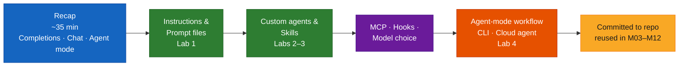

---

## Architecture

### 1. The seven-rung climb (slide 5)

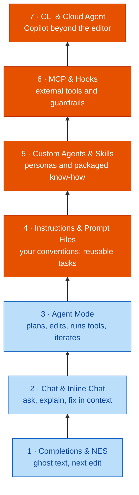

Light blue = recap (rungs 1–3). Orange = advanced (rungs 4–7), where the cohort spends most of its time.

### 2. Copilot's evolution and surfaces (slide 4)

```mermaid
graph LR
    Y1["2021<br/>Technical preview<br/>suggestions in VS Code<br/>(OpenAI Codex)"] --> Y2["2022<br/>General availability<br/>subscription for<br/>individual developers"]
    Y2 --> Y3["2023<br/>Copilot Chat<br/>moved to GPT-4"]
    Y3 --> Y4["2024<br/>Multi-model choice<br/>e.g. Claude, Gemini"]
    Y4 --> Y5["Feb 2025<br/>Agent mode<br/>plans, edits, runs tools"]
    Y5 --> Y6["May 2025<br/>Coding agent<br/>async PRs in cloud<br/>(now: cloud agent)"]
    Y6 --> Y7["Jun 2026<br/>AI-credit billing<br/>usage by tokens replaces<br/>premium requests"]

    style Y1 fill:#1565c0,stroke:#0d47a1,color:#fff
    style Y2 fill:#1565c0,stroke:#0d47a1,color:#fff
    style Y3 fill:#1565c0,stroke:#0d47a1,color:#fff
    style Y4 fill:#1565c0,stroke:#0d47a1,color:#fff
    style Y5 fill:#e65100,stroke:#bf360c,color:#fff
    style Y6 fill:#e65100,stroke:#bf360c,color:#fff
    style Y7 fill:#e65100,stroke:#bf360c,color:#fff
```

**Where Copilot runs today:** VS Code *(today's tool)*, Visual Studio, JetBrains IDEs, Neovim, GitHub.com, Copilot CLI, Cloud agent.

### 3. The customisation stack in the repo (slide 9)

```
repo/
├── .github/
│   ├── copilot-instructions.md        ← always-on instructions
│   ├── instructions/
│   │   └── api.instructions.md        ← file-scoped (applyTo glob)
│   ├── prompts/
│   │   └── add-tests.prompt.md        ← prompt file  (/add-tests)
│   ├── agents/
│   │   └── reviewer.agent.md          ← custom agent (persona)
│   ├── skills/
│   │   └── dotnet-tests/SKILL.md      ← agent skill (+ scripts/ templates/ examples/)
│   └── hooks/
│       └── audit.json                 ← hooks (lifecycle guardrails)
├── .vscode/
│   └── mcp.json                       ← MCP servers
└── AGENTS.md                          ← cross-agent option (alternative to copilot-instructions.md)
```

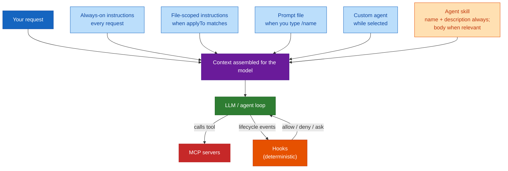

This diagram is this guide's synthesis of slides 9, 15 and 17 — it connects the Module 01 idea of *context engineering* to concrete files.

### 4. MCP integration (slide 18)

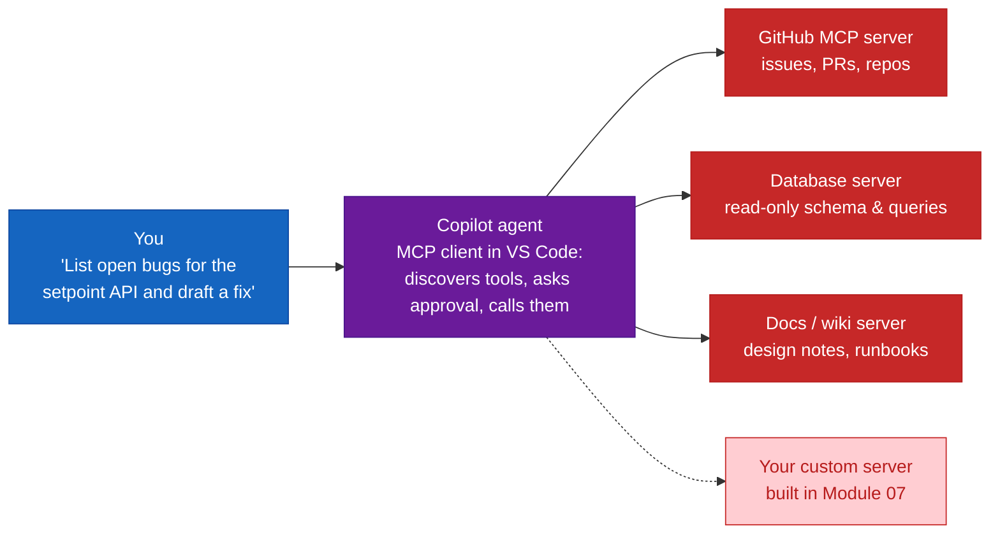

### 5. Hook lifecycle (slide 19)


### 6. The agent-mode workflow end-to-end (slide 20)

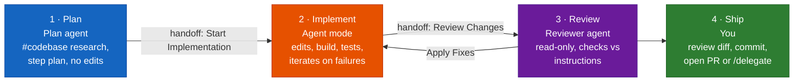

| Feeds every step | Guardrails |
|------------------|-----------|
| Instructions · Prompt files · Skills · MCP tools | Approve tool and terminal calls · Checkpoints to roll back edits · Hooks enforce hard rules · Human reviews every diff |

### 7. Cloud agent flow (slide 21)

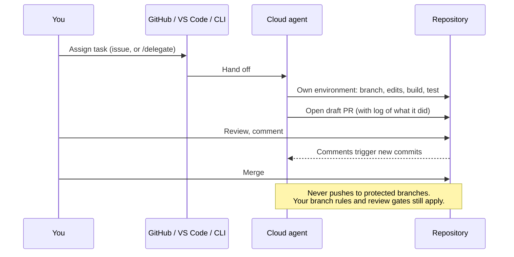

---

## Core Concepts

### Part A — Recap (segments 01–02)

#### Concept card A1 — Plans and AI credits (slide 6)

Capabilities by plan, as presented in the deck (**prices intentionally omitted** in the deck):

| | Individual | | | | | Organisation | |
|---|---|---|---|---|---|---|---|
| **Plan** | Free | Student | Pro | Pro+ | Max | Business | **Enterprise** |
| **For** | Individuals without org access | Verified students, free | Individual developers | Heavy individual users | Highest individual usage | Organisations | GitHub Enterprise Cloud |
| **Models** | Auto selection only | Auto selection only | A selection of models | Premium models | Priority premium models | Premium models | Priority premium models |
| **Notes** | Limited agents; 2,000 completions/month | No third-party agents | Monthly AI-credit allowance | Larger credit allowance | Highest individual allowance | Central management & policy; pooled credits | All of Business + enterprise-grade features; largest pooled allowance |

Enterprise is the **programme platform**. Three billing facts to keep:

| Fact | Detail |
|------|--------|
| **AI credits** | Chat, agents and premium models consume credits by tokens (input, output, cached) at each model's rate |
| **Always included** | Code completions and next edit suggestions don't consume credits on any plan |
| **Admin budgets** | Org plans pool credits; admins set budgets per enterprise, cost centre or user |

> Link to Module 01: tokens are the unit of cost. Here is where that becomes literal — *the model you pick changes the cost of every run.*

#### Concept card A2 — Four ways to work, four levels of autonomy (slide 7)

**In the editor**

| Feature | Shortcut | What it does |
|---------|----------|--------------|
| Code completions | `Tab` / `Esc` | Ghost-text suggestions as you type |
| Next edit suggestions (NES) | `Tab` | Predicts your next edit *and where it goes* |
| Inline chat | `Ctrl+I` | Prompt in place: editor, terminal, notebook |
| Chat view | `Ctrl+Alt+I` | Multi-turn chat with agents, tools, context |

**In chat — pick a mode** (`Ctrl+Shift+I` to switch agent; ⌘ on macOS):

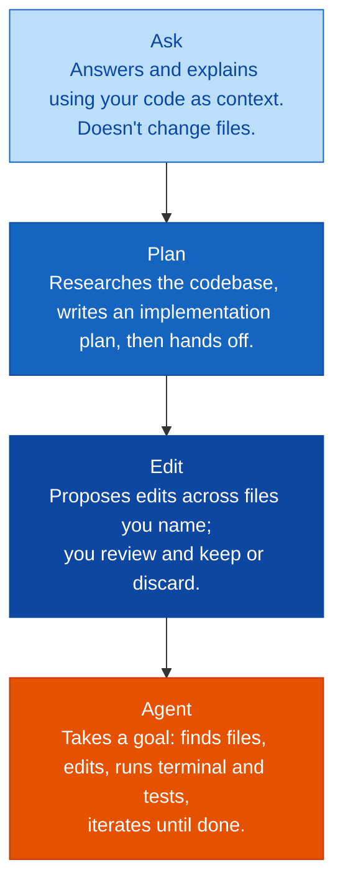

*Down the ladder: more autonomy, more need to verify* (slide 7). This maps directly to Module 01's LLM → assistant → agent progression.

#### Concept card A3 — The command vocabulary: `/`, `@`, `#` (slide 8)

> **Slash runs a task, @ picks a domain expert, # attaches precise context.**

| `/` Slash commands — *run a task or reusable prompt* | `@` Chat participants — *route to a domain* | `#` Context references — *attach exactly what matters* |
|---|---|---|
| `/explain` explain selected code | `@workspace` the current workspace | `#codebase` search the whole codebase |
| `/fix` propose a fix | `@github` repos, issues, pull requests | `#file` / `#symbol` a specific file or symbol |
| `/tests` generate tests | `@terminal` shell and terminal | `#selection` current selection |
| `/doc` add documentation | `@vscode` editor settings and features | `#changes` uncommitted changes |
| `/init` draft project instructions | | `#problems` errors and warnings |
| `/<name>` run a prompt file or skill | | `#fetch` content of a web page |

Shortcuts (Windows/Linux; ⌘ on macOS):

| Keys | Action |
|------|--------|
| `Ctrl+Alt+I` | Open chat |
| `Ctrl+I` | Inline chat |
| `Ctrl+Shift+I` | Switch agent |
| `Ctrl+Alt+.` | Model picker |
| `Ctrl+N` | New chat |
| `F2` | AI rename |

**Analogy [Beyond the deck].** `/` is a *verb* ("explain this"), `@` is *who you're asking* (a specialist colleague), `#` is *what you're pointing at* ("this file, these changes"). `#` is your hands-on tool for the context-window discipline from Module 01.

---

### Part B — Instructions & prompt files (segment 03)

#### Concept card B1 — Custom instructions: teach Copilot your team's rules once (slide 10)

**Definition.** Always-on and file-scoped Markdown added to chat and agent requests, so you stop repeating yourself.

| Kind | File | When it applies |
|------|------|-----------------|
| **Always-on** | `.github/copilot-instructions.md` or `AGENTS.md` | Included with every chat and agent request in the repo |
| **File-scoped** | `*.instructions.md` with an `applyTo` glob, or a `description` | When files match the glob, or Copilot loads it when the task matches the description |

**Three scopes:** User (personal) · Workspace (committed, shared) · Organisation (managed in GitHub). **Sources add together.**

**Generate a draft:** type `/init` for project-wide instructions or `/create-instructions` for a scoped file — **then review it.**

Always-on example (slide 10):

```markdown
# Project: Zone Control API
- .NET 8 Web API + React front end
- Build: dotnet build   Test: dotnet test
- Validation uses FluentValidation in /Validation
- Never change public API contracts without a spec
  (why: field devices depend on them)
```

File-scoped example (slide 10) — `.github/instructions/api.instructions.md`:

```markdown
---
applyTo: "src/Api/**/*.cs"
description: "Controller and validator rules"
---
- Return ProblemDetails for 4xx/5xx
- Log with ILogger<T>; no Console.WriteLine
```

**Write them well (slide 10):** short, single-purpose rules; **say why**; show a preferred *and* an avoided pattern; skip what linters already enforce.

> ⚠ **Important note from the deck:** *instructions don't affect inline completions.* They shape chat and agent requests only.

**Analogy [Beyond the deck].** Onboarding doc for a new hire who joins every single morning with no memory (Module 01: the model is stateless). The instruction file is what you'd hand them each day.

#### Concept card B2 — Prompt files: turn a good prompt into a team command (slide 11)

**Definition.** A `.prompt.md` file is a reusable, parameterised task you run with `/name` — *on demand, not always on.*

```markdown
---
description: 'Write xUnit tests for an API endpoint'
agent: 'agent'
tools: ['search/codebase', 'runTests']
argument-hint: 'scenario to focus on'
---
Write xUnit tests for ${selection}.
Cover valid, boundary and invalid input, focusing on
${input:scenario:out-of-range setpoint}.
Follow [our test conventions](../instructions/tests.instructions.md).
Run the tests with #tool:runTests and fix failures.
```

Saved as `.github/prompts/add-endpoint-tests.prompt.md` and invoked as:

```text
/add-endpoint-tests  scenario=null zone id
```

| Anatomy | Detail |
|---------|--------|
| **Frontmatter** | `description`, `agent` (ask / agent / custom), `model`, `tools`, `argument-hint` — all optional |
| **Variables** | `${selection}`, `${file}`, `${workspaceFolder}`, `${input:name:placeholder}` |
| **References** | Link instruction files with Markdown links; call tools with `#tool:<name>` |
| **Run it** | `/name` in chat · *Chat: Run Prompt* · the play button in the editor |
| **Scope** | `.github/prompts/` for the team; your profile for personal prompts |

> **Instructions = how we *always* work. Prompt files = how we do *this one task*.**

#### 🧪 Lab 1 — Build a team instruction set and a prompt file (15 min, slide 12)

**Goal:** Commit always-on and file-scoped instructions plus one reusable prompt file to the sample repo.

| Step | Action |
|-----:|--------|
| 1 | Ask chat a **baseline question** ("Add validation to UpdateSetpoint") and **save the answer** for comparison |
| 2 | Run `/init` to draft `.github/copilot-instructions.md`. **Trim to non-obvious rules:** stack, build/test commands, conventions, reasons |
| 3 | Add `api.instructions.md` with `applyTo: "src/Api/**/*.cs"` — validation, error-handling and logging patterns |
| 4 | Create `add-endpoint-tests.prompt.md` using `${selection}` and `${input:scenario}`; run it with `/add-endpoint-tests` |

**Files you create**

```
.github/copilot-instructions.md
.github/instructions/api.instructions.md
.github/prompts/add-endpoint-tests.prompt.md
```

**Done when:** re-asking the baseline question gives an answer that follows your conventions *without you naming them*, the **References** list in chat shows your instruction files were used, and `/add-endpoint-tests` generates tests that pass.

---

### Part C — Custom agents & skills (segment 04)

#### Concept card C1 — Custom agents: personas with their own tools, model and handoffs (slide 13)

**Definition.** An `.agent.md` file defines *who does the work, what it may touch, and where it hands off next.* (Formerly "custom chat modes".)

```markdown
---
name: Reviewer
description: Review changes for bugs and security
tools: ['search', 'usages']   # read-only
handoffs:
  - label: Apply Fixes
    agent: agent
    prompt: Apply the fixes suggested above.
---
Review the change against our instructions.
Do not edit files. List each finding with its
location, severity and a suggested fix.
```

Saved as `.github/agents/reviewer.agent.md`. Other frontmatter fields named on the slide: `model` (one or a prioritised list), `agents` (allowed subagents), `user-invocable`, `disable-model-invocation`, `target`, `hooks`.

**Use them:** pick from the agents dropdown, type `/agents` to manage, or `/create-agent` to generate one.

**Handoffs chain agents into a workflow:**

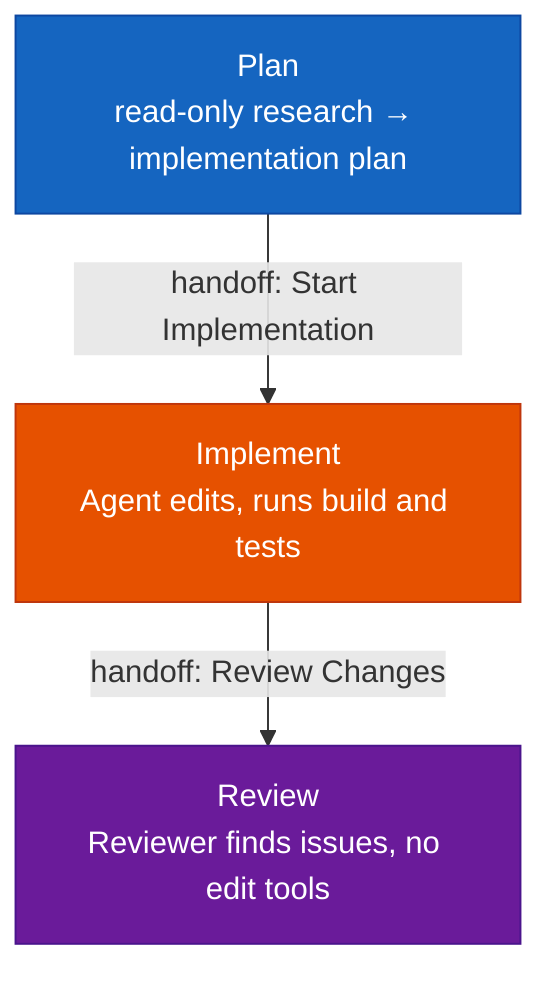

**Design insight (Lab 2's tagline):** *a persona whose tools make the wrong behaviour impossible.* A reviewer that has no edit tool *cannot* edit files — that's stronger than an instruction saying "please don't edit".

**Analogy [Beyond the deck].** Job roles with badge access. The auditor's badge opens the records room but not the vault — you don't rely on telling them "please don't open the vault".

#### 🧪 Lab 2 — Configure a read-only Reviewer agent (15 min, slide 14)

**Goal:** Create a custom Reviewer agent with read-only tools and an "Apply Fixes" handoff, and use it on a flawed change.

| Step | Action |
|-----:|--------|
| 1 | Run *Chat: New Custom Agent* (or `/create-agent`) and save it as `.github/agents/reviewer.agent.md` |
| 2 | Set tools to **read-only** (`search`, `usages`). In the body, point to your instruction files and define the finding format |
| 3 | Add a handoff: label "Apply Fixes" → `agent: agent`, with a pre-filled prompt |
| 4 | Select Reviewer, review the **deliberately flawed branch**, click **Apply Fixes**, let Agent mode fix it |

**Done when:** Reviewer lists findings with **location, severity and fix**, and edits no files. The Apply Fixes button switches to Agent mode with the prompt pre-filled, and the fixed code passes the tests.

#### Concept card C2 — Agent skills: packaged know-how that loads only when needed (slide 15)

**Definition.** A skill is a **folder**: `SKILL.md` instructions plus scripts, templates and examples — *an open standard across agents.*

```
.github/skills/dotnet-tests/
├── SKILL.md              # name, description, steps
├── scripts/run-filtered.ps1
├── templates/test-class.cs
└── examples/zone-service-tests.cs
```

`SKILL.md` (slide 15):

```markdown
---
name: dotnet-tests
description: Run, write or fix .NET unit
  tests. Use when asked about xUnit tests.
---
1. Run scripts/run-filtered.ps1 for the class
2. New tests start from templates/test-class.cs
```

**Progressive loading — why skills scale:**

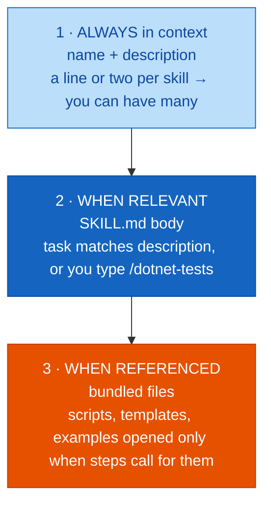

**One skill, many agents:** VS Code · Copilot CLI · Cloud agent · other agents. Locations: project skills `.github/skills/` · personal `~/.copilot/skills/` · standard: agentskills.io.

> The `description` is the trigger. Lab 3 step 4 says it plainly: *"Tighten the description if it didn't trigger."*

**[Beyond the deck] — a sample `scripts/run-filtered.ps1`.** The deck says the script runs `dotnet test` with `--filter`; this is one minimal way to do it:

```powershell
# scripts/run-filtered.ps1 — run only the tests whose names contain the given class
param([Parameter(Mandatory = $true)][string]$Class)
dotnet test --filter "FullyQualifiedName~$Class"
```

**Analogy [Beyond the deck].** A cookbook's *index* is always on your shelf (name + description), the *recipe* comes out when you cook that dish (SKILL.md body), and the *special equipment* only comes out of the cupboard when a step needs it (bundled files). Module 01's "noise dilutes focus" is exactly why this beats pasting everything up front.

#### 🧪 Lab 3 — Package a reusable skill (15 min, slide 16)

**Goal:** Create a `dotnet-tests` skill with a bundled script and template, and confirm Copilot loads it on its own.

| Step | Action |
|-----:|--------|
| 1 | Create `.github/skills/dotnet-tests/` with a `SKILL.md`: `name`, and a `description` saying **what it does and when to use it** |
| 2 | Write the steps in the body. Add `scripts/run-filtered.ps1` (`dotnet test` with a `--filter`) and `templates/test-class.cs` |
| 3 | **Without naming the skill**, ask Agent mode: "Add and run unit tests for ZoneService." Check it was loaded |
| 4 | Invoke it directly with `/dotnet-tests for AlarmService`. Tighten the description if it didn't trigger in step 3 |

**Done when:** in step 3 the skill loads without being named, the new tests follow the template, and the script runs them. `/dotnet-tests` works as a slash command.

#### Concept card C3 — Which customisation, when? (slide 17)

| | **Custom instructions** | **Prompt files** | **Custom agents** | **Agent skills** |
|---|---|---|---|---|
| **Answers** | How we always work | How we do this task | Who does it, with what tools | Specialist capability + resources |
| **Triggered by** | Every request / `applyTo` glob | You type `/name` | You select it (or a handoff) | Model, when relevant — or `/name` |
| **Contains** | Markdown rules | Markdown + variables + tools | Persona, tools, model, handoffs | `SKILL.md` + scripts, templates |
| **Context cost** | Always in context | Only when run | While selected | Tiny until loaded |
| **Best for** | Stack, standards, guardrails | Repeated tasks (tests, docs) | Roles: planner, reviewer | Workflows: test runs, migrations |
| **Example** | `copilot-instructions.md` | `add-endpoint-tests.prompt.md` | `reviewer.agent.md` | `skills/dotnet-tests/` |

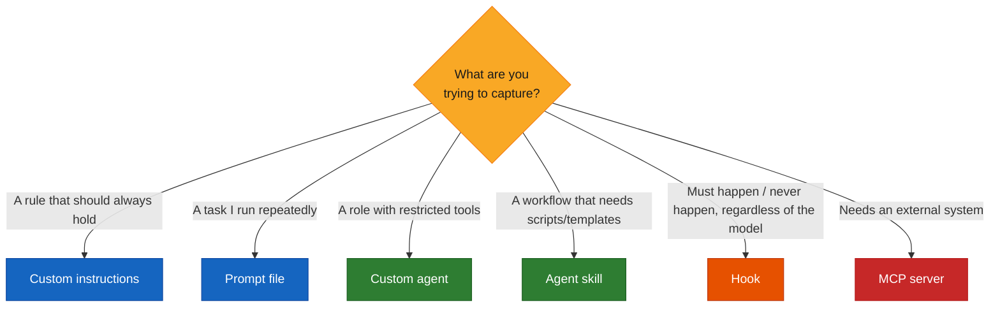

*The decision tree is this guide's rendering of the slide-17 rule of thumb plus slides 18–19; the deck itself shows the table.*

---

### Part D — MCP, hooks & model choice (segment 05)

#### Concept card D1 — MCP: governed access to your systems (slide 18)

**Definition.** The Model Context Protocol connects agents to external tools and data through a standard interface. The Copilot agent is the **MCP client in VS Code**: it discovers tools, asks approval, and calls them.

| MCP primitive | Meaning |
|---------------|---------|
| **Tools** | Actions the agent can call |
| **Resources** | Data it can read |
| **Prompts** | Templates the server offers |

Config (slide 18) — `.vscode/mcp.json`:

```json
{
  "servers": {
    "github": { "type": "http", "url": "https://api.githubcopilot.com/mcp" }
  }
}
```

stdio servers use `command` + `args` instead of `url` (per the slide's comment). The URL above is copied from the deck and was not independently fetched — confirm against the GitHub MCP docs before use.

| Governance point | Detail |
|------------------|--------|
| **Trust & approval** | Trust each server on first start; approve tool calls per call, session or workspace |
| **Enterprise policy** | `chat.mcp.access` and Copilot policy control which servers may run at all |
| **Keep it lean** | Up to **128 tools per request** — enable only the servers a task needs |

> Link to Module 01: every enabled tool's description costs context tokens. "Keep it lean" is context discipline applied to tools.

Module 07 builds your **own** MCP server — the dashed box in the architecture diagram above.

#### Concept card D2 — Hooks (Preview): deterministic guardrails (slide 19)

**Definition.** Shell commands that run on agent lifecycle events — `SessionStart`, `UserPromptSubmit`, `PreToolUse` (can **allow / deny / ask**), `PostToolUse` (e.g. run formatter), `Stop`.

Example (slide 19) — `.github/hooks/audit.json`:

```json
{
  "hooks": {
    "PostToolUse": [{
      "type": "command",
      "command": "./log-tool.sh"
    }]
  }
}
```

What hooks are good for (slide 19): ✔ block destructive commands · ✔ format or lint after edits · ✔ audit-log every tool call · ✔ inject project context.

> **Unlike instructions, hooks always run — they don't depend on the model choosing to comply.**

| | Instructions | Hooks |
|---|---|---|
| Mechanism | Text the model reads | Shell command the platform runs |
| Reliability | Advisory | Deterministic |
| Use for | Preferences, conventions, *why* | Hard rules, audit, enforcement |

This is the Champion's **Guardian** role (Module 01) made concrete.

#### Concept card D3 — Model choice: quality, speed and credits (slide 19)

Open the picker with `Ctrl+Alt+.`.

| Choice | Best for | Trade-off |
|--------|----------|-----------|
| **Auto** | Everyday chat — a sensible default | Copilot picks for you |
| **Fast, lighter models** | Explanations, small edits, boilerplate | Lower latency, fewer credits |
| **Stronger reasoning models** | Planning, multi-file refactors, tricky debugging | Slower; cost more per token |

**Pin it:** prompt files and custom agents can set `model` — agents accept a **prioritised list**. Under AI credits, *the model you pick changes the cost of every run.*

---

### Part E — Beyond the editor (segment 06)

#### Concept card E1 — Copilot CLI (slide 21)

Agentic help in the terminal, with the *same* instructions, agents, skills and MCP servers. Commands shown on the slide:

```text
$ copilot
> /model                 choose the model
> /agent reviewer        select a custom agent
> /mcp                   manage MCP servers
> /add-dir ./src         grant directory access
> /usage                 session usage metrics
> /delegate add setpoint validation
  → hands off to the cloud agent as a PR
```

**Good for:** scripted or terminal-first work, quick repo questions, running agents outside the IDE.

#### Concept card E2 — Cloud agent (slide 21)

Asynchronous and PR-based:

| Step | What happens |
|------|--------------|
| **Assign a task** | From GitHub (e.g. an issue), VS Code, or `/delegate` |
| **Works in the cloud** | Own environment: branch, edits, build and test |
| **Opens a draft PR** | With a log of what it did |
| **You review & iterate** | Comments trigger new commits; you merge |

**Never pushes to protected branches — your branch rules and review gates still apply.**

> **Portable by design:** skills, custom agents and MCP config you commit today travel with the repo into the CLI and the cloud agent. *That's the payoff of putting know-how in files, not in people's heads.*

#### 🧪 Lab 4 — Agent-mode end to end vs. a chat-only baseline (25 min, slide 22)

**Goal:** Implement one small feature first with chat and inline only, then with the full stack: **Plan → Agent → Reviewer.** *Evidence for your adoption case.*

| Step | Action |
|-----:|--------|
| 1 | **Baseline:** implement "reject out-of-range setpoints with ProblemDetails + tests" using chat and inline only. **Record time and iterations** |
| 2 | **Reset the branch.** Start in the Plan agent, review the plan, then hand off to Agent mode to implement and run tests |
| 3 | Switch to your Reviewer agent; use **Apply Fixes** for any findings. Let the `dotnet-tests` skill handle test runs |
| 4 | Fill in the comparison: **time, iterations, conventions followed, tests passing, credits used.** Share one insight |

**Files:** reuses Labs 1–3 (`copilot-instructions.md`, `api.instructions.md`, `reviewer.agent.md`, `skills/dotnet-tests/`) plus a new `comparison-worksheet.md`.

**Done when:** both runs produce a passing build, and the worksheet has a row for each approach covering time, iterations, rule violations and credits. **Each pair names one place the advanced flow helped and one place it cost more.**

**[Beyond the deck] — a starting `comparison-worksheet.md`** (columns follow the slide's list):

```markdown
| Approach              | Time (min) | Iterations | Conventions followed (Y/N, which) | Rule violations | Tests passing | Credits used |
|-----------------------|-----------:|-----------:|-----------------------------------|----------------:|---------------|-------------:|
| Chat + inline only    |            |            |                                   |                 |               |              |
| Plan → Agent → Reviewer |          |            |                                   |                 |               |              |

**One place the advanced flow helped:**
**One place it cost more:**
```

> Link to Module 01: the worksheet's *time*, *iterations* and *credits* are small-scale versions of the six baseline measures (cycle time, quality, PR review, testing effort, token usage, AI cost). Lab 4 is your first piece of baseline-vs-advanced evidence.

---

## Module 02 outcomes & what's next (slide 23)

By the end of the session, committed to the repo:

- [ ] Copilot's evolution, surfaces, plans and AI-credit billing are understood
- [ ] Completions, chat modes and `/`, `@`, `#` commands are used fluently
- [ ] A team instruction set and a prompt file are committed
- [ ] A read-only reviewer agent with a handoff is configured and used
- [ ] A reusable skill loads on demand; MCP and hooks are understood as extension and guardrail layers
- [ ] An agent-mode task has been run end to end and compared against a baseline

**Next:** Module 03 — *Prompt Engineering Recap & Context Engineering* (2 hours): from prompt-only to structured context — selection, layering, compression and token-aware practice — compared on quality, iterations and tokens.

---

## Glossary

| Term | One-line definition |
|------|---------------------|
| **NES** | Next edit suggestions — predicts your next edit and where it goes (`Tab`) |
| **Ask / Plan / Edit / Agent** | Chat modes, in increasing autonomy |
| **Agent mode** | Copilot plans, edits files and runs tools itself |
| **Always-on instructions** | `copilot-instructions.md` or `AGENTS.md`, sent with every request |
| **File-scoped instructions** | `*.instructions.md` with an `applyTo` glob |
| **Prompt file** | `*.prompt.md`: reusable, parameterised task run with `/name` |
| **Custom agent** | `*.agent.md`: persona with tools, model and handoffs (formerly custom chat modes) |
| **Handoff** | A button/prompt that moves work from one agent to another |
| **Agent skill** | Folder with `SKILL.md` + resources; loaded progressively |
| **MCP** | Model Context Protocol — standard interface to external tools/data |
| **Hook** | Shell command run on an agent lifecycle event (Preview) |
| **AI credits** | Token-based usage billing for chat, agents and premium models |
| **Cloud agent** | Asynchronous agent that works in its own environment and opens a draft PR |
| **`/delegate`** | Hands a task to the cloud agent |

---

## References

Every link below was fetched on 2026-10-14; each returned HTTP 200 and its page title matched the description.

### Official documentation

- [GitHub Copilot documentation](https://docs.github.com/en/copilot) — canonical docs root: plans, billing, features, cloud agent, CLI.
- [Build with AI in VS Code](https://code.visualstudio.com/docs/copilot/overview) — VS Code's Copilot overview (editor features, chat modes).
- [Create and manage agent customizations](https://code.visualstudio.com/docs/copilot/customization/overview) — how the customisation layers fit together.
- [Use custom instructions in VS Code](https://code.visualstudio.com/docs/copilot/customization/custom-instructions) — `copilot-instructions.md`, `AGENTS.md`, `*.instructions.md`.
- [Use prompt files in VS Code](https://code.visualstudio.com/docs/copilot/customization/prompt-files) — `.prompt.md` format and variables.
- [Custom agents in VS Code](https://code.visualstudio.com/docs/copilot/customization/custom-agents) — `.agent.md`, tools, handoffs.
- [Use Agent Skills in VS Code](https://code.visualstudio.com/docs/copilot/customization/agent-skills) — `SKILL.md` folders and progressive loading.
- [Add and manage MCP servers in VS Code](https://code.visualstudio.com/docs/copilot/customization/mcp-servers) — `mcp.json`, trust and approval.
- [Configure agent hooks in Visual Studio Code (Preview)](https://code.visualstudio.com/docs/copilot/customization/hooks) — lifecycle events and hook config.

### Standards & projects

- [Agent Skills](https://agentskills.io) — the open standard the deck cites for skills.
- [Model Context Protocol](https://modelcontextprotocol.io) — the open protocol behind MCP servers (Module 07).
- [github/copilot-cli](https://github.com/github/copilot-cli) — the Copilot CLI repository. (Confirmed via the GitHub API; the github.com page returned a transient HTTP 500 on a later fetch.)

> **Not listed / unverified:** the deck's `https://api.githubcopilot.com/mcp` server URL is a service endpoint, not a documentation page, and was not fetched. A GitHub Docs deep link for the cloud agent was dropped because the page I fetched was titled "GitHub Copilot on GitHub.com", not the cloud agent — use the docs root above to find current cloud-agent pages. Plan names, allowances and the June 2026 billing change come from the deck only; check them in the live GitHub docs before quoting externally.
