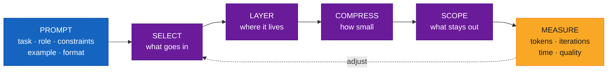
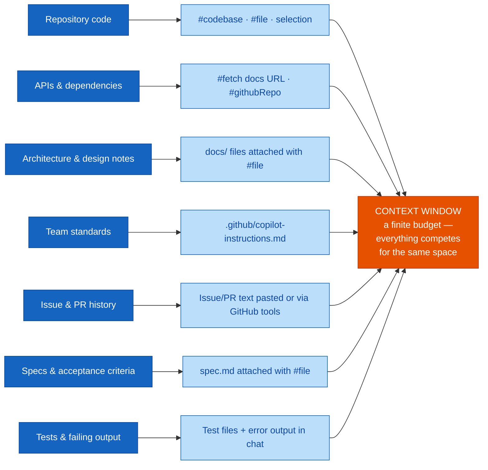
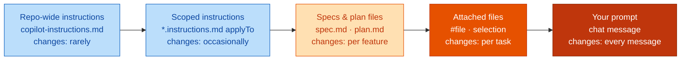
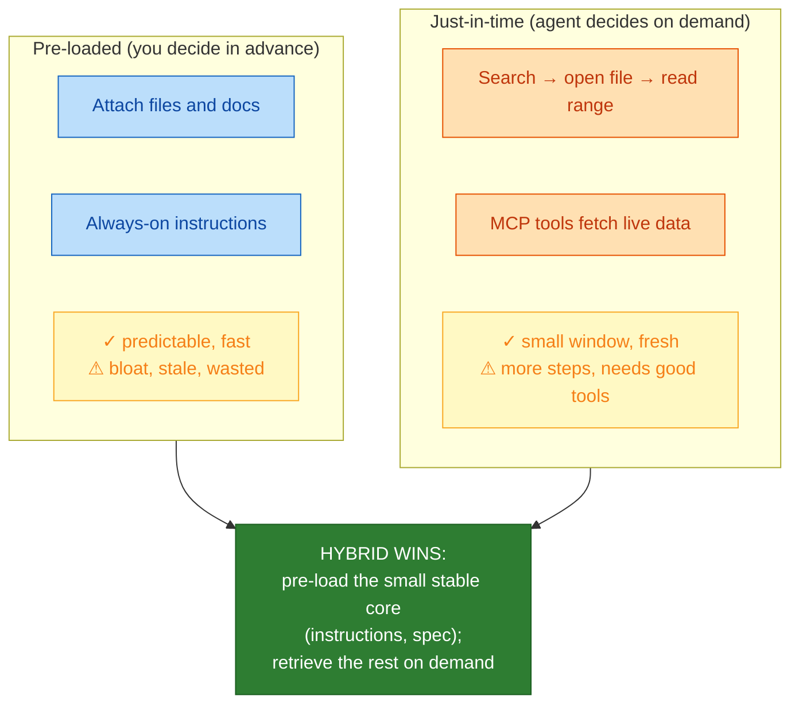
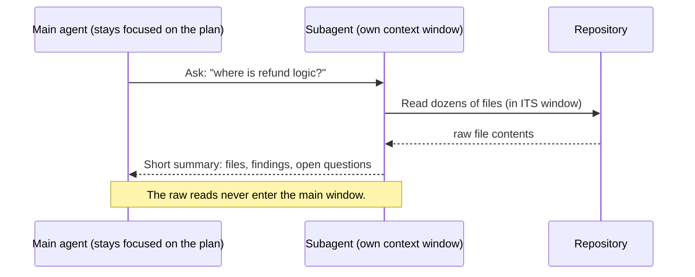
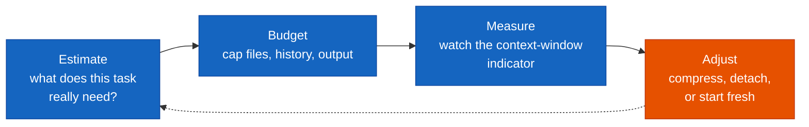
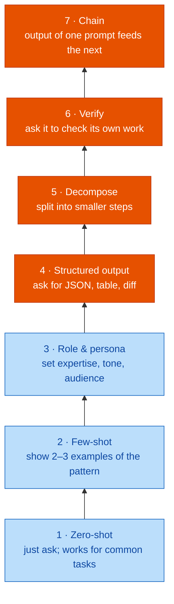
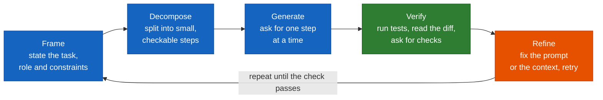
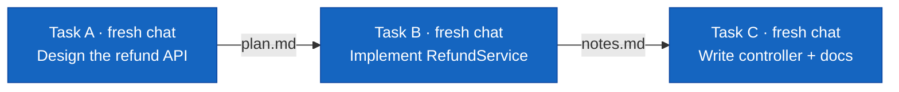
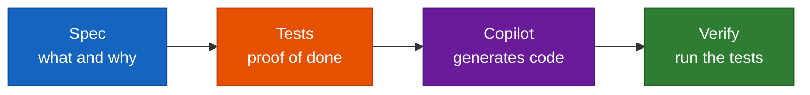

# Module 03 — Prompt Engineering Recap & Context Engineering — Comprehensive Guide

> **Source:** `presentations/Module03_Prompt_Engineering_Context_Engineering.pdf` (24 slides, 2 hours, recap + one progressive lab, primary tool: Copilot Enterprise in VS Code).
> **Audience:** Honeywell Software Engineering teams (IA · BA · PA&T), *AI Champions Programme — GitHub Copilot Enterprise, SDD, MCP & Agentic Software Engineering*.
> Content marked **[Beyond the deck]** is added by this guide. Everything else traces to a slide.
> **Illustrative numbers:** the deck labels its token counts, proportions, thresholds and recall chart as *illustrative* or *rule of thumb*, not measured data. This guide keeps those labels.

---

## Overview

Module 01 told you the model is **stateless** and its **context window** is its entire working memory. Module 02 gave you the files that feed that window (instructions, prompt files, agents, skills, MCP). Module 03 teaches the discipline of **deciding what goes in the window — and what stays out.**

The module's thesis (slides 3, 8):

> *The model is only as good as the context it is given. Context engineering is the discipline of giving it exactly the right information — no more, no less.*
> *Prompt engineering optimises the words of the request. Context engineering optimises the whole set of tokens the model sees when it answers. Same model, very different results.*

### Time budget (slide 2)

| # | Segment | Min | Core question |
|---|---------|----:|---------------|
| 01 | Prompt Fundamentals & Techniques | 20 | How do I build a good prompt, and which technique when? |
| 02 | From Prompting to Context Engineering | 15 | Where do prompts hit a ceiling, and what are the seven context sources? |
| 03 | The Four Moves: Select · Layer · Compress · Scope | 30 | What goes into the window, where does it live, how small can it get, what stays out? |
| 04 | Failure Modes & Token Discipline | 15 | How does context go wrong, and how do I budget tokens? |
| 05 | Specs, Agents & Best-Practice Checklist | 15 | Why are specs/tests the densest context, and how do agents fetch it? |
| 06 | **Lab:** Prompt-Only to Engineered Context | 25 | What does each context move actually change, measured? |

### Where it sits in the programme (slide 3)

| Module | Link |
|--------|------|
| **M02** | Instructions, prompt files and `#` mentions are the tools you use today |
| **M04–05** | Specs are the most structured form of context you will write |
| **M07** | MCP is context delivered just-in-time from external systems |
| **M11** | Token and cost discipline from today feeds observability and ROI |

---

## Quick Start

1. **Prompt = one slice.** Your prompt is a small part of what the model reads. System/tool definitions, custom instructions, chat history and attached files fill most of the window.
2. **Build prompts in layers:** task → role & goal → constraints → example → output format. Each layer removes one source of ambiguity.
3. **Work in a loop:** frame → decompose → generate → verify → refine. **If the third retry still fails, stop rewording — fix the context, not the phrasing.**
4. **Three context problems:** *missing* (model guesses), *wrong* (model follows stale info), *too much* (model loses the thread).
5. **Four moves, in order:**

| Move | Question | One-line practice |
|------|----------|-------------------|
| **SELECT** | What goes in? | Only files, docs and facts that bear on *this* task |
| **LAYER** | Where does it live? | Stable rules in instructions; volatile detail in the prompt |
| **COMPRESS** | How small can it get? | Summarise history, outline files, keep only decisions |
| **SCOPE** | What stays out? | One task per chat; push noisy exploration to a separate context |

6. **Five failure modes:** poisoning, distraction, confusion, clash, lost-in-the-middle.
7. **Treat context as a budget:** estimate → budget → measure → adjust.
8. **Specs + tests are the densest context you can write** — a few lines of intent and a few executable checks beat pages of prose.
9. **Guiding principle (slide 9):** *find the smallest possible set of high-signal tokens that makes the right outcome likely* — adapted from Anthropic's context-engineering guidance.

---

## Visual Summary



This mirrors slide 23's "context engineering loop": **Prompt → Select → Layer → Compress → Scope → Measure.**

---

## Architecture

### 1. What fills a Copilot chat request (slide 9)

Proportions are illustrative in the deck.

```
┌──────────┬──────────┬──────────────┬────────────────────────────────┬──────────┐
│ System & │ Custom   │ Chat         │ Attached files,                │ Your     │
│ tool     │ instruc- │ history      │ selection, results             │ prompt   │
│ defs     │ tions    │              │                                │          │
└──────────┴──────────┴──────────────┴────────────────────────────────┴──────────┘
 ◄──────────── CONTEXT ENGINEERING — controls all of this ─────────────►◄ PROMPT ENG ►
```

| | Prompt engineering | Context engineering |
|---|---|---|
| Asks | *How do I ask?* | *What does the model see?* |
| Concerns | Wording, role, constraints, examples | Which files, docs, specs and history are in the window |
| Nature | One request at a time; you write it each time | Persisted, reusable, shared by the team; designed once, improved continuously |

### 2. Seven context sources and how Copilot takes them in (slide 10)



*Large files degrade gracefully (slide 10): **whole → outline → omitted** as the window fills.* That is the platform doing a crude compress move for you — and the reason to select ranges deliberately.

### 3. Layers by rate of change (slide 13)



**STABLE — written once, shared by everyone** (left) → **VOLATILE — rewritten each task** (right).

### 4. The two ways context arrives (slide 19)



### 5. Scope with a subagent (slide 15)



### 6. Token-discipline loop (slide 17)



---

## Core Concepts

### Part A — Prompt engineering recap (segment 01)

#### Concept card A1 — Build a prompt layer by layer (slide 4)

**Definition.** Same task, five prompts. *Each layer removes one source of ambiguity.* The deck's C#/.NET prompts are explicitly illustrative — use your own language and domain in the lab.

| # | Layer | Prompt text (from the slide) | What it buys you |
|--:|-------|------------------------------|------------------|
| 1 | **Task** | *Write a function to validate emails.* | Says **what** to produce |
| 2 | **+ Role & goal** | *As a senior C# engineer, write an email validator for our signup API.* | Sets **level and intent** |
| 3 | **+ Constraints** | *…use .NET 8, no regex, return a `Result<T>`, no external packages.* | **Shrinks the solution space** |
| 4 | **+ Example** | *…e.g. "a@b.co" → Ok; "a@@b" → Error("double @").* | **Shows, not tells,** the pattern |
| 5 | **+ Output format** | *…return only the method and 3 xUnit tests, no prose.* | **Output you can use as-is** |

Assembled prompt **[Beyond the deck — the five slide fragments stitched together]**:

```text
As a senior C# engineer, write an email validator for our signup API.
Use .NET 8, no regex, return a Result<T>, no external packages.
Examples: "a@b.co" -> Ok; "a@@b" -> Error("double @").
Return only the method and 3 xUnit tests, no prose.
```

> Link to Module 01: this is the six-part prompt anatomy (role, task, context, constraints, examples, output format) built up one layer at a time. Note the one part missing from all five prompts: **context** — which is exactly what the second half of the module is about.

#### Concept card A2 — The prompting technique ladder (slide 5)

Seven techniques, from simplest to patterns that chain prompts.



| Tier | Techniques | Character |
|------|-----------|-----------|
| **BASIC — shape the request** | Zero-shot · Few-shot · Role & persona | Cheap, quick wins. *Most everyday Copilot chat lives here.* |
| **ADVANCED — shape the process** | Structured output · Decompose · Verify · Chain | Patterns that change *how the work proceeds* |

#### Concept card A3 — GitHub's eight prompt practices (slide 6)

| # | Practice | In one line |
|--:|----------|-------------|
| 1 | Start general, then specific | Set the goal, then add detail |
| 2 | Give examples | Input/output pairs beat adjectives |
| 3 | Break complex tasks down | Smaller prompts, better results |
| 4 | Avoid ambiguity | Name the thing you mean |
| **5** | **Indicate relevant code** | Select it, or use `#` to attach it |
| 6 | Experiment and iterate | Refine; don't restart blindly |
| **7** | **Keep history relevant** | New thread per task |
| 8 | Follow good coding practices | Review everything it produces |

> **Spot the pattern (deck):** practices **5** and **7** aren't prompt wording at all — they are *context decisions*. That's the doorway to the second half of the module.

#### Concept card A4 — The working loop: decompose → iterate → verify (slide 7)



> **Rule of thumb (deck):** *if the third retry still fails, stop rewording the prompt — the model is missing information. Fix the context, not the phrasing.*

**Analogy [Beyond the deck].** Asking a contractor for the same quote in ever-fancier language when they simply never saw the floor plan. After a few tries, hand them the floor plan.

---

### Part B — From prompting to context engineering (segment 02)

#### Concept card B1 — Where prompting hits its ceiling (slide 8)

*A perfect prompt can still fail. When it does, the cause is usually the information around it.*

| Problem | Symptom | What you see | The fix |
|---------|---------|--------------|---------|
| **Missing context** | Model guesses | Invents a method name, a config key, or a library your repo doesn't use | **Add the right files, docs or spec** |
| **Wrong context** | Model follows stale info | Copies an old pattern, a deprecated API, or an outdated decision from earlier in the chat | **Remove it; refresh from the source of truth** |
| **Too much context** | Model loses the thread | Ignores your constraint because it is buried under 40 files and a long history | **Cut to the smallest set that still answers** |

**Analogy [Beyond the deck].** Missing context is an exam with the textbook withheld; wrong context is the *previous year's* textbook; too much context is a 40-book pile on the desk where the one relevant page can't be found.

This is Module 01's "noise dilutes focus" and "stateless between calls" turned into three diagnoses.

#### Concept card B2 — Prompt vs context engineering

(See the table under *Architecture §1*.) The practical difference: **a prompt is rewritten every time; context is designed once and improved continuously** — it lives in files the whole team shares.

---

### Part C — The four moves (segment 03)

> *Every best practice in the rest of this module is one of these four.* **Order matters:** select first (cheapest win), layer so it persists, compress when it grows, scope when tasks multiply.

The deck's "industry shorthand" labels: Select = **select** · Layer ≈ **write** · Compress = **compress** · Scope ≈ **isolate**. (This four-way vocabulary of write/select/compress/isolate appears in LangChain's context-engineering write-up — see References.)

#### Concept card C1 — Move 1: SELECT — right context, not more context (slide 12)

*Start from the task and work outward. **Add a source only if you can say what question it answers.***

The slide's worked example — candidate files in the repo, filtered by four tests:

```
CANDIDATES                          4 TESTS                       WHAT GOES IN (#file)
OrderService.cs         ──┐                                       OrderService.cs
OrderController.cs      ──┤       Relevant?                       OrderController.cs
README.md                 │       Authoritative?          ──►     OrderServiceTests.cs
OrderServiceTests.cs    ──┤       Current?                        orders-spec.md
Startup.cs                │       Small enough?
Billing/*.cs              │
CHANGELOG.md              │
docs/orders-spec.md     ──┘
```

| Tip | Detail |
|-----|--------|
| **Implicit vs explicit** | Your selection and active file go in automatically. Anything else needs a `#` mention. |
| **Pin the source of truth** | Attach the spec or interface, *not a blog-post description of it.* |
| **Select a range, not a file** | Highlight the method; Copilot treats the selection as the focus. |
| **`#codebase` is a search** | Let Copilot find files — **then check what it found before trusting it.** |

> **Best practice:** name the evidence a good answer depends on, then attach exactly that. **If you can't say why a file is attached, detach it.**

#### Concept card C2 — Move 2: LAYER — stable context first, volatile last (slide 13)

*Different information changes at different speeds. Store it where its change rate matches.*

| Layer | Artifact | Changes | Typical content |
|-------|----------|---------|-----------------|
| Repo-wide instructions | `copilot-instructions.md` | Rarely | Stack, build/test commands, naming, banned patterns |
| Scoped instructions | `*.instructions.md` (`applyTo`) | Occasionally | Rules for tests, API layer, UI, SQL |
| Specs & plan files | `spec.md`, `plan.md` | Per feature | Goal, acceptance criteria, design decisions |
| Attached files | `#file`, selection | Per task | The code and tests being changed right now |
| Your prompt | Chat message | Every message | The one specific ask, with its constraint |

> **Best practice:** *if you typed the same instruction in chat three times, it belongs one layer up. If an instruction applies to one task, it does **not** belong in an always-on file — it will cost tokens on every request.*

This is Module 02's customisation stack read through a cost lens: always-on files are charged to every request, so keep them short and current.

#### Concept card C3 — Move 3: COMPRESS — keep the signal, drop the rest (slide 14)

*As chats, files and logs grow, replace raw bulk with distilled versions.*

| Raw bulk | Compression technique | Result | Illustrative size |
|----------|----------------------|--------|-------------------|
| Long chat history | `/compact` or *Compact Conversation* | Short summary of decisions | 40k → 3k tokens |
| Whole large file | Outline, or select the method | Signatures + the one method | 8k → 600 tokens |
| Full build/test log | Paste failing lines only | The error and 5 lines around it | 12k → 400 tokens |

*Token figures are illustrative; measure your own in the lab.*

**The handoff note** (slide 14) — a compressed history you can carry into a fresh chat:

```markdown
## Goal
Add refund support to orders
## Decided
- Use Result<T>, no exceptions
- Refund ≤ original amount
## Done
- RefundService + 3 tests
## Next
- Controller endpoint
- Update spec.md
```

> **Best practice:** compress at **natural breakpoints** — after a decision, before switching sub-task. **Always keep: goal, decisions, constraints, what's left.**

**Analogy [Beyond the deck].** Shift-handover notes. The incoming nurse doesn't need the whole night's transcript; they need *goal, decisions, constraints, what's next*.

#### Concept card C4 — Move 4: SCOPE — one task, one context (slide 15)

*Isolation keeps unrelated detail out of the window and keeps noisy exploration from drowning the signal.*

**New chat per task, connected by files:**



Each chat holds *only what that task needs*; the **file** (not the chat history) carries the decisions forward.

**Send noisy exploration to a separate context** — see the subagent sequence above: the main agent stays on the plan; the subagent reads dozens of files in its own window and returns *files, findings, open questions — not the raw reads.*

> **Best practice:** start a new chat **when the task changes, when the model starts repeating old mistakes, or after a plan is written to a file.** *History is context too — keep it relevant.*

---

### Part D — Failure modes & token discipline (segment 04)

#### Concept card D1 — Five ways context goes wrong (slide 16)

*More context is not better context. Know the symptoms so you can diagnose a bad answer quickly.*

| # | Failure mode | What happens | Fix | Move |
|--:|--------------|--------------|-----|------|
| 1 | **Poisoning** | A wrong fact or hallucination enters the window and gets reused | **Start fresh; correct at the source** | Scope |
| 2 | **Distraction** | So much history that the model repeats it instead of reasoning | **Compress; new chat** | Compress / Scope |
| 3 | **Confusion** | Irrelevant files or tools pull the answer off target | **Select fewer, sharper sources** | Select |
| 4 | **Clash** | Two sources disagree (old spec vs new code); model blends them | **Remove or reconcile one** | Select / Layer |
| 5 | **Lost in the middle** | Models use information at the **start and end** of the input best; facts buried in the middle are used less reliably (Liu et al., TACL, 2024) | **Put the critical constraint first or last; repeat it in the prompt** | Layer |

The right-hand "Move" column is this guide's mapping of each fix to the four moves — **[Beyond the deck]**.

```
Recall by position  (illustrative shape — NOT measured data, per the slide)

  ████                                                  ████
  ████  ████                                      ████  ████
  ████  ████  ████                          ████  ████  ████
  ████  ████  ████  ░░░░                    ░░░░  ████  ████
  ████  ████  ████  ░░░░  ░░░░  ░░░░  ░░░░  ░░░░  ████  ████
  ─────────────────────────────────────────────────────────────
  START of context         ▲ weak middle           END of context
```

**Practical consequence [Beyond the deck, derived from the deck's fix]:** in a long prompt, put the non-negotiable constraint at the top (or in always-on instructions, which come first) *and* restate it at the end of your message.

#### Concept card D2 — Token discipline: treat context as a budget (slide 17)

*Every token you add costs attention and, under usage-based billing, money.*

**Reading the context-window indicator** (illustrative; *"thresholds are a rule of thumb for this course, not a product setting"*):

| Window used | State | Action |
|-------------|-------|--------|
| 0–60% | 🟢 Comfortable | Carry on |
| 60–85% | 🟡 Trim now | Detach files, trim logs |
| 85%+ | 🔴 Compact / restart | `/compact` or fresh chat |

**What drives token use:** always-on instructions · attached files · chat history · tool & search results · model output.

**Why it matters now (deck):**
- Copilot is billed in AI credits, consumed by token usage (since June 2026).
- Bloated context costs credits on every request, *and still lowers answer quality.*
- Module 11 turns these habits into measured ROI and governance.

> This closes the loop opened in Module 01's **token usage** and **AI cost** baseline measures: the habits here are what move those two numbers.

---

### Part E — Specs, agentic context & the checklist (segment 05)

#### Concept card E1 — Specs and tests: the densest context you can write (slide 18)

*A few lines of intent plus a few executable checks tell the model more than pages of prose.*



`orders-spec.md` (slide 18):

```markdown
## Refund
Goal: customers can refund a paid order.

MUST: refund <= original amount
MUST: only for status = Paid
MUST: write an audit entry
OUT OF SCOPE: partial item refunds
```

`RefundTests.cs` (slide 18 — the deck marks it *illustrative*):

```csharp
[Fact] void Refund_Over_Amount_Fails()
  => Assert.True(svc.Refund(o, 150m).IsError);

[Fact] void Refund_Unpaid_Order_Fails()
  => Assert.True(svc.Refund(unpaid, 10m).IsError);
```

> The slide's snippet is a fragment: `svc`, `o` and `unpaid` are assumed to exist in the test class, and the one-line `=>` form is shown without an enclosing class or `public` modifiers. Treat it as pseudo-structure to read, not a compile-ready file.

**Note how spec and tests complement each other:** the spec states *intent* (MUST / OUT OF SCOPE are crisp, scannable constraints); the tests state *proof* (executable, so verification is mechanical rather than by eye).

> **Bridge to Module 04 (deck):** *Spec-Driven Development turns this idea into a workflow — specs first, with Spec Kit or OpenSpec. Today you use specs and tests as context; next time you make them the **source of truth**.*

#### Concept card E2 — Agentic context: let the agent fetch what it needs (slide 19)

Beyond pre-loading, agents can retrieve **just in time**, so the window holds only what is needed right now.

| | **Pre-loaded (up front)** | **Just-in-time (on demand)** |
|---|---|---|
| Who decides | You, in advance | The agent: searches, reads, calls tools |
| Mechanisms | Attach files and docs; always-on instructions | Search → open file → read range; MCP tools fetch live data |
| Good | Predictable, fast | Small window, fresh |
| Risk | Bloat, stale, wasted | More steps, needs good tools |

**Three agentic context patterns:**

| Pattern | How it works | Module link |
|---------|--------------|-------------|
| **Skills — progressive disclosure** | Only name + description load first; full instructions load when the task matches | Module 02 agent skills |
| **Memory & notes files** | The agent writes `plan.md` / `notes.md` *outside* the window and reads them back later | The handoff note, automated |
| **MCP tools** | Live data (issues, docs, DB) arrives as a small tool result, *not a pasted dump* | Module 07 |

> **Best practice (deck):** **hybrid wins** — pre-load the small stable core (instructions, spec); let the agent retrieve the rest on demand.

#### Concept card E3 — The best-practices checklist (slide 20)

*Run through this before you blame the model. Most bad answers trace back to one unchecked box.*

| **SELECT** | **LAYER** |
|---|---|
| ☐ Can I say why each attached file is there? | ☐ Are stable rules in instructions, not chat? |
| ☐ Is the source of truth attached (spec, interface, tests)? | ☐ Are always-on files short and current? |
| ☐ Did I select the range, not the whole file? | ☐ Is task detail in the prompt, not in global files? |

| **COMPRESS** | **SCOPE** |
|---|---|
| ☐ Did I summarise after each decision? | ☐ New chat for each new task? |
| ☐ Are logs trimmed to the failing lines? | ☐ Is noisy exploration done in a subagent? |
| ☐ Is the goal + constraints still in the window? | ☐ Is the critical rule first or last? |

**Keep this card (deck):** print it, pin it in your team channel, or **turn it into a prompt file that reviews your context before you send a big agent task.**

**[Beyond the deck] — that prompt file.** A starting point using the Module 02 prompt-file format (frontmatter fields and `#` mentions as presented in the Module 02 deck; save as `.github/prompts/review-my-context.prompt.md` and adapt):

```markdown
---
description: 'Review my chat context against the four moves before a big agent task'
agent: 'ask'
argument-hint: 'what task am I about to run?'
---
I'm about to run this task: ${input:task:describe the task}.

Review what is currently attached and in this chat, using this checklist.
Answer each item PASS / FAIL with one line of evidence, then list the
single most valuable change.

SELECT: Is each attached file justified? Is the source of truth (spec,
interface, tests) attached? Would a selected range beat the whole file?
LAYER: Are stable rules in instructions rather than repeated in chat?
Is task detail in the prompt rather than in always-on files?
COMPRESS: Has history been summarised after decisions? Are logs trimmed
to failing lines? Are goal and constraints still present?
SCOPE: Should this be a new chat? Should exploration go to a subagent?
Is the critical rule at the start or end?
```

---

### Part F — The lab (segment 06)

#### 🧪 Lab — From prompt-only to engineered context (25 min, slides 21–22)

**Goal:** implement the *same small feature* five ways and see how context choices change quality, tokens, iterations and time. **Change one thing per round and measure what happens.**


| Step | Round | Action |
|-----:|-------|--------|
| 1 | **R0 — baseline** | New chat, **prompt only** ("add refund support to orders"). Record tokens, iterations, time, quality |
| 2 | **R1 — select** | New chat; select the method and attach the 2–3 relevant files with `#file`. **Same prompt** |
| 3 | **R2 — layer** | Add a short instruction file and a **10-line spec plus failing tests.** Re-run |
| 4 | **R3/R4 — compress and scope** | Summarise into a handoff note, start a fresh chat with **only note + spec.** Compare all rounds |

**Files you create (slide 21):**

```
lab03/
├── .github/copilot-instructions.md
├── specs/refund-spec.md
├── notes/handoff.md
└── results.md
```

**Worksheet — one row per round (slide 22).** *The pattern across rows is the lesson, not any single number.*

| Round | What changed | Input tokens | Iterations | Time (min) | Quality 1–5 | Notes |
|-------|--------------|-------------:|-----------:|-----------:|------------:|-------|
| **R0** | Prompt only | | | | | |
| **R1** | Add: selected code and `#file` attachments | | | | | |
| **R2** | Add: instructions, spec and tests | | | | | |
| **R3** | Add: compressed handoff note | | | | | |
| **R4** | Add: fresh scoped chat (note + spec only) | | | | | |

**Quality rubric (one point each, plus 1 base):**

| Points | Criterion |
|-------:|-----------|
| 1 | Base point |
| +1 | Compiles and tests pass |
| +1 | Follows team conventions |
| +1 | No invented APIs or files |
| +1 | Small, reviewable diff |

Total range: **1–5.**

**Questions to answer after R4:**
1. Which round gave the **biggest quality jump**?
2. Did **tokens rise, then fall**? Why?
3. Which added context **did nothing**?

**Done when:** `results.md` holds a filled worksheet for all five rounds, and you can name **which single change helped most — and which one did nothing.**

**[Beyond the deck] — practical notes for running it**

- *Where to read tokens:* the deck says to watch the **context-window indicator** (slide 17) and record "Input tokens". How that indicator is presented depends on your VS Code/Copilot version; if no exact count is shown, record the indicator's percentage and note it as an estimate in the Notes column rather than inventing a number.
- *Fairness:* use the **same task, same model, same branch reset** for each round. Reset the branch between rounds so earlier output doesn't leak into later ones (this also prevents "wrong context" from sneaking in).
- *Expect a non-monotonic curve.* The deck's own question — "did tokens rise, then fall?" — hints at the usual shape: R1–R2 add tokens but cut iterations; R3–R4 cut tokens while holding quality. Your numbers may differ; that's data.

**A sample `.github/copilot-instructions.md` for the lab [Beyond the deck]** — short, single-purpose, with reasons (Module 02's "write them well" rules). Replace with your real stack:

```markdown
# Project: Orders API
- .NET 8 Web API
- Build: dotnet build   Test: dotnet test
- Return Result<T> from services; do not throw for business-rule failures
  (why: callers map Result to ProblemDetails in one place)
- Never change public API contracts without a spec
```

For `specs/refund-spec.md`, the 6-line Refund spec on slide 18 is already close to the "10-line spec" the lab asks for — add acceptance criteria until you have ~10 lines. For `notes/handoff.md`, use the Goal / Decided / Done / Next template from the Compress card.

> Link to Module 01 and 02: this worksheet is a mini baseline experiment — *tokens, iterations, time, quality* — in the same spirit as Module 01's six baseline measures and Module 02's Lab 4 comparison. It is the first place you generate evidence that context discipline moves **token usage** and **AI cost**.

---

## Module 03 outcomes & what's next (slide 23)

Six outcomes — *and the one habit that ties them together* (the **Prompt → Select → Layer → Compress → Scope → Measure** loop):

- [ ] Prompts are structured: task, role, constraints, example, output format
- [ ] The decompose → iterate → verify loop is used instead of one-shot prompts
- [ ] Context sources are selected deliberately with `#file`, `#codebase` and selections
- [ ] Stable rules live in instruction files; volatile detail stays in the prompt
- [ ] History is compressed and tasks are scoped with new chats or subagents
- [ ] Context effects are measured on tokens, iterations, time and quality

**Next:** Module 04 — *Spec-Driven Development with Spec Kit / OpenSpec* (2 hours): move from using specs as context to making them the **source of truth** — write the spec first, then plan, tasks and implementation.

---

## Glossary

| Term | One-line definition |
|------|---------------------|
| **Prompt engineering** | Optimising the wording of one request: role, constraints, examples, format |
| **Context engineering** | Optimising the whole set of tokens the model sees when it answers |
| **Zero-shot / Few-shot** | Ask directly / show 2–3 examples of the pattern |
| **Decompose** | Split a task into smaller, checkable steps |
| **Chain** | Output of one prompt feeds the next |
| **Select** | Choose only the files, docs and facts that bear on the task |
| **Layer** | Store stable rules in instructions, volatile detail in the prompt |
| **Compress** | Replace raw bulk with distilled versions (summaries, outlines, trimmed logs) |
| **Scope** | One task per chat; isolate noisy exploration in a separate context |
| **Handoff note** | Short Goal / Decided / Done / Next summary that carries decisions into a fresh chat |
| **Subagent** | An agent with its own context window that returns a short summary |
| **Poisoning** | A wrong fact enters the window and is reused |
| **Distraction** | Excess history makes the model repeat rather than reason |
| **Confusion** | Irrelevant files/tools pull the answer off target |
| **Clash** | Two sources disagree and the model blends them |
| **Lost in the middle** | Information in the middle of a long input is used less reliably than at the ends |
| **Pre-loaded vs just-in-time** | Context you attach in advance vs context the agent fetches on demand |
| **`#file` / `#codebase` / `#fetch` / `#githubRepo`** | Copilot context mentions for a file, a codebase search, a web page, a GitHub repo |
| **`/compact`** | Compact the conversation into a short summary (also *Compact Conversation*) |

---

## References

Every link below was fetched on 2026-10-14; each returned HTTP 200 and the page title matched the description. Where a URL redirected, the final address is listed.

### Research papers

- [Lost in the Middle: How Language Models Use Long Contexts](https://arxiv.org/abs/2307.03172) — Liu et al.; the arXiv version of the paper behind slide 16's "lost in the middle".
- [Lost in the Middle — ACL Anthology (TACL)](https://aclanthology.org/2024.tacl-1.9/) — the published TACL version the deck cites.

### Blog posts & guidance

- [Effective context engineering for AI agents](https://www.anthropic.com/engineering/effective-context-engineering-for-ai-agents) — Anthropic; the guidance the deck's guiding principle is adapted from. Also covers compaction, structured note-taking, just-in-time retrieval and sub-agents — the same ideas as the Compress, Scope and agentic-context cards.
- [How Long Contexts Fail (and How to Fix Them)](https://www.dbreunig.com/2025/06/22/how-contexts-fail-and-how-to-fix-them.html) — names the context *poisoning*, *distraction*, *confusion* and *clash* failure modes used on slide 16. (The deck does not cite a source for these names; this page uses the same four terms.)
- [Context Engineering for Agents — LangChain](https://blog.langchain.com/context-engineering-for-agents/) — uses the write / select / compress / isolate vocabulary that the deck's "industry shorthand" labels correspond to.
- [Prompt engineering for GitHub Copilot Chat — GitHub Docs](https://docs.github.com/en/copilot/concepts/prompting/prompt-engineering) — GitHub's prompt-practice guidance (slide 6).

### Official documentation

- [Add context to chat — VS Code](https://code.visualstudio.com/docs/copilot/chat/copilot-chat-context) — `#` mentions, attaching files, selection.
- [Use chat in VS Code](https://code.visualstudio.com/docs/copilot/chat/chat-agent-mode) — chat modes and conversation management.
- [Create and manage agent customizations — VS Code](https://code.visualstudio.com/docs/copilot/customization/overview) — instructions, prompt files, agents and skills (the "layer" artifacts).

### Tools & projects

- [github/spec-kit](https://github.com/github/spec-kit) — Spec Kit, used in Module 04.
- [Fission-AI/OpenSpec](https://github.com/Fission-AI/OpenSpec) — OpenSpec, the alternative spec framework named on slides 18 and 23.

> **Not independently verified:** the claim that Anthropic's page contains the exact phrase "smallest possible set of high-signal tokens". The deck says its principle is *adapted from* that guidance, and this guide repeats it that way rather than quoting the page. The `/compact` and *Compact Conversation* command names, and where the context-window indicator appears, come from the deck; check them against your installed VS Code/Copilot version.
