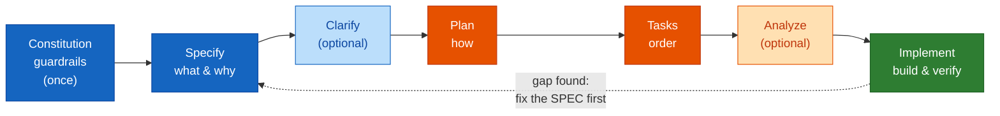
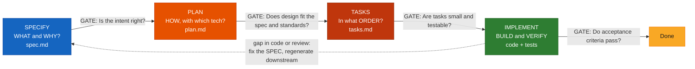
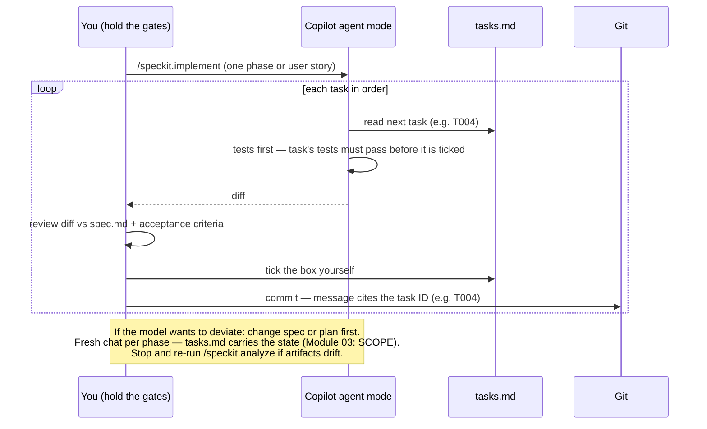
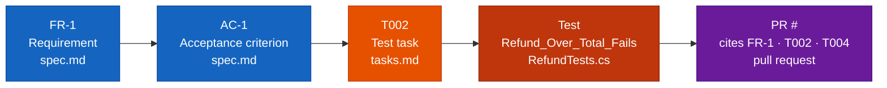
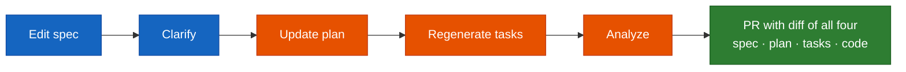
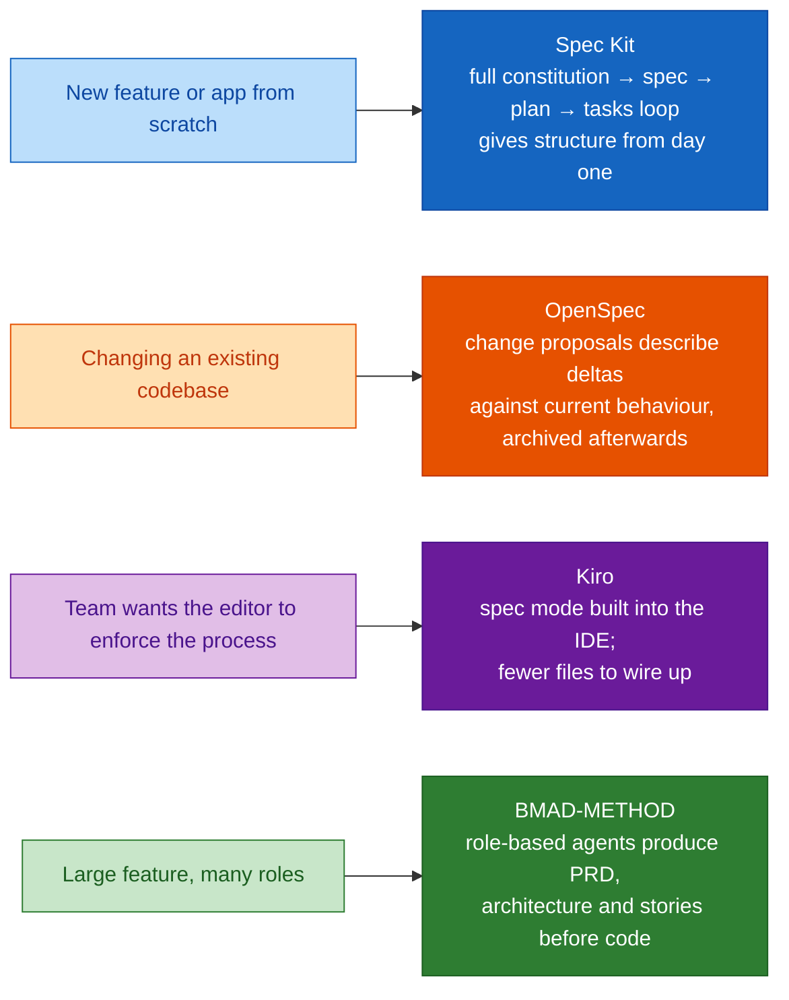
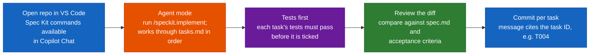
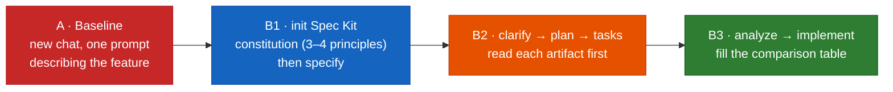

# Module 04 — Spec-Driven Development with GitHub Spec Kit — Comprehensive Guide

> **Source:** `presentations/Module04_Spec_Driven_Development_GitHub_Spec_Kit.pdf` (19 slides, 2 hours, concepts + one Spec Kit lab, primary tool: Copilot + GitHub Spec Kit, Day 2).
> **Audience:** Honeywell Software Engineering teams (IA · BA · PA&T), *AI Champions Programme — GitHub Copilot Enterprise, SDD, MCP & Agentic Software Engineering*.
> Content marked **[Beyond the deck]** is added by this guide. Everything else traces to a slide.
> **Illustrative examples:** the deck labels its constitution, spec, tasks, IDs and test names *illustrative*. This guide keeps that label.

---

## ⚠ Currency check — the deck vs. today's Spec Kit

Spec Kit moves fast, and the deck itself says (slide 9): *"Check the Spec Kit README for current flags and supported agents before the session."* I did, on **2026-10-14**, against the live README and docs site. The deck's **concepts and workflow are unchanged**; some **spellings and flags differ**:

| Topic | Deck (slides 9–14) | Live README / docs (checked 2026-10-14) |
|-------|-------------------|------------------------------------------|
| **Install + init** | `uvx --from git+https://github.com/github/spec-kit.git specify init my-app --ai copilot` | `uv tool install specify-cli` then `specify init my-project --integration copilot` |
| **Command spelling in Copilot chat** | `/speckit.constitution`, `/speckit.specify`, … (dotted) | Copilot's default mode installs **skills**, invoked as `/speckit-constitution`, `/speckit-specify`, … (hyphenated). The docs use the dotted form as notation. A `--commands` option scaffolds `.github/agents/*.agent.md` + `.github/prompts/*.prompt.md` instead. |
| **Core loop** | constitution → specify → (clarify) → plan → tasks → (analyze) → implement | Same, **plus** a final `/speckit-converge` step: *repeat implement → converge until it reports "Converged"* |
| **Clarify / checklist / analyze / taskstoissues** | Present | Still present (the docs call clarify, checklist and analyze *quality gates*) |
| **Other processes** | Not covered | README now also ships **bug fixing** (`specify extension add bug`) and **idea assessment** (`specify extension add assess`) as opt-in extensions |

**How to use this guide:** follow the deck's workflow and artifacts; when you type commands in the lab, use whichever spelling your installed version shows (`specify --help`, the README, or the `/` picker in chat). I did **not** install or run the CLI, so I have not tested which flags your installed version accepts.

---

## Overview

Module 03 ended with a bridge: *specs and tests are the densest context you can write — next time you make them the source of truth.* Module 04 is that "next time."

Core idea (slide 4):

> **In SDD the specification is the source of truth; code is one output of it. You review the spec before you review the code.**

Why this matters (slide 3): *AI writes code fast. A spec is how you decide in advance what "correct" means — and how reviewers, tests and agents check it afterwards.*

### Time budget (slide 2)

| # | Segment | Min | Core question |
|---|---------|----:|---------------|
| 01 | Why Spec-Driven Development | 15 | Where does prompt-only work drift, and what chain fixes it? |
| 02 | Anatomy of a Good Specification | 20 | What makes a requirement strong rather than weak? |
| 03 | The SDD Tool Landscape | 15 | Spec Kit, OpenSpec, Kiro, BMAD, Task Master, Tessl — how to choose? |
| 04 | GitHub Spec Kit Deep Dive | 35 | Constitution, specify, clarify, plan, tasks, analyze, implement — and their artifacts |
| 05 | Best Practices & Change Control | 10 | Do/don't list, traceability, keeping specs alive as code changes |
| 06 | **Lab:** Spec Kit vs Prompt-Only | 25 | Build one feature both ways; compare quality, rework, tokens, time |

### Where it sits in the programme (slide 3)

Module 04 is the **first module of BUILD & VALIDATE**: *specifications become the contract everything else is checked against.*

| Module | Link |
|--------|------|
| **M03** | A spec is the densest, most durable context you can write |
| **M05** | Takes today's spec through architecture, tests, CI/CD, PR and release |
| **M06** | Acceptance criteria in the spec become the test strategy |
| **M08** | PR automation and LLM-judge check code against the spec |

---

## Quick Start

1. **Prompt-only drifts; specs anchor.** Intent in a long chat → code fills every gap with a guess → review "by feel" → rework loop that drifts from the original intent.
2. **The SDD chain:** **Specify** (what & why) → **Plan** (how, with which tech) → **Tasks** (in what order) → **Implement** (build & verify). Each stage has an **artifact** and a **human review gate**.
3. **Gap found? Fix the spec first, then regenerate downstream — never patch only the code.**
4. **Quality test for a requirement:** *could a stranger write a test from this line without asking you a question?* If not, it isn't specific enough.
5. **Spec Kit's seven commands:** constitution → specify → *clarify* → plan → tasks → *analyze* → implement (dashed = optional but strongly recommended).
6. **Rhythm:** run one command, **read the artifact, edit it by hand if needed, then move on.** The review between commands is the point — not a speed bump.
7. **Spec = what and why; plan = how.** If your spec names a framework, you've started the plan too early.
8. **Never accept a task as done on the model's say-so:** run the tests, read the diff, tick the box yourself.
9. **Calibrate:** a 10-line bug fix doesn't need a constitution amendment and four documents. Full loop for features; light path for small changes.

---

## Visual Summary



Light fills = optional gates. Matches slide 18's "Spec Kit loop".

---

## Architecture

### 1. Prompt-only vs spec-driven (slide 4)

```mermaid
graph TB
    subgraph PO["PROMPT-ONLY"]
        P1["Idea in chat<br/>intent lives in a long conversation"] --> P2["Code appears<br/>model fills every gap with a guess"]
        P2 --> P3["Review by feel<br/>'looks right' — no shared definition of done"]
        P3 --> P4["Rework loop<br/>fix, re-prompt, drift from original intent"]
    end
    subgraph SD["SPEC-DRIVEN"]
        S1["Spec<br/>intent, constraints, acceptance criteria"] --> S2["Plan<br/>architecture and decisions, checked vs spec"]
        S2 --> S3["Tasks<br/>small, ordered, traceable units"]
        S3 --> S4["Code + checks<br/>each task verified against the spec"]
    end

    style P1 fill:#ffcdd2,stroke:#c62828,color:#b71c1c
    style P2 fill:#ffcdd2,stroke:#c62828,color:#b71c1c
    style P3 fill:#ffcdd2,stroke:#c62828,color:#b71c1c
    style P4 fill:#c62828,stroke:#b71c1c,color:#fff
    style S1 fill:#c8e6c9,stroke:#2e7d32,color:#1b5e20
    style S2 fill:#c8e6c9,stroke:#2e7d32,color:#1b5e20
    style S3 fill:#c8e6c9,stroke:#2e7d32,color:#1b5e20
    style S4 fill:#2e7d32,stroke:#1b5e20,color:#fff
```



What the spec-driven path buys you (slide 4): **intent is explicit · work is repeatable by humans and agents · review compares to a contract · intent survives the chat session.**

### 2. The SDD chain with review gates (slide 5)



> **Human in the loop (deck):** *AI drafts every artifact; engineers own the gates. Reviewing a one-page spec is far cheaper than reviewing 800 lines of code that solve the wrong problem.*

### 3. Spec Kit end to end (slide 10)

```mermaid
graph LR
    subgraph DEFINE["DEFINE — what and why"]
        C1["1 · Principles<br/>/speckit.constitution<br/>→ constitution.md"]
        C2["2 · Spec<br/>/speckit.specify<br/>→ spec.md"]
        C3["3 · Clarify (optional)<br/>/speckit.clarify<br/>→ spec.md updated"]
    end
    subgraph DESIGN["DESIGN — how, in what order, is it consistent?"]
        C4["4 · Plan<br/>/speckit.plan<br/>→ plan.md + design docs"]
        C5["5 · Tasks<br/>/speckit.tasks<br/>→ tasks.md"]
        C6["6 · Analyze (optional)<br/>/speckit.analyze<br/>→ report only"]
    end
    subgraph BUILD["BUILD"]
        C7["7 · Implement<br/>/speckit.implement<br/>→ code + tests"]
    end
    C1 --> C2 --> C3 --> C4 --> C5 --> C6 --> C7

    style C1 fill:#1565c0,stroke:#0d47a1,color:#fff
    style C2 fill:#1565c0,stroke:#0d47a1,color:#fff
    style C3 fill:#bbdefb,stroke:#1565c0,color:#0d47a1
    style C4 fill:#e65100,stroke:#bf360c,color:#fff
    style C5 fill:#e65100,stroke:#bf360c,color:#fff
    style C6 fill:#ffe0b2,stroke:#e65100,color:#bf360c
    style C7 fill:#2e7d32,stroke:#1b5e20,color:#fff
```



*(Dotted command spelling as shown on the deck's slides — see the currency check above for the hyphenated form Copilot's default mode uses.)*

### 4. What Spec Kit creates in your repo (slide 9)

```
your-repo/
├── .specify/
│   ├── memory/
│   │   └── constitution.md              ← project-wide rules, written once
│   └── templates/                       ← the templates the commands fill in
└── specs/
    └── 001-refund-orders/               ← feature folders are numbered
        ├── spec.md                      ← /speckit.specify  (+ clarify updates it)
        ├── plan.md                      ← /speckit.plan
        ├── research.md                  ← options considered
        ├── data-model.md                ← entities, fields
        ├── contracts/                   ← API / event schemas
        ├── quickstart.md                ← how to verify
        └── tasks.md                     ← /speckit.tasks
```

> **Key idea (deck):** *the commands are just structured prompts + templates. Everything they produce is plain Markdown in git — reviewable in a PR like any other code.*

This is Module 02 and 03 in action: the commands are prompt files/skills (Module 02), and the artifacts are the *selected, layered, task-scoped* context (Module 03) that the agent reads.

### 5. Implementing with Copilot on rails (slide 14)



### 6. Traceability and change control (slide 16)



*Illustrative IDs; your repo's numbering will differ.*

**When requirements change:**



---

## Core Concepts

### Part A — Why SDD (segment 01)

#### Concept card A1 — Prompt-only drifts, specs anchor (slides 4–5)

**Definition.** Spec-Driven Development puts the *intent* in versioned text files that humans review and agents read, and derives plan, tasks and code from them. The difference between the two paths is *where the intent lives*.

| | Prompt-only | Spec-driven |
|---|---|---|
| Where intent lives | A long conversation | `spec.md`, in git |
| Gaps | Model fills each with a guess | Surfaced by clarify/analyze, or marked as unknowns |
| Review | "Looks right" — no shared definition of done | Compare to a contract (acceptance criteria) |
| When it goes wrong | Fix, re-prompt, **drift from original intent** | **Fix the spec, regenerate downstream** |
| Repeatable by | Whoever wrote the chat | Humans *and* agents |
| Survives the session? | No | Yes |

**Analogy [Beyond the deck].** Building from a verbal description versus building from architectural drawings with a signed-off brief. When the owner says "that's not what I meant," the drawings tell you whether *you* or *the brief* was wrong — and you fix the drawing before you move any walls.

**Link to Module 01:** this is the answer to the "prompts instead of specs" problem — *requirements translated loosely into tasks give inconsistent results from prompt-only work* — which Modules 03–04 own.

---

### Part B — Anatomy of a good specification (segment 02)

#### Concept card B1 — Six building blocks (slide 6)

*Each one removes a category of guessing from the model.*

| # | Block | What it contains |
|--:|-------|------------------|
| 1 | **Users & scenarios** | Who does what, in prioritised user stories |
| 2 | **Functional requirements** | Testable "MUST" statements |
| 3 | **Non-functional constraints** | Performance, security, compliance, platform |
| 4 | **Interfaces & contracts** | APIs, schemas, events, error shapes |
| 5 | **Acceptance criteria** | Given / When / Then — how we know it is done |
| 6 | **Out of scope & open questions** | What we deliberately do not build; what is unclear |

#### Concept card B2 — Weak vs strong (slide 6, examples illustrative)

**Weak** — `weak-requirement.md`:

```text
Users should be able to refund orders
quickly and securely.

// vague · untestable · no limits
```

**Strong** — `strong-requirement.md`:

```text
FR-3: A support agent MUST be able to refund a
  Paid order up to its original amount.
AC: Given a Paid order of 100,
    When agent refunds 150, Then request is
    rejected with error REFUND_EXCEEDS_TOTAL.
```

| Why the strong one works | |
|---|---|
| **Who** | "a support agent" (actor named) |
| **What / limit** | "refund a Paid order up to its original amount" (state + boundary) |
| **Testable** | Given/When/Then with concrete numbers (100, 150) |
| **Observable result** | A named error code, `REFUND_EXCEEDS_TOTAL` |

> **Quality test (deck):** *could a stranger write a test from each line without asking you a question? If not, it is not specific enough.*

Notice the strong requirement almost *is* the test — compare the Given/When/Then to Module 03's `Refund_Over_Amount_Fails` example. That is the SDD payoff: the acceptance criterion converts mechanically into a test task (see traceability).

**[Beyond the deck] — a skeleton to start a spec from.** The six blocks as headings, with the IDs the deck uses (FR-n, AC-n) so tasks and tests can cite them:

```markdown
# Feature: <name>

## Users & scenarios
- **US1 (P1)** As a <role>, I can <action> so that <outcome>.

## Functional requirements
- **FR-1** <actor> MUST <testable behaviour>.

## Non-functional constraints
- **NFR-1** <performance / security / compliance / platform limit>.

## Interfaces & contracts
- <endpoint / schema / event / error shape>

## Acceptance criteria
- **AC-1** (FR-1) Given <state>, When <action>, Then <observable result>.

## Out of scope
- <what we deliberately do not build>

## Open questions
- [NEEDS CLARIFICATION: <question>]
```

---

### Part C — The SDD tool landscape (segment 03)

#### Concept card C1 — Six tools (slide 7)

*Different tools put the spec in different places. Know what each one is optimised for.* **Common thread:** all six keep intent in versioned text files that humans review and agents read; they differ in workflow shape, agent support and how much process they impose.

| Tool | Tag | What it does (per the deck) |
|------|-----|------------------------------|
| **GitHub Spec Kit** ⭐ *today's focus* | CLI + slash commands | Open-source CLI + slash commands. Specify → plan → tasks → implement loop; works with many agents incl. Copilot |
| **OpenSpec** | Change-driven | Change-based: propose → apply → archive. Small, reviewable change units; specs stay aligned with what shipped |
| **AWS Kiro** | IDE-integrated | A spec-driven IDE that enforces requirements → design → tasks inside the editor |
| **BMAD-METHOD** | Agent-team | Multi-agent planning: analyst, PM, architect, scrum-master and dev agents produce PRD and story files |
| **Task Master AI** | PRD → tasks | Parses a PRD into dependency-ordered tasks exposed to agents over MCP. Does not write the spec for you |
| **Tessl** | Spec registry | Specs as persistent agent memory, with a registry of library specs to reduce invented APIs. Framework in closed beta |

> The descriptions above are the deck's. Tool capabilities and availability (e.g. Tessl's "closed beta") change; check each project's own site — linked in [References](#references) — before choosing.

#### Concept card C2 — Choosing a tool: greenfield vs brownfield (slide 8)

*Match the tool to the shape of the work, not to the hype.*



**Brownfield reality (deck):**
- **Recover the implicit spec first** — what does the system do today?
- **Make impact analysis and regression criteria explicit.**
- **Iterate — don't expect a perfect upfront spec.**

> **Today:** *we use Spec Kit for the lab. The same habits — explicit intent, review gates, traceability — transfer to any of these tools. Module 05 returns to brownfield work.*

---

### Part D — GitHub Spec Kit deep dive (segment 04)

#### Concept card D1 — What you install and what it creates (slide 9)

**Three steps:** initialise → scaffold → run commands in chat.

Deck's init command (slide 9) — **see the currency check; the live README now shows a different form:**

```bash
# From the deck (slide 9) — one-time, in your project folder
uvx --from git+https://github.com/github/spec-kit.git \
  specify init my-app --ai copilot

# From the live README (checked 2026-10-14)
uv tool install specify-cli
specify init my-project --integration copilot
```

**Works with many agents** (deck): Copilot, Claude Code, Cursor, Gemini CLI, Windsurf, Codex CLI and more — *with the same structure.*

Prerequisites per the live README: **Python 3.11+**, **uv**, and a supported AI coding agent. After `init`, **launch your coding agent in the project directory** and invoke the process steps *in the agent's chat* — they are agent skills/commands, **not terminal commands.**

#### Concept card D2 — The seven commands (slide 10)

*Dashed steps are optional but strongly recommended.*

| # | Command | Phase | What it does | Output |
|--:|---------|-------|--------------|--------|
| 1 | `/speckit.constitution` | DEFINE | Project-wide rules: quality, testing, architecture | `constitution.md` |
| 2 | `/speckit.specify` | DEFINE | User stories, requirements, success criteria | `spec.md` |
| 3 | `/speckit.clarify` *(optional)* | DEFINE | Up to five targeted questions on gaps | `spec.md` updated |
| 4 | `/speckit.plan` | DESIGN | Tech context, data model, contracts | `plan.md` + design docs |
| 5 | `/speckit.tasks` | DESIGN | Ordered, per user story, parallel-marked | `tasks.md` |
| 6 | `/speckit.analyze` *(optional)* | DESIGN | Read-only consistency check across artifacts | report only |
| 7 | `/speckit.implement` | BUILD | Executes tasks in order | code + tests |

**Rhythm (deck):** *run one command, read the artifact, edit it by hand if needed, then move on. The review between commands is the point — not a speed bump.*

#### Concept card D3 — Steps 1–2: constitution and specify (slide 11)

*Set the rules once; then describe each feature as what and why — not how.*

**Step 1 — `/speckit.constitution`: project-wide, written once** (`memory/constitution.md`, illustrative):

```markdown
## Principles
1. Test-first: no task is done without a
   passing test for its acceptance criteria
2. Layered: controllers → services → repos
3. Public APIs are versioned and documented
4. No new dependency without a recorded reason

## Governance
Amendments need a PR and a reviewer.
```

**Step 2 — `/speckit.specify`: per feature** (`specs/001-refund-orders/spec.md`, illustrative):

```markdown
## User story 1 (P1)
As a support agent, I can refund a paid order
so that customers are made whole quickly.

## Requirements
FR-1 Refund <= original amount
FR-2 Only orders in status Paid
[NEEDS CLARIFICATION: partial refunds?]
```

| Principle | Meaning |
|-----------|---------|
| **Constitution = guardrails** | Every later plan is checked against it |
| **Spec = what and why** | Leave the tech stack out; that is the plan's job |
| **Mark unknowns** | Flag open questions (`[NEEDS CLARIFICATION: …]`) instead of letting the model guess |

> **Best practice:** *describe the outcome and the user, not the implementation. If your spec names a framework, you have started the plan too early.*

#### Concept card D4 — Steps 4–5: plan and tasks (slide 12)

*The plan decides how; the task list makes it executable, ordered and traceable.*

`/speckit.plan` → design artifacts in `specs/001-refund-orders/`:

| File | Content |
|------|---------|
| `plan.md` | Tech context + decisions |
| `research.md` | Options considered |
| `data-model.md` | Entities, fields |
| `contracts/` | API / event schemas |
| `quickstart.md` | How to verify |

> **The plan includes a Constitution Check:** *does the design break any principle? Justify or fix before moving on.*

`/speckit.tasks` → `tasks.md` (illustrative):

```markdown
## Phase 1 · Setup
- [ ] T001 Create RefundService skeleton in src/Orders/
## Phase 2 · User Story 1 (P1)
- [ ] T002 [P] [US1] Test: refund over total rejected (FR-1)
- [ ] T003 [P] [US1] Test: unpaid order rejected (FR-2)
- [ ] T004 [US1] Implement Refund() in RefundService.cs
- [ ] T005 [US1] Add POST /orders/{id}/refund endpoint

// [P] = can run in parallel · IDs are stable · paths are exact
```

| Convention | Meaning |
|------------|---------|
| **Stable IDs** (`T001…`) | Cited in commits and PRs |
| **`[P]` = parallel** | Independent tasks can run side by side |
| **Story labels** (`[US1]`) | Every task traces to a requirement |

Note the order in the example: **tests (T002, T003) come before implementation (T004)** — the constitution's "test-first" principle shows up in the task list.

> **Best practice:** *tell the plan your tech choices and constraints explicitly (stack, existing services, limits). If you don't, the model picks for you — review the plan like an architecture proposal.*

#### Concept card D5 — Quality gates: clarify, checklist, analyze (slide 13)

*Three cheap checks that catch problems before any code exists.*

| Command | When | What it does | You get |
|---------|------|--------------|---------|
| `/speckit.clarify` | After specify, before plan | Asks up to five targeted questions about gaps and ambiguity, then records your answers in a Clarifications section of the spec | Fewer silent assumptions |
| `/speckit.checklist` | Anytime after specify | Generates checklists that test the **requirements themselves**: complete, clear, consistent, measurable | Requirements quality, not code quality |
| `/speckit.analyze` | After tasks, before implement | Read-only scan across spec, plan and tasks for gaps, inconsistencies and constitution violations. **Changes no files.** | A report to act on |

> **Best practice (deck):** *a wrong line in a spec costs minutes to fix; the same gap found in code costs a review cycle and a rewrite. Treat these gates as mandatory, not optional.*

(The live docs likewise describe clarify, checklist and analyze as quality gates you add "for anything with meaningful ambiguity" — only `specify` is strictly required before `plan`.)

#### Concept card D6 — Step 7: implement with Copilot — and keep it on rails (slide 14)

*Spec Kit supplies the plan; Copilot agent mode does the typing; you hold the gates.*



**Keep the agent on rails (deck):**
- Implement **one phase or user story at a time**, not the whole list
- If the model wants to deviate, **change the spec or plan first**
- **Start a fresh chat per phase;** `tasks.md` carries the state *(Module 03: SCOPE)*
- **Stop and re-run `/speckit.analyze`** if artifacts drift

**Take it to your team:** `/speckit.taskstoissues` exports `tasks.md` as **GitHub Issues**, so work can be assigned, tracked and linked to PRs across engineers *and agents.*

> **Best practice:** *never accept a task as done on the model's say-so. Run the tests, read the diff, and tick the box yourself.*

**[Beyond the deck] — a commit message that carries the trace.** The deck says the message "cites the task ID"; here is one concrete shape, also citing the requirement so the trail in the traceability diagram is searchable:

```text
T004: implement Refund() in RefundService (FR-1, FR-2)

Rejects refunds above the original amount and refunds of non-Paid orders.
Tests: T002, T003.
```

**Link to Module 02:** this is the Plan → Agent → Reviewer workflow from Module 02 with a stronger front end: the *Plan* is now a reviewed `plan.md`/`tasks.md` instead of an ad-hoc chat plan.

---

### Part E — Best practices & change control (segment 05)

#### Concept card E1 — Do this / avoid this (slide 15)

*Habits that separate teams who get leverage from teams who generate paperwork.*

| ✅ DO THIS | ❌ AVOID THIS |
|-----------|---------------|
| Write the constitution first and keep it short and enforceable | Paste a vague prompt into `/speckit.specify` and accept the first draft |
| Describe outcomes and acceptance criteria; keep the stack for the plan | Put framework or library choices into the spec |
| Run clarify and analyze every time — they are the cheapest checks | Skip straight to implement because "it looks fine" |
| Review and edit each artifact by hand before running the next command | Run the whole task list in one long chat |
| Keep spec, plan and tasks in git; review them in PRs | Patch code to fix a gap and leave the spec stale |
| Fix the spec first, then regenerate downstream artifacts | Over-spec a one-line fix — match ceremony to risk |

> **Calibrate (deck):** *a 10-line bug fix does not need a constitution amendment and four documents. Use the full loop for features, the light path for small changes.*

(The live README now offers a separate, lighter **bug-fixing** process — assess → fix → test, via an opt-in extension — which is one concrete "light path". The deck doesn't cover it.)

#### Concept card E2 — Traceability and change control (slide 16)

*Specs only stay valuable if they change with the code. Build the trail, then keep it alive.*

**Trace a requirement forward:** `FR-1` (spec.md) → `AC-1` (spec.md) → `T002` test task (tasks.md) → test `Refund_Over_Total_Fails` (RefundTests.cs) → PR citing `FR-1 · T002 · T004`.

**When requirements change:** edit spec → clarify → update plan → regenerate tasks → analyze → **one PR with the diff of all four.**

> **Best practice (deck):** *make "spec changed?" a PR-template question and a review check. In Module 08 an LLM-judge can enforce it automatically against the spec.*

**[Beyond the deck] — that PR-template question.** A minimal `.github/pull_request_template.md` fragment:

```markdown
## Spec traceability
- Requirements / tasks this PR implements (e.g. FR-1, T002, T004):
- [ ] Did the spec change? If yes: spec.md, plan.md and tasks.md are updated in this PR.
- [ ] If code deviated from the plan, the plan was updated first.
```

---

### Part F — The lab (segment 06)

#### 🧪 Lab — Spec Kit vs prompt-only on the same feature (25 min, slide 17)

**Goal:** implement the *same* feature with a prompt-only chat (baseline) and with the Spec Kit loop; **compare quality, rework, tokens and time.** *Build one small feature twice and measure the difference — not just feel it.*



| Step | Round | Action |
|-----:|-------|--------|
| 1 | **A — baseline** | New chat, **one prompt** describing the feature. Let Copilot build it. Note **time, iterations and tests passing** |
| 2 | **B1** | **Init Spec Kit;** run `/speckit.constitution` (**3–4 principles**) then `/speckit.specify` for the same feature |
| 3 | **B2** | Run `/speckit.clarify`, **answer the questions,** then `/speckit.plan` and `/speckit.tasks`; **read each artifact before moving on** |
| 4 | **B3** | `/speckit.analyze`, then implement. Fill the comparison table: **tokens, iterations, time, rework, acceptance criteria met** |

**Files you create (slide 17):**

```
lab04/
├── .specify/memory/constitution.md
├── specs/001-feature/spec.md
├── specs/001-feature/plan.md
├── specs/001-feature/tasks.md
└── comparison.md
```

**[Beyond the deck] — a starting `comparison.md`** (columns follow the slide's list; add a row per run):

```markdown
| Run                | Tokens | Iterations | Time (min) | Rework (what had to be redone, why) | Acceptance criteria met (n / total) |
|--------------------|-------:|-----------:|-----------:|--------------------------------------|-------------------------------------|
| A — prompt-only    |        |            |            |                                      |                                     |
| B — Spec Kit loop  |        |            |            |                                      |                                     |

**Which spec line prevented a rework I saw in the baseline?**
**Where did Spec Kit cost more (time, tokens, ceremony)?**
```

**Done when (deck):** `comparison.md` has both runs side by side, **and you can name which spec line prevented a rework you saw in the baseline.**

**[Beyond the deck] — practical notes**

- *Pick a feature small enough for 25 minutes.* The deck's running example is the refund feature (FR-1: refund ≤ original amount; FR-2: only for Paid orders); it fits and gives you the same acceptance criteria to score both runs against.
- *Fix the acceptance criteria before you start either run,* so "acceptance criteria met" is judged against the same list, not whatever each run happened to build. This is the SDD idea applied to the lab itself.
- *Count the front-loaded cost honestly.* Spec Kit will probably use **more** tokens and time *before* any code exists. The deck's Module 08 and 11 links suggest the payoff shows up in rework, review and repeatability — so record rework and review effort, not just time-to-first-code.
- *Reuse Module 03's worksheet habits:* same model, reset the branch between runs, record the context-window indicator if exact token counts aren't shown.
- *Command and flag spellings:* see the currency check — use what your installed version shows.

---

## Module 04 outcomes & what's next (slide 18)

Six outcomes — *and the habit that ties them together: **review the spec before the code.***

- [ ] The spec → plan → tasks → implementation chain, with its review gates, is explained
- [ ] A specification with testable requirements and acceptance criteria can be written
- [ ] SDD tools (Spec Kit, OpenSpec, Kiro, BMAD, Task Master, Tessl) are matched to the work
- [ ] The Spec Kit commands, artifacts and best practices are applied end to end
- [ ] Requirements are traced to tasks, tests and PRs; changes start in the spec
- [ ] A spec-driven run has been compared against a prompt-only baseline

**Next:** Module 05 — *SDD across the full software development lifecycle* (3.5 hours): take a spec through architecture, tests, CI/CD, PR and release readiness — and apply SDD to **brownfield** code.

---

## Glossary

| Term | One-line definition |
|------|---------------------|
| **SDD** | Spec-Driven Development: the specification is the source of truth; code is one output |
| **Spec (`spec.md`)** | What and why: users, requirements, acceptance criteria — no tech stack |
| **Plan (`plan.md`)** | How, with which tech; checked against the spec and constitution |
| **Tasks (`tasks.md`)** | Small, ordered, traceable units of work with stable IDs |
| **Constitution** | Project-wide principles every plan is checked against; amended via PR |
| **FR / AC** | Functional requirement / acceptance criterion (the deck's ID style) |
| **Given / When / Then** | Acceptance-criterion format: state, action, observable result |
| **`[NEEDS CLARIFICATION]`** | Marker for an open question, instead of letting the model guess |
| **`[P]`** | Task marker: can run in parallel with other tasks |
| **`[US1]`** | Task label tracing the task to user story 1 |
| **Quality gate** | A cheap check before code exists: clarify, checklist, analyze |
| **Constitution Check** | Section of the plan asking whether the design breaks any principle |
| **Traceability** | Being able to follow FR → AC → task → test → PR |
| **Greenfield / Brownfield** | New build vs. change to an existing codebase |
| **`/speckit.taskstoissues`** | Exports `tasks.md` as GitHub Issues |
| **Converge** | Newer Spec Kit step (not in the deck): repeat implement → converge until it reports "Converged" |

---

## References

Every link below was fetched on 2026-10-14; each returned HTTP 200 and its page title matched the description.

### Spec Kit — official

- [github/spec-kit](https://github.com/github/spec-kit) — the repository and README (MIT-licensed).
- [Spec Kit documentation](https://github.github.io/spec-kit/) — docs-site root.
- [Spec-Driven Development Quickstart](https://github.github.io/spec-kit/quickstart.html) — end-to-end walkthrough.
- [Agentic SDD — command reference](https://github.github.io/spec-kit/reference/agentic-sdd.html) — each command, its inputs and outputs, the quality gates.
- [Supported AI Coding Agent Integrations](https://github.github.io/spec-kit/reference/integrations.html) — integration keys and command-invocation spelling (dotted vs hyphenated).
- [Installation Guide](https://github.github.io/spec-kit/installation.html) — installers, pinned releases, CI.
- [Adopting Spec Kit in an Existing Project](https://github.github.io/spec-kit/guides/existing-projects.html) — the brownfield path.
- [What is Spec-Driven Development?](https://github.github.io/spec-kit/concepts/sdd.html) — the concept page.
- [uv documentation](https://docs.astral.sh/uv/) — the Python package/tool manager the install command uses.

### Blog posts & guidance

- [Spec-driven development with AI: Get started with a new open source toolkit — The GitHub Blog](https://github.blog/ai-and-ml/generative-ai/spec-driven-development-with-ai-get-started-with-a-new-open-source-toolkit/) — GitHub's introduction to Spec Kit and SDD.

### The other SDD tools (slide 7)

- [OpenSpec](https://github.com/Fission-AI/OpenSpec) — change-driven spec framework.
- [Kiro](https://kiro.dev) — AWS's spec-driven IDE.
- [BMAD-METHOD](https://github.com/bmad-code-org/BMAD-METHOD) — agent-team planning method.
- [Task Master](https://github.com/eyaltoledano/claude-task-master) — PRD-to-tasks task manager for AI editors (the deck's "Task Master AI").
- [Tessl](https://tessl.io) — spec registry / agent enablement platform.

> **Not independently verified:** the deck's one-line characterisations of the five non-Spec-Kit tools (e.g. Kiro's enforced requirements → design → tasks flow, Tessl's "closed beta" status) — the sites above exist and match the tool names, but I did not audit each feature claim; the guide repeats them as the deck's, and tool details change quickly. I also did not install or run the Spec Kit CLI, so command-flag differences noted in the currency check come from the live README and docs, not from a test run.
