# SDD Across the Full SDLC: Greenfield, Brownfield, Modernization — Comprehensive Guide

> **Module 05 · Day 2 · 3.5 hours · 3 concepts · 2 labs · 1 demo · Primary tools: GitHub Copilot + Spec Kit**
> Source: `presentations/Module05_SDD_Greenfield_Brownfield_Modernization.pdf` (19 slides). Slide numbers below are written *(s.N)*.
> Material that is not in the deck is marked **[Beyond the deck]**. Deck snippets labelled "illustrative" stay illustrative.

---

## Overview

Module 04 gave you the spec → plan → tasks loop. Module 05 carries that one habit — **the spec is the contract** — across three terrains that get progressively harder *(s.4)*:

| Terrain | What the spec describes | Main risk | Safety net |
|---|---|---|---|
| **Greenfield** — build new | The behaviour you want to create | Over-building, unclear intent | ADR + instructions + one test per criterion + CI |
| **Brownfield** — change existing | What exists today **+ the delta** you want | Breaking behaviour nobody wrote down | As-is spec, blast-radius rings, pinned behaviour |
| **Modernization** — replace legacy | Current behaviour **+ the target to match** | Subtle parity loss, big-bang failure | Characterization tests + incremental cutover |

The loop never changes — *specify → plan → tasks → implement → verify*. What changes is **the evidence you gather before the spec** and **the tests you write before the code** *(s.4)*.

**Why it matters (s.3):** "most of your real work is not greenfield. Today's goal is to make AI-assisted change safe in the code you already own."

### Time budget *(s.2)*

| # | Block | Minutes | Slides |
|---|---|---|---|
| 1 | Greenfield: Spec to Release | 35 | 4–7 |
| 2 | **Lab 1** — Greenfield Spec to PR | 40 | 8 |
| 3 | Brownfield: Archaeology & Impact | 30 | 9–10 |
| 4 | **Lab 2** — Brownfield Change (concept: s.11) | 45 | 11–12 |
| 5 | App Modernization Patterns | 30 | 13–15 |
| 6 | Migration Demo & Best Practices | 30 | 16–17 |
| | **Total** | **210 (3.5 h)** | |

### Where this sits in the 12-module journey *(s.3)*

| Link | What it connects to |
|---|---|
| **M04 → M05** | The spec → plan → tasks loop is what you now run end to end |
| **M05 → M06** | Spec-to-test traceability becomes a full test strategy |
| **M05 → M07** | MCP connects agents to repos, tickets and build systems |
| **M05 → M08** | PR automation and LLM-judge enforce spec conformance |

Earlier guides: [Module 03 — Prompt & Context Engineering](./module-03-prompt-engineering-context-engineering.md) (the LAYER / SCOPE / COMPRESS moves reused here) and [Module 04 — Spec-Driven Development with Spec Kit](./module-04-spec-driven-development-github-spec-kit.md) (the spec artifacts and command spellings).

### ⚠ Currency check (as of 2026-10-15)

The deck's *ideas* hold up; a few *spellings and product details* should be re-checked before the session.

| Topic | Deck says | What I found | Action |
|---|---|---|---|
| Spec Kit commands (Lab 1 step 2 uses `/speckit.implement`) | dotted `/speckit.*` | In Copilot's default skills mode the live README uses hyphenated `/speckit-implement`; there is also a `/speckit-converge` step (see the currency table in the [Module 04 guide](./module-04-spec-driven-development-github-spec-kit.md)). The existing-projects doc page still writes dotted names as notation. | Use whichever spelling your installed version shows |
| Recovering the as-is spec (s.9) | Recover a 1-page as-is spec before the change spec | The Spec Kit [existing-projects guide](https://github.github.io/spec-kit/guides/existing-projects.html) advises **against** "document the entire existing system" as a first feature; the new `spec.md` should define the *intended change*, not a retroactive spec of all behaviour, and the codebase stays "implementation context". | Compatible if you keep the as-is note **small and scoped to the code you will touch** — see Part C |
| Copilot modernization agent (s.15) | Assess → Plan → Execute → Review; report written to `.github/modernize/assessment/`; example goal "upgrade to Spring Boot 3" | The Microsoft Learn [modernization agent overview](https://learn.microsoft.com/en-us/azure/developer/github-copilot-app-modernization/modernization-agent/overview) describes **Assess → Plan → Execute** delivered through the **Modernize CLI** (marked GA there for assessment and planning); the IDE experience handles upgrades/migrations for Java, .NET and C++. Review is *your* step. | I did **not** find the `.github/modernize/assessment/` path on the pages I read — treat it as deck-only until you see it in your run |
| "No general-purpose GA tool translates C++ to .NET" (s.13) | Reality check | The Microsoft pages describe C++ *upgrades* (toolset/language), not cross-language translation. I did not search exhaustively. | Keep as the deck's claim |

I did not install or run the Spec Kit CLI or the Modernize CLI.

---

## Quick Start

Five sentences to carry out of the room:

1. **Same loop, new inputs.** Greenfield starts from intent; brownfield starts from *archaeology*; modernization starts from *characterization tests*.
2. **Greenfield:** write the first **ADR** and the **instruction file** *before* the first feature; give every acceptance criterion one named test; make CI and the PR template enforce the spec.
3. **Brownfield:** recover a small as-is spec (treat it as a hypothesis), size the **blast radius in four rings**, pin current behaviour with tests, then change *only* what the delta spec says.
4. **Modernization:** pick the **smallest step on the spectrum** that solves the real problem; migrate **one slice at a time** behind a facade and a flag; the legacy system's outputs become the acceptance test.
5. **All terrains:** *spec first, code second · human gate at every stage · small reversible steps · evidence over assertion · fix the spec, then regenerate* *(s.17)*.

And the calibration rule: **match ceremony to risk.** A typo fix needs none of this; a payment-flow change needs all of it *(s.17)*.

---

## Visual Summary

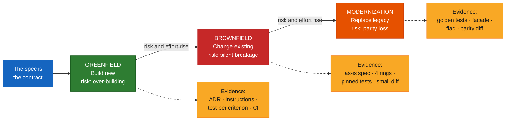

---

## Architecture

### 1. Three terrains, one loop

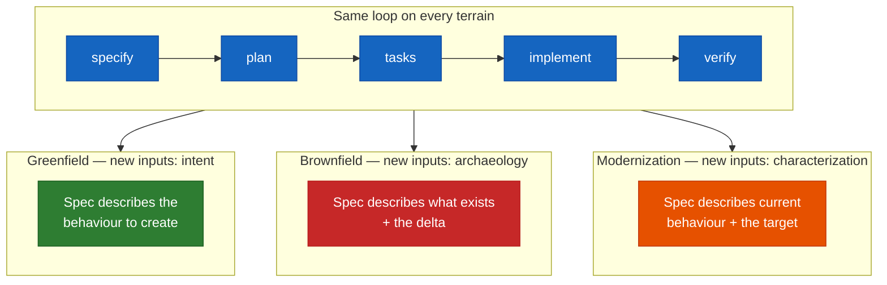

### 2. Greenfield: eight stages, eight human gates *(s.5)*

Every stage produces an artifact and has a gate: **AI accelerates, engineers decide.**

```mermaid
graph LR
    S1["1 Spec<br/>spec.md"]:::blue
    S2["2 Architecture<br/>plan.md · ADRs"]:::blue
    S3["3 Conventions<br/>instructions"]:::blue
    S4["4 Implement<br/>code per task"]:::orange
    S5["5 Test<br/>unit + integration"]:::orange
    S6["6 CI/CD<br/>pipeline"]:::orange
    S7["7 Pull request<br/>spec-linked PR"]:::green
    S8["8 Release<br/>readiness list"]:::green

    S1 -->|"Intent right?"| S2
    S2 -->|"Fits constraints?"| S3
    S3 -->|"Rules explicit?"| S4
    S4 -->|"Matches tasks?"| S5
    S5 -->|"Criteria covered?"| S6
    S6 -->|"Green and gated?"| S7
    S7 -->|"Reviewed vs spec?"| S8
    S8 -->|"Spec fully met?"| DONE(("Ship")):::green

    classDef blue fill:#1565c0,stroke:#0d47a1,color:#fff
    classDef orange fill:#e65100,stroke:#bf360c,color:#fff
    classDef green fill:#2e7d32,stroke:#1b5e20,color:#fff
```

Groups: **Foundations** (1–3, "Module 04 + today") · **Build and prove** (4–6) · **Ship** (7–8).

> **Key idea (s.5):** the same spec drives every stage — the plan, the tests, the PR checklist and the release sign-off all point back to it. That is what "complete SDLC" means in SDD.

### 3. One question at five gates: "does this still match the spec?" *(s.7)*

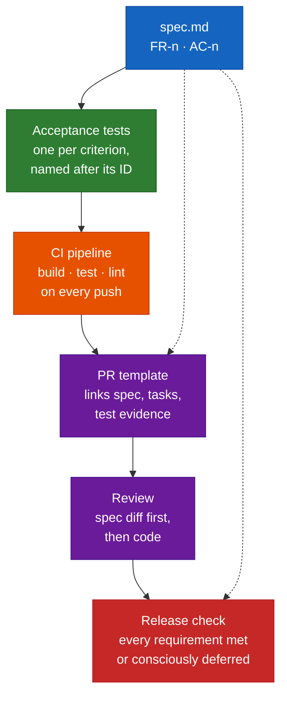

### 4. Lab 1 interaction: implement, push, let the pipeline teach *(s.8)* — **[Beyond the deck]** sequence

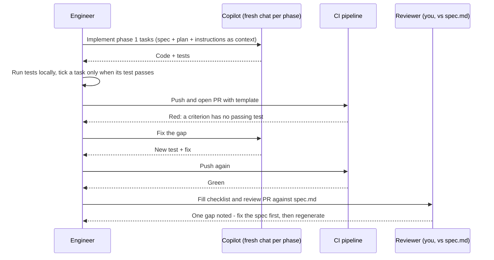

### 5. Brownfield step 1 — repository archaeology: five digs *(s.9)*

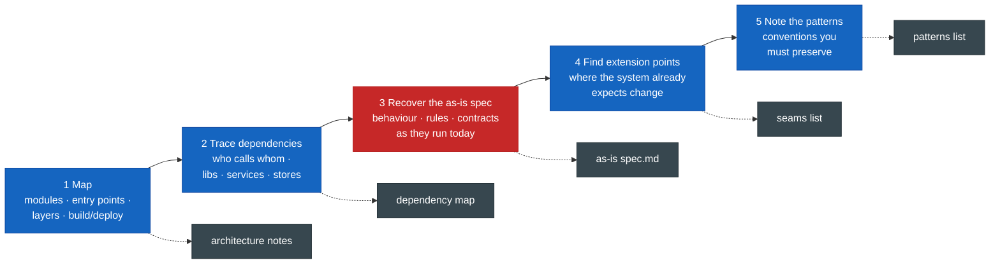

### 6. Brownfield step 2 — blast radius in four rings *(s.10)*

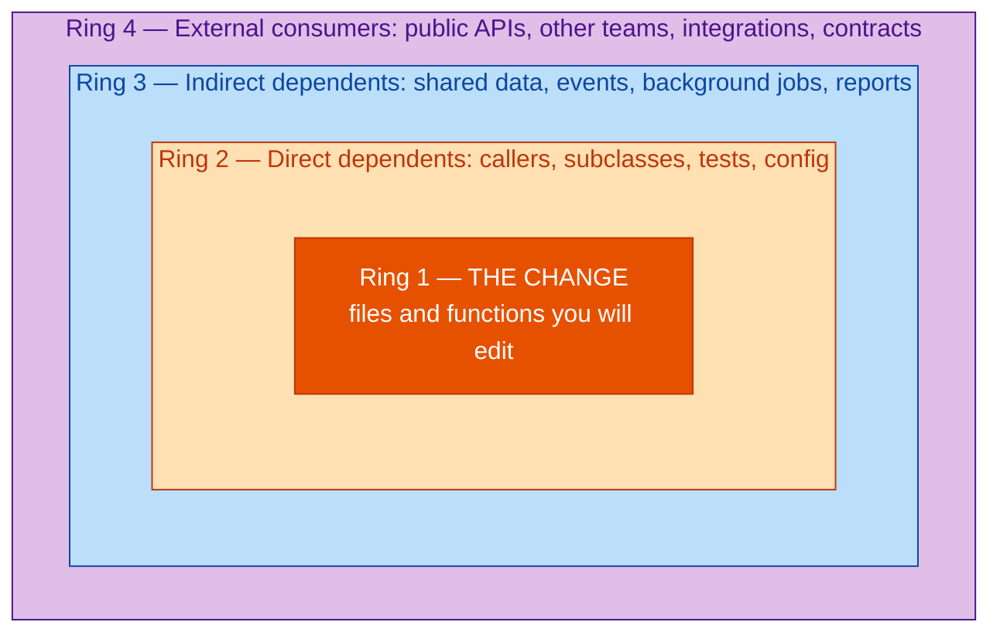

> **Best practice (s.10):** turn each ring into a checklist line with a guard (test, flag or review). **Rings 3–4 are where AI-assisted changes usually break things silently.**

### 7. Brownfield step 3 — minimal change, maximum protection *(s.11)*

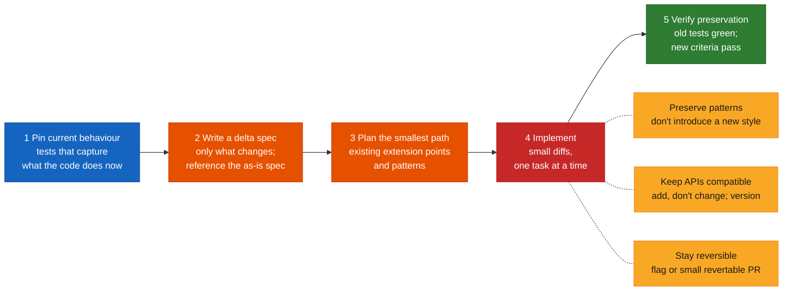

### 8. Modernization spectrum of ambition *(s.13)*

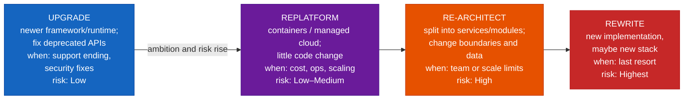

### 9. Strangler Fig: a facade routes each request to legacy or new *(s.14)*

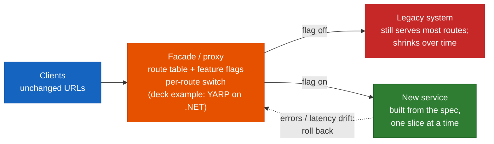

Example rollout of **one slice** *(s.14)* — compare errors and latency against baseline at each step; roll back if they drift. The percentages are the deck's illustrative example:

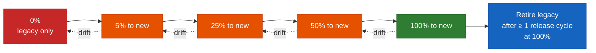

### 10. SDD for modernization + the Copilot modernization agent *(s.15)*

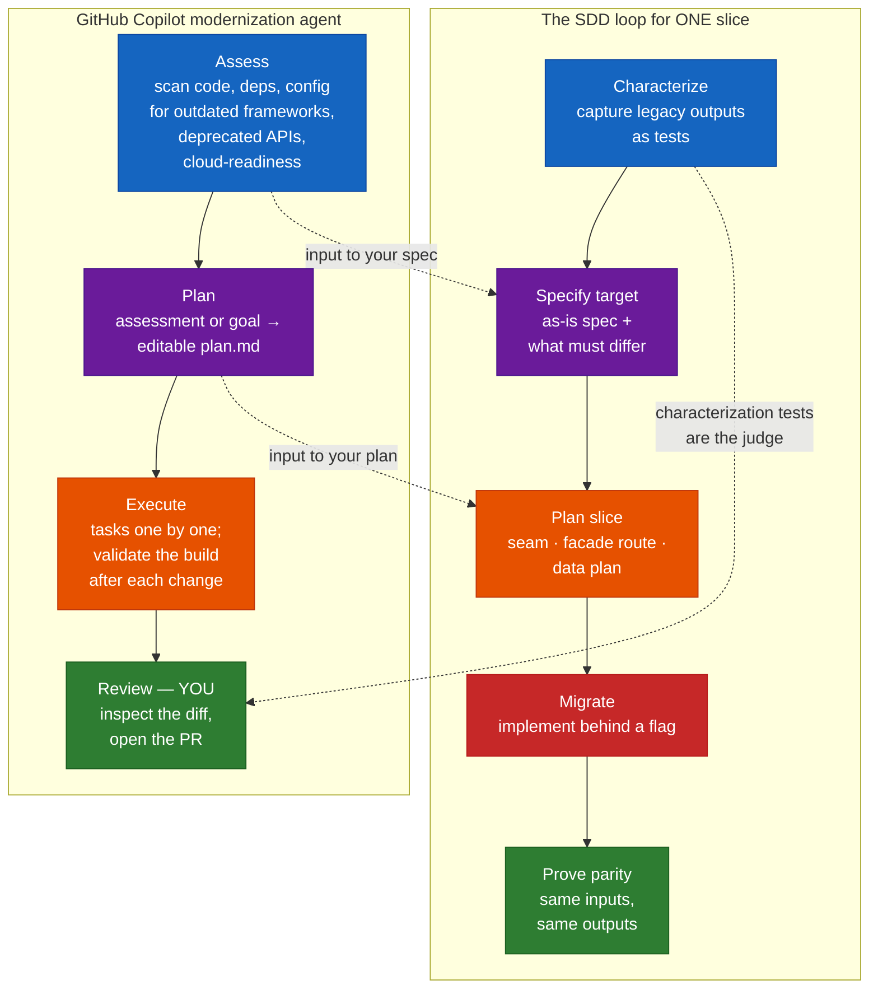

### 11. Facilitator demo: one slice, legacy to modern *(s.16)*

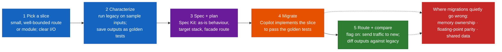

### 12. Which terrain am I on? — **[Beyond the deck]** synthesis

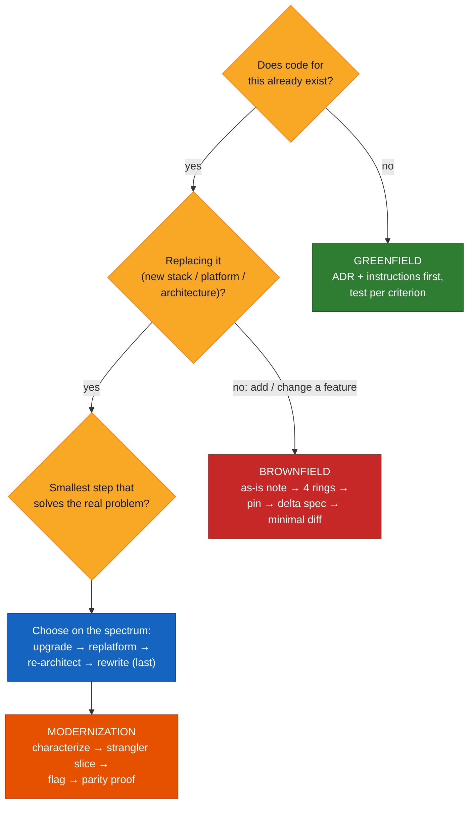

---

## Core Concepts

### Part A — Greenfield: the pipeline from spec to release

#### Concept card A1 · Architecture and conventions as context *(s.6)*

**Definition.** Decide the shape once; let every later prompt inherit it. This is Module 03's **LAYER** move applied to a new project.

| Artifact | Says | Lives in |
|---|---|---|
| **Spec** | *what* — outcome and acceptance criteria | `specs/001-…/spec.md` |
| **ADR** (Architecture Decision Record) | *how* — structure and the reasons for it | `docs/adr/001-layering.md` (also feeds `plan.md`) |
| **Instructions** | *always* — rules every prompt inherits | `.github/copilot-instructions.md` |

**The deck's ADR (illustrative):**

```markdown
## Decision
Controllers → Services → Repositories.
No controller touches the database.
## Why
Keeps business rules testable without HTTP.
## Consequences
Every feature adds one service + its tests.
```

**The deck's instruction file (illustrative):**

```markdown
## Build & test
dotnet build · dotnet test (must pass)
## Code style
Result<T> for expected failures; no exceptions
## Always
Cite the task ID in commit messages
Add a test for every acceptance criterion
```

**Analogy.** The spec is the *order*, the ADR is the *floor plan*, the instruction file is the *site rulebook* every contractor reads on day one.

> **Best practice (s.6):** write the first ADR and the instruction file **before the first feature.** "Retrofitting conventions after 30 AI-generated files is brownfield work you created yourself."

**[Beyond the deck] — optional extra ADR lines.** Real ADRs usually also carry a *Status* (proposed / accepted / superseded) and a date, so a later ADR can supersede an earlier one explicitly. The [ADR community site](https://adr.github.io/) collects templates; the deck's three-heading form is a fine minimum for the lab.

#### Concept card A2 · Quality gates: Spec → Tests → CI → PR → Release *(s.7)*

| Gate | What it enforces |
|---|---|
| **Acceptance tests** | One test per criterion, **named after its ID** |
| **CI pipeline** | Build, test, lint on every push |
| **PR template** | Links spec, tasks and test evidence |
| **Review** | Reviewer reads the **spec diff first**, then code |
| **Release check** | Every requirement met **or consciously deferred** |

**The deck's CI fragment (illustrative):**

```yaml
on: [pull_request]
jobs:
  verify:
    steps:
      - run: dotnet build --no-restore
      - run: dotnet test  # fails the PR if red
```

**The deck's PR template (illustrative):**

```markdown
- [ ] Spec: specs/001-…/spec.md (changed? Y/N)
- [ ] Tasks done: T001-T008
- [ ] Each AC has a passing test (list IDs)
- [ ] Constitution check: no principle broken
- [ ] AI-generated code reviewed line by line
```

> **Best practice (s.7):** make the pipeline *refuse* what the spec forbids. "A red CI run on a missing acceptance test teaches more than a style guide."

**[Beyond the deck] — a workflow you can run as-is.** The deck's fragment omits `runs-on`, checkout and SDK setup, so it will not run on its own. A complete version (adjust the SDK version and pin actions to your organisation's standard; see GitHub's [Building and testing .NET](https://docs.github.com/en/actions/tutorials/build-and-test-code/net) page):

```yaml
name: verify
on: [pull_request]
jobs:
  verify:
    runs-on: ubuntu-latest
    steps:
      - uses: actions/checkout@v4
      - uses: actions/setup-dotnet@v4
        with:
          dotnet-version: 8.0.x
      - run: dotnet restore
      - run: dotnet build --no-restore
      - run: dotnet test --no-build   # fails the PR if red
```

GitHub picks up a PR template from `.github/pull_request_template.md` — see [Creating a pull request template](https://docs.github.com/en/communities/using-templates-to-encourage-useful-issues-and-pull-requests/creating-a-pull-request-template-for-your-repository). (The deck's slide label spells it `pull_request_template.md`, which matches.)

**[Beyond the deck] — extending the PR template for the other two terrains** (use only the lines that apply):

```markdown
### Brownfield (change to existing code)
- [ ] notes/as-is.md updated or confirmed still accurate
- [ ] change-impact.md: every ring has a guard (test / flag / review)
- [ ] Pinned (characterization) tests were green BEFORE the change
- [ ] Diff touches only files listed in the change plan
- [ ] Public APIs unchanged (or versioned)

### Modernization (slice migration)
- [ ] Golden / characterization tests captured from legacy
- [ ] Parity evidence attached (same inputs → same outputs, tolerances stated)
- [ ] Behind a flag; rollback = flag off
- [ ] Data ownership for this slice decided (who writes which tables)
```

#### Concept card A3 · Lab 1 — Greenfield: Spec to a Checked PR *(s.8, 40 min)*

**Goal.** Deliver the Module 04 feature as a pull request where **every requirement traces to a task, a test and a passing pipeline.**

| Step | Do |
|---|---|
| 1 | Add the foundations: a one-page ADR and `.github/copilot-instructions.md` with build/test commands and two rules |
| 2 | Run `/speckit.implement` **phase by phase** (fresh chat per phase). Tick a task **only when its test passes** |
| 3 | Add the CI workflow and the PR template. Push; fix anything the pipeline catches |
| 4 | Open the PR, fill the checklist, **review it yourself against `spec.md`.** Note one gap and **fix the spec first** |

Files you create (deck's tree, under `lab05a/`):

```
lab05a/
  docs/adr/001-*.md
  .github/copilot-instructions.md
  .github/workflows/ci.yml
  .github/pull_request_template.md
  specs/001-*/            (from Module 04)
```

**Done when:** the PR shows a green pipeline and a checklist where each acceptance criterion maps to a named, passing test.

**Practical notes — [Beyond the deck]**
- "Fresh chat per phase" is the Module 03 **SCOPE** move: each phase starts with the spec, plan and instructions loaded from files, not from yesterday's conversation.
- If a command spelling in step 2 does not match what your Copilot chat offers, see the currency check above.
- "Fix the spec first" means: edit `spec.md` (add the missing criterion or clarify it), *then* regenerate or add the test and code — never patch code to match a spec you silently changed in your head.

---

### Part B — Brownfield: archaeology, impact, minimal change

#### Concept card B1 · Repository archaeology *(s.9)*

**Definition.** Before you can write a change spec, recover what the system already does. Five digs:

| # | Dig | Looks for | Output |
|---|---|---|---|
| 1 | **Map** | Modules, entry points, layers, build and deploy | architecture notes |
| 2 | **Trace dependencies** | Who calls whom; libraries, services, data stores | dependency map |
| 3 | **Recover the as-is spec** | Behaviour, rules and contracts as they run today | `as-is spec.md` |
| 4 | **Find extension points** | Where the system already expects change | seams list |
| 5 | **Note the patterns** | Conventions you must preserve | patterns list |

**Two warnings from the deck (s.9):**
- *Ask Copilot to explore* — in a **subagent or fresh chat** — and return **a summary with file references.** Then verify it by reading the code yourself.
- "AI summaries of legacy code can sound certain and be wrong. **Treat the as-is spec as a hypothesis until a test confirms it.**"

> **Best practice (s.9):** keep exploration output small and file-backed (Module 03: SCOPE and COMPRESS). "A 1-page as-is spec beats a 40-page chat transcript."

**[Beyond the deck] — a reconciliation with Spec Kit's own brownfield advice.** The Spec Kit [existing-projects guide](https://github.github.io/spec-kit/guides/existing-projects.html) recommends adopting in place (`specify init --here --force --integration <key>` from the repo root, after committing or stashing and branching so you can review the diff), writing the constitution from principles that are *already true* ("Do not invent standards merely to fill the constitution template"), and using **one spec per bounded change**. It explicitly does not ask you to document the whole system first. The two views fit together if you read the deck's as-is spec as **"just enough to change this slice safely"**:

| Deck's as-is note | Spec Kit's `spec.md` for the change |
|---|---|
| Describes how the *touched area* behaves today (layers, entry points, rules) | Describes the *intended change* and its compatibility boundaries |
| A hypothesis, confirmed by pinned tests | A contract for the delta |
| Lives in `notes/` | Lives in `specs/002-delta/` |

**[Beyond the deck] — skeleton for a 1-page as-is note** (`lab05b/notes/as-is.md`):

```markdown
# As-is: <area you will touch>
Status: HYPOTHESIS — confirmed by: <test names, or "not yet">

## Layers & entry points
- <layer> — <file/folder> — <one-line role>

## Behaviour today (rules, contracts)
- <rule> — evidence: <file:line or test>

## Dependencies (in / out)
- calls: <…>    called by: <…>    data: <tables / queues>

## Patterns to preserve
- <naming, layering, error handling, logging>

## Extension points (seams)
- <where the system already expects change>

## Unknowns
- <things I could not confirm>
```

**[Beyond the deck] — an exploration prompt** (run in a fresh chat or subagent; keep the output in a file):

```text
Explore only the Orders area of this repo. Return a summary of at most one page with
file:line references for every claim: layers and entry points, who calls
OrderService, what data stores it touches, the error-handling and naming patterns,
and where new behaviour would normally be added. Mark anything you could not verify
as "unverified". Do not suggest changes and do not edit files.
```

#### Concept card B2 · Sizing the blast radius *(s.10)*

**Definition.** Change-impact analysis asks *what else could this change touch?* Work outward in rings.

| Ring | Name | Examples |
|---|---|---|
| 1 | **The change** | Files and functions you will edit |
| 2 | **Direct dependents** | Callers, subclasses, tests, config that use them |
| 3 | **Indirect dependents** | Shared data, events, background jobs, reports |
| 4 | **External consumers** | Public APIs, other teams, integrations, contracts |

**The deck's `change-impact.md` (illustrative):**

```text
Change: add refund to OrderService
Direct:  OrderController, 14 tests
Indirect: nightly revenue report
External: Billing API v1 (frozen)
Risk: report double-counts refunds
Guard: add report regression test
```

**Tooling note (s.10):** dependency-analysis tools, IDE "find usages", and Copilot's codebase search **each find different edges** — use more than one, and record what you checked.

> **Best practice (s.10):** turn each ring into a checklist line with a guard (test, flag or review). Rings 3–4 are where AI-assisted changes usually break things silently.

**[Beyond the deck] — a fuller `change-impact.md` template** with the "what I checked" line the deck asks for:

```markdown
# Change impact: <change in one line>

| Ring | What is affected | How I found it | Risk | Guard |
|---|---|---|---|---|
| 1 Change | <files / functions> | change plan | — | planned-files list |
| 2 Direct | <callers, tests, config> | IDE find-usages; Copilot search | <…> | pinned tests |
| 3 Indirect | <jobs, reports, events, shared tables> | grep for table/queue names; ask owners | <…> | regression test / flag |
| 4 External | <public APIs, other teams, contracts> | API docs; consumer list | <…> | no change to contract / version |

Checked with: [ ] IDE find-usages  [ ] dependency tool  [ ] Copilot codebase search  [ ] asked a human owner
```

#### Concept card B3 · Minimal change, maximum protection *(s.11)*

**Definition.** *Prove today's behaviour first, change the least you can, then prove nothing else moved.*

| Step | Action |
|---|---|
| 1. **Pin current behaviour** | Write tests that capture what the code does now |
| 2. **Write a delta spec** | Only what changes; reference the as-is spec |
| 3. **Plan the smallest path** | Use existing extension points and patterns |
| 4. **Implement** | Small diffs, one task at a time |
| 5. **Verify preservation** | Old tests still green; new criteria pass |

**Three guard-rails (s.11):**

| Guard-rail | Meaning |
|---|---|
| **Preserve patterns** | Follow the existing layering and naming — don't introduce a new style in passing |
| **Keep APIs compatible** | Add, don't change; version anything a consumer might depend on |
| **Stay reversible** | Behind a flag, or in a small PR you can revert cleanly |

> **Best practice (s.11):** tell Copilot the constraint explicitly — *"change only X; do not refactor; keep public signatures."* "Left alone, models love to tidy code you did not ask them to touch."

**[Beyond the deck] — a constrained implementation prompt:**

```text
Implement task T003 from specs/002-delta/tasks.md.
Change only: src/Orders/OrderService.cs and tests/Orders/RefundTests.cs.
Do not refactor, rename, reformat or reorder anything else.
Keep all public signatures unchanged. Follow the existing layering
(Controllers → Services → Repositories). If you believe another file must
change, stop and tell me why instead of editing it.
```

**[Beyond the deck] — a skeleton for a delta spec** (`specs/002-delta/spec.md`):

```markdown
# Delta spec: <feature>
Builds on: notes/as-is.md (hypothesis confirmed by tests: <names>)

## Change (only what differs)
- FR-1: <new or changed behaviour>
- AC-1: <observable criterion>

## Unchanged (explicit)
- <behaviour that must stay exactly as today — each backed by a pinned test>

## Compatibility
- Public APIs: <unchanged | added v2 endpoint …>
- Data: <no schema change | additive column …>

## Out of scope
- <things the model might be tempted to tidy>

## Rollback
- <flag name | revert the single PR>
```

#### Concept card B4 · Lab 2 — Brownfield: Add a Feature Safely *(s.12, 45 min)*

**Goal.** Add **one feature** to an existing application with a change plan, a delta spec, and **evidence that existing behaviour is unchanged.**

| Step | Do |
|---|---|
| 1 | Explore the app (fresh chat or subagent): write a **1-page as-is note** — layers, entry points, dependencies, patterns to preserve |
| 2 | Fill `change-impact.md` using the four rings. Mark **every external consumer** and the guard you will add for each |
| 3 | Write a short delta spec and plan; **pin current behaviour** with tests for the code you will touch |
| 4 | Implement with **"change only X"** instructions. Run all tests, **check the diff touches only planned files**, open the PR |

Files you create (deck's tree, under `lab05b/`):

```
lab05b/
  notes/as-is.md
  change-impact.md
  specs/002-delta/spec.md
  tests/   (pinned + new)
```

**Done when:** all pre-existing tests pass, the new criteria pass, and the diff contains **no files outside your change plan.**

**[Beyond the deck] — a one-line check for "no files outside the plan".** Keep the planned files in `planned-files.txt` (one path per line). This prints any changed file that is *not* planned — empty output means clean (bash/zsh; replace `origin/main` with your base branch):

```bash
comm -13 <(sort planned-files.txt) <(git diff --name-only origin/main...HEAD | sort)
```

---

### Part C — Modernization: the spectrum, Strangler Fig, characterization

#### Concept card C1 · A spectrum of ambition *(s.13)*

**Definition.** More change means more value and more risk. **Pick the smallest step that solves the real problem.**

| Option | What it is | When | Risk |
|---|---|---|---|
| **Upgrade** | Newer framework or runtime version; fix deprecated APIs | Support ending, security fixes | Low |
| **Replatform** | Containers or managed cloud services; little code change | Cost, ops, scaling | Low–Medium |
| **Re-architect** | Split into services or modules; change boundaries and data | Team or scale limits | High |
| **Rewrite** | New implementation, possibly new language or stack | **Last resort** | Highest |

> **Reality check (s.13):** "no general-purpose, GA tool translates one language to another reliably (for example C++ to .NET). AI accelerates each slice; **humans own the design and the parity proof.**"

Martin Fowler's note on the Strangler Fig pattern (see [References](#references)) is blunt about the same danger: be wary of simple rewrites — "we've seen this simple-sounding plan go down in flames most of the time."

#### Concept card C2 · The Strangler Fig *(s.14)*

**Definition.** A **facade** routes each request to legacy or new. Traffic shifts gradually; **legacy retires last.**

- **Clients** keep **unchanged URLs.**
- **Facade / proxy** holds a *route table + feature flags*; a **per-route switch** chooses the target. The deck's example is **YARP on .NET** ([YARP documentation](https://microsoft.github.io/reverse-proxy/)).
- **Legacy system** still serves most routes and shrinks over time.
- **New service** is built from the spec, one slice at a time.

Example rollout of one slice (deck figures, illustrative): **5% → 25% → 50% → 100% to new.** Check errors and latency against baseline at each step; **roll back if they drift.**

> **Best practice (s.14):** retire legacy code **only after the new path has run at 100% for at least one release cycle.** Until then, the legacy route is your rollback.

**Analogy.** Fowler's own metaphor is the strangler fig vine: it grows in a host tree, becomes self-sustaining, and the host eventually goes. Here the vine is the new service and the tree is the legacy system.

**[Beyond the deck] — what the facade's route table tracks per slice** (plain illustration, *not* YARP syntax — consult the YARP docs for real configuration):

| Route | Target now | Flag | Traffic to new | Rollback |
|---|---|---|---|---|
| `GET /api/quotes/{id}` | new | `quotes-new` | 100% (one release cycle done) | flag off → legacy |
| `POST /api/refunds` | legacy | `refunds-new` | 0% | n/a |
| `GET /api/reports/*` | legacy | — | 0% | n/a |

**[Beyond the deck] — related patterns.** The Azure Architecture Center describes the [Strangler Fig pattern](https://learn.microsoft.com/en-us/azure/architecture/patterns/strangler-fig) and the [Anti-Corruption Layer pattern](https://learn.microsoft.com/en-us/azure/architecture/patterns/anti-corruption-layer) (a translation boundary so legacy models don't leak into the new design). Fowler's [Branch By Abstraction](https://martinfowler.com/bliki/BranchByAbstraction.html) and [Feature Toggles](https://martinfowler.com/articles/feature-toggles.html) cover the "implement behind a seam / behind a flag" mechanics. The deck does not mention these; they are pointers, not course content.

#### Concept card C3 · SDD for modernization: characterize, specify, migrate, prove *(s.15)*

**Definition.** *The legacy system's behaviour becomes the acceptance test for its replacement.*

| Stage | What happens |
|---|---|
| **Characterize** | Capture legacy outputs as tests |
| **Specify target** | As-is spec + what must differ |
| **Plan slice** | Seam, facade route, data plan |
| **Migrate** | Implement behind a flag |
| **Prove parity** | Same inputs, same outputs |

**Characterization tests** record what the code *does*, not what it *should* do — the term comes from Michael Feathers' book *Working Effectively with Legacy Code*. They pin the behaviour first; whether that behaviour is *right* is a separate question the spec answers.

**[Beyond the deck] — a golden-master characterization test, as a sketch.** The types (`LegacyQuoteClient`, `NewQuoteService`, `QuoteRequest`) are assumed for illustration; replace them with your own. The idea: record legacy output once, then assert the new code matches it, with tolerances **you chose on purpose**:

```csharp
using System.Text.Json;
using Xunit;

public class QuoteParityTests
{
    // Inputs captured from real or representative legacy runs (one JSON file per case).
    public static IEnumerable<object[]> GoldenCases() =>
        Directory.GetFiles("golden", "*.json")
                 .Select(path => new object[] { path });

    [Theory]
    [MemberData(nameof(GoldenCases))]
    public void New_matches_legacy_for_recorded_input(string path)
    {
        var golden = JsonSerializer.Deserialize<GoldenCase>(File.ReadAllText(path))!;

        var actual = new NewQuoteService().Quote(golden.Request);

        Assert.Equal(golden.Expected.Currency, actual.Currency);
        // Floating-point parity: compare with a tolerance chosen on purpose, not exact equality.
        Assert.Equal(golden.Expected.Total, actual.Total, precision: 2);
    }
}

public record GoldenCase(QuoteRequest Request, QuoteResult Expected);
```

(`Assert.Equal(double, double, int precision)` compares to the given number of decimal places; use a `decimal` overload or a custom tolerance if your domain needs it.)

**The GitHub Copilot modernization agent (s.15) — Assess → Plan → Execute → Review:**

| Stage | Per the deck |
|---|---|
| **Assess** | Scans code, dependencies and config for outdated frameworks, deprecated APIs and cloud-readiness issues; writes a report to `.github/modernize/assessment/` |
| **Plan** | Turns the assessment (or your goal, e.g. "upgrade to Spring Boot 3") into an editable `plan.md` |
| **Execute** | Applies tasks one by one, validating the build after each change and committing |
| **Review** | **You** inspect the diff and open a PR — the agent does not replace review |

Per the Microsoft Learn pages: the modernization agent is delivered through the **Modernize CLI**, follows an **Assess → Plan → Execute** model, produces plans that you can **review, refine and approve before execution**, and creates branches and commits "with traceable change history"; the IDE experience covers upgrades and migrations for .NET, Java and C++. Humans remain in the loop — "every change reviewable, and every step validated". See the [currency check](#-currency-check-as-of-2026-10-15) for the one deck detail I could not confirm (the report path).

> **Best practice (s.15):** use the agent's assessment and plan **as inputs to your own spec — edit them.** "Its output may not always be accurate; **keep your characterization tests as the judge.**"

#### Concept card C4 · Demo — one slice, legacy to modern *(s.16)*

Facilitator-led; **watch the evidence at each step, not just the final working code.**

| Step | What happens | Evidence produced |
|---|---|---|
| 1. **Pick a slice** | Small, well-bounded route or module with clear inputs and outputs | The slice boundary |
| 2. **Characterize** | Run legacy with sample inputs; save outputs as **golden tests** | Recorded legacy behaviour |
| 3. **Spec + plan** | Spec Kit: as-is behaviour, target stack, facade route | Spec and plan |
| 4. **Migrate** | Copilot implements the slice to pass the golden tests | Passing golden tests |
| 5. **Route + compare** | Flag on: send traffic to new; **diff outputs against legacy** | Parity diff |

**Where migrations quietly go wrong (s.16):**

| Hazard | What to do |
|---|---|
| **Memory ownership** | Manual allocation and lifetimes have no direct equivalent in managed runtimes — **design, don't translate** |
| **Floating-point parity** | Compilers and runtimes can round differently — compare with **tolerances you chose on purpose** |
| **Shared data** | Both systems may write the same tables during the transition — **decide who owns what** |

**Discuss (s.16):** which step produced the evidence you would show a sceptical reviewer? *(Hint from the deck: step 2 and step 5 — the first and last.)*

**[Beyond the deck] — a parity-report skeleton** you could attach to the PR for a slice:

```markdown
# Parity report: <slice> — legacy vs new
Inputs compared: <n> recorded cases + <m> live-shadow requests
Tolerances: <field → tolerance and why>
Differences found: <list, each classified: bug in new | intended change | legacy bug kept | legacy bug fixed>
Error rate (new vs baseline) at <5% / 25% / 50% / 100%>: <numbers>
Latency p95 (new vs baseline): <numbers>
Data ownership during transition: <table → writer>
Decision: proceed | hold | roll back
```

---

### Part D — Best practices across the three terrains *(s.17)*

| Greenfield | Brownfield | Modernization |
|---|---|---|
| ADR and instruction file **before** the first feature | Recover the as-is spec; **treat it as a hypothesis** | **Characterization tests before any change** |
| **One test per acceptance criterion** | Size the blast radius in **four rings** | Strangler Fig: **slice, flag, shift, retire last** |
| Pipeline and PR template **enforce** the spec | Pin behaviour, change minimally, **keep APIs compatible** | **Parity proof per slice**; avoid big-bang |

**All terrains (the shared habits at the bottom):**

| Habit | In practice |
|---|---|
| **Spec first, code second** | No implementation without a spec or delta spec you can point at |
| **Human gate at every stage** | The eight greenfield gates; ring guards in brownfield; review step in the modernization agent |
| **Small, reversible steps** | One task at a time; small PRs; flags |
| **Evidence over assertion** | Tests, diffs, parity reports — not "Copilot said it works" |
| **Fix the spec, then regenerate** | When review finds a gap, change the spec first |

> **Calibrate (s.17):** match ceremony to risk. A typo fix needs none of this; a payment-flow change needs all of it.

**[Beyond the deck] — a rough ceremony ladder** (my suggestion, not the deck's):

| Change | Minimum ceremony |
|---|---|
| Typo, copy change | Normal PR review |
| Small bug fix in well-tested code | Failing test first, minimal diff, normal review |
| New feature in existing code | Delta spec + change-impact + pinned tests |
| Payment / security / data-migration change | Everything above + flag + parity or shadow evidence + named approver |

---

### Part E — Progressive path: simple → advanced

| Level | You can… | Practise with |
|---|---|---|
| 1 — Foundations | Write an ADR and instruction file; name tests after criteria | Lab 1 steps 1–2 |
| 2 — Gates | Make CI and the PR template refuse spec violations | Lab 1 steps 3–4 |
| 3 — Archaeology | Produce a hypothesis-grade as-is note with file references | Lab 2 step 1 |
| 4 — Impact | Fill four rings with a guard for each | Lab 2 step 2 |
| 5 — Protected change | Pin → delta spec → minimal diff → prove preservation | Lab 2 steps 3–4 |
| 6 — Modernization slice | Characterize → specify → migrate behind a flag → prove parity | Demo (s.16), then your own slice |

---

## Outcomes — "What you can do now" *(s.18)*

- [ ] A greenfield feature is taken from spec to a **spec-checked PR** through architecture, tests and CI.
- [ ] An existing codebase is explored and its **implicit spec recovered**.
- [ ] Change impact is sized in **rings, with a guard for each**.
- [ ] A brownfield change is made **minimally**, with existing behaviour **proven preserved**.
- [ ] Modernization options are chosen **on the spectrum, not defaulted to rewrite**.
- [ ] A slice is migrated **Strangler-Fig style** with **characterization tests as the judge**.

**Next — Module 06: Test Strategy & Validation (1.5 h).** Derive a full test strategy from the SDD feature: spec-to-test traceability, mocks and stubs, negative scenarios, and a deliberate defect to prove the tests catch it.

---

## Glossary

| Term | Meaning |
|---|---|
| **Greenfield / Brownfield / Modernization** | Build new / change existing / replace legacy |
| **ADR** | Architecture Decision Record: a short note of a decision, why, and its consequences |
| **Instructions file** | `.github/copilot-instructions.md` — rules every Copilot prompt in the repo inherits |
| **As-is spec** | A written description of current behaviour; a *hypothesis* until tests confirm it |
| **Delta spec** | A spec of only what changes, referencing the as-is spec |
| **Blast radius** | Everything a change could affect, sized in four rings |
| **Pinning tests** | Tests that capture current behaviour before you change it |
| **Characterization / golden-master test** | A test that records what code *does* today and asserts it stays (or is matched by the replacement) |
| **Seam** | A place where behaviour can be altered or replaced without editing surrounding code |
| **Facade / proxy** | The routing layer in front of legacy and new in a Strangler Fig migration |
| **Strangler Fig** | Replace a system one slice at a time behind a facade; retire legacy last |
| **Parity proof** | Evidence that new behaviour equals legacy for the same inputs (within stated tolerances) |
| **Big-bang** | Replacing everything at once, with no incremental fallback |
| **Modernization agent** | GitHub Copilot's Assess → Plan → Execute modernization workflow (Modernize CLI); review is yours |

---

## References

All links below were fetched on 2026-10-15 and returned 200 with a page matching the description.

### Course sources
- `presentations/Module05_SDD_Greenfield_Brownfield_Modernization.pdf` — the deck this guide follows.
- [Module 03 guide](./module-03-prompt-engineering-context-engineering.md) · [Module 04 guide](./module-04-spec-driven-development-github-spec-kit.md) — LAYER/SCOPE/COMPRESS and the Spec Kit artifacts used here.

### Spec-driven development
- [github/spec-kit](https://github.com/github/spec-kit) — the toolkit; check the README for current install and command spellings.
- [Adopting Spec Kit in an Existing Project](https://github.github.io/spec-kit/guides/existing-projects.html) — Spec Kit's own brownfield guidance (adopt in place, spec per bounded change).

### GitHub Copilot, Actions and templates
- [Adding repository custom instructions for GitHub Copilot](https://docs.github.com/en/copilot/how-tos/copilot-on-github/customize-copilot/add-custom-instructions/add-repository-instructions) — `.github/copilot-instructions.md`.
- [Building and testing .NET](https://docs.github.com/en/actions/tutorials/build-and-test-code/net) — GitHub Actions workflow for the .NET build/test gate.
- [Creating a pull request template for your repository](https://docs.github.com/en/communities/using-templates-to-encourage-useful-issues-and-pull-requests/creating-a-pull-request-template-for-your-repository) — the spec-linked PR template.

### Modernization
- [GitHub Copilot modernization — overview (Microsoft Learn)](https://learn.microsoft.com/en-us/azure/developer/github-copilot-app-modernization/overview) — scope (Java, .NET, C++), availability, human-in-the-loop.
- [GitHub Copilot modernization agent overview (Microsoft Learn)](https://learn.microsoft.com/en-us/azure/developer/github-copilot-app-modernization/modernization-agent/overview) — the Assess → Plan → Execute model and the Modernize CLI.
- [Strangler Fig Application — Martin Fowler](https://martinfowler.com/bliki/StranglerFigApplication.html) — origin of the pattern and advice on incremental replacement.
- [Strangler Fig pattern — Azure Architecture Center](https://learn.microsoft.com/en-us/azure/architecture/patterns/strangler-fig) — facade-based incremental migration.
- [Anti-Corruption Layer pattern — Azure Architecture Center](https://learn.microsoft.com/en-us/azure/architecture/patterns/anti-corruption-layer) — keeping legacy models out of the new design.
- [YARP documentation](https://microsoft.github.io/reverse-proxy/) — the .NET reverse proxy named in the deck's facade example.

### Practices
- [Architectural Decision Records (ADRs)](https://adr.github.io/) — ADR background and templates.
- [Branch By Abstraction — Martin Fowler](https://martinfowler.com/bliki/BranchByAbstraction.html) — changing behind a seam.
- [Feature Toggles (aka Feature Flags) — Martin Fowler](https://martinfowler.com/articles/feature-toggles.html) — flags for gradual rollout and rollback.

### Not verified
- The deck's `.github/modernize/assessment/` report path and the "upgrade to Spring Boot 3" example goal were not confirmed against the Microsoft pages I read.
- The deck's claim that no general-purpose GA tool translates C++ to .NET reliably is the deck's; I did not research it independently.
- Deck figures (14 tests, 5/25/50/100% rollout, task and test names) are illustrative and kept as such.
