# Test Strategy & Validation — Comprehensive Guide

> **Module 06 · Day 3 · 1.5 hours · Concepts + defect-injection lab · Primary tools: GitHub Copilot + your test framework**
> Source: `presentations/Module06_Test_Strategy_Validation.pdf` (18 slides). Slide numbers below are written *(s.N)*.
> Material that is not in the deck is marked **[Beyond the deck]**. Deck snippets labelled "illustrative" stay illustrative.

---

## Overview

> *"AI can write code and tests faster than you can read them. This module builds the testing stack that proves the code matches the spec — from unit tests and test doubles to integration, contract and regression checks."* *(s.1)*

The one idea: **tests come from the spec, and must fail before they pass.** If AI writes both the code and the tests from the same misunderstanding, everything passes and the bug ships *(s.4)*. So the acceptance criteria written in Modules 04–05 become the source of every test, and a deliberate planted defect proves the suite can actually catch something.

### Time budget *(s.2)*

| # | Block | Min | Slides |
|---|---|---|---|
| 1 | The Testing Stack & Spec Traceability | 15 | 4–7 |
| 2 | Unit Tests & Test Doubles | 15 | 8–9 |
| 3 | Integration, API & Database Validation | 15 | 10–11 |
| 4 | Negative, Contract & Regression | 15 | 12–13 (regression: s.5) |
| 5 | Suite Quality & Best Practices | 10 | 14–15 |
| 6 | **Lab: Inject a Defect, Prove It's Caught** | 20 | 16 |
| | **Total** | **90** | |

### Where this sits in the 12-module journey *(s.3)*

| Link | Connection |
|---|---|
| **M04–M05 → M06** | Acceptance criteria in the spec are the source of every test |
| **M05 → M06** | Characterization and regression tests protect brownfield change ([Module 05 guide](./module-05-sdd-greenfield-brownfield-modernization.md)) |
| **M06 → M08** | PR automation checks test evidence against the spec |
| **M06 → M11** | Defect-catch and rework data feed observability and ROI |

> **Why this matters (s.3):** "the faster AI writes code, the more your safety depends on tests you trust. This module is how you earn that trust."

### ⚠ Things to know before teaching it (checked 2026-10-15)

| # | Observation | What to do |
|---|---|---|
| 1 | **Slide 6 vs slide 8 overlap.** Slide 8's `Refund_Over_Total_Fails` is commented `// AC-1` but asserts the error code `REFUND_EXCEEDS_TOTAL`, which is **AC-4**'s wording; slide 6 then shows AC-4 as "NO TEST YET". | Good discussion point: either that test also covers AC-4, or the assertion belongs in a separate AC-4 test. The worked example below splits them. |
| 2 | **Slide 7's matrix has more than one "primary" mark** for some rows (AC-2: unit *and* API; AC-4: unit, API *and* contract) while the best practice says "one criterion, one primary layer". | Read it as: the *rule* is proven at the unit layer, the *external shape* at the API/contract layer — each layer proves a different aspect. Say so explicitly. |
| 3 | **Slide 8's C# is a fragment**, not compile-ready (`void` test method is not `public`; `svc` and `PaidOrder` undefined). xUnit only discovers `public` test methods. | The worked example in Part B3 is a complete, compiled version. |
| 4 | **GitHub's own "Writing tests with GitHub Copilot" tutorial** shows the `/tests` command generating tests for the file open in the editor. That is the "write tests for this file and stop there" pattern the deck warns against *(s.15)*. | Use `/tests` only *after* spec-derived tests exist, or attach `#file:spec.md` and the criteria so it works from the spec — see Part B1. |
| 5 | **Stryker.NET's getting-started page states it requires the .NET 10 runtime or newer.** | Check your lab machines' runtime before promising automated mutation runs; the manual defect injection in the lab needs nothing extra. |

I did not run Copilot, Stryker.NET or Testcontainers. The worked example in Part B3 *was* compiled and run (details there).

---

## Quick Start

1. **Tests from the spec, not the code.** Write acceptance criteria with IDs first; derive test cases from them; *see each test fail* before the code makes it pass.
2. **Know the stack:** unit (fastest, most) → integration → API & contract → acceptance/end-to-end (slowest, fewest). Regression is not a layer — it's the same layers re-run on every change.
3. **One criterion, one cheapest layer that can prove it.** Everything at every layer is a slow suite; nothing at any layer is a hole.
4. **Double only at the boundary** — network, clock, payments, email. Prefer fakes and state checks; mock everything and every refactor breaks your tests.
5. **Ask for the unhappy paths.** AI writes happy paths readily; request invalid input, boundaries, not-allowed, dependency-fails, repeat/overlap and wrong-state cases — and assert a clear error *and no side effects*.
6. **Prove the suite works:** plant one defect, find which test fails, fix, re-run. *A test that has never failed has never proved anything* *(s.4)*.
7. **Golden rule (s.15):** when a test fails, decide whether the **code or the spec** is wrong — never silently change the test to match whatever the code does.

---

## Visual Summary

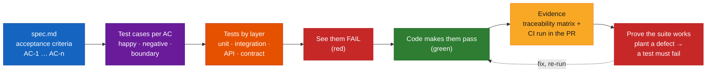

---

## Architecture

### 1. Why tests must come from the spec, not the code *(s.4)*

```mermaid
graph TB
    subgraph BAD["Tests derived from CODE — a false sense of safety"]
        direction LR
        B1["1 Code generated<br/>model fills a gap in the<br/>requirement with a guess"]:::red
        B2["2 Tests from the code<br/>assert whatever the<br/>code already does"]:::red
        B3["3 All green<br/>tests and code share the<br/>same wrong assumption"]:::red
        B4["4 Bug ships<br/>nobody checked it<br/>against the intent"]:::dark
        B1 --> B2 --> B3 --> B4
    end

    subgraph GOOD["Tests derived from the SPEC — an independent check"]
        direction LR
        G1["1 Acceptance criteria<br/>written and reviewed<br/>before any code"]:::green
        G2["2 Tests written first<br/>run them: they<br/>should fail (red)"]:::green
        G3["3 Code makes them pass<br/>green means the criteria<br/>are met"]:::green
        G4["4 Bug caught<br/>a wrong guess fails a test<br/>written from the intent"]:::blue
        G1 --> G2 --> G3 --> G4
    end

    classDef red fill:#c62828,stroke:#b71c1c,color:#fff
    classDef dark fill:#37474f,stroke:#263238,color:#fff
    classDef green fill:#2e7d32,stroke:#1b5e20,color:#fff
    classDef blue fill:#1565c0,stroke:#0d47a1,color:#fff
```

### 2. The testing stack: many fast tests, few slow ones *(s.5)*

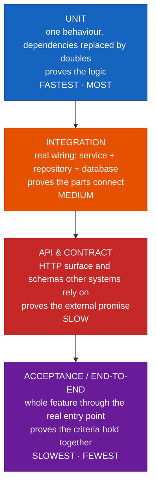

> **Regression is not a layer (s.5):** "it is the same layers re-run on every change. A regression suite is simply the tests you refuse to delete — Module 05's pinned behaviour."

### 3. Spec-to-test traceability *(s.6)*

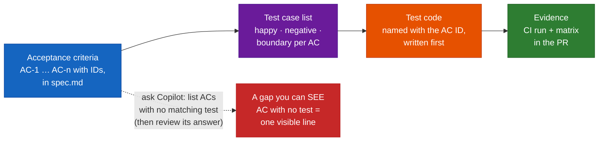

### 4. Prompt-from-the-spec loop *(s.8, s.15)* — sequence **[Beyond the deck]**

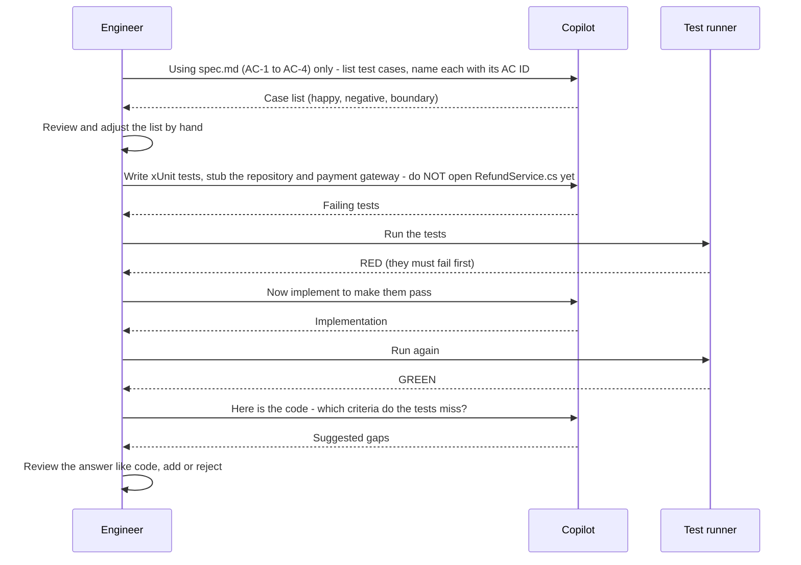

### 5. Test doubles: from dummy to mock *(s.9)*

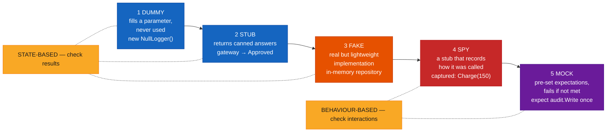

### 6. Integration test: real wiring, controlled edges *(s.10)*

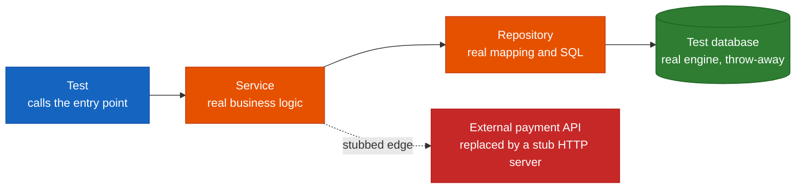

### 7. API and database validation: one test, two witnesses *(s.11)*

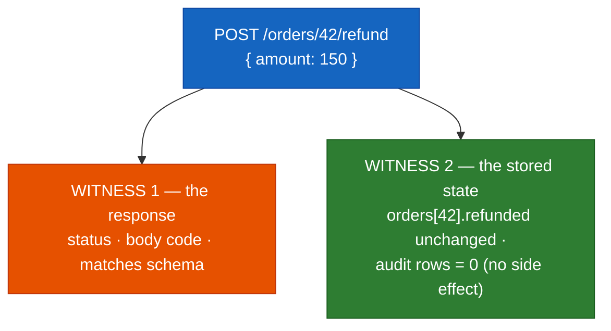

### 8. Six families of "break it on purpose" *(s.12)*

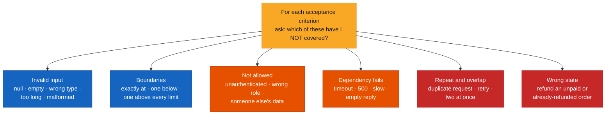

### 9. Contract validation from both sides *(s.13)*

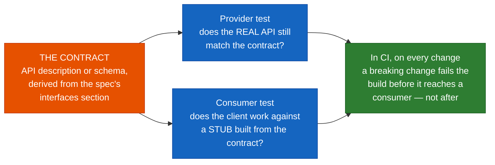

### 10. Is the suite any good? Four levels of evidence *(s.14)*

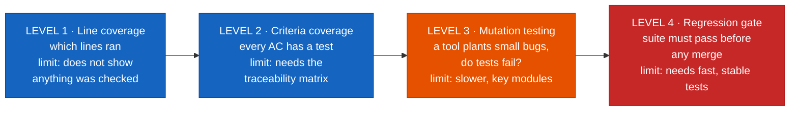

### 11. When a test fails — whose fault is it? *(s.15)* — flow **[Beyond the deck]**

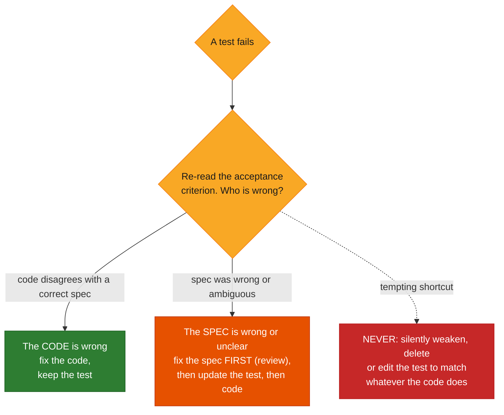

### 12. The lab loop: plant a defect, watch the right test fail *(s.16)*

```mermaid
graph LR
    L1["1 Traceability matrix<br/>AC → layer<br/>mark any AC with no test"]:::blue
    L2["2 Write FAILING tests first<br/>unit (doubles at boundary),<br/>then integration/API"]:::purple
    L3["3 Make everything green<br/>record baseline: tests,<br/>pass rate, AC coverage"]:::green
    L4["4 Plant ONE defect<br/>relax a limit,<br/>drop a check"]:::red
    L5["5 Run the suite<br/>which test fails?<br/>fix the code, re-run"]:::orange
    L6["defect-report.md<br/>defect · catching test ·<br/>criteria that would<br/>have slipped"]:::yellow

    L1 --> L2 --> L3 --> L4 --> L5 --> L6

    classDef blue fill:#1565c0,stroke:#0d47a1,color:#fff
    classDef purple fill:#6a1b9a,stroke:#4a148c,color:#fff
    classDef green fill:#2e7d32,stroke:#1b5e20,color:#fff
    classDef red fill:#c62828,stroke:#b71c1c,color:#fff
    classDef orange fill:#e65100,stroke:#bf360c,color:#fff
    classDef yellow fill:#f9a825,stroke:#f57f17,color:#1a1a1a
```

---

## Core Concepts

### Part A — The testing stack and spec traceability

#### Concept card A1 · Tests must come from the spec, not the code *(s.4)*

**Definition.** If a model writes code *and* tests from the same reading of the requirement, the tests simply restate the code's assumptions. Tests derived from **acceptance criteria written and reviewed before any code** are an *independent* check.

| | From the code | From the spec |
|---|---|---|
| Step 1 | Model fills a requirement gap with a guess | Acceptance criteria reviewed before any code |
| Step 2 | Tests assert whatever the code already does | Tests written first — they should fail (red) |
| Step 3 | All green; tests and code share the wrong assumption | Code makes them pass; green = criteria met |
| Step 4 | **Bug ships** — nobody checked intent | **Bug caught** — a wrong guess fails a test written from the intent |

> **Rule of thumb (s.4):** a test that has never failed has never proved anything. See it fail first — then make it pass.

**Analogy.** Marking your own exam with an answer key you wrote *after* seeing your answers. The key has to exist first.

#### Concept card A2 · The testing stack *(s.5)*

| Layer | What it checks | Proves | Speed · count |
|---|---|---|---|
| **Unit** | One behaviour; dependencies replaced by doubles | The logic | Fastest · most |
| **Integration** | Real wiring: service + repository + database | The parts connect | Medium |
| **API & contract** | HTTP surface and schemas other systems rely on | The external promise | Slow |
| **Acceptance / end-to-end** | Whole feature through the real entry point | The criteria hold together | Slowest · fewest |

"Each layer checks something the layer below cannot. Build from the bottom up." Martin Fowler's [Practical Test Pyramid](https://martinfowler.com/articles/practical-test-pyramid.html) and [Test Pyramid](https://martinfowler.com/bliki/TestPyramid.html) pages are the standard background reading for this shape.

#### Concept card A3 · Spec-to-test traceability *(s.6)*

**Definition.** Name tests after acceptance criteria so gaps are visible — to you, to reviewers and to CI.

Pipeline: **Acceptance criteria** (AC-1…AC-n with IDs in `spec.md`) → **Test case list** (happy, negative and boundary cases per AC) → **Test code** (named with the AC ID; written first) → **Evidence** (CI run + the matrix in the PR).

**The deck's `traceability.md` (illustrative):**

```text
AC-1  refund <= original amount
  UT-1  Refund_Over_Total_Fails            (unit)
  UT-2  Refund_Exactly_Total_Succeeds      (boundary)
AC-2  only Paid orders can be refunded
  UT-3  Refund_Unpaid_Order_Fails          (negative)
AC-3  audit entry written
  IT-1  Refund_Writes_Audit_Row            (integration)
AC-4  error code REFUND_EXCEEDS_TOTAL  ← NO TEST YET
```

**A gap you can see (s.6):** "AC-4 has no test. In a matrix that is one visible line; in a pile of AI-generated tests it is invisible. Ask Copilot to list ACs with no matching test — then review its answer."

> **Best practice (s.6):** keep the matrix in the repo and in the PR. A reviewer should be able to answer "is every criterion tested?" in under a minute.

**[Beyond the deck] — a mechanical gap check, tested.** If each test carries its AC ID as an xUnit trait (`[Trait("AC", "AC-1")]`, shown in Part B3), a one-liner lists criteria in `spec.md` that no test mentions. I ran it against a five-criterion spec where AC-5 had no test, and it printed `NO TEST: AC-5`:

```bash
for ac in $(grep -oE 'AC-[0-9]+' spec.md | sort -u); do
  grep -rq "Trait(\"AC\", \"$ac\")" --include='*Tests.cs' . || echo "NO TEST: $ac"
done
```

Traits also let you run one criterion's tests: `dotnet test --filter "AC=AC-1"` (I ran it; it executed the five AC-1 tests). This is a *presence* check, not a quality check — a test can carry an AC tag and assert nothing, which is exactly what Level 3 (mutation) and review are for.

#### Concept card A4 · Deriving the strategy from the feature *(s.7)*

**Definition.** "For each criterion, choose the cheapest layer that can prove it." The deck's illustrative refund example (● primary check · ○ also covered):

| Acceptance criterion | Unit | Integration | API | Contract |
|---|:--:|:--:|:--:|:--:|
| **AC-1** Refund ≤ original amount | ● | | ○ | |
| **AC-2** Only Paid orders can be refunded | ● | ○ | ● | |
| **AC-3** Audit entry is written | ○ | ● | | |
| **AC-4** Error code `REFUND_EXCEEDS_TOTAL` | ● | | ● | ● |
| **AC-5** Billing API v1 responses unchanged | | | ○ | ● |

What each layer uses here:

| Layer | Set-up |
|---|---|
| **Unit** | Doubles replace the repository and the payment gateway |
| **Integration** | Real database engine; external API stubbed |
| **API / Contract** | Real HTTP surface; schema checked against the contract |

> **Best practice (s.7):** one criterion, one primary layer. "If every criterion is tested at every layer you have a slow suite; if one is tested nowhere you have a hole." (See the note in the pre-read table about the matrix's multiple ● marks.)

---

### Part B — Unit tests and test doubles

#### Concept card B1 · Unit tests with Copilot: prompt from the spec *(s.8)*

**Definition.** Ask for test cases first, from the criteria — **before the model reads the implementation.**

**The deck's prompt pattern (illustrative):**

```text
Using #file:spec.md (AC-1 to AC-4) only:
1. List test cases: happy, negative, boundary — name each with its AC ID.
2. Write xUnit tests. Use a stub for the repository and payment gateway.
3. Do NOT open RefundService.cs yet.
4. Run the tests; they must FAIL first.
```

**The deck's result — Arrange · Act · Assert (illustrative fragment):**

```csharp
[Fact]  // AC-1
void Refund_Over_Total_Fails()
{
  var order = PaidOrder(total: 100m);   // arrange
  var r = svc.Refund(order, 150m);      // act
  Assert.Equal("REFUND_EXCEEDS_TOTAL",
               r.Error.Code);           // assert
}
```

Three habits *(s.8)*:

| Habit | Meaning |
|---|---|
| **One behaviour per test** | A failure points at one cause |
| **Name by criterion** | AC ID in the name or a comment |
| **Review like code** | Tests that assert nothing still pass |

> **Best practice (s.8):** withhold the implementation until the tests exist. *Then* show Copilot the code and ask it to find criteria the tests miss.

**About Copilot's `/tests`.** GitHub's [Writing tests with GitHub Copilot](https://docs.github.com/en/copilot/tutorials/write-tests) tutorial describes opening the file under test and using `/tests`, opening existing test files in adjacent tabs so Copilot matches your framework and style, breaking integration-test requests into smaller pieces (one method at a time), specifying mocks and verification, and asking what additional tests are needed to find gaps. It also says generated tests "may not cover all scenarios" and to always review them. These fit the deck *if* you feed the criteria in; used alone on a code file, `/tests` produces code-derived tests.

#### Concept card B2 · Test doubles *(s.9)*

**Definition.** Stand-ins for real dependencies, from simplest to most assertive. **Use the simplest one that works.**

| # | Double | What it does | Deck's example | Style |
|---|---|---|---|---|
| 1 | **Dummy** | Fills a parameter; never actually used | `new NullLogger()` | State-based |
| 2 | **Stub** | Returns canned answers so the code under test can proceed | `gateway → Approved` | State-based |
| 3 | **Fake** | A real but lightweight implementation | in-memory repository | State-based |
| 4 | **Spy** | A stub that also records how it was called | captured: `Charge(150)` | Behaviour-based |
| 5 | **Mock** | Pre-set expectations; fails if they are not met | expect `audit.Write` once | Behaviour-based |

*State-based* tests check **results**; *behaviour-based* tests check **interactions**. This vocabulary is Gerard Meszaros's, popularised in Fowler's [Test Double](https://martinfowler.com/bliki/TestDouble.html) post; his longer [Mocks Aren't Stubs](https://martinfowler.com/articles/mocksArentStubs.html) covers the state-vs-behaviour debate.

> **Best practice (s.9):** double only at the boundary — network, clock, payments, email. "Mock everything and your tests describe the implementation, so every refactor breaks them."

#### Concept card B3 · Worked example — **[Beyond the deck]**, compiled and run

A complete version of the refund feature and a spec-derived unit suite, using hand-written doubles (no mocking library) so each double's role is visible. **How I checked it:** a scratch xUnit project on the .NET 8.0.122 SDK with the stock `dotnet new xunit` template (xunit 2.4.2); `dotnet test` → **10 passed, 0 failed**. The project is not kept in this repo; the code below is the full source.

**`RefundService.cs`** (the code under test — deliberately simple: one refund per order):

```csharp
namespace RefundDemo;

public enum OrderStatus { Pending, Paid, Refunded }

public sealed class Order
{
    public int Id { get; init; }
    public decimal Total { get; init; }
    public OrderStatus Status { get; set; }
    public decimal RefundedAmount { get; set; }
}

public sealed record RefundError(string Code);

public sealed record RefundResult(bool Succeeded, RefundError? Error)
{
    public static RefundResult Ok() => new(true, null);
    public static RefundResult Fail(string code) => new(false, new RefundError(code));
}

public interface IOrderRepository
{
    Order? Find(int id);
    void Save(Order order);
}

public interface IPaymentGateway
{
    bool Refund(int orderId, decimal amount);
}

public interface IAuditLog
{
    void Write(string entry);
}

public sealed class RefundService(IOrderRepository orders, IPaymentGateway gateway, IAuditLog audit)
{
    public const string ExceedsTotal = "REFUND_EXCEEDS_TOTAL";

    public RefundResult Refund(int orderId, decimal amount)
    {
        var order = orders.Find(orderId);
        if (order is null) return RefundResult.Fail("ORDER_NOT_FOUND");
        if (order.Status != OrderStatus.Paid) return RefundResult.Fail("ORDER_NOT_PAID");
        if (amount <= 0) return RefundResult.Fail("INVALID_AMOUNT");
        if (amount > order.Total) return RefundResult.Fail(ExceedsTotal);

        if (!gateway.Refund(order.Id, amount)) return RefundResult.Fail("GATEWAY_FAILED");

        order.RefundedAmount = amount;
        order.Status = OrderStatus.Refunded;
        orders.Save(order);
        audit.Write($"refund order={order.Id} amount={amount}");
        return RefundResult.Ok();
    }
}
```

**`RefundTests.cs`** (organised by AC-1…AC-4, each test tagged with its AC; in your own work you would write these *before* the service body exists):

```csharp
using Xunit;

namespace RefundDemo;

// Test doubles: simplest one that works, at the boundary only.
sealed class FakeOrderRepository : IOrderRepository          // fake: working in-memory implementation
{
    private readonly Dictionary<int, Order> _orders = new();
    public void Add(Order order) => _orders[order.Id] = order;
    public Order? Find(int id) => _orders.GetValueOrDefault(id);
    public void Save(Order order) => _orders[order.Id] = order;
}

sealed class SpyPaymentGateway(bool succeeds = true) : IPaymentGateway   // stub that also records calls = spy
{
    public List<(int OrderId, decimal Amount)> Calls { get; } = new();
    public bool Refund(int orderId, decimal amount)
    {
        Calls.Add((orderId, amount));
        return succeeds;
    }
}

sealed class SpyAuditLog : IAuditLog
{
    public List<string> Entries { get; } = new();
    public void Write(string entry) => Entries.Add(entry);
}

public class RefundTests
{
    private readonly FakeOrderRepository _repo = new();
    private readonly SpyAuditLog _audit = new();

    private RefundService Sut(SpyPaymentGateway gateway) => new(_repo, gateway, _audit);

    private Order GivenOrder(OrderStatus status, decimal total = 100m)
    {
        var order = new Order { Id = 42, Total = total, Status = status };
        _repo.Add(order);
        return order;
    }

    // ---- AC-1: refund <= original amount ----------------------------------------
    [Fact, Trait("AC", "AC-1")]
    public void Refund_Over_Total_Fails()                         // UT-1 (unit)
    {
        var order = GivenOrder(OrderStatus.Paid);
        var gateway = new SpyPaymentGateway();

        var result = Sut(gateway).Refund(42, 150m);

        Assert.False(result.Succeeded);
        Assert.Equal(OrderStatus.Paid, order.Status);             // state untouched
        Assert.Empty(gateway.Calls);                              // no money moved
        Assert.Empty(_audit.Entries);                             // no side effect
    }

    [Fact, Trait("AC", "AC-1")]
    public void Refund_Exactly_Total_Succeeds()                   // UT-2 (boundary)
    {
        GivenOrder(OrderStatus.Paid);

        var result = Sut(new SpyPaymentGateway()).Refund(42, 100m);

        Assert.True(result.Succeeded);
    }

    [Fact, Trait("AC", "AC-1")]
    public void Refund_One_Cent_Over_Total_Fails()                // boundary: one above the limit
    {
        GivenOrder(OrderStatus.Paid);

        var result = Sut(new SpyPaymentGateway()).Refund(42, 100.01m);

        Assert.False(result.Succeeded);
    }

    [Theory, Trait("AC", "AC-1")]
    [InlineData(0)]
    [InlineData(-5)]
    public void Refund_Non_Positive_Amount_Fails(double amount)   // invalid input
    {
        GivenOrder(OrderStatus.Paid);

        var result = Sut(new SpyPaymentGateway()).Refund(42, (decimal)amount);

        Assert.False(result.Succeeded);
        Assert.Equal("INVALID_AMOUNT", result.Error!.Code);
    }

    // ---- AC-2: only Paid orders can be refunded ---------------------------------
    [Theory, Trait("AC", "AC-2")]
    [InlineData(OrderStatus.Pending)]
    [InlineData(OrderStatus.Refunded)]                            // wrong state: unpaid or already refunded
    public void Refund_Unpaid_Or_Already_Refunded_Order_Fails(OrderStatus status)   // UT-3 (negative)
    {
        var order = GivenOrder(status);
        var gateway = new SpyPaymentGateway();

        var result = Sut(gateway).Refund(42, 10m);

        Assert.False(result.Succeeded);
        Assert.Equal("ORDER_NOT_PAID", result.Error!.Code);
        Assert.Equal(status, order.Status);
        Assert.Empty(gateway.Calls);
    }

    // ---- AC-3: audit entry is written -------------------------------------------
    [Fact, Trait("AC", "AC-3")]
    public void Refund_Writes_Audit_Entry()                       // behaviour check: a spy is the right double
    {
        GivenOrder(OrderStatus.Paid);

        Sut(new SpyPaymentGateway()).Refund(42, 60m);

        var entry = Assert.Single(_audit.Entries);
        Assert.Contains("order=42", entry);
        Assert.Contains("amount=60", entry);
    }

    [Fact, Trait("AC", "AC-3")]
    public void Failed_Gateway_Refund_Writes_No_Audit_Entry_And_Leaves_Order_Paid()   // dependency fails
    {
        var order = GivenOrder(OrderStatus.Paid);

        var result = Sut(new SpyPaymentGateway(succeeds: false)).Refund(42, 60m);

        Assert.False(result.Succeeded);
        Assert.Equal("GATEWAY_FAILED", result.Error!.Code);
        Assert.Equal(OrderStatus.Paid, order.Status);
        Assert.Equal(0m, order.RefundedAmount);
        Assert.Empty(_audit.Entries);
    }

    // ---- AC-4: error code REFUND_EXCEEDS_TOTAL ----------------------------------
    [Fact, Trait("AC", "AC-4")]
    public void Over_Total_Refund_Returns_Documented_Error_Code()
    {
        GivenOrder(OrderStatus.Paid);

        var result = Sut(new SpyPaymentGateway()).Refund(42, 150m);

        Assert.Equal("REFUND_EXCEEDS_TOTAL", result.Error!.Code);   // literal on purpose: the contract, not the constant
    }
}
```

Notes on the choices (each ties to a slide):
- **Fake repository** (state-based) — Part B2 "prefer fakes and state checks".
- **Spy gateway and spy audit** — AC-3 is about an *interaction*, so a spy is the simplest double that can check it.
- **Every failure test also asserts no side effects** (order unchanged, gateway not called, no audit row) — slide 12's "clear error and no side effects, not just 'doesn't crash'".
- **The AC-4 test asserts the literal string**, not `RefundService.ExceedsTotal`: the constant is the code's opinion; the literal is the contract.
- The `[InlineData]` uses `double` because C# attributes can't take `decimal` arguments; the test casts it.

---

### Part C — Integration, API and database validation

#### Concept card C1 · Integration tests: real wiring, controlled edges *(s.10)*

**Definition.** "Keep the parts you own real. Replace only what you cannot control or what is slow."

Test → **Service** (real business logic) → **Repository** (real mapping and SQL) → **Test database** (real engine, throw-away). The external **payment API** is replaced by a **stub HTTP server**.

How to keep them reliable *(s.10)*:

| Habit | Meaning |
|---|---|
| **Isolate** | Each test seeds its own data and cleans up; no test depends on another |
| **Disposable database** | A real engine in a container, or an in-memory mode your team trusts |
| **Test failure paths** | Make the stub time out or return 500 — see what the service does |

> **Best practice (s.10):** integration tests prove the wiring that unit tests with doubles cannot: mappings, queries, transactions, configuration.

**[Beyond the deck] — .NET tooling pointers** (docs I confirmed exist; I did not build a lab with them): Microsoft's [Integration tests in ASP.NET Core](https://learn.microsoft.com/en-us/aspnet/core/test/integration-tests) and [Testcontainers for .NET](https://dotnet.testcontainers.org/) ("a library to support tests with throwaway instances of Docker containers"; it needs a Docker-API compatible container runtime).

#### Concept card C2 · API and database validation: check the response and the stored state *(s.11)*

**Definition.** "A good API test asserts what came back and what did — or did not — change underneath."

**The deck's pseudo-code (illustrative):**

```text
POST /orders/42/refund   { "amount": 150 }

expect status       == 422
expect body.code    == "REFUND_EXCEEDS_TOTAL"
expect body matches ErrorSchema

expect db.orders[42].refunded == 0   // unchanged
expect db.audit rows          == 0   // no side effect
```

| API checks | Database checks |
|---|---|
| Status codes for success and each failure | State after success is exactly right |
| Response matches the schema | Failure leaves state untouched (rollback) |
| Error shape is stable and documented | Constraints and uniqueness hold |
| Auth: allowed and forbidden callers | Migrations apply to a clean database |

> **Best practice (s.11):** for every failing request, also assert nothing changed. "Half-applied writes are the bugs that cost the most to find later."

The deck notes this is pseudo-code — "use your team's API test tool (HTTP client, collection runner, or framework test host)". Part B3's failure tests apply the same two-witness idea at unit level (result *and* state).

---

### Part D — Negative, contract and regression

#### Concept card D1 · Break it on purpose: negative and boundary scenarios *(s.12)*

**Definition.** "AI generates happy paths readily. You have to ask for the rest — one prompt per row."

| Family | What to try |
|---|---|
| **Invalid input** | Null, empty, wrong type, too long, malformed |
| **Boundaries** | Exactly at, one below, one above every limit |
| **Not allowed** | Unauthenticated, wrong role, someone else's data |
| **Dependency fails** | Timeout, 500, slow response, empty reply |
| **Repeat and overlap** | Duplicate request, retry, two at once |
| **Wrong state** | Refund an unpaid or already-refunded order |

The deck's one-line prompt (illustrative): `For AC-2, list negative and boundary cases I haven't covered.`

> Each failure scenario must assert **a clear error and no side effects** — not just "doesn't crash".
> **Best practice (s.12):** the six rows are a reusable checklist. Paste it into a prompt file and run it against every new acceptance criterion. (Prompt files are covered in the [Module 02 guide](./module-02-github-copilot-recap-advanced-features.md).)

**[Beyond the deck] — the checklist as a ready-to-paste prompt:**

```text
For #file:spec.md acceptance criterion <AC-n>, go through these six families and,
for each, list the cases I have NOT yet covered in the existing tests. Do not write
code yet and do not open the implementation.
1. Invalid input (null, empty, wrong type, too long, malformed)
2. Boundaries (exactly at, one below, one above every limit)
3. Not allowed (unauthenticated, wrong role, someone else's data)
4. Dependency fails (timeout, 500, slow, empty reply)
5. Repeat and overlap (duplicate request, retry, two at once)
6. Wrong state (e.g. unpaid or already-refunded order)
For each case state the expected error AND what must remain unchanged.
```

**Mapping the worked example to the six rows:** invalid input → `Refund_Non_Positive_Amount_Fails`; boundaries → exactly total / one cent over; wrong state → `Refund_Unpaid_Or_Already_Refunded_Order_Fails`; dependency fails → `Failed_Gateway_Refund_…`. **Not covered by that example:** *not allowed* (no auth in the toy service) and *repeat and overlap* (single-threaded, no idempotency key) — a useful illustration of a gap the checklist would surface.

#### Concept card D2 · Contract validation: protect everyone who depends on you *(s.13)*

**Definition.** "A contract is the promise your API makes. Test it from both sides so a change can't break a consumer silently."

- **The contract** — an API description or schema, derived from the spec's *interfaces* section.
- **Provider test** — does the *real* API still match the contract?
- **Consumer test** — does the client work against a *stub built from the contract*?
- **In CI, on every change** — "a breaking change fails the build before it reaches a consumer — not after."

| Safe changes | Breaking changes |
|---|---|
| Add an optional field | Remove or rename a field |
| Add a new endpoint | Change a field's type |
| Loosen a validation rule | Add a new required input |

> **Best practice (s.13):** version the contract with the spec. A contract change is a spec change — it needs a review before any code.

**[Beyond the deck] — where to read more** (pages I confirmed exist): the [OpenAPI Specification](https://spec.openapis.org/oas/latest.html) is a common way to describe an HTTP contract; [Pact](https://docs.pact.io/) describes itself as a code-first, consumer-driven contract testing tool where "the contract is generated during the execution of the automated consumer tests"; Fowler's [Consumer-Driven Contracts](https://martinfowler.com/articles/consumerDrivenContracts.html) article covers the idea. The deck does not name a tool; the choice is your team's. Slide 7's AC-5 ("Billing API v1 responses unchanged") is the kind of criterion a contract test guards.

#### Concept card D3 · Regression *(s.5, s.14)*

Regression is not a layer; it is **every layer re-run on every change**. "A regression suite is simply the tests you refuse to delete — Module 05's pinned behaviour." At Level 4 of the evidence ladder it becomes a **gate: the suite must pass before any merge** (which needs *fast, stable* tests).

---

### Part E — Suite quality and best practices

#### Concept card E1 · Is the suite any good? Four levels of evidence *(s.14)*

"Passing tests prove little unless the tests themselves are good. Climb the ladder."

| Level | Group | Evidence | Limit (deck) |
|---|---|---|---|
| 1 | Basic — *what ran* | **Line coverage** — which lines ran during tests | Does not show anything was *checked* |
| 2 | Basic | **Criteria coverage** — every acceptance criterion has a test | Needs the traceability matrix |
| 3 | Advanced — *does the suite catch bugs?* | **Mutation testing** — a tool plants small bugs; do tests fail? | Slower; run on key modules |
| 4 | Advanced | **Regression gate** — suite must pass before any merge | Needs fast, stable tests |

> **Today's lab is mutation testing by hand (s.14):** "you plant one defect and see whether the suite notices. Automated mutation tools do the same at scale. Agree your own coverage thresholds as a team — there is no universal number."

**Supporting reading.** Fowler's [Test Coverage](https://martinfowler.com/bliki/TestCoverage.html) says coverage is "a useful tool for finding untested parts of a codebase" but "of little use as a numeric statement of how good your tests are", and that "if you make a certain level of coverage a target, people will try to attain it" — which is why the deck lists *"chase a coverage percentage as the goal"* under **avoid**. Microsoft's [Use code coverage for unit testing](https://learn.microsoft.com/en-us/dotnet/core/testing/unit-testing-code-coverage) covers collecting coverage in .NET.

**Automated mutation testing in .NET.** [Stryker.NET](https://stryker-mutator.io/docs/stryker-net/getting-started/) "allows you to test your tests by temporarily inserting bugs". Its getting-started page gives `dotnet tool install -g dotnet-stryker` and then `dotnet stryker` run from the unit-test project's directory, and states it requires the **.NET 10 runtime or newer** (see the pre-read table). I did not run it.

#### Concept card E2 · Best practices for AI-assisted testing *(s.15)*

*Treat AI as a fast test writer and a poor judge of what the tests should prove.*

| ✅ Do this | ❌ Avoid this |
|---|---|
| Derive tests from the spec's acceptance criteria, with IDs | Ask Copilot to "write tests for this file" and stop there |
| See each new test fail before the code makes it pass | Accept tests that assert nothing or only that code ran |
| Ask explicitly for negative, boundary and failure cases | Weaken or delete a failing test to get a green build |
| Double only at boundaries; prefer fakes and state checks | Mock every collaborator until tests mirror the code |
| Assert on state and side effects, not just return values | Chase a coverage percentage as the goal |
| Review generated tests as carefully as generated code | Let AI edit tests and implementation in one unreviewed step |

> **Golden rule (s.15):** when a test fails, decide whether the code or the spec is wrong — **never silently change the test to match whatever the code does.**

Microsoft's [Best practices for writing unit tests](https://learn.microsoft.com/en-us/dotnet/core/testing/unit-testing-best-practices) is general .NET background that pairs with this list (I confirmed the page exists; it is not the deck's source).

---

### Part F — Lab: Inject a defect, prove the suite catches it *(s.16, 20 min)*

**Goal.** Build a spec-derived test suite for your SDD feature, **plant one deliberate defect, and show the suite fails for the right reason.**

| Step | Do |
|---|---|
| 1 | From `spec.md`, build the **traceability matrix** (AC → layer) with Copilot, then adjust it by hand. Mark any criterion with no test |
| 2 | Write **failing unit tests first** (stubs/fakes at the boundary), then integration or API tests for the criteria that need them |
| 3 | Make everything green. **Record the baseline:** tests, pass rate, AC coverage |
| 4 | **Plant one defect** (e.g. relax a limit, drop a check). Run the suite, find which test fails, then fix the code and re-run |

Files you create (deck's tree):

```
lab06/
  traceability.md
  tests/unit/
  tests/integration/
  defect-report.md
```

**Done when:** `defect-report.md` names **the planted defect, the test that caught it, and any criterion that would have slipped through.**

#### [Beyond the deck] What a real run looks like

I ran five single-line defects against the worked example in Part B3 (one at a time, baseline restored between runs; baseline = 10 tests, all green):

| # | Planted defect (one line) | Failing test(s) | What it shows |
|---|---|---|---|
| A | **Relax the limit:** `amount > order.Total` → `amount > order.Total * 1.1m` | `Refund_One_Cent_Over_Total_Fails` **only** | The deck-style over-total test (150 vs a 110 limit) **still passes** — only the *boundary* test catches a slightly-relaxed limit |
| B | **Drop a side effect:** delete the `audit.Write(...)` line | `Refund_Writes_Audit_Entry` | The spy is what makes AC-3 checkable |
| C | **Drop a check:** remove the `Status != Paid` guard | both `…Unpaid_Or_Already_Refunded…` cases (Pending, Refunded) | Wrong-state negative tests |
| D | **Change the contract string:** `"REFUND_EXCEEDS_TOTAL"` → `"TOO_MUCH"` | `Over_Total_Refund_Returns_Documented_Error_Code` | Asserting the *literal* is what protects AC-4 |
| E | **Tighten the limit:** `>` → `>=` | `Refund_Exactly_Total_Succeeds` | The exactly-at-limit boundary test |

Defect A is the most instructive: a suite with only the happy-path and "obviously too big" case would have stayed green. That is the kind of "criterion that would have slipped through" the report should record.

**A `defect-report.md` skeleton** (filled with the Defect A result as an example):

```markdown
# Defect report — Refund feature

## Baseline
Tests: 10   Passing: 10 (100%)   AC coverage: AC-1..AC-4 each have ≥ 1 test   (AC-5: contract test pending)

## Planted defect
File: RefundService.cs   Change: `amount > order.Total` → `amount > order.Total * 1.1m`
Intent: "relax a limit"

## Result
Failing test(s): Refund_One_Cent_Over_Total_Fails (AC-1, boundary)
Failed for the RIGHT reason? Yes — expected Succeeded=false for 100.01 on a 100.00 order.

## What would have slipped through
Refund_Over_Total_Fails (150 vs 110 limit) still passed. Without the one-cent boundary test,
AC-1 would have looked covered while the limit was 10% too loose.

## Follow-ups
- Add boundary test to the matrix for every numeric limit.
- Repeat with a dropped check and a dropped side effect.
```

**Practical notes.** "Fails for the right reason" means the failure message points at the planted line's behaviour — not a compile error or an unrelated test. If your suite stays green after the defect, that is a *finding*, not a failure of the lab: record the uncovered criterion and add the missing test.

---

### Part G — Progressive path: simple → advanced

| Level | You can… | Practise with |
|---|---|---|
| 1 | Explain why code-derived tests give false safety | Part A1 |
| 2 | Write a traceability matrix and find the untested AC | Lab step 1; the gap-check one-liner |
| 3 | Write spec-derived unit tests with the simplest double that works | Part B3 |
| 4 | Ask for and assert negative, boundary and failure cases with no side effects | Part D1 |
| 5 | Validate integration, API response *and* stored state; guard contracts | Parts C and D2 |
| 6 | Prove the suite can catch bugs; reason about mutation testing | Lab step 4; Stryker.NET |

---

## Outcomes — "What you can do now" *(s.17)*

- [ ] Acceptance criteria are mapped to tests through a **traceability matrix**.
- [ ] **Spec-derived unit tests** are written with the right test doubles.
- [ ] **Integration and API tests** validate wiring, responses and stored state.
- [ ] **Negative, boundary and failure scenarios** are requested and covered.
- [ ] **Contract and regression checks** protect consumers and existing behaviour.
- [ ] A **planted defect** proved the suite catches real bugs.

The habit that ties them together: **tests come from the spec, and must fail before they pass.**

**Next — Module 07: MCP-Enabled Workflows & Custom MCP Server Creation (3 hours).** Connect agents to repositories, APIs and enterprise services through MCP, then build and govern a simple custom MCP server.

---

## Glossary

| Term | Meaning |
|---|---|
| **Acceptance criterion (AC)** | A testable statement in the spec with an ID (AC-1…AC-n) |
| **Traceability matrix** | A table mapping each AC to the tests (and layer) that prove it |
| **Unit / integration / API / contract / acceptance test** | The layers of the stack, fastest to slowest |
| **Regression suite** | The tests you refuse to delete; the same layers re-run on every change |
| **Test double** | Any stand-in for a real dependency: dummy, stub, fake, spy or mock |
| **Dummy / Stub / Fake / Spy / Mock** | Unused filler / canned answers / lightweight real implementation / stub that records calls / pre-set expectations that fail if unmet |
| **State-based vs behaviour-based** | Checking results vs checking interactions |
| **Arrange · Act · Assert** | Set up, perform the one behaviour, check the outcome |
| **Contract** | The promise an API makes: its schema or description, versioned with the spec |
| **Provider / consumer test** | Real API vs contract / client vs a stub built from the contract |
| **Line coverage / criteria coverage** | Which lines ran / whether every AC has a test |
| **Mutation testing** | Planting small bugs to see whether tests fail; the lab does it by hand |
| **Red → green** | A new test must fail first, then pass once the code is right |

---

## References

All links below returned 200 and the pages match the descriptions. Pages whose *content* I read are noted; others I confirmed exist by title only.

### Course sources
- `presentations/Module06_Test_Strategy_Validation.pdf` — the deck this guide follows.
- [Module 05 guide](./module-05-sdd-greenfield-brownfield-modernization.md) · [Module 02 guide](./module-02-github-copilot-recap-advanced-features.md) — pinned behaviour and prompt files.

### GitHub Copilot
- [Writing tests with GitHub Copilot](https://docs.github.com/en/copilot/tutorials/write-tests) *(content read)* — `/tests`, prompting for unit and integration tests, reviewing results.

### Testing concepts
- [The Practical Test Pyramid — Martin Fowler](https://martinfowler.com/articles/practical-test-pyramid.html) · [Test Pyramid](https://martinfowler.com/bliki/TestPyramid.html) *(title only)* — shape of the stack.
- [Test Double — Martin Fowler](https://martinfowler.com/bliki/TestDouble.html) *(content read)* — dummy, fake, stub, spy, mock.
- [Mocks Aren't Stubs — Martin Fowler](https://martinfowler.com/articles/mocksArentStubs.html) *(title only)* — state vs behaviour verification.
- [Test Coverage — Martin Fowler](https://martinfowler.com/bliki/TestCoverage.html) *(content read)* — what coverage numbers can and cannot tell you.
- [Consumer-Driven Contracts: A Service Evolution — Martin Fowler](https://martinfowler.com/articles/consumerDrivenContracts.html) *(title only)* — contracts from the consumer side.

### .NET and tooling
- [xUnit.net](https://xunit.net/) *(title only)* — the test framework used in the examples.
- [Integration tests in ASP.NET Core — Microsoft Learn](https://learn.microsoft.com/en-us/aspnet/core/test/integration-tests) *(title only)*
- [Testcontainers for .NET](https://dotnet.testcontainers.org/) *(content read)* — throwaway Docker containers for tests.
- [Best practices for writing unit tests — .NET](https://learn.microsoft.com/en-us/dotnet/core/testing/unit-testing-best-practices) *(title only)*
- [Use code coverage for unit testing — .NET](https://learn.microsoft.com/en-us/dotnet/core/testing/unit-testing-code-coverage) *(title only)*
- [Stryker.NET — getting started](https://stryker-mutator.io/docs/stryker-net/getting-started/) *(content read)* — mutation testing for .NET; install/run commands.
- [Pact documentation](https://docs.pact.io/) *(content read)* — consumer-driven contract testing.
- [OpenAPI Specification](https://spec.openapis.org/oas/latest.html) *(title only)* — a common HTTP contract format.

### Not verified / caveats
- Deck figures and names (AC-1…AC-5, `RefundTests.cs`, UT/IT IDs, `REFUND_EXCEEDS_TOTAL`) are the deck's illustrative example; the worked example reuses them but is **my own code**.
- I did not run Copilot, Testcontainers, Pact or Stryker.NET; their descriptions come from their docs pages as fetched on 2026-10-15.
- The pre-read table's items 1–3 are observations about the deck itself.
