# MCP-Enabled Workflows & Custom MCP Server Creation — Comprehensive Guide

> **Module 07 · Day 3 · 3 hours · Concepts + 2 labs · Primary tools: Copilot agent mode + MCP**
> Source: `presentations/Module07_MCP_Workflows_Custom_Server.pdf` (19 slides). Slide numbers below are written *(s.N)*.
> Material that is not in the deck is marked **[Beyond the deck]**. Deck snippets labelled "illustrative" stay illustrative.

---

## Overview

> *"Give your agents safe, governed access to repositories, docs and enterprise systems. Learn what MCP is, integrate it in Copilot, run a real workflow, then build and govern a custom MCP server."* *(s.1)*

The module is a climb in five moves, matching the closing path on slide 18: **Concepts → Configure → Integrate → Build → Govern.**

> **Why this matters (s.3):** "an agent is only as useful as what it can reach, and only as safe as the limits you put on that reach. MCP is the standard way to do both."

### Time budget *(s.2)*

| # | Block | Min | Slides |
|---|---|---|---|
| 1 | MCP Concepts & Architecture | 25 | 4–7 |
| 2 | Integrating MCP in Copilot | 25 | 8–9 |
| 3 | **Lab 1** — Repo to Spec Validation (workflow: s.10) | 35 | 10–11 |
| 4 | Designing a Custom MCP Server | 30 | 12–13 |
| 5 | **Lab 2** — Build, Wire & Govern | 45 | 14 |
| 6 | Security, Governance & Best Practices | 20 | 15–17 |
| | **Total** | **180 (3 h)** | |

### Where this sits in the 12-module journey *(s.3)*

The first module of the **EXTEND** phase: "agents stop being limited to what is in the editor."

| Link | Connection |
|---|---|
| **M03 → M07** | Tool results are context — select, compress and scope them ([Module 03 guide](./module-03-prompt-engineering-context-engineering.md)) |
| **M04–M06 → M07** | Specs and tests are what an MCP workflow validates against ([Module 04](./module-04-spec-driven-development-github-spec-kit.md), [05](./module-05-sdd-greenfield-brownfield-modernization.md), [06](./module-06-test-strategy-validation.md) guides) |
| **M07 → M08** | PR-review agents use MCP tools and need the same governance |
| **M07 → M10** | Code agents and RAG reuse MCP servers as their tools |

Earlier MCP background lives in the [Module 02 guide](./module-02-github-copilot-recap-advanced-features.md).

### ⚠ Currency check (as of 2026-10-15)

The concepts in the deck hold; several *file names, product details and spec details* have moved. Verified against the sources in [References](#references).

| # | Topic | Deck says | What I found | What to do |
|---|---|---|---|---|
| 1 | **Where the config lives** *(s.8, s.11, s.14)* | `.vscode/mcp.json` with a top-level `servers` object | VS Code's [MCP servers doc](https://code.visualstudio.com/docs/agent-customization/mcp-servers) now lists a workspace-root **`.mcp.json`** with a top-level **`mcpServers`** object as "preferred for configurations that you share with your team", and says its guided flow "lists the deprecated `.vscode/mcp.json` … for compatibility. Prefer the portable destinations for new servers." Writing to the workspace-root file is controlled by an *experimental* setting, `chat.mcp.workspaceRootConfig.enabled`. | Tell learners both exist. Use whichever your VS Code offers; Part B1 shows both shapes. I did not test either in VS Code. |
| 2 | **Protocol version** | JSON-RPC 2.0; stdio and Streamable HTTP; tools / resources / prompts; elicitation | All still true. The current spec version is **2026-07-28**: the protocol is described as **stateless** (each request carries version and capabilities in `_meta`), servers answer a `server/discover` request, **elicitation** arrives through a "Multi Round-Trip Requests" pattern, and **sampling, roots and logging are marked deprecated**. | Nothing in the deck is wrong. Don't teach sampling/roots as core; if a learner asks, point to the spec's deprecation notes. |
| 3 | **Org policy** *(s.8, s.15)* | "Organisations can control MCP use in Copilot; it is off by default for some plans" | GitHub Docs: the **"MCP servers in Copilot"** policy is for organisations/enterprises, "disabled by default", and "only applies to users who have a Copilot Business or Copilot Enterprise subscription"; Free, Pro, Pro+ and Max are not governed by it. | Compatible. Ask your admin which side of this line your learners are on. |
| 4 | **GitHub MCP server read-only mode & toolsets** *(s.9)* | "supports a read-only mode and toolsets" | Confirmed. Local server: `--read-only` and `--toolsets`. Remote server (`https://api.githubcopilot.com/mcp/`): "Add `/readonly` to the end of any URL" or use headers; per-toolset URLs look like `…/mcp/x/issues` and `…/mcp/x/issues/readonly`. | Lab 1 can be done with URLs alone (Part B). |
| 5 | **`from fastmcp import FastMCP`** *(s.13)* | "FastMCP for Python"; "SDK syntax and CLI commands change between versions" | **I ran the deck's server unchanged** with **FastMCP 4.1.0** (Python 3.14.7, which pulled in `mcp` 2.3.0) and it works as written. Note this is the standalone `fastmcp` package; the official `modelcontextprotocol/python-sdk` is a separate package. | Pin the version you teach with. |
| 6 | **"command": "python" pitfall** — **[Beyond the deck]** | `"command": "npx"` example only | When I ran `fastmcp list server.py` with the venv *not* on `PATH`, the server was spawned with a different `python` (one that had an incompatible `mcp` package) and the connection closed with an `ImportError` in the log. With the venv's `bin` first on `PATH`, it worked. | In `mcp.json`, point `command` at the interpreter that has the dependencies installed (absolute path), not bare `python`. |

---

## Quick Start

1. **MCP is a common plug.** Without it, *N* AI apps × *M* tools = N×M custom integrations; with it, N + M implementations *(s.4)* — the deck's 3×3 = 9 vs 3+3 = 6 is the counting argument; real estates have far more.
2. **Four participants:** a **host** (VS Code + Copilot agent mode) creates one **client** per **server**; servers front **systems of record**. Two transports: **stdio** (local process) and **Streamable HTTP** (remote, usually OAuth) *(s.5)*.
3. **Three building blocks:** **tools** (model-controlled actions), **resources** (application-controlled context), **prompts** (user-controlled templates) *(s.6)*.
4. **One tool call has two key moments** *(s.7)*: **step 3 — you approve** (your control point) and **step 5 — the result returns into the model's context** (your risk point). Everything in the security slide comes back to these two.
5. **Start read-only.** Prove the workflow with read tools, add writes only behind a human approval step *(s.9, s.10, s.17)*.
6. **Building your own:** reuse an approved server first; build small; one tool, one job; typed and validated inputs; small structured output; read-only by default *(s.12)*. **Never** expose a raw `run_query(sql)` or `run_command(cmd)`.
7. **Test before an agent touches it** (MCP Inspector, including bad input), then **write the one-page governance record** — owner, purpose, tools, data, auth, approval, off switch *(s.13, s.16)*.
8. **Golden rule (s.17):** "MCP standardises how an agent connects. It does not decide what the agent should be allowed to do — you do."

---

## Visual Summary

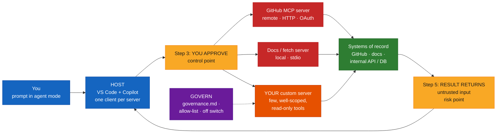

---

## Architecture

### 1. The problem MCP solves: N × M becomes N + M *(s.4)*

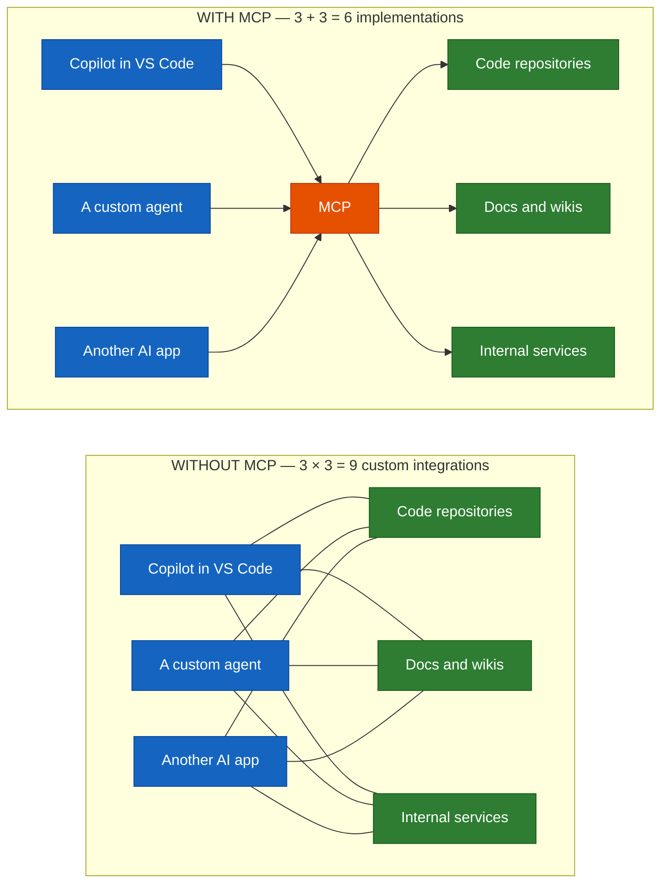

> **Think of it as (s.4):** a common plug for AI apps and tools. Build or approve a server once; any MCP-capable host can use it.

### 2. Host → Client → Server → System *(s.5)*

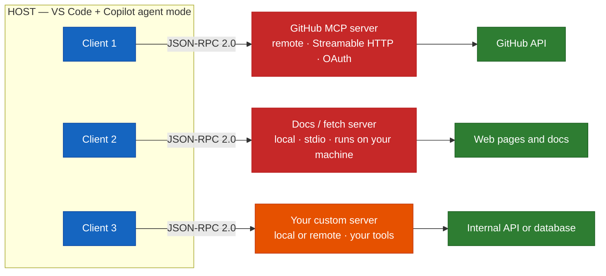

"One client per server inside the host. Servers can run on your machine or remotely." The MCP architecture page adds that local stdio servers typically serve a single client, while remote Streamable HTTP servers typically serve many.

### 3. Two layers, two transports

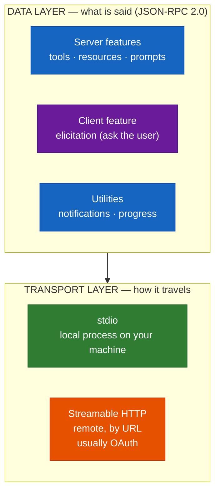

*(Layer names come from the MCP architecture page; the deck's slide 5 states the two transports and that "the protocol on top is the same for both".)*

### 4. What a server offers: tools, resources, prompts *(s.6)*

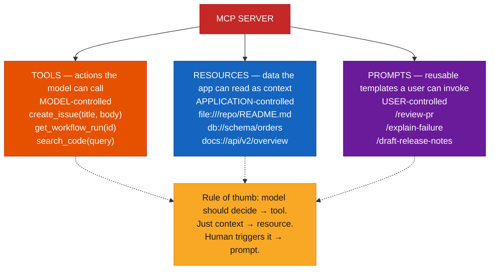

*(Examples are the deck's illustrative ones.)* **Client feature — elicitation (s.6):** "a server can ask the user for missing input mid-task, instead of guessing. Hosts differ in which features they support."

### 5. One tool call, end to end *(s.7)*

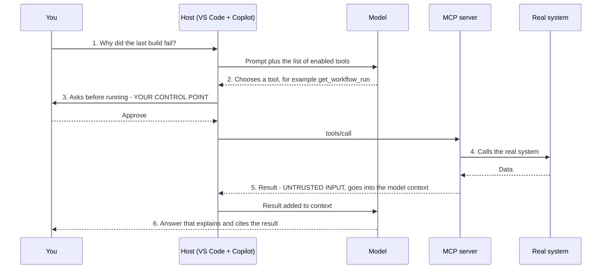

> **Why this matters (s.7):** step 3 is your control point and step 5 is your risk point.

### 6. Integrating in VS Code: add, trust, pick, check policy *(s.8)*

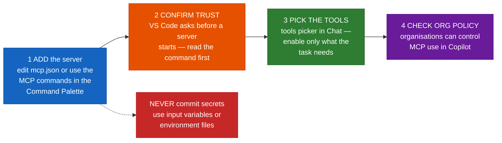

### 7. What teams connect first: read-only before read-write *(s.9)*

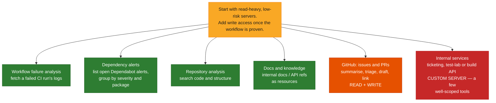

> **Tip (s.9):** "the GitHub MCP server supports a read-only mode and toolsets, so you can expose just issues, or just PRs, instead of everything."

### 8. The workflow: repo → spec check → result analysis *(s.10)*

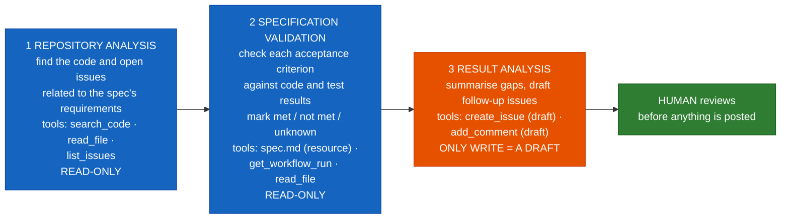

*(Tool names are the deck's illustrative ones.)*

> **Design choice (s.10):** steps 1–2 are read-only. The only write is a draft in step 3, and a human approves it. **Prove the workflow read-only first, then add writes.**

### 9. Build or reuse? *(s.12)*

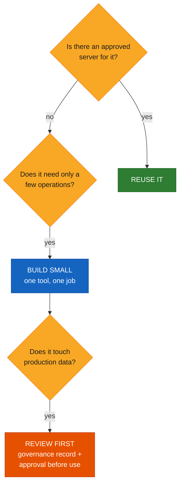

*(The deck presents these as three questions with outcomes — Reuse it / Build small / Review first; the flow arrangement is my reading of them.)*

### 10. The build loop: write, run, inspect, break, register *(s.13)*

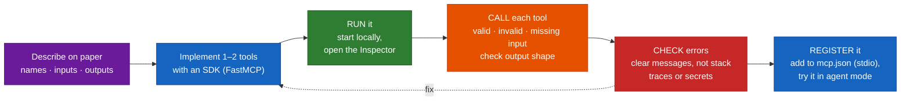

### 11. Threats and where their controls sit *(s.15)*

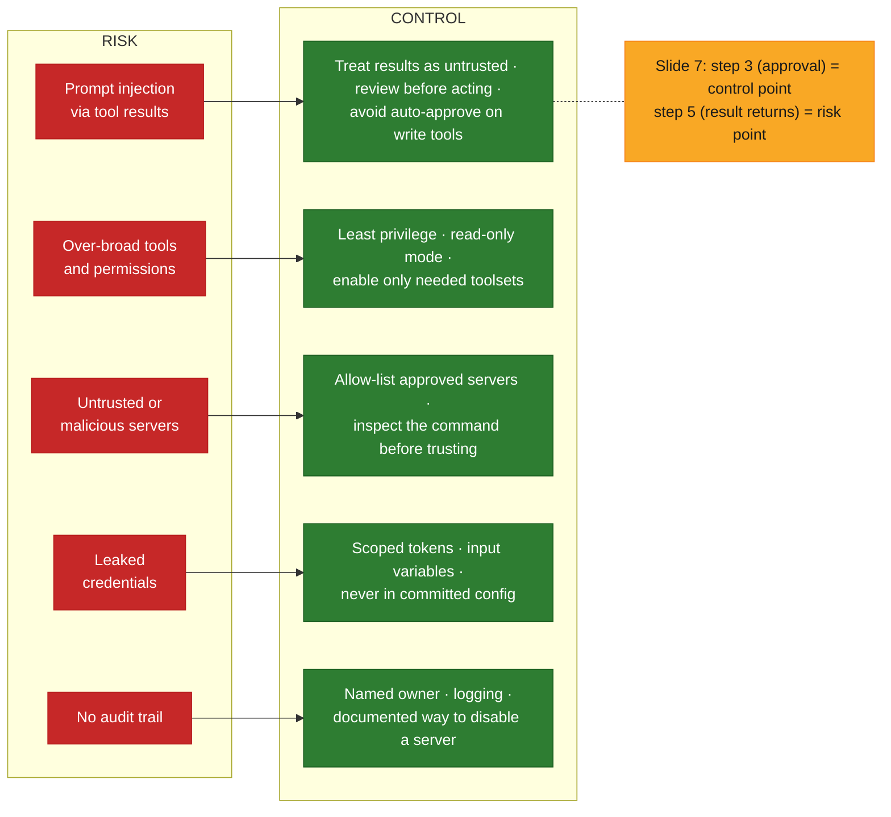

---

## Core Concepts

### Part A — MCP concepts and architecture

#### Concept card A1 · The problem: one protocol instead of N × M *(s.4)*

**Definition.** *"Every AI app connecting to every tool used to mean custom glue for each pair."* MCP replaces the glue with one protocol, so a server is built or approved **once** and any MCP-capable host can use it.

| | Without MCP | With MCP |
|---|---|---|
| Apps (Copilot in VS Code, a custom agent, another AI app) × tools (repositories, docs and wikis, internal services) | 3 × 3 = **9** custom integrations | 3 + 3 = **6** implementations |

*The numbers are the counting argument for 3 apps and 3 tools — "real estates have far more."*

**Analogy (deck's):** a common plug for AI apps and tools. MCP does not change what's on the other end of the plug; it just means you don't rewire each appliance.

#### Concept card A2 · Host, client, server, system *(s.5)*

| Participant | Role |
|---|---|
| **Host** | The AI application the user sits in — here **VS Code + Copilot agent mode**; it coordinates the clients |
| **Client** | A protocol-level component inside the host that keeps **one connection to one server** |
| **Server** | A program that provides context/tools to clients — GitHub's remote server, a local docs/fetch server, **your custom server** |
| **System of record** | What the server actually talks to: GitHub API, web pages and docs, an internal API or database |

**Two transports (s.5):**

| Transport | Used for | Notes |
|---|---|---|
| **stdio** | Local servers — a process on your machine | The deck's docs/fetch server example |
| **Streamable HTTP** | Remote servers — reachable by URL | Usually with OAuth; the deck's GitHub server example |

JSON-RPC 2.0 sits on top of both, so the protocol is the same. The MCP architecture page adds: Streamable HTTP "supports standard HTTP authentication methods including bearer tokens, API keys, and custom headers" and "MCP recommends using OAuth".

#### Concept card A3 · Tools, resources and prompts *(s.6)*

| Building block | What it is | Controller | Deck's illustrative examples |
|---|---|---|---|
| **Tools** | Actions the model can call | **Model** | `create_issue(title, body)` · `get_workflow_run(id)` · `search_code(query)` |
| **Resources** | Data the app can read as context | **Application** | `file:///repo/README.md` · `db://schema/orders` · `docs://api/v2/overview` |
| **Prompts** | Reusable templates a user can invoke | **User** | `/review-pr` · `/explain-failure` · `/draft-release-notes` |

> **Rule of thumb (s.6):** "if the model should decide to do it, make it a tool. If it is just context, make it a resource. If a human triggers it, make it a prompt."

The MCP [server concepts](https://modelcontextprotocol.io/docs/learn/server-concepts) page uses the same model/application/user split, and notes that tools "may require user consent prior to execution", listing UI patterns such as approval dialogs for individual executions, permission settings for pre-approving "safe" operations, and activity logs.

**Client feature — elicitation (s.6).** A server can ask the user for missing input mid-task. The MCP [client concepts](https://modelcontextprotocol.io/docs/learn/client-concepts) page describes two modes: **form** (structured input, validated against a schema) and **URL** (the user is sent to a page and the data "never passes through the client", which makes it the mode for sensitive things like credentials). It also says servers "must not use form mode to request sensitive information such as passwords, API keys, access tokens, or payment credentials".

#### Concept card A4 · One tool call, end to end *(s.7)*

| Step | What happens | |
|---|---|---|
| 1. You ask | A prompt in agent mode | |
| 2. Model chooses | Picks a tool from those listed | |
| 3. **You approve** | The host asks before running | **Control point** |
| 4. Server executes | Calls the real system | |
| 5. **Result returns** | Added to the model's context | **Risk point** — "Tool results are untrusted input: step 5 puts text from an external system into the model's context." |
| 6. Answer | The model explains and cites the result | |

The MCP [tools specification](https://modelcontextprotocol.io/specification/latest/server/tools) agrees on both ends: there "SHOULD always be a human in the loop with the ability to deny tool invocations", and clients "SHOULD … validate tool results before passing to LLM". It also separates **protocol errors** (unknown tool, malformed request) from **tool execution errors** reported in the result with `isError: true`, which "language models can use to self-correct and retry" — the shape you'll see in Part D.

---

### Part B — Integrating MCP in Copilot

#### Concept card B1 · Add, trust, pick, check policy *(s.8)*

**The deck's workspace config — "shared with the team" (illustrative):**

```json
{
  "servers": {
    "github": {
      "type": "http",
      "url": "https://api.githubcopilot.com/mcp/"
    },
    "team-docs": {
      "type": "stdio",
      "command": "npx",
      "args": ["-y", "<docs-server-package>"]
    }
  }
}
```

| Step | Do |
|---|---|
| **Add the server** | Edit `mcp.json`, or use the MCP commands in the Command Palette |
| **Confirm trust** | VS Code asks you to trust a server before it starts — **read the command first** |
| **Pick the tools** | Open the tools picker in Chat; **enable only what the task needs** |
| **Check org policy** | Organisations can control MCP use in Copilot; it is off by default for some plans |

> **Never commit secrets (s.8):** use input variables or environment files for tokens in `mcp.json`. "The file is shared; the credentials must not be."

**What the current VS Code docs add** (see the currency check; I did not run VS Code):
- Command Palette commands named there: **MCP: Add Server**, **MCP: List Servers**, **MCP: Open User Configuration**, **MCP: Open Workspace Folder MCP Configuration**, **MCP: Browse Resources**, **MCP: Reset Trust**.
- The tools picker is **Configure Tools** in the chat input; you "may be asked to confirm each tool invocation".
- Trust: servers from other sources "show a trust dialog the first time they start or when their configuration changes"; servers in workspace config files inherit Workspace Trust.
- Organisations can manage MCP access centrally via enterprise-managed settings, including an enterprise allowlist.
- **File shape differs:** the workspace-root `.mcp.json` uses `mcpServers`; the older `.vscode/mcp.json` uses `servers`. Same content, different top-level key:

```json
{
  "mcpServers": {
    "github": {
      "type": "http",
      "url": "https://api.githubcopilot.com/mcp/"
    }
  }
}
```

**[Beyond the deck] — the GitHub server with a PAT and an input variable** (shape quoted from the github/github-mcp-server README; OAuth needs no token at all in VS Code):

```json
{
  "servers": {
    "github": {
      "type": "http",
      "url": "https://api.githubcopilot.com/mcp/",
      "headers": {
        "Authorization": "Bearer ${input:github_mcp_pat}"
      }
    }
  },
  "inputs": [
    {
      "type": "promptString",
      "id": "github_mcp_pat",
      "description": "GitHub Personal Access Token",
      "password": true
    }
  ]
}
```

The token is prompted for, not written into the file. The README's advice: minimum scopes, separate tokens per project, rotate regularly, keep tokens out of version control.

**[Beyond the deck] — a read-only remote GitHub server for Lab 1.** Per the server's `docs/remote-server.md`: *"Add `/readonly` to the end of any URL to restrict the tools in the toolset to only those that enable read access."* Using the URL pattern from that page (not tested in VS Code):

```json
{
  "servers": {
    "github-readonly": {
      "type": "http",
      "url": "https://api.githubcopilot.com/mcp/readonly"
    },
    "github-actions-readonly": {
      "type": "http",
      "url": "https://api.githubcopilot.com/mcp/x/actions/readonly"
    }
  }
}
```

The README lists the default toolsets as `context`, `repos`, `issues`, `pull_requests`, `users`, and others including `actions` and `dependabot`. The deck's Lab 1 needs code search, file reads, open issues and workflow runs — roughly the default read toolset plus `actions`. Even then, open **Configure Tools** and switch off what you don't need.

#### Concept card B2 · Real-world integrations: what teams connect first *(s.9)*

| Integration | Access | What it's for |
|---|---|---|
| **GitHub: issues and PRs** | Read + write | Summarise, triage, draft and link issues and PRs from the editor |
| **Workflow failure analysis** | Read-only | Fetch a failed CI run's logs and ask the agent for likely causes |
| **Dependency alerts** | Read-only | List open Dependabot alerts and group by severity and package |
| **Repository analysis** | Read-only | Search code and structure so the agent answers from your repo, not guesses |
| **Docs and knowledge** | Read-only | Expose internal docs and API references as resources the agent can read |
| **Internal services** | **Custom server** | Wrap a ticketing, test-lab or build API as a few well-scoped tools |

> **Start with read-heavy, low-risk servers; add write access once the workflow is proven.**

GitHub's [About MCP](https://docs.github.com/en/copilot/concepts/context/mcp) page says "Enabling only the toolsets you need improves your AI assistant's performance and security."

---

### Part C — The MCP-enabled workflow and Lab 1

#### Concept card C1 · Repo → spec check → result analysis *(s.10)*

Three agent steps, each using different tools, with a human checkpoint before anything is written.

| Step | Agent does | Tools (illustrative) | Access |
|---|---|---|---|
| **1 Repository analysis** | Finds the code and open issues related to the spec's requirements | `search_code` · `read_file` · `list_issues` | Read-only |
| **2 Specification validation** | Checks each acceptance criterion against code and test results; marks **met / not met / unknown** | `spec.md` (resource) · `get_workflow_run` · `read_file` | Read-only |
| **3 Result analysis** | Summarises gaps and drafts follow-up issues; **you review before anything is posted** | `create_issue` (draft) · `add_comment` (draft) | Draft only |

This is Modules 04–06 in action: the spec's acceptance criteria (with IDs) are what step 2 validates, and the test results from Module 06 are the evidence. Module 03's point applies too — tool results become context, so ask for **small, file-backed, cited** outputs (the "met / not met / unknown" statuses with file or run references).

#### Concept card C2 · Lab 1 — Connect and Validate *(s.11, 35 min)*

**Goal.** Connect a **read-only** MCP server, then use agent mode to check your feature's spec against the repo and produce a gap list.

| Step | Do |
|---|---|
| 1 | Add the GitHub MCP server in `.vscode/mcp.json`, **trust it, and enable only the read tools you need** in the tools picker |
| 2 | Prompt: find the code and tests for each acceptance criterion in `spec.md`. **Watch which tools it calls and approve each one** |
| 3 | Ask it to mark each criterion **met / not met / unknown**, **citing the file or run** that supports it |
| 4 | Have it **draft (not post)** one follow-up issue for a gap. Review the draft and edit it |

Files you create (deck's tree, under `lab07a/`):

```
lab07a/
  .vscode/mcp.json
  spec.md
  validation-report.md
  draft-issue.md
```

**Done when:** `validation-report.md` lists every criterion with a status and evidence, **and you can name every tool call the agent made.**

**[Beyond the deck] — prompts and templates for Lab 1**

*Step 2 prompt:*

```text
Using #file:spec.md, list each acceptance criterion by ID. For each one, use only
read-only tools to find (a) the code that implements it and (b) the test that covers it.
Return file paths with line numbers. Do not edit anything and do not create or comment on
issues. If you cannot find evidence, say "not found" rather than guessing.
```

*Step 3 prompt:*

```text
Now mark each criterion MET, NOT MET or UNKNOWN. MET requires a cited file and a passing
test or workflow run. NOT MET requires a cited gap. Use UNKNOWN when evidence is missing
or conflicting. Output a markdown table: AC | Status | Evidence (file:line or run id) | Notes.
```

*`validation-report.md` skeleton:*

```markdown
# Validation report — <feature>
Spec: spec.md   Repo/ref checked: <owner/repo @ sha or branch>   Date: <date>
MCP servers and toolsets enabled: <list>   (all read-only: yes/no)

| AC | Status (MET / NOT MET / UNKNOWN) | Evidence (file:line / run id) | Notes |
|----|----------------------------------|-------------------------------|-------|
| AC-1 | | | |

## Tool calls the agent made (from the chat transcript)
1. <tool> — <arguments> — approved by me: yes/no
2. …

## I verified by hand (treat agent evidence as a claim until checked)
- <criterion>: opened <file> and confirmed <what>

## Gaps → draft issue
See draft-issue.md
```

*`draft-issue.md` skeleton (a draft file — nothing is posted):*

```markdown
**Title:** <criterion ID> — <short gap>
**Spec reference:** specs/<…>/spec.md#<AC-id>
**Observed:** <what the repo/tests show, with file:line or run id>
**Expected (from spec):** <the criterion>
**Suggested next step:** <one line>
**Source:** drafted by agent from read-only MCP tools; reviewed and edited by <me>
```

**Practical notes — [Beyond the deck].** (1) "Name every tool call" is easiest if you keep the chat transcript visible and copy tool names as you approve. (2) If the agent says MET without a cited file or run, send it back — a statement without evidence is the "assertion over evidence" failure from Module 06. (3) Repo text, issue bodies and logs are **untrusted input** (step 5): don't let content found in them redirect the task.

---

### Part D — Designing and building a custom MCP server

#### Concept card D1 · When to build, and how to design the tools *(s.12)*

*Build a server when an approved one does not exist for your system — and keep it small.*

| Ask | Answer |
|---|---|
| Is there an approved server for it? | **Reuse it** |
| Does it need only a few operations? | **Build small** |
| Does it touch production data? | **Review first** |

**Tool design principles (s.12):**

| Principle | Meaning |
|---|---|
| **One tool, one job** | Clear name, narrow purpose |
| **Describe it for the model** | The description is the instruction |
| **Typed, validated inputs** | Reject bad arguments early |
| **Small, structured output** | Return what is needed, not a dump |
| **Safe by default** | Read-only unless writes are essential |

> **Anti-pattern (s.12):** a single `run_query(sql)` or `run_command(cmd)` tool. "It hands the model your whole system. Expose the three questions you actually need answered."

The MCP tools spec adds naming guidance — names "SHOULD be between 1 and 128 characters", use letters, digits, underscore, hyphen and dot, and be unique within a server — and a requirement list for servers: **validate all tool inputs, implement proper access controls, rate limit tool invocations, sanitize tool outputs**.

#### Concept card D2 · A minimal server in about twenty lines *(s.13)*

**The deck's `server.py` (illustrative — FastMCP for Python):**

```python
from fastmcp import FastMCP

mcp = FastMCP("Build Tools")


@mcp.tool
def get_build_status(build_id: str) -> dict:
    """Return status and failing step for a build.
    Read-only. build_id looks like 'b-1234'."""
    if not build_id.startswith("b-"):
        raise ValueError("invalid build id")
    # call your real build API here
    return {"id": build_id, "status": "failed", "step": "unit-tests"}


if __name__ == "__main__":
    mcp.run()
```

**I ran this unchanged** (FastMCP 4.1.0 on Python 3.14.7, in a scratch virtual environment) and exercised it four ways:

| Call | Result |
|---|---|
| `get_build_status("b-1234")` | OK → `{"id": "b-1234", "status": "failed", "step": "unit-tests"}` |
| `get_build_status("x-1")` (bad id) | `isError: true`, message: `Error calling tool 'get_build_status': invalid build id` |
| call with **no** argument | `isError: true`, a validation message (`Missing required argument`) — comes from the server's input schema before your code runs |
| `build_id: 123` (wrong type) | `isError: true`, validation message (`Input should be a valid string`) |

What the tool's published schema looked like to the client: `{"type": "object", "additionalProperties": false, "properties": {"build_id": {"type": "string"}}, "required": ["build_id"]}` — the type hint became the typed input, and the docstring became the description ("the description is the instruction").

The deck's four steps for this server *(s.13)*:

| Step | Do |
|---|---|
| **Run it** | Start locally with the SDK's dev command and open the Inspector |
| **Call each tool** | Valid input, invalid input, missing input. Check output shape |
| **Check errors** | Failures should be clear messages, **not stack traces or secrets** |
| **Register it** | Add to `.vscode/mcp.json` (stdio) and try it in agent mode |

> **Verify against current docs (s.13):** "SDK syntax and CLI commands change between versions. Treat this as a shape, not a copy-paste recipe." I pinned the versions above; the [FastMCP docs](https://gofastmcp.com/) and the official [Python SDK](https://github.com/modelcontextprotocol/python-sdk) are the places to re-check.

**[Beyond the deck] — how I tested it, with commands that worked.** The [MCP Inspector](https://modelcontextprotocol.io/docs/tools/inspector) is the deck's tool. Besides its web UI, I used its **CLI mode** (Inspector 2.11.0 from npm) against the server over stdio:

```bash
# list tools
npx @modelcontextprotocol/inspector --cli /path/to/venv/bin/python /path/to/server.py --method tools/list

# call a tool (good input, then bad input)
npx @modelcontextprotocol/inspector --cli /path/to/venv/bin/python /path/to/server.py \
  --method tools/call --tool-name get_build_status --tool-arg build_id=b-9
npx @modelcontextprotocol/inspector --cli /path/to/venv/bin/python /path/to/server.py \
  --method tools/call --tool-name get_build_status --tool-arg build_id=zzz
```

The good call returned `content` plus `structuredContent` with `"isError": false`; the bad call returned `"isError": true` with the clear message. FastMCP's own CLI also worked once its virtual environment was first on `PATH`: `fastmcp list server.py` and `fastmcp call server.py get_build_status build_id=b-42`. (The server's *stderr* logged a full traceback for the bad call — that's the server's own log, not what the client received. Keep logs on stderr: on a stdio server, stdout *is* the protocol channel.)

**Two findings worth teaching from that run:**
1. **Validation errors echo the input.** The missing-argument and wrong-type messages included the offending `input_value` and a link to a validation-library docs page. That's fine for a build id, but it means *whatever the model sends comes back in the error* — never put secrets in tool arguments, and decide whether your errors should be trimmed.
2. **The deck's check is thin.** `startswith("b-")` accepts `b-` followed by anything. That's fine for a demo; the hardened version below uses a pattern.

**[Beyond the deck] — a hardened, three-primitive version (tested).** It shows tight input schemas, small outputs, the `readOnlyHint` annotation, and one **resource** and one **prompt** so all three building blocks from slide 6 appear. The "builds" are in-memory stand-ins for your real API:

```python
from typing import Annotated

from fastmcp import FastMCP
from pydantic import Field

mcp = FastMCP("Build Tools")

# Stand-in for your real build API (read-only in this sketch).
_BUILDS = {
    "b-1234": {"status": "failed", "step": "unit-tests"},
    "b-1235": {"status": "passed", "step": None},
    "b-1236": {"status": "failed", "step": "lint"},
}


@mcp.tool(annotations={"readOnlyHint": True})
def get_build_status(
    build_id: Annotated[str, Field(pattern=r"^b-\d{1,8}$", description="Build id, e.g. 'b-1234'")],
) -> dict:
    """Return the status and failing step (if any) for one build. Read-only."""
    build = _BUILDS.get(build_id)
    if build is None:
        raise ValueError(f"no build with id {build_id}")
    return {"id": build_id, **build}


@mcp.tool(annotations={"readOnlyHint": True})
def list_failed_builds(
    limit: Annotated[int, Field(ge=1, le=20, description="Max builds to return (1-20)")] = 5,
) -> list[dict]:
    """List the most recent failed builds (id and failing step only). Read-only."""
    failed = [{"id": k, "step": v["step"]} for k, v in _BUILDS.items() if v["status"] == "failed"]
    return failed[:limit]


@mcp.resource("builds://policy")
def build_policy() -> str:
    """The team's rules for reading build results (context, not an action)."""
    return "Only report failures from the default branch. Never paste raw logs into tickets."


@mcp.prompt
def explain_failure(build_id: str) -> str:
    """User-invoked template: explain why a build failed."""
    return f"Use get_build_status for {build_id}, then explain the likely cause in three sentences."


if __name__ == "__main__":
    mcp.run()
```

What I observed running that file (FastMCP 4.1.0, same environment):

| Check | Result |
|---|---|
| Tools listed | `get_build_status`, `list_failed_builds`, both with `readOnlyHint: true`; schemas carried the `pattern` and the `minimum`/`maximum`/`default` constraints |
| Resource / prompt listed | `builds://policy` readable; prompt `explain_failure` listed |
| `list_failed_builds(limit=5)` | `[{"id": "b-1234", "step": "unit-tests"}, {"id": "b-1236", "step": "lint"}]` — id and step only, not logs |
| `build_id = "b-1; DROP TABLE"` | `isError: true` — rejected by the schema pattern before the function body ran |
| `build_id = "b-9999"` (unknown) | `isError: true`, `no build with id b-9999` |
| `limit = 500` | `isError: true` — rejected by the `le=20` bound |

> **Don't treat `readOnlyHint` as enforcement.** The MCP tools spec says clients "MUST consider tool annotations to be untrusted unless they come from trusted servers." The hint helps UIs; real read-only-ness comes from what your server's credentials can do.

**[Beyond the deck] — registering it (shape only; I did not run VS Code).** For a stdio server, use the interpreter that has the dependencies (see currency-check item 6), and an absolute path to the script:

```json
{
  "servers": {
    "build-tools": {
      "type": "stdio",
      "command": "/absolute/path/to/venv/bin/python",
      "args": ["/absolute/path/to/server.py"]
    }
  }
}
```

(Use the `mcpServers` key if your VS Code writes to workspace-root `.mcp.json`.) Don't put API tokens in `env` in a committed file — use input variables or an environment file, as on slide 8.

#### Concept card D3 · Lab 2 — Build, Wire, Govern *(s.14, 45 min)*

**Goal.** Build a server with **one or two read-only tools**, test it, wire it into Copilot, and document how it is governed.

| Step | Do |
|---|---|
| 1 | Pick a system (build status, test results, docs index). **Write the tool names, inputs and outputs on paper before any code** |
| 2 | Implement one or two tools **with Copilot's help**. Validate inputs and keep outputs small. Test in the Inspector |
| 3 | Register it in `.vscode/mcp.json` and run a short agent prompt that needs your tool. **Note what you had to approve** |
| 4 | Fill in `governance.md`: owner, purpose, tools, data touched, auth, approval rule, how to disable |

Files you create (deck's tree, under `lab07b/`):

```
lab07b/
  server.py
  .vscode/mcp.json
  governance.md
  test-notes.md
```

**Done when:** your tool works in agent mode, handles one bad input cleanly, and `governance.md` is complete enough for a reviewer to approve or reject.

**[Beyond the deck] — a `test-notes.md` skeleton** (the table mirrors the checks I ran above):

```markdown
# Test notes — <server name>
Versions: <SDK + version> · <Inspector version> · <Python/Node version>

| Tool | Input | Expected | Actual | isError | Message OK (clear, no stack trace/secret)? |
|------|-------|----------|--------|---------|---------------------------------------------|
| get_build_status | b-1234 | status object | | false | n/a |
| get_build_status | x-1 (bad id) | clear error | | true | |
| get_build_status | (missing) | clear error | | true | |
| get_build_status | wrong type | clear error | | true | |

## What I had to approve in agent mode
- <tool call> — approval prompt text — I approved because …

## Output size check
Largest response: <n> characters / <n> items. Would it flood the context? <yes/no>
```

**Practical notes — [Beyond the deck].** "Write the tool names, inputs and outputs on paper first" is the same discipline as writing the spec before the code (Module 04): it is the tool's *contract*. Asking Copilot to draft the server is fine; then **review the generated tool list** — if it produced a general `run_query`-style tool, replace it with the narrow questions you wrote on paper.

---

### Part E — Security, governance and best practices

#### Concept card E1 · Threats and their controls *(s.15)*

*Each risk has a practical control. Most of them live at the approval and result steps you saw earlier.*

| Risk | Control |
|---|---|
| **Prompt injection via tool results** | Treat results as untrusted; review before acting; **avoid auto-approve on write tools** |
| **Over-broad tools and permissions** | Least privilege; read-only mode; enable only needed toolsets |
| **Untrusted or malicious servers** | Allow-list approved servers; **inspect the command before trusting** |
| **Leaked credentials** | Scoped tokens, input variables, never in committed config |
| **No audit trail** | Named owner, logging, and a documented way to disable a server |

> **Policy note (s.15):** organisations can restrict MCP in Copilot, and availability depends on plan. **Ask your admin before rolling a server out beyond a pilot.**

**What the MCP documentation says on the same points** (verified 2026-10-15):

| Deck control | MCP docs, in their words |
|---|---|
| Treat results as untrusted | Clients **SHOULD** "validate tool results before passing to LLM"; "show tool inputs to the user before calling the server, to avoid malicious or accidental data exfiltration" |
| Human approval | "there **SHOULD** always be a human in the loop with the ability to deny tool invocations" |
| Inspect the command before trusting | Security best practices (local server compromise): a client with one-click local server setup must "show the exact command that will be executed, without truncation" and require explicit approval; local servers "run with the same privileges as the client" |
| Least privilege / scoped tokens | Scope minimization: start with a "minimal initial scope set", elevate incrementally; avoid wildcard or omnibus scopes |
| Server-side hygiene | Servers **MUST** "validate all tool inputs", "implement proper access controls", "rate limit tool invocations", "sanitize tool outputs" |
| Audit | Clients **SHOULD** "log tool usage for audit purposes" and "implement timeouts for tool calls" |
| (Extra) token handling | "Token passthrough" is an anti-pattern; "MCP servers **MUST NOT** accept any tokens that were not explicitly issued for the MCP server" |
| (Extra) state handles | If a server hands out an id for state, possession of the id must not count as authentication — "bind handles server-side to the authenticated user" |

OWASP lists prompt injection as the first risk in its LLM top-ten ([LLM01](https://genai.owasp.org/llmrisk/llm01-prompt-injection/)) — useful background for why step 5 is the risk point.

**[Beyond the deck] — a rule of thumb for auto-approval.** Treat three categories differently when deciding what to approve: **(a)** read tools on systems you already have access to — fine to approve per-call while you learn the workflow; **(b)** write tools — approve each call, read the arguments, avoid blanket auto-approve; **(c)** delete/irreversible tools — don't expose them to an agent at all unless there's a strong reason and a second human gate.

#### Concept card E2 · Governing a server: the one-page record *(s.16)*

*"If a reviewer cannot answer these seven questions from one page, the server is not ready."*

| Field | Question |
|---|---|
| **Owner** | Who maintains and fixes it? |
| **Purpose** | What job does it do? What is out of scope? |
| **Tools** | Each tool: inputs, outputs, read or write |
| **Data** | What systems and data classes can it reach? |
| **Auth** | How does it authenticate? Which scopes? |
| **Approval** | Which calls need a human yes? |
| **Off switch** | How is it disabled quickly? |

> **Habit (s.16):** store `governance.md` next to the server code and review it **in the same pull request as any new tool.**

**[Beyond the deck] — `governance.md` filled in for the hardened "Build Tools" server above** (an example of the level of detail a reviewer needs; the owner and system names are placeholders):

```markdown
# Governance record — Build Tools MCP server

**Owner:** <team / named person>, escalation <channel>
**Purpose:** Let developers ask an agent about build results. Out of scope: triggering, cancelling or editing builds; reading source or logs.
**Tools:**
| Tool | Inputs | Output | Access |
|------|--------|--------|--------|
| get_build_status | build_id matching ^b-\d{1,8}$ | id, status, failing step | read-only |
| list_failed_builds | limit 1–20 (default 5) | list of id + failing step | read-only |
**Resources / prompts:** builds://policy (reporting rules) · explain_failure (user-invoked)
**Data:** Build metadata only (ids, status, step names). No source code, no logs, no personal data.
**Auth:** Service credential with read-only scope on the build API; stored in <secret store>, supplied via input variable / env file; never in mcp.json.
**Approval rule:** Read tools may be approved per call. Any future write tool requires a new governance review and per-call approval; no auto-approve.
**Logging:** Server logs each call (tool, argument, caller) to <log sink> for <n> days.
**Off switch:** Remove the entry from mcp.json / disable in org policy · revoke the service credential.
**Review:** <date> · reviewed in PR <#>
```

#### Concept card E3 · Best practices for MCP workflows and servers *(s.17)*

*Start narrow, keep a human at the checkpoints, and treat every server as production software.*

| ✅ Do this | ❌ Avoid this |
|---|---|
| Reuse an approved server before building your own | Install servers from unknown sources without reading them |
| Start read-only; add writes only with approval steps | Auto-approve write or delete tools |
| Enable only the tools the current task needs | Expose raw SQL or shell as a single tool |
| Write tool descriptions and typed inputs for the model | Put tokens or secrets in `mcp.json` or logs |
| Test with the Inspector, including bad input | Return huge payloads that flood the context |
| Keep a one-page governance record per server | Assume a server is safe because the protocol is standard |

> **Golden rule (s.17):** MCP standardises how an agent connects. It does not decide what the agent should be allowed to do — **you** do.

---

### Part F — Progressive path: simple → advanced

| Level | You can… | Practise with |
|---|---|---|
| 1 | Explain host / client / server and tools / resources / prompts | Parts A2–A3 |
| 2 | Narrate one tool call and point at the control and risk steps | Part A4 |
| 3 | Add a server, trust it deliberately, and enable only needed tools | Part B1; Lab 1 step 1 |
| 4 | Run a read-only repo → spec check → draft workflow and cite evidence | Part C; Lab 1 |
| 5 | Build, test (valid / invalid / missing input) and register a small read-only server | Part D; Lab 2 steps 1–3 |
| 6 | Write the governance record and the threat/control mapping for a server | Part E; Lab 2 step 4 |

---

## Outcomes — "What you can do now" *(s.18)*

- [ ] **Explain** hosts, clients, servers and the tools / resources / prompts model.
- [ ] **Configure** MCP servers in VS Code and choose tools deliberately.
- [ ] **Run** a repo → spec validation → result analysis workflow.
- [ ] **Design and build** a small, read-only custom MCP server.
- [ ] **Test** a server with the Inspector and register it for agent use.
- [ ] **Apply** security controls and document governance for every server.

**Next — Module 08: PR Automation, Quality Gates & LLM-as-Judge (1 hour).** Use agents and MCP tools to review pull requests, enforce quality gates and judge AI output.

---

## Glossary

| Term | Meaning |
|---|---|
| **MCP (Model Context Protocol)** | An open protocol for connecting AI applications to tools and data — "a common plug" |
| **Host** | The AI application (here VS Code + Copilot agent mode) that manages the clients |
| **Client** | A component inside the host holding one connection to one server |
| **Server** | A program that exposes tools, resources and prompts — local or remote |
| **System of record** | The real system behind a server (GitHub, docs, internal API/DB) |
| **stdio / Streamable HTTP** | Local-process transport / remote-by-URL transport (usually with OAuth) |
| **JSON-RPC 2.0** | The message format MCP uses over either transport |
| **Tool / Resource / Prompt** | Model-controlled action / application-controlled context / user-controlled template |
| **Elicitation** | A server asking the user for missing input mid-task (form or URL mode) |
| **Tools picker / Configure Tools** | The VS Code chat control for enabling only the tools a task needs |
| **Workspace trust / server trust** | VS Code's prompts before a workspace or an MCP server is allowed to run |
| **Read-only mode / toolsets** | GitHub MCP server options to expose fewer, safer tools |
| **MCP Inspector** | A developer tool for connecting to a server, listing and calling its tools |
| **FastMCP** | A Python framework for building MCP servers (used in the deck's example) |
| **`isError`** | The result flag that marks a tool execution error the model can read and retry |
| **Tool annotation / `readOnlyHint`** | Metadata describing a tool's behaviour — advisory, not enforcement |
| **Prompt injection** | Instructions hidden in data (like a tool result) that try to steer the model |
| **Least privilege** | Give a tool or token only the access the task needs |
| **Governance record** | The one-page `governance.md`: owner, purpose, tools, data, auth, approval, off switch |

---

## References

All links below returned 200. Pages whose *content* I read are noted; others I confirmed exist by title only.

### Course sources
- `presentations/Module07_MCP_Workflows_Custom_Server.pdf` — the deck this guide follows.
- Earlier guides: [Module 02](./module-02-github-copilot-recap-advanced-features.md) · [Module 03](./module-03-prompt-engineering-context-engineering.md) · [Module 04](./module-04-spec-driven-development-github-spec-kit.md) · [Module 05](./module-05-sdd-greenfield-brownfield-modernization.md) · [Module 06](./module-06-test-strategy-validation.md).

### MCP protocol and docs
- [What is MCP? — modelcontextprotocol.io](https://modelcontextprotocol.io/docs/getting-started/intro) *(title only)*
- [Architecture overview](https://modelcontextprotocol.io/docs/learn/architecture) *(content read)* — hosts, clients, servers; layers; transports; primitives.
- [Understanding MCP servers](https://modelcontextprotocol.io/docs/learn/server-concepts) *(content read)* — tools, resources, prompts and who controls each.
- [Understanding MCP clients](https://modelcontextprotocol.io/docs/learn/client-concepts) *(content read)* — elicitation; deprecated roots and sampling.
- [MCP specification — Tools](https://modelcontextprotocol.io/specification/latest/server/tools) *(content read)* — tool definitions, error handling, security considerations.
- [Security Best Practices](https://modelcontextprotocol.io/docs/tutorials/security/security_best_practices) *(content read)* — confused deputy, token passthrough, local server compromise, scope minimization.
- [MCP Inspector docs](https://modelcontextprotocol.io/docs/tools/inspector) *(title only)* · [modelcontextprotocol/inspector](https://github.com/modelcontextprotocol/inspector) *(I ran its CLI mode)*
- [modelcontextprotocol/servers](https://github.com/modelcontextprotocol/servers) *(title only)* — reference server implementations.
- [JSON-RPC 2.0 Specification](https://www.jsonrpc.org/specification) *(title only)*

### GitHub Copilot and VS Code
- [About Model Context Protocol (MCP) — GitHub Docs](https://docs.github.com/en/copilot/concepts/context/mcp) *(content read)* — what MCP is for Copilot; the "MCP servers in Copilot" policy.
- [Extending GitHub Copilot Chat with MCP servers — GitHub Docs](https://docs.github.com/en/copilot/how-tos/provide-context/use-mcp/extend-copilot-chat-with-mcp) *(title only)*
- [github/github-mcp-server](https://github.com/github/github-mcp-server) *(README read)* — official GitHub MCP server: toolsets, `--read-only`, PAT configuration.
- [github-mcp-server — remote server doc](https://github.com/github/github-mcp-server/blob/main/docs/remote-server.md) *(content read)* — remote URL, `/readonly` and per-toolset URLs.
- [Add and manage MCP servers in VS Code](https://code.visualstudio.com/docs/agent-customization/mcp-servers) *(content read)* — config locations, trust, tools picker, commands.
- [MCP configuration reference — VS Code](https://code.visualstudio.com/docs/agents/reference/mcp-configuration) *(title only)*

### Building servers
- [FastMCP documentation](https://gofastmcp.com/) *(title only)* · [PrefectHQ/fastmcp](https://github.com/PrefectHQ/fastmcp) *(title only)* — the framework used in the deck's example; I ran version 4.1.0.
- [modelcontextprotocol/python-sdk](https://github.com/modelcontextprotocol/python-sdk) *(title only)* — the official Python SDK (a separate package from FastMCP).

### Security background
- [OWASP LLM01:2025 Prompt Injection](https://genai.owasp.org/llmrisk/llm01-prompt-injection/) *(title only)*

### Not verified / caveats
- I did not run VS Code, Copilot agent mode, or the GitHub MCP server; the VS Code config shapes and the read-only URLs come from the docs pages above, and the Lab 1 prompts and report templates are my own suggestions.
- The server code was run only against local, in-memory stand-ins — no real build API, no OAuth, no remote transport. FastMCP 4.1.0, `mcp` 2.3.0, Python 3.14.7 and Inspector 2.11.0 were the versions in my scratch environment.
- Deck tool names and URIs (`create_issue`, `search_code`, `docs://api/v2/overview`, …), the `<docs-server-package>` placeholder, and the "illustrative" snippets are the deck's examples, not endorsements of specific packages.
- The deck's claim that availability "depends on plan" is consistent with GitHub's policy page for Copilot Business/Enterprise; your organisation's actual settings are not something I could check.
