# PR Automation, Quality Gates & LLM-as-Judge — Comprehensive Guide

> **Module 08 · Day 3 · 1 hour · Concepts + 1 lab · Primary tools: Copilot code review + CI**
> Source: `presentations/Module08_PR_Automation_Quality_Gates_LLM_Judge.pdf` (18 slides). Slide numbers below are written *(s.N)*.
> Material that is not in the deck is marked **[Beyond the deck]**. Deck snippets labelled "illustrative" stay illustrative.

---

## Overview

> *"Make pull-request review faster and more consistent without lowering the bar: AI review with evidence, quality gates in CI, and an LLM judge you can calibrate and trust, with a human always closing the loop."* *(s.1)*

> **Why this matters (s.3):** "AI raises the volume of code faster than humans can read it. Review has to get smarter, not just faster." — and the journey line: *agents now write and review code; this module makes sure someone checks the checkers.*

### Time budget *(s.2)*

| # | Block | Min | Slides |
|---|---|---|---|
| 1 | AI-Assisted PR Review | 8 | 4–5 |
| 2 | Evidence & Configuration | 10 | 6–8 |
| 3 | Quality Gates in CI | 10 | 9–10 |
| 4 | LLM-as-Judge | 12 | 11–14 |
| 5 | **Lab: Review a Flawed Change** | 15 | 15 |
| 6 | Best Practices & Wrap-up | 5 | 16–17 |
| | **Total** | **60** | |

### Where this sits in the 12-module journey *(s.3)*

| Link | Connection |
|---|---|
| **M04–M05 → M08** | The spec is what review checks the change against ([Module 04](./module-04-spec-driven-development-github-spec-kit.md), [05](./module-05-sdd-greenfield-brownfield-modernization.md) guides) |
| **M06 → M08** | Test evidence and regression risk come from the test strategy ([Module 06 guide](./module-06-test-strategy-validation.md)) |
| **M07 → M08** | MCP tools feed review agents, and the same governance applies ([Module 07 guide](./module-07-mcp-workflows-custom-server.md)) |
| **M08 → M11** | Judge scores and gate results become quality metrics |

### ⚠ Currency check and findings (as of 2026-10-15)

The deck's ideas hold. These are the details worth knowing before you teach it — checked against GitHub's documentation, and (for the lab) reproduced in a scratch project.

| # | Topic | Deck says | What I found | What to do |
|---|---|---|---|---|
| 1 | **Do Copilot reviews count as approvals?** *(s.4, s.16)* | "Required CI checks, not AI comments, are what block a merge"; merge approval stays with a named human | GitHub Docs: "By default, Copilot's reviews do not count toward required approvals" and the review is left as a **Comment**. **But** a *public-preview* option exists: if enabled, "Copilot can submit an approving review that satisfies your repository's required-approval rule". At enterprise level the setting defaults to "Disabled everywhere". | Consistent by default. If your org turns Copilot approvals on, it contradicts the deck's principle — treat that as a governance decision, not a convenience. |
| 2 | **Which branch the instructions come from** *(s.7)* | "Read from the PR head branch — test an instruction change in the same PR" | Confirmed: Copilot "reads repository custom instructions, agent instructions, and agent skills from the head branch". It also reads **`AGENTS.md`** at the repo root. | Good — you can iterate on instructions inside one PR. |
| 3 | **Limits** *(s.7)* | Cannot change formatting, block merges, or follow external links; vague goals do nothing; start with 10–20 rules | Matches the docs, which add: it cannot change the PR overview comment; keep a single file to about **1,000 lines**; "Copilot may not follow every instruction perfectly every time". To use an external standard, **copy its content into the file**. | See "format" caveat in row 4. |
| 4 | **"Ask for where / what / why / fix / confidence"** *(s.6)* | The evidence-based comment shape | Because instructions "cannot change the format of review comments", you can ask but cannot enforce this shape in Copilot's own comments. **My inference:** treat the shape as something you *assess* (Lab step 2 does exactly that) and enforce it where you control the format — the judge prompt. | Put "confidence" into the judge's JSON and into your own review, not only into the review instruction file. |
| 5 | **It reviews once by default** — **[Beyond the deck]** | Not mentioned | "Unless Copilot has been configured to review each push to a pull request, it will only review a pull request once." Re-request with the Reviewers menu, or enable **Review new pushes** in the ruleset. | Mention it in the lab: after you fix something, re-request the review. |
| 6 | **Static analysis is a separate product** — **[Beyond the deck]** | Review and "automated checks" shown as separate stages | GitHub's code-review page: static analysis is **GitHub Code Quality** ("Rules-based CodeQL-powered analysis"), not part of Copilot review; Copilot's agentic review can also gather project context and use MCP servers. | Keep your deterministic scanners in the "automated checks" stage; don't expect the AI reviewer to replace them. |
| 7 | **`actions/dependency-review-action@v5`** — **[Beyond the deck]** | (Not in the deck; I wanted a dependency gate for the recipes) | The action's README uses `@v5`, **but no floating `v5` tag existed when I checked** — only the full tag `v5.0.0` (the `v4.x` tags exist; `actions/checkout@v7` and `actions/setup-dotnet@v6` do have floating tags). So `@v5` would not resolve. The workflow below uses `@v5.0.0`. | Pin versions (ideally to a commit SHA per your org's standard) and **let `actionlint` plus a first run catch typos** — `actionlint` doesn't know whether a tag exists. |
| 8 | **Availability** | "Copilot code review" | Plan-dependent: the docs mention Copilot Business/Enterprise licences, and say the Free plan does not include code review. Dependency review's action works on public repos, and private repos "that have GitHub Code Security or GitHub Advanced Security enabled". | Ask your admin which features your org has. |
| 9 | **"Passes CI and looks tidy, but silently drops an acceptance criterion"** *(s.5)* | A real-world use case | **I reproduced it** in a scratch project (Part E): all tests green, the Module 06 AC-presence check clean, yet a guard was removed and a payload logged. | Use it as the lab's story. |

I **did not run Copilot code review or any LLM judge** — no model was called in this guide. What I verified by running: the lab's flawed change and its CI result, the three advisory gate scripts, the workflow's syntax (`actionlint`), and a small judge-calibration library with 15 passing tests (one of them cross-checking my kappa against scikit-learn).

---

## Quick Start

1. **Order the pipeline from deterministic to accountable** *(s.4)*: PR opened (template filled, spec linked) → automated checks (build, lint, tests, scans) → AI review (comments with evidence) → LLM judge (scores spec fit and risk) → **human approval owns the merge**.
2. **AI review and judges advise; they do not own the decision.** "Required CI checks, not AI comments, are what block a merge" *(s.4)*.
3. **Review six dimensions** *(s.5)* — the first two are the ones generic tools miss: **specification compliance** and **coding/design standards**; then security, test evidence, regression risk, maintainability.
4. **A comment you cannot verify costs more reviewer time than it saves** *(s.6)*: want **Where · What · Why · Fix · Confidence**. Low confidence, security findings and protected areas go to a **named human**.
5. **Configure review with short, specific, testable rules** *(s.7)* — `copilot-instructions.md` plus path-scoped `*.instructions.md` with `applyTo`; start with 10–20 rules; test them on real PRs.
6. **Layer the gates** *(s.9)*: cheap deterministic gates first (build/lint, tests, security scan — **blocking**); spec check and AI review **advisory first**; human approval blocking. Promote a gate to blocking only when the team agrees it has earned it.
7. **An LLM judge is another model** *(s.11–14)*: write an **anchored, small rubric**, know its four biases (length, position, self-preference, confident-but-wrong), **calibrate against human labels**, and track how often humans overturn it.
8. **Golden rule (s.16):** "the goal is fewer review cycles at the same or better quality — measure both, never just the first."

---

## Visual Summary

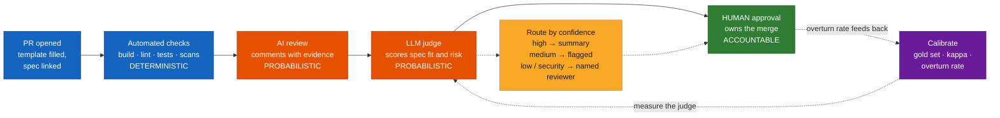

---

## Architecture

### 1. The review pipeline: automation first, human last *(s.4)*

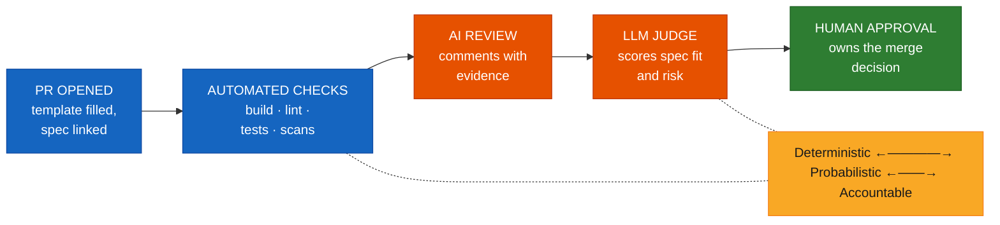

> **Principle (s.4):** AI review and judges advise; they do not own the decision. Merge approval stays with a named human, and required CI checks — not AI comments — are what block a merge.

### 2. Six dimensions an AI reviewer should check *(s.5)*

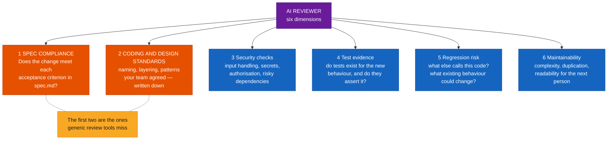

### 3. Anatomy of an evidence-based comment *(s.6)*

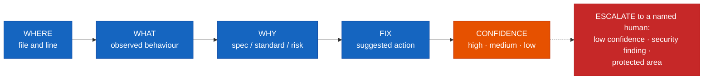

| | Comment |
|---|---|
| **Weak** *(s.6)* | "This might have security issues. Consider improving error handling." — no location, no evidence, no action, no confidence. |
| **Evidence-based (illustrative, s.6)** | "OrderService.cs L42: AC-3 requires rejecting quantity ≤ 0, but this path accepts 0. No test covers it. Suggest a guard and a boundary test. Confidence: high." |

> **Escalation rule (s.6):** low confidence, security findings, or anything touching a protected area goes to a named human reviewer. "Agree the rule once as a team; do not leave it to each reviewer."

### 4. Where Copilot review gets its rules *(s.7)*

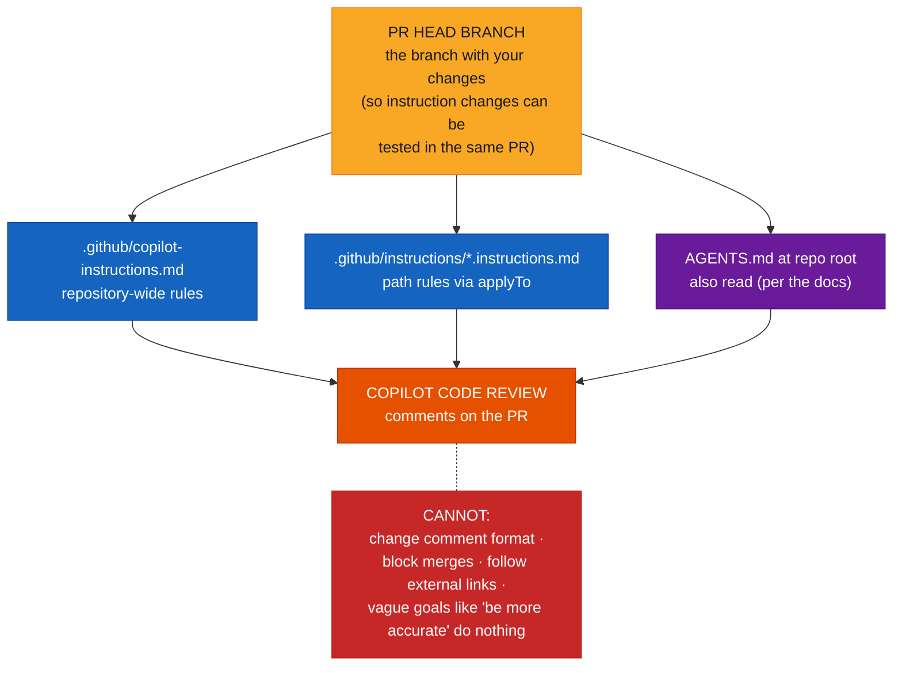

### 5. One PR through the whole flow — sequence **[Beyond the deck]**

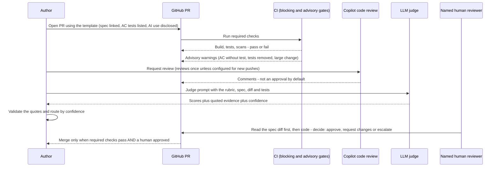

### 6. Layered quality gates *(s.9)*

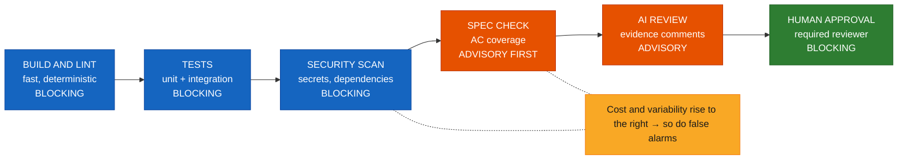

> **Design rule (s.9):** block only on checks you trust. Start a new AI-based gate as advisory, measure how often it is right, and promote it to blocking only when the team agrees it earns it.

### 7. Promoting a gate from advisory to blocking — flow **[Beyond the deck]**

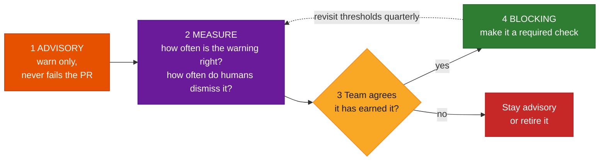

### 8. LLM-as-judge: inputs → judge → score → action *(s.11)*

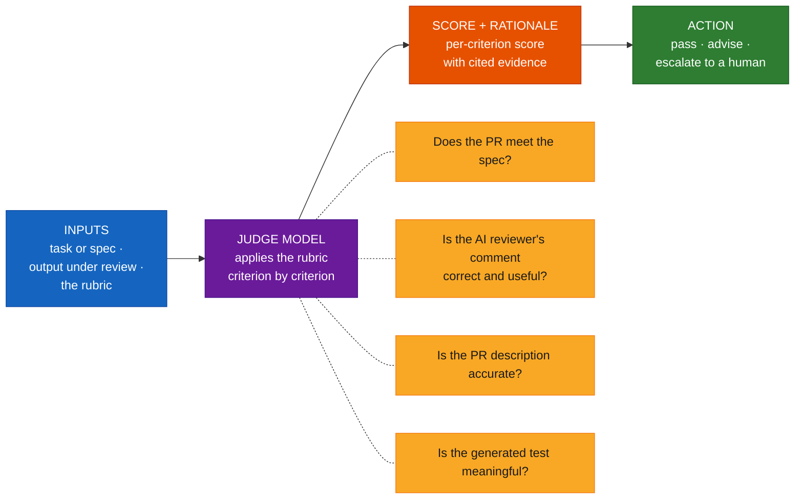

### 9. Judge failure modes and mitigations *(s.13)*

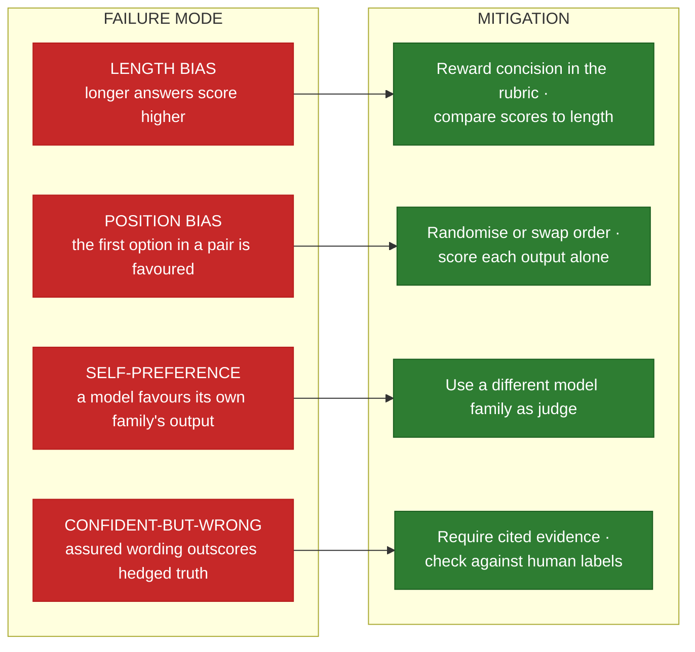

### 10. Judge output guard-rails — flow **[Beyond the deck]**

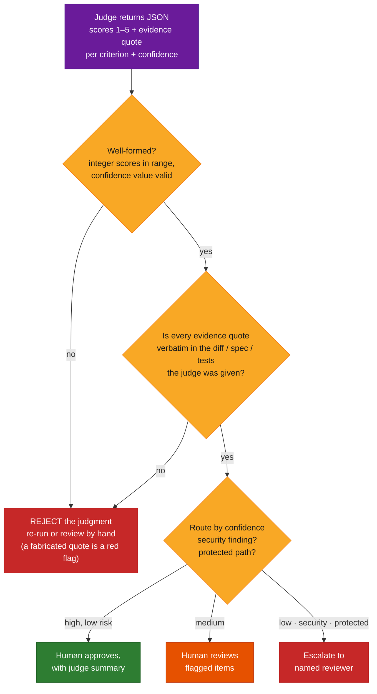

### 11. Calibrate the judge, then route by confidence *(s.14)*

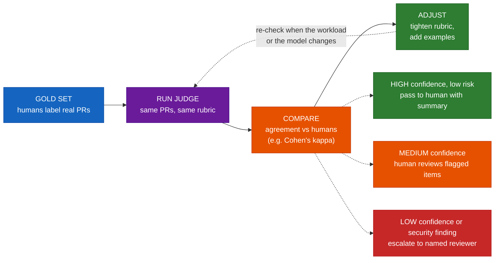

> **Closing the loop (s.14):** a human approves every merge. Track how often reviewers overturn the judge — "that rate tells you whether it is helping or just adding noise." The routing policy is illustrative; the agreement target is a team decision.

### 12. The lab: review a flawed change *(s.15)*

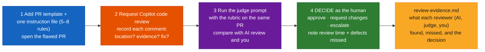

---

## Core Concepts

### Part A — The review pipeline and what to check

#### Concept card A1 · Automation first, human last *(s.4)*

**Definition.** Each stage removes a kind of problem so the human reviewer spends time on judgement.

| Stage | Produces | Nature |
|---|---|---|
| **PR opened** | Template filled, spec linked | Author-supplied evidence |
| **Automated checks** | Build, lint, tests, scans | **Deterministic** |
| **AI review** | Comments with evidence | **Probabilistic** |
| **LLM judge** | Scores spec fit and risk | **Probabilistic** |
| **Human approval** | The merge decision | **Accountable** |

**Analogy.** Airport security: scanners and metal detectors (deterministic) clear the obvious problems, a trained officer (probabilistic, tired after a long shift) flags the odd bag, and a named person with the authority decides who boards. You wouldn't let the sniffer dog sign the boarding pass.

**The principle, again (s.4):** AI review and judges advise. A named human owns the merge; required CI checks are what block it.

**GitHub mechanisms that implement "human owns it".** Branch protection and rulesets can require status checks and pull-request reviews ([protected branches](https://docs.github.com/en/repositories/configuring-branches-and-merges-in-your-repository/managing-protected-branches/about-protected-branches), [rulesets](https://docs.github.com/en/repositories/configuring-branches-and-merges-in-your-repository/managing-rulesets/about-rulesets) — the rulesets page says multiple rulesets can apply to one branch and the most restrictive rule wins where they conflict). On Copilot specifically, see row 1 of the currency table: reviews don't count toward required approvals unless your organisation enables the preview option.

#### Concept card A2 · What an AI reviewer should check *(s.5)*

| # | Dimension | The question |
|---|---|---|
| 1 | **Specification compliance** | Does the change meet each acceptance criterion in `spec.md`? |
| 2 | **Coding and design standards** | Naming, layering, patterns your team agreed — **written down** |
| 3 | Security checks | Input handling, secrets, authorisation, risky dependencies |
| 4 | Test evidence | Do tests exist for the new behaviour, and do they actually assert it? |
| 5 | Regression risk | What else calls this code? What existing behaviour could change? |
| 6 | Maintainability | Complexity, duplication, readability for the next person |

*"The first two are the ones generic review tools miss."*

> **Real-world use case (s.5):** "a change passes CI and looks tidy, but silently drops an acceptance criterion. Only a spec-aware review catches that; a linter never will." Part E reproduces exactly this.

---

### Part B — Evidence and configuration

#### Concept card B1 · Evidence-based comments, confidence and escalation *(s.6)*

*"A comment you cannot verify costs more reviewer time than it saves."*

| Part | Content |
|---|---|
| **Where** | File and line |
| **What** | Observed behaviour |
| **Why** | Spec / standard / risk |
| **Fix** | Suggested action |
| **Confidence** | High · medium · low |

**Escalation rule (s.6):** low confidence, security findings, or anything touching a protected area → a **named human reviewer**.

**[Beyond the deck] — a checklist for scoring a review comment** (Lab step 2 asks "did it give a location, evidence and a fix?"). One line per comment in `review-evidence.md`:

```markdown
| # | Comment (short) | Location? | Evidence (quote/spec/test)? | Fix? | Correct on checking? | Useful? |
|---|-----------------|-----------|-----------------------------|------|----------------------|---------|
| 1 | | Y/N | Y/N | Y/N | Y/N/partly | Y/N |
```

"Correct on checking" is the one that matters most — open the line, read the code, and decide for yourself.

#### Concept card B2 · Configuring AI review with instruction files *(s.7)*

*Tell Copilot code review what your team cares about — in short, specific, testable rules.*

| File | Purpose |
|---|---|
| `copilot-instructions.md` | Repository-wide rules |
| `*.instructions.md` + `applyTo` | Rules for specific paths, in `.github/instructions/` |
| **Read from the PR head branch** | Test an instruction change in the same PR |
| **Keep it small** | Start with 10–20 specific rules; iterate on real PRs |

**The deck's path-specific file (illustrative):**

```markdown
---
applyTo: "src/api/**"
---
# API review rules
- Every endpoint must validate input and
  return the error shape in docs/errors.md.
- Flag any change that lacks a test for
  each new acceptance criterion (AC-n).
- Never log tokens, emails or full payloads.
- Prefer small functions; flag methods > 40
  lines and say why it hurts readability.
```

**Limits to teach (s.7):** instructions cannot change comment formatting, block merges, or follow external links, and vague goals like "be more accurate" do nothing. Behaviour is non-deterministic, so test and refine.

GitHub's tutorial [Using custom instructions to unlock the power of Copilot code review](https://docs.github.com/en/copilot/tutorials/customize-code-review) agrees and adds: distinct headings, bullet points, "short, imperative directives rather than long narrative paragraphs", examples of correct and incorrect patterns, and a try-it-on-a-PR loop — "Begin with 10–20 specific instructions", open a PR, request a review, note which instructions were followed or missed, and add new ones in small groups.

**[Beyond the deck] — a lab-ready file with 7 rules** for the refund-style project used in Modules 05–06 (it sits in `lab08/.github/instructions/`; `applyTo` here targets C# files). It deliberately turns the deck's rules into *checkable* statements and leaves out anything Copilot cannot do (format, merge-blocking):

```markdown
---
applyTo: "**/*.cs"
---
# Review rules (refund service)
- Flag any change that removes or weakens a test, unless the PR description names the spec change that justifies it.
- For each acceptance criterion (AC-n) in the linked spec, check that a test tagged with that AC exists and asserts the behaviour. Flag any criterion without one.
- Flag any removed input guard (null, range, positive-amount checks) and name the acceptance criterion that required it.
- Never log whole objects, tokens, emails or complete payloads. Audit entries may contain ids and amounts only.
- Layering is Controllers -> Services -> Repositories. Flag any controller that touches a repository or the database directly.
- Flag methods longer than 40 lines and say why it hurts readability.
- When you flag something, say where (file and line), what you observed, which rule or criterion it breaks, and a suggested fix.
```

The last rule *asks* for the evidence shape but, per the currency check, cannot enforce it — which is why Lab step 2 *records* whether each comment had it.

**How to request the review** (per GitHub's [Using GitHub Copilot code review](https://docs.github.com/en/copilot/how-tos/use-copilot-agents/use-code-review)): on the PR page, **Reviewers → Copilot → Request**; from the CLI `gh pr edit PR-NUMBER --add-reviewer @copilot` (or `gh pr create --reviewer @copilot`); thumbs-up/down on a comment gives feedback. Re-request after pushes unless **Review new pushes** is on ([Configuring code review](https://docs.github.com/en/copilot/how-tos/copilot-on-github/set-up-copilot/configure-code-review): ruleset → *Automatically request Copilot code review*, with optional *Review new pushes* and *Review draft pull requests*).

#### Concept card B3 · PR templates and quality checklists *(s.8)*

*A good template makes the author supply what the reviewer — human or AI — needs.*

**The deck's `.github/pull_request_template.md` (illustrative):**

```markdown
## What and why
Spec: specs/orders/spec.md (AC-1..AC-4)

## Evidence
- [ ] Tests added/updated (list AC IDs)
- [ ] CI green; test report linked
- [ ] No new secrets or PII in logs

## Risk
- Callers affected: <list>
- Rollback: <how>

## AI assistance
- Tools used and what was human-reviewed
```

| Part | Why |
|---|---|
| **Spec linked** | Reviewer knows what "done" means |
| **Tests mapped to AC** | Evidence, not a claim |
| **Risk and rollback** | Blast radius is stated |
| **AI use disclosed** | Review depth matches origin |

> **Tip (s.8):** keep the template under a minute to complete. "Long templates get ticked without being read."

(GitHub documents PR templates in [Creating a pull request template for your repository](https://docs.github.com/en/communities/using-templates-to-encourage-useful-issues-and-pull-requests/creating-a-pull-request-template-for-your-repository); the Module 05 guide has the same pattern with brownfield and modernization extras.)

---

### Part C — Quality gates in CI

#### Concept card C1 · Layered gates, blocking vs advisory *(s.9)*

*Cheap, deterministic gates run first; costly, probabilistic ones run last.*

| Gate | Checks | Mode |
|---|---|---|
| **Build & lint** | Fast, deterministic | **Blocking** |
| **Tests** | Unit + integration | **Blocking** |
| **Security scan** | Secrets, dependencies | **Blocking** |
| **Spec check** | AC coverage | **Advisory first** |
| **AI review** | Evidence comments | **Advisory** |
| **Human approval** | Required reviewer | **Blocking** |

*"Cost and variability rise to the right → so do false alarms."*

> **Design rule (s.9):** block only on checks you trust. Start a new AI-based gate as advisory, measure how often it is right, and promote it to blocking only when the team agrees it earns it.

#### Concept card C2 · Real-world gate recipes *(s.10)*

*Each gate answers one question and has an owner and a defined response.*

| Gate | Condition | Response (deck) | One way to implement it **[Beyond the deck]** |
|---|---|---|---|
| **Changed code has tests** | Coverage on changed lines meets a team-set threshold | Block or advise — team decides | A changed-lines ("patch") coverage status, e.g. Codecov's `codecov/patch` ("measures lines adjusted in the pull request"); or a script of your own |
| **No secrets or risky dependencies** | Scanner finds none at agreed severity | **Block** | [Push protection](https://docs.github.com/en/code-security/concepts/secret-security/push-protection) for secrets (blocks pushes containing detected secrets; can be bypassed with a reason by default, with alerts and audit entries) + [dependency review](https://docs.github.com/en/code-security/concepts/supply-chain-security/dependency-review) / `actions/dependency-review-action` (fails on vulnerable additions at a severity you set) |
| **Every AC maps to a test** | Spec check lists AC IDs with no test | Advise → block when trusted | `gate-ac-coverage.sh` below (reads the AC IDs in `spec.md`, looks for the tag on tests) |
| **Large change flagged** | Diff exceeds the team's size guide | Advise: ask to split | `gate-large-change.sh` below |
| **Protected area touched** | Auth, payments or config paths changed | **Require named reviewer** | A `CODEOWNERS` file + "Require review from Code Owners" |

> **No universal numbers (s.10):** "coverage, size and severity thresholds are for your team to set from its own history. Revisit them quarterly."

**[Beyond the deck] — one workflow with blocking and advisory jobs.** Checked with `actionlint` 1.7.12 (clean). Not run on GitHub Actions. The `advisory-gates` job uses `continue-on-error: true`, so warnings show as annotations and never fail the PR; mark `build-and-test` and `dependency-review` as *required* in your branch protection or ruleset to make them blocking:

```yaml
name: pr-gates
on:
  pull_request:

permissions:
  contents: read

jobs:
  # ---- BLOCKING: cheap and deterministic. Mark these jobs as required status checks. ----
  build-and-test:
    runs-on: ubuntu-latest
    steps:
      - uses: actions/checkout@v7
      - uses: actions/setup-dotnet@v6
        with:
          dotnet-version: 8.0.x
      - run: dotnet build
      - run: dotnet test --no-build

  dependency-review:
    runs-on: ubuntu-latest
    steps:
      - uses: actions/checkout@v7
      - uses: actions/dependency-review-action@v5.0.0
        with:
          fail-on-severity: high   # a team-set threshold

  # ---- ADVISORY: new or probabilistic checks. Warn, never fail, until measured and trusted. ----
  advisory-gates:
    runs-on: ubuntu-latest
    steps:
      - uses: actions/checkout@v7
        with:
          fetch-depth: 0          # the scripts diff against the base branch
      - name: Every AC in the spec has a test
        run: ./.github/gates/gate-ac-coverage.sh specs/001-refund/spec.md
        continue-on-error: true
      - name: Tests removed?
        run: ./.github/gates/gate-removed-tests.sh "origin/${{ github.base_ref }}"
        continue-on-error: true
      - name: Large change?
        run: ./.github/gates/gate-large-change.sh "origin/${{ github.base_ref }}" 400
        continue-on-error: true
```

(Action versions: `checkout@v7` and `setup-dotnet@v6` were the current majors when I checked; the module-05 guide's workflow uses `@v4`, which still exists. Pin to whatever your organisation standardises on. See currency row 7 for why `dependency-review-action` is pinned to a full tag.)

**The three advisory scripts** (Bash; each emits a GitHub `::warning::` annotation). I ran all three in a scratch git repo — results are in Part E:

`.github/gates/gate-ac-coverage.sh` — *list acceptance criteria in the spec that no test is tagged with* (works with the `[Fact, Trait("AC", "AC-1")]` convention from the Module 06 guide):

```bash
#!/usr/bin/env bash
# Advisory gate: list acceptance criteria in the spec that no test mentions.
# Tests carry their AC as an xUnit trait: [Fact, Trait("AC", "AC-1")]
# Usage: gate-ac-coverage.sh <spec.md> [tests-dir]
set -euo pipefail
spec="${1:?usage: $0 <spec.md> [tests-dir]}"
tests="${2:-.}"
missing=0
for ac in $(grep -oE 'AC-[0-9]+' "$spec" | sort -u); do
  if ! grep -rq --include='*Tests.cs' "Trait(\"AC\", \"$ac\")" "$tests"; then
    echo "::warning title=AC without a test::$ac appears in $spec but no test is tagged with it."
    missing=$((missing + 1))
  fi
done
echo "acceptance criteria without a test: $missing"
```

`.github/gates/gate-removed-tests.sh` — *warn when a PR removes more test methods than it adds* (the "weaken or delete a failing test" anti-pattern from Module 06):

```bash
#!/usr/bin/env bash
# Advisory gate: warn when a PR removes more test methods than it adds.
# Usage: gate-removed-tests.sh <base-ref>   (e.g. origin/main)
set -euo pipefail
base="${1:?usage: $0 <base-ref>}"
diff_out="$(git diff "$base"...HEAD -U0 -- '*Tests.cs' || true)"
removed="$(printf '%s\n' "$diff_out" | grep -cE '^-[[:space:]]*\[(Fact|Theory)' || true)"
added="$(printf '%s\n' "$diff_out" | grep -cE '^\+[[:space:]]*\[(Fact|Theory)' || true)"
echo "test methods removed: $removed, added: $added"
if [ "$removed" -gt "$added" ]; then
  echo "::warning title=Tests removed::This change removes $((removed - added)) more test method(s) than it adds. Explain why in the PR (spec change?)."
fi
```

`.github/gates/gate-large-change.sh` — *warn when the diff exceeds the team's size guide* (400 is a placeholder, not a recommendation):

```bash
#!/usr/bin/env bash
# Advisory gate: warn when the diff exceeds the team's size guide.
# Usage: gate-large-change.sh <base-ref> [max-changed-lines]
set -euo pipefail
base="${1:?usage: $0 <base-ref> [max-changed-lines]}"
max="${2:-400}"   # a team-set number, not a universal one
total="$(git diff --numstat "$base"...HEAD | awk '{a += $1; d += $2} END {print a + d + 0}')"
echo "changed lines (added + deleted): $total (guide: $max)"
if [ "$total" -gt "$max" ]; then
  echo "::warning title=Large change::$total changed lines exceeds the guide of $max. Consider splitting this PR."
fi
```

**Protected areas — `CODEOWNERS`.** GitHub's [About code owners](https://docs.github.com/en/repositories/managing-your-repositorys-settings-and-features/customizing-your-repository/about-code-owners) says the file lives in `.github/`, the repo root or `docs/`, uses patterns that "follow most of the same rules used in gitignore files", and "the last matching pattern takes the most precedence"; the "Require review from Code Owners" option is in a branch protection rule. Paths and team names below are placeholders:

```text
# A named human must approve changes to these paths.
/src/Payments/   @your-org/payments-reviewers
/src/Auth/       @your-org/security-reviewers
/.github/        @your-org/platform-team
```

**A limit to teach.** The "AC maps to a test" gate is a **presence** check. It can't tell whether the test *asserts* anything, or whether a criterion's *behaviour* is still correct — see Part E, where it stays silent about a real defect.

---

### Part D — LLM-as-judge

#### Concept card D1 · A model that grades another model's work *(s.11)*

*Use it when "is this good?" needs judgement that a rule or a test cannot express.*

| Stage | What happens |
|---|---|
| **Inputs** | Task or spec, output under review, and the rubric |
| **Judge model** | Applies the rubric criterion by criterion |
| **Score + rationale** | Per-criterion score with cited evidence |
| **Action** | Pass, advise, or escalate to a human |

**Used in code review to judge…** *Does the PR meet the spec?* · *Is the AI reviewer's comment correct and useful?* · *Is the PR description accurate?* · *Is the generated test meaningful?*

> **Remember (s.11):** "a judge is another model. It can be wrong, biased or inconsistent, so it is measured and calibrated like any other check."

#### Concept card D2 · Designing a rubric: anchored, specific, few criteria *(s.12)*

*Vague rubrics give vague scores. Describe what each score level looks like.*

| Criterion | Score 1 | Score 3 | Score 5 |
|---|---|---|---|
| **Spec compliance** | Misses a stated criterion | Meets most; gaps unstated | Every AC met, with evidence |
| **Test evidence** | No tests for new behaviour | Tests exist; weak assertions | Tests assert each AC and edge |
| **Risk awareness** | Ignores callers and rollback | Mentions risk generically | Names callers, impact, rollback |
| **Comment quality** | Vague, no location | Located but no fix | Located, evidenced, actionable |

Three tips *(s.12)*: ask for **a score and a one-line evidence quote per criterion**; use **a small discrete scale (e.g. 1–5), not free text**; include **one good and one bad example per criterion**.

> **Version it (s.12):** treat the rubric prompt like code. "When scores shift, you can trace it to a rubric change."

**[Beyond the deck] — the rubric as a versioned prompt with JSON output.** Save as `lab08/judge-rubric.md`. It uses the deck's four criteria, adds the "evidence must be a verbatim quote" rule that the validator below enforces, and asks for a confidence value (the judge is where *you* control the output format). Use a judge from a **different model family** than the code-generating model *(s.13)*:

````markdown
# judge-rubric v1  (change this file in a PR; note the version in review-evidence.md)

You are reviewing a pull request. You are given: SPEC, DIFF, TESTS, PR_DESCRIPTION.
Score each criterion independently on a 1-5 scale using the anchors below.
For EVERY criterion, quote one line VERBATIM from SPEC, DIFF, TESTS or PR_DESCRIPTION as evidence.
If you cannot find a quote that supports a score, score 1 and set evidence to "none found".
Do not reward length or confident tone. Be concise.

| Criterion | 1 | 3 | 5 |
|---|---|---|---|
| spec_compliance | Misses a stated criterion | Meets most; gaps unstated | Every AC met, with evidence |
| test_evidence | No tests for new behaviour | Tests exist; weak assertions | Tests assert each AC and edge |
| risk_awareness | Ignores callers and rollback | Mentions risk generically | Names callers, impact, rollback |

Good example (spec_compliance=5): "AC-2 requires Paid only; DIFF line `if (order.Status != OrderStatus.Paid)` and test `Refund_Unpaid_Or_Already_Refunded_Order_Fails` cover it."
Bad example (spec_compliance=5): "Looks correct overall." (no quote, no criterion named)

Return ONLY this JSON:
{
  "confidence": "high" | "medium" | "low",
  "criteria": [
    {"name": "spec_compliance", "score": 1-5, "evidence": "<verbatim quote>"},
    {"name": "test_evidence",   "score": 1-5, "evidence": "<verbatim quote>"},
    {"name": "risk_awareness",  "score": 1-5, "evidence": "<verbatim quote>"}
  ],
  "suggested_action": "approve" | "request-changes" | "escalate"
}
````

*(Comment quality is the criterion for judging the **AI reviewer's comments** rather than the PR; run it as a second pass over the comments.)*

#### Concept card D3 · Where judges go wrong — and what reduces it *(s.13)*

*Four documented failure modes. None disappear; all can be reduced and monitored.*

| Failure mode | What happens | Mitigation |
|---|---|---|
| **Length bias** | Longer answers score higher | Reward concision in the rubric; compare scores to length |
| **Position bias** | The first option in a pair is favoured | Randomise or swap order; score each output alone |
| **Self-preference** | A model favours its own family's output | Use a different model family as judge |
| **Confident-but-wrong** | Assured wording outscores hedged truth | Require cited evidence; check against human labels |

> **Practical stance (s.13):** a judge is a cheap, consistent first pass — not ground truth. Spot-check it against human decisions regularly.

**Background.** The widely cited paper [Judging LLM-as-a-Judge with MT-Bench and Chatbot Arena](https://arxiv.org/abs/2306.05685) (Zheng et al., 2023) studies LLM judges and examines "position, verbosity, and self-enhancement biases, as well as limited reasoning ability", reporting that a strong judge reached "over 80% agreement" with human preferences, "roughly matching" the agreement humans show with each other. That is a result about chat-quality benchmarks, not about code review in your repo — which is why the deck insists you calibrate on *your* PRs.

#### Concept card D4 · Calibrate the judge, then route by confidence *(s.14)*

**Calibration loop (s.14):** **Gold set** (humans label real PRs) → **Run judge** (same PRs, same rubric) → **Compare** (agreement vs humans) → **Adjust** (tighten rubric, add examples).

*"Agreement is often measured with a statistic such as Cohen's kappa. The target is a team decision; re-check when the workload or model changes."*

**Routing by confidence (illustrative policy, s.14):**

| Judgment | Route |
|---|---|
| **High confidence, low risk** | Pass to human with summary |
| **Medium confidence** | Human reviews flagged items |
| **Low confidence or security finding** | Escalate to named reviewer |

> **Closing the loop (s.14):** a human approves every merge. Track how often reviewers overturn the judge.

**Cohen's kappa in one line.** It measures agreement *beyond what chance would produce* (see [Cohen's kappa](https://en.wikipedia.org/wiki/Cohen%27s_kappa) and scikit-learn's [`cohen_kappa_score`](https://scikit-learn.org/stable/modules/generated/sklearn.metrics.cohen_kappa_score.html)). For a 1–5 scale, "quadratic-weighted" kappa gives partial credit to near misses.

**[Beyond the deck] — worked example, run with the helper library below** (8 PRs, human scores vs judge scores):

```text
human = [5, 4, 2, 3, 1, 4, 5, 2]
judge = [5, 5, 2, 3, 2, 4, 4, 1]

exact agreement      : 0.5
within-1 agreement   : 1.0
kappa (unweighted)   : 0.36
kappa (quadratic)    : 0.871
```

The same judge looks poor on exact agreement and unweighted kappa, and very good on within-1 and weighted kappa. Neither is "the" answer — which statistic you gate on, and the threshold, is the team decision the deck mentions. The more useful question is *where* it disagrees: here every miss is off by one point, and the judge scored higher than the human twice and lower twice. A judge that is *consistently* higher would be a different problem.

**[Beyond the deck] — a small, dependency-free helper library (tested).** `judge_tools.py` does not call any model; it checks a judge's *outputs*: agreement and kappa (unweighted and quadratic), swap-order consistency (position bias), length correlation (length bias), the overturn rate, **validation that every evidence quote actually appears in the sources the judge was given** (a cheap guard against the "confident-but-wrong" mode), and the routing policy above. Standard library only; I ran it on Python 3.14.

```python
"""Small, dependency-free helpers for running an LLM judge responsibly.

Nothing here calls a model. It checks a judge's *outputs*:
  - cohen_kappa / agreement      : how well does the judge agree with human labels?
  - swap_consistency             : does the verdict change when the order is swapped (position bias)?
  - length_correlation           : do scores just track answer length (length bias)?
  - validate_judgment            : is the judge's output well-formed, and is its evidence real?
  - route                        : which human path does a judgment go down?
"""
from __future__ import annotations

import math
import re
from typing import Iterable, Sequence

CONFIDENCE = ("high", "medium", "low")


# ---------------------------------------------------------------- agreement -----
def agreement(human: Sequence[int], judge: Sequence[int], tolerance: int = 0) -> float:
    """Share of items where |human - judge| <= tolerance."""
    _check_pair(human, judge)
    return sum(abs(h - j) <= tolerance for h, j in zip(human, judge)) / len(human)


def cohen_kappa(human: Sequence[int], judge: Sequence[int], weights: str | None = None) -> float:
    """Cohen's kappa. weights=None -> unweighted; weights='quadratic' -> quadratic-weighted
    (partial credit for near misses on an ordinal scale such as 1-5)."""
    _check_pair(human, judge)
    n = len(human)
    labels = sorted(set(human) | set(judge))
    index = {label: i for i, label in enumerate(labels)}
    k = len(labels)
    observed = [[0.0] * k for _ in range(k)]
    for h, j in zip(human, judge):
        observed[index[h]][index[j]] += 1
    row = [sum(r) for r in observed]
    col = [sum(observed[i][c] for i in range(k)) for c in range(k)]

    def weight(i: int, j: int) -> float:
        if weights is None:
            return 0.0 if i == j else 1.0
        if weights == "quadratic":
            return ((labels[i] - labels[j]) / (labels[-1] - labels[0])) ** 2 if k > 1 else 0.0
        raise ValueError("weights must be None or 'quadratic'")

    num = sum(weight(i, j) * observed[i][j] for i in range(k) for j in range(k))
    den = sum(weight(i, j) * row[i] * col[j] / n for i in range(k) for j in range(k))
    return 1.0 if den == 0 else 1.0 - num / den


def overturn_rate(judge_decision: Sequence[str], human_decision: Sequence[str]) -> float:
    """How often did the human end up with a different decision than the judge's suggestion?"""
    _check_pair(judge_decision, human_decision)
    return sum(a != b for a, b in zip(judge_decision, human_decision)) / len(judge_decision)


# --------------------------------------------------------------- biases ---------
def swap_consistency(runs: Iterable[tuple[str, str]]) -> dict:
    """Pairwise judging. For each pair of outputs (X, Y) the judge is run twice:
    order 1 shows (X, Y), order 2 shows (Y, X). Each verdict is 'first', 'second' or 'tie'.
    Returns the share of pairs whose underlying winner is unchanged by the swap, and how
    often the judge picks whatever was shown first (about 0.5 is expected without bias)."""
    consistent = total = first_picks = decided = 0
    for v1, v2 in runs:
        total += 1
        w1 = {"first": "X", "second": "Y", "tie": "tie"}[v1]
        w2 = {"first": "Y", "second": "X", "tie": "tie"}[v2]
        consistent += w1 == w2
        for v in (v1, v2):
            if v != "tie":
                decided += 1
                first_picks += v == "first"
    return {
        "pairs": total,
        "consistent": consistent / total if total else math.nan,
        "first_position_pick_rate": first_picks / decided if decided else math.nan,
    }


def length_correlation(scores: Sequence[float], lengths: Sequence[float]) -> float:
    """Pearson correlation between judge score and output length (a hint of length bias,
    not proof: longer answers may also really be better)."""
    _check_pair(scores, lengths)
    n = len(scores)
    ms, ml = sum(scores) / n, sum(lengths) / n
    cov = sum((s - ms) * (l - ml) for s, l in zip(scores, lengths))
    vs = sum((s - ms) ** 2 for s in scores)
    vl = sum((l - ml) ** 2 for l in lengths)
    return math.nan if vs == 0 or vl == 0 else cov / math.sqrt(vs * vl)


# ------------------------------------------------- judgment validation + routing -
def _norm(text: str) -> str:
    return re.sub(r"\s+", " ", text).strip()


def validate_judgment(judgment: dict, sources: str, scale: tuple[int, int] = (1, 5)) -> list[str]:
    """Return a list of problems (empty list = well-formed and every quote is real).
    Every criterion must carry an integer score on the scale and an evidence quote that
    appears verbatim (ignoring whitespace) in `sources` (the diff, spec and tests the
    judge was given). A quote that is not in the sources is treated as fabricated."""
    problems: list[str] = []
    haystack = _norm(sources)
    criteria = judgment.get("criteria")
    if not isinstance(criteria, list) or not criteria:
        return ["missing 'criteria' list"]
    for i, c in enumerate(criteria):
        name = c.get("name", f"#{i}")
        score = c.get("score")
        if not isinstance(score, int) or isinstance(score, bool) or not scale[0] <= score <= scale[1]:
            problems.append(f"{name}: score must be an integer {scale[0]}-{scale[1]}, got {score!r}")
        quote = c.get("evidence")
        if not isinstance(quote, str) or not quote.strip():
            problems.append(f"{name}: no evidence quote")
        elif _norm(quote) not in haystack:
            problems.append(f"{name}: evidence quote not found in the sources: {quote!r}")
    if judgment.get("confidence") not in CONFIDENCE:
        problems.append(f"confidence must be one of {CONFIDENCE}, got {judgment.get('confidence')!r}")
    return problems


def route(judgment: dict, security_finding: bool = False, protected_path_touched: bool = False) -> str:
    """The deck's illustrative routing policy. A human approves the merge on every path."""
    if security_finding or protected_path_touched or judgment.get("confidence") == "low":
        return "escalate to named reviewer"
    if judgment.get("confidence") == "medium":
        return "human reviews flagged items"
    return "human approves, with judge summary"


# ----------------------------------------------------------------------------------
def _check_pair(a: Sequence, b: Sequence) -> None:
    if len(a) != len(b) or not a:
        raise ValueError("need two non-empty sequences of equal length")


if __name__ == "__main__":
    human = [5, 4, 2, 3, 1, 4, 5, 2]
    judge = [5, 5, 2, 3, 2, 4, 4, 1]
    print("exact agreement      :", agreement(human, judge))
    print("within-1 agreement   :", agreement(human, judge, tolerance=1))
    print("kappa (unweighted)   :", round(cohen_kappa(human, judge), 3))
    print("kappa (quadratic)    :", round(cohen_kappa(human, judge, weights="quadratic"), 3))
```

**How I checked it:** 15 unit tests, all passing (Python 3.14; the tests include a cross-check that `cohen_kappa` equals scikit-learn's `cohen_kappa_score` — unweighted and quadratic — to 9 decimal places, a fabricated-quote rejection test, a whitespace-tolerance test, and a "judge that always picks whichever answer is shown first" test that reports 0% consistency and a 100% first-position pick rate). The tests are in the collapsed block below. Run them with `python test_judge_tools.py -v` next to `judge_tools.py` (scikit-learn is optional; that one test skips without it).

<details>
<summary>test_judge_tools.py (15 tests)</summary>

```python
import math
import unittest

from judge_tools import (agreement, cohen_kappa, length_correlation, overturn_rate, route,
                         swap_consistency, validate_judgment)

HUMAN = [5, 4, 2, 3, 1, 4, 5, 2, 3, 3, 1, 5]
JUDGE = [5, 5, 2, 3, 2, 4, 4, 1, 3, 4, 1, 5]


class AgreementTests(unittest.TestCase):
    def test_perfect_agreement(self):
        self.assertEqual(cohen_kappa(HUMAN, HUMAN), 1.0)
        self.assertEqual(agreement(HUMAN, HUMAN), 1.0)

    def test_tolerance_is_more_lenient(self):
        self.assertLess(agreement(HUMAN, JUDGE), agreement(HUMAN, JUDGE, tolerance=1))

    def test_quadratic_kappa_credits_near_misses(self):
        self.assertGreater(cohen_kappa(HUMAN, JUDGE, "quadratic"), cohen_kappa(HUMAN, JUDGE))

    def test_matches_scikit_learn_when_available(self):
        try:
            from sklearn.metrics import cohen_kappa_score
        except ImportError:
            self.skipTest("scikit-learn not installed")
        self.assertAlmostEqual(cohen_kappa(HUMAN, JUDGE), cohen_kappa_score(HUMAN, JUDGE), places=9)
        self.assertAlmostEqual(cohen_kappa(HUMAN, JUDGE, "quadratic"),
                               cohen_kappa_score(HUMAN, JUDGE, weights="quadratic"), places=9)

    def test_mismatched_lengths_rejected(self):
        with self.assertRaises(ValueError):
            agreement([1, 2], [1])

    def test_overturn_rate(self):
        self.assertEqual(overturn_rate(["approve", "approve", "escalate", "approve"],
                                       ["approve", "request-changes", "escalate", "approve"]), 0.25)


class BiasTests(unittest.TestCase):
    def test_always_picks_first_is_flagged(self):
        stats = swap_consistency([("first", "first")] * 10)
        self.assertEqual(stats["consistent"], 0.0)
        self.assertEqual(stats["first_position_pick_rate"], 1.0)

    def test_order_independent_judge_is_consistent(self):
        # X wins whichever slot it is in: order 1 -> 'first', order 2 -> 'second'
        stats = swap_consistency([("first", "second"), ("second", "first"), ("tie", "tie")])
        self.assertEqual(stats["consistent"], 1.0)
        self.assertAlmostEqual(stats["first_position_pick_rate"], 0.5)

    def test_length_correlation(self):
        self.assertAlmostEqual(length_correlation([1, 2, 3, 4], [10, 20, 30, 40]), 1.0)
        self.assertTrue(math.isnan(length_correlation([3, 3, 3], [1, 2, 3])))


SOURCES = """
- if (amount <= 0) return RefundResult.Fail("INVALID_AMOUNT");
+ audit.Write($"refund order={order.Id} amount={amount} payload={JsonSerializer.Serialize(order)}");
AC-1: refund amount must be greater than zero and not exceed the order total.
"""


def good():
    return {"confidence": "high", "criteria": [
        {"name": "Spec compliance", "score": 2, "evidence": 'if (amount <= 0) return RefundResult.Fail("INVALID_AMOUNT");'},
        {"name": "Risk awareness", "score": 3, "evidence": "payload={JsonSerializer.Serialize(order)}"},
    ]}


class ValidationTests(unittest.TestCase):
    def test_real_quotes_pass(self):
        self.assertEqual(validate_judgment(good(), SOURCES), [])

    def test_whitespace_differences_are_ignored(self):
        j = good()
        j["criteria"][0]["evidence"] = 'if  (amount <= 0)\n  return RefundResult.Fail("INVALID_AMOUNT");'
        self.assertEqual(validate_judgment(j, SOURCES), [])

    def test_fabricated_quote_is_rejected(self):
        j = good()
        j["criteria"][1]["evidence"] = "logger.LogInformation(email)"
        problems = validate_judgment(j, SOURCES)
        self.assertEqual(len(problems), 1)
        self.assertIn("not found in the sources", problems[0])

    def test_bad_score_missing_evidence_and_bad_confidence(self):
        j = {"confidence": "certain", "criteria": [
            {"name": "A", "score": 9, "evidence": "AC-1"},
            {"name": "B", "score": True, "evidence": "AC-1"},
            {"name": "C", "score": 3, "evidence": ""},
        ]}
        problems = validate_judgment(j, SOURCES)
        self.assertEqual(len(problems), 4)

    def test_missing_criteria(self):
        self.assertEqual(validate_judgment({}, SOURCES), ["missing 'criteria' list"])


class RoutingTests(unittest.TestCase):
    def test_policy(self):
        self.assertEqual(route({"confidence": "high"}), "human approves, with judge summary")
        self.assertEqual(route({"confidence": "medium"}), "human reviews flagged items")
        self.assertEqual(route({"confidence": "low"}), "escalate to named reviewer")
        self.assertEqual(route({"confidence": "high"}, security_finding=True), "escalate to named reviewer")
        self.assertEqual(route({"confidence": "high"}, protected_path_touched=True), "escalate to named reviewer")


if __name__ == "__main__":
    unittest.main()
```

</details>

**What this does *not* do.** It doesn't call a judge, it doesn't make a judge good, and a verbatim quote can still be *irrelevant* — it only catches invented evidence. A judge can quote real lines and still draw the wrong conclusion, which is why the human spot-check and the overturn rate stay in the loop. Also, the quote check assumes you pass the judge exactly the text you validate against (diff, spec, tests, PR description).

---

### Part E — Lab: review a flawed change *(s.15, 15 min)*

**Goal.** Configure a PR quality flow, run AI review and a judge against a flawed change, and capture the evidence.

| Step | Do |
|---|---|
| 1 | Add the PR template and **one instruction file with 5–8 rules** from your spec and standards. Open a PR containing a flawed change (provided) |
| 2 | **Request Copilot code review.** Record each comment: did it give a **location, evidence and a fix**? |
| 3 | **Run the judge prompt with the rubric** on the same PR. Compare its scores with the AI review and your own view |
| 4 | **Decide as the human:** approve, request changes, or escalate. **Note review time and any defect the tools missed** |

Files you create (deck's tree, under `lab08/`):

```
lab08/
  pull_request_template.md
  .github/instructions/
  judge-rubric.md
  review-evidence.md
```

**Done when:** `review-evidence.md` lists **what each reviewer (AI, judge, you) found, what each missed, and your final decision with reasons.**

#### [Beyond the deck] A flawed change you can use if none is provided — built and run

The deck says a flawed PR is "provided". If you need one, here is one I built from the refund service in the [Module 06 guide](./module-06-test-strategy-validation.md) (same code; 10 tests, all passing at baseline). Imagine a PR titled *"Simplify refund validation"* whose description says *"Removes redundant check. All tests pass."* It does three things:

```diff
--- a/RefundService.cs
+++ b/RefundService.cs
@@ -1,2 +1,4 @@
+using System.Text.Json;
+
 namespace RefundDemo;
 
@@ -44,5 +46,4 @@ public sealed class RefundService(...)
         if (order is null) return RefundResult.Fail("ORDER_NOT_FOUND");
         if (order.Status != OrderStatus.Paid) return RefundResult.Fail("ORDER_NOT_PAID");
-        if (amount <= 0) return RefundResult.Fail("INVALID_AMOUNT");
         if (amount > order.Total) return RefundResult.Fail(ExceedsTotal);
 
@@ -52,5 +53,5 @@ public sealed class RefundService(...)
         order.Status = OrderStatus.Refunded;
         orders.Save(order);
-        audit.Write($"refund order={order.Id} amount={amount}");
+        audit.Write($"refund order={order.Id} amount={amount} payload={JsonSerializer.Serialize(order)}");
         return RefundResult.Ok();
     }
```

…and in `RefundTests.cs` it **deletes** the `Refund_Non_Positive_Amount_Fails` test (the `[Theory]` with `0` and `-5`). Take the spec to be: *AC-1: refund amount must be greater than zero and not exceed the order total.*

**What I measured on this PR** (scratch git repo; .NET 8 SDK; commands as in the gate scripts above):

| Check | Result |
|---|---|
| Baseline (before the PR) | **10 tests, all pass** |
| **CI after the PR** (`dotnet test`) | **8 tests, all pass — green** |
| `gate-ac-coverage.sh` against an AC-1…AC-4 spec | **Clean** — AC-1 still has tagged tests, so no gap is reported |
| `gate-removed-tests.sh` | **Warns:** `test methods removed: 1, added: 0` (it counts the removed `[Theory]` attribute, which carried two cases) |
| `gate-large-change.sh` | 18 changed lines — warns only if your guide is below that (I tried guides of 10 and 400) |
| **Put the deleted test back** and run it against the PR's code | **2 failures** — `Refund_Non_Positive_Amount_Fails` with `amount: 0` and `amount: -5` (the refund is now accepted) |

So CI is green and the presence-style spec check is silent, yet the change (a) **lets a zero or negative refund through** — it would reach the payment gateway — and (b) **logs the whole order object into the audit entry**, breaking the "never log full payloads" rule, while (c) **removing the test that would have caught (a)** and describing it as redundant. This is slide 5's "passes CI and looks tidy, but silently drops an acceptance criterion" — reproduced.

**A gold label for this PR (my reading — replace with your team's).** Use it as the "human" column when you compare reviewers:

| # | Defect | Dimension (s.5) | Which cheap gate would hint at it? |
|---|---|---|---|
| D1 | Removed `amount <= 0` guard → AC-1 no longer enforced | Spec compliance · Regression risk | None blocking. `gate-removed-tests` hints indirectly |
| D2 | Deleted the test that covered it, described as "redundant" | Test evidence | `gate-removed-tests.sh` (advisory warning) |
| D3 | Audit entry now serialises the whole order | Security · Coding standards | None here (a secret scanner won't flag an object dump) |
| — | PR description over-claims ("Removes redundant check") | Risk awareness · accuracy of description | None — judge/human only |

**Suggested `review-evidence.md` skeleton:**

```markdown
# Review evidence — PR "<title>"
Instruction file version: <commit>   Judge rubric version: judge-rubric v1   Judge model family: <not the author model's>

## Gold label (human, before looking at AI output)
D1 … D2 … D3 …   (my decision: approve / request changes / escalate — and why)

## What each reviewer found
| Defect | Copilot review | Judge | Me |
|--------|----------------|-------|----|
| D1 | found / missed / partly | score + quote | |
| D2 | | | |
| D3 | | | |

## Copilot comments scored (location / evidence / fix / correct on checking / useful)
(table from Part B1)

## Judge output
<paste JSON> · validate_judgment problems: <none | list> · routed to: <route>

## Final decision (human)
Decision: approve / request changes / escalate   Reasons: …
Review time: <min> (with tools) vs my estimate without: <min>
Defects the tools missed: …
What I'd change in the instructions / rubric: …
```

**Judge input tip.** Give the judge exactly: the spec text, `gh pr diff <PR-NUMBER>` output, the changed test files, and the PR description — and validate quotes against that same text. Then run the judge in the *other* order or on a second model family and see whether the verdict is stable (the helper's `swap_consistency` is for pairwise setups).

**What I could not do.** I did not run Copilot code review or any judge against this PR, so I can't tell you what they will say — and, per the docs, Copilot "is not guaranteed to spot all problems" and may differ run to run. That is the point of the lab: record what happened, don't assume it.

---

### Part F — Best practices and wrap-up

#### Concept card F1 · Best practices for AI review, gates and judges *(s.16)*

*Automate the checking; keep humans accountable for the deciding.*

| ✅ Do this | ❌ Avoid this |
|---|---|
| Require a spec link and test evidence in every PR | Treat AI comments as approvals or as ground truth |
| Write short, specific review rules; test them on real PRs | Pile on vague rules like "be more accurate" |
| Run cheap deterministic gates before AI-based ones | Block merges on a check nobody has measured |
| Start new AI gates as advisory; promote on evidence | Let one judge score its own model's output |
| Use anchored rubrics and a different-family judge | Skip human spot-checks of the judge |
| Escalate low confidence and security findings to a human | Chase review speed while quality signals get worse |

> **Golden rule (s.16):** the goal is fewer review cycles at the same or better quality — measure both, never just the first.

**[Beyond the deck] — a small "measure both" list** to track from the first week (the deck names the principle, not the metrics): *review cycles per PR* and *time to merge* (speed) — and, for quality, *defects found after merge*, *reverts*, *how often humans overturn the judge*, *what share of AI comments reviewers mark correct and useful* (from the B1 checklist), and *how many advisory warnings get dismissed* (the signal that a gate isn't earning promotion). Module 11 turns these into quality metrics.

#### Concept card F2 · Progressive path: simple → advanced

| Level | You can… | Practise with |
|---|---|---|
| 1 | Explain the pipeline and who owns the merge | Part A |
| 2 | Write a PR template and a 7-rule instruction file; request and re-request a review | Part B; Lab step 1 |
| 3 | Tell an evidence-based comment from a weak one | B1; Lab step 2 |
| 4 | Build blocking and advisory gates, and a `CODEOWNERS` rule | Part C |
| 5 | Write an anchored rubric, validate a judge's output, read kappa | Part D; Lab step 3 |
| 6 | Calibrate on a gold set, route by confidence, track the overturn rate | D4; Lab step 4 |

---

## Outcomes — "What you can do now" *(s.17)*

- [ ] **Place** AI review, gates and a judge in a clear review pipeline.
- [ ] **Configure** Copilot review with instructions and a PR template.
- [ ] **Ask** for evidence-based comments with confidence and escalation.
- [ ] **Layer** quality gates and choose blocking versus advisory.
- [ ] **Write** an anchored LLM-as-Judge rubric and know its biases.
- [ ] **Calibrate** the judge and keep a human approving every merge.

**Next — Module 09: Studio-style no-code agents (Rovo Agent Studio) · 2 hours.** See how product and program roles author governed agents in Atlassian Rovo Studio, and where that meets engineering.

---

## Glossary

| Term | Meaning |
|---|---|
| **Quality gate** | A check in the PR flow with an owner and a defined response (block, advise, or require a reviewer) |
| **Blocking / advisory** | Fails the PR / warns without failing it |
| **Required status check** | A CI job that must pass before merge, configured in branch protection or a ruleset |
| **Copilot code review** | GitHub Copilot reviewing a PR and commenting; leaves a "Comment" review by default |
| **Custom instructions (review)** | `.github/copilot-instructions.md`, `.github/instructions/*.instructions.md` (with `applyTo`), and `AGENTS.md`; read from the PR head branch |
| **Evidence-based comment** | Where · What · Why · Fix · Confidence |
| **Escalation** | Routing low-confidence, security or protected-area findings to a named human |
| **CODEOWNERS** | A file mapping paths to owners; with "Require review from Code Owners", their approval is needed |
| **PR template** | A checklist the author completes: spec link, evidence, risk, AI use |
| **LLM-as-Judge** | A model that scores another model's (or a PR's) work against a rubric |
| **Anchored rubric** | A rubric that describes what each score level looks like |
| **Length / position / self-preference bias** | Longer answers score higher / the first option is favoured / a model favours its own family |
| **Confident-but-wrong** | Assured wording outscoring hedged truth |
| **Gold set** | Human-labelled examples used to calibrate a judge |
| **Cohen's kappa** | Agreement between two raters beyond chance; weighted variants give partial credit on ordinal scales |
| **Overturn rate** | How often a human reverses the judge's suggestion |
| **Presence check** | A gate that tests that something exists (e.g. a test tagged with an AC), not that it is good |

---

## References

All links below returned 200. Pages whose *content* I read are noted; others I confirmed exist by title only.

### Course sources
- `presentations/Module08_PR_Automation_Quality_Gates_LLM_Judge.pdf` — the deck this guide follows.
- Earlier guides: [Module 02](./module-02-github-copilot-recap-advanced-features.md) · [Module 05](./module-05-sdd-greenfield-brownfield-modernization.md) · [Module 06](./module-06-test-strategy-validation.md) · [Module 07](./module-07-mcp-workflows-custom-server.md).

### GitHub Copilot code review
- [About GitHub Copilot code review](https://docs.github.com/en/copilot/concepts/agents/code-review) *(content read)* — what it does, approvals, instruction files and head branch, limitations, re-review.
- [Using GitHub Copilot code review](https://docs.github.com/en/copilot/how-tos/use-copilot-agents/use-code-review) *(content read)* — requesting a review (UI, API, `gh`), feedback, "Comment" reviews.
- [Configuring code review by GitHub Copilot](https://docs.github.com/en/copilot/how-tos/copilot-on-github/set-up-copilot/configure-code-review) *(content read)* — automatic review rulesets, new pushes, org/enterprise settings, Copilot approvals preview.
- [Using custom instructions to unlock the power of Copilot code review](https://docs.github.com/en/copilot/tutorials/customize-code-review) *(content read)* — instruction structure, unsupported instructions, iterate-and-test.
- [About customizing GitHub Copilot responses](https://docs.github.com/en/copilot/concepts/prompting/response-customization) *(title only)*

### Gates, ownership and security on GitHub
- [Creating a pull request template for your repository](https://docs.github.com/en/communities/using-templates-to-encourage-useful-issues-and-pull-requests/creating-a-pull-request-template-for-your-repository) *(title only)*
- [About protected branches](https://docs.github.com/en/repositories/configuring-branches-and-merges-in-your-repository/managing-protected-branches/about-protected-branches) *(title only)* · [About rulesets](https://docs.github.com/en/repositories/configuring-branches-and-merges-in-your-repository/managing-rulesets/about-rulesets) *(content partly read)*
- [About code owners](https://docs.github.com/en/repositories/managing-your-repositorys-settings-and-features/customizing-your-repository/about-code-owners) *(content read)*
- [Push protection](https://docs.github.com/en/code-security/concepts/secret-security/push-protection) *(content read)* · [Dependency review](https://docs.github.com/en/code-security/concepts/supply-chain-security/dependency-review) *(content read)* · [actions/dependency-review-action](https://github.com/actions/dependency-review-action) *(README read; see currency row 7 on the version tag)*
- [Workflow syntax for GitHub Actions](https://docs.github.com/en/actions/writing-workflows/workflow-syntax-for-github-actions) *(title only)* · [rhysd/actionlint](https://github.com/rhysd/actionlint) *(the linter I used on the workflow)*
- [Codecov — status checks](https://docs.codecov.com/docs/commit-status) *(content read)* — project vs patch status; one example of a changed-lines coverage gate.

### LLM-as-judge
- [Judging LLM-as-a-Judge with MT-Bench and Chatbot Arena (arXiv 2306.05685)](https://arxiv.org/abs/2306.05685) *(abstract read)* — position, verbosity and self-enhancement biases; agreement with humans.
- [Cohen's kappa — Wikipedia](https://en.wikipedia.org/wiki/Cohen%27s_kappa) *(title only)* · [scikit-learn `cohen_kappa_score`](https://scikit-learn.org/stable/modules/generated/sklearn.metrics.cohen_kappa_score.html) *(title only; I cross-checked my implementation against it)*

### Not verified / caveats
- **No model was called.** I did not run Copilot code review or any LLM judge. Statements about what they do come from GitHub's documentation and the paper's abstract, not from observation.
- **The flawed change, the gate scripts and the judge library were run** in a scratch environment (.NET 8 SDK, Python 3.14, Bash). The workflow file was linted with `actionlint` but **not run on GitHub Actions**. The Copilot instruction file, the PR-template extensions and the rubric prompt are my own suggestions and are untested against a live Copilot.
- The gold labels, the 400-line size guide, the `fail-on-severity: high` setting and all example paths/team names are **placeholders or examples**, not recommendations. Coverage, size and severity thresholds are your team's call *(s.10)*.
- Deck examples (`OrderService.cs L42`, AC-3, `src/api/**`, the routing policy) are illustrative and kept as such.
