# Code-Based Agent Development (Copilot SDK) & Simple RAG Flow — Comprehensive Guide

> **Module 10 · Day 4 · 2 hours · Concepts + build lab · Primary tool: GitHub Copilot SDK + a sample document set**
> Source: `presentations/Module10_Code_Agents_Copilot_SDK_RAG.pdf` (18 slides). Slide numbers below are written *(s.N)*.
> Material that is not in the deck is marked **[Beyond the deck]**. Deck snippets labelled "illustrative" or "pseudocode" stay illustrative.

---

## Overview

> *"Build a working agent in code, then make it trustworthy: wire tools, understand the execution loop and its guardrails, and ground the agent in your own documents with a simple retrieval step."* *(s.1)*

> **Why this matters (s.3):** "Modules 07 and 09 used agents someone else built; here you build the agent yourself." And: "RAG is taught here as a source of context for the agent you just built, not as a separate architecture."

The module's build-up (s.17): **Prompt → Tools → Loop → Guardrails → RAG.** Each rung adds one capability and one new way to fail (s.4). "Skipping a rung means debugging two problems at once."

### Time budget *(s.2)*

| # | Block | Min | Slides |
|---|---|---|---|
| 1 | Chat to Agent & the Copilot SDK | 15 | 4–5 |
| 2 | Anatomy of a Single Agent | 25 | 6–7 |
| 3 | The Loop, Guardrails & Use Cases | 15 | 8–10 |
| 4 | Grounding the Agent with RAG | 25 | 11–14 |
| 5 | **Lab: Agent, then RAG** | 35 | 15 |
| 6 | Best Practices & Wrap-up | 5 | 16–17 |
| | **Total** | **120** | |

### Where this sits in the 12-module journey *(s.3)*

| Link | Connection |
|---|---|
| **M03 → M10** | Instructions and retrieved context *are* context engineering ([Module 03 guide](./module-03-prompt-engineering-context-engineering.md)) |
| **M07 → M10** | "Agent tools can be MCP servers you already built" — and the tool-design rules carry over unchanged ([Module 07 guide](./module-07-mcp-workflows-custom-server.md)) |
| **M09 → M10** | "The studio agent idea, now authored in code" ([Module 09 guide](./module-09-rovo-studio-no-code-agents.md)) |
| **M10 → M11** | "Agent Prism traces what this agent does and costs" — Observability, ROI & Governance, 1.5 h (s.17) |

### ⚠ Currency check (as of 2026-10-16)

The deck's *shape* holds, and it tells you to "confirm current status, languages, API names and billing in the official repository and GitHub docs before building on it" (s.5). I did that. Everything below was read from the SDK repository (cloned at commit `206b49e`, 2026-10-15), its docs, and the packages I installed. The deck's pseudocode is deliberately generic, so most rows are "what the real name is" rather than "the deck is wrong".

| # | Topic | Deck says | What the SDK's own docs and package say now | What to do |
|---|---|---|---|---|
| 1 | **Status** *(s.5)* | "The SDK is new and moving." | Repo README: "The GitHub Copilot SDK is **generally available** and follows semantic versioning." I installed `github-copilot-sdk` **1.0.22** from PyPI. Two loose ends: the Python package metadata still says `Development Status :: 3 - Alpha`, and the repo's `CHANGELOG.md` top entry was v1.0.14 (2026-09-16). Several features are still labelled experimental (session limits, citations, live tool changes). | Teach "GA, but pin the version and treat experimental APIs as moving." |
| 2 | **Languages** *(s.5)* | "Node.js, Python, Go or .NET" | **Six** official SDKs: Node.js/TypeScript, Python, Go, .NET, **Rust, Java**. Clojure and C++ exist but are community-run and "not supported by GitHub". | This guide uses Python. Every concept maps one-to-one. |
| 3 | **Prerequisites** *(s.5)* | "Copilot CLI installed and signed in" | For **Node.js, Python and .NET the CLI runtime is bundled** (Python: `python -m copilot download-runtime`, or it is fetched on first use). Go, Java and Rust need `copilot` on `PATH`. Python needs **3.11+**. A Copilot subscription is needed **unless you use BYOK** (your own provider key, key-based auth only). | Check `python --version` before the session. No separate CLI install for Python. |
| 4 | **API names** *(s.7)* | `create_agent(instructions, tools)` and `agent.send(...)` (pseudocode) | `CopilotClient()` → `client.create_session(model=…, tools=[…], system_message=…, hooks=…, on_permission_request=…)`; tools via **`@define_tool`** + a Pydantic model; send with **`session.send_and_wait(prompt, timeout=…)`**; "done" = the **`session.idle`** event. There is no `create_agent`. | Map pseudocode to real names in the first 5 minutes of the lab. |
| 5 | **Who runs the loop** *(s.8)* | "Plan, act, observe, repeat — set stop conditions: max steps, time budget, tool allow-list, approval." | The SDK "is a transport layer"; **the Copilot CLI runtime runs the loop**, and "the model is the decision-maker for when to stop." I found **no `max_turns` / `max_steps` option** on `create_session`. What *does* exist: `available_tools` (allow-list), permission handler, hooks, `session_limits={"max_ai_credits": …}` (experimental, a **soft** cap "checked after model calls return"), `send_and_wait(timeout=…)` and `session.abort()`. | Teach "step cap" as something **you implement in a hook** (Part C) rather than a built-in knob. |
| 6 | **Default tool surface** *(s.16: "avoid broad tools or write access on day one")* | Implies you choose the tools | "By default, the SDK exposes the Copilot CLI's first-party tools, similar to running the CLI with `--allow-all`." So a brand-new session can already offer shell and file-edit tools. | **Narrow explicitly** with `available_tools=[…]` and a strict permission handler. I confirmed the model is then offered only your tools (Part E). |
| 7 | **Permissions** *(s.9)* | "Permission hook: approve, deny or ask a human" | `on_permission_request` is optional; if omitted, requests are emitted as events and **left pending**. The handler returns `PermissionDecisionApproveOnce()`, `PermissionDecisionReject(feedback=…)`, `PermissionDecisionUserNotAvailable()` (the default) or `PermissionNoResult()`. `PermissionHandler.approve_all` exists but **raises if managed settings are enabled**. A *separate* `on_pre_tool_use` hook returns `"allow"`, `"deny"` or `"ask"`. | Two layers exist: permission handler (what kinds of action) and pre-tool hook (this specific call). Use both. |
| 8 | **Hook names** *(s.9: "hook names vary — read the SDK docs")* | Generic | Python hooks: `on_pre_tool_use`, `on_post_tool_use`, `on_post_tool_use_failure`, `on_user_prompt_submitted`, `on_session_start`, `on_session_end`, `on_error_occurred`, `on_subagent_start`, `on_subagent_stop`. **Gotcha:** the keyword arguments are `snake_case`, but the dicts you read and return use `camelCase` (`toolName`, `toolArgs`, `permissionDecision`). | Copy the dict keys exactly; a typo is silent. |
| 9 | **Cost** *(s.8: "set limits before you run it unattended")* | Generic "budget" | GitHub moved Copilot to **usage-based billing on 2026-06-01**: premium requests were replaced by **GitHub AI Credits**, consumed by input, output and cached tokens at each model's API rate. SDK README: billing is "based on the same model as the Copilot CLI, with each prompt being counted towards your usage allowance." The blog post does not name the SDK. Usage is observable per call via the **`assistant.usage`** event. | Log `assistant.usage` in the lab, and set `session_limits` for anything unattended. |
| 10 | **RAG failure points** *(s.14)* | Five rows, "Research on real RAG systems names recurring failure points" | The research is Barnett et al. (2024), which names **seven**: FP1 Missing Content, FP2 Missed the Top Ranked Documents, FP3 Not in Context (consolidation limits), FP4 Not Extracted, FP5 Wrong Format, FP6 Incorrect Specificity, **FP7 Incomplete**. The deck merges FP5 and FP6 into one row and omits FP7. | Add the seventh row yourself: "answer is correct but incomplete." |
| 11 | **Citations** *(s.12–13: "cite source" via instructions)* | Done in the prompt | The SDK also has an **experimental `enable_citations`** option. Citations "are produced by the model provider, not by the SDK" and "turning on `enable_citations` does not guarantee that a response contains citations." | **[Beyond the deck]** Keep the deck's instruction-based citation as the baseline; treat provider citations as optional extra. |
| 12 | **Starter template and sample docs** *(s.15)* | "From the starter template…", "the sample documents" | Neither is in this repository, and `labs/` has no `module-10` folder yet. | The lab in Part E is a self-contained stand-in with the same file layout as s.15 (`agent/`, `docs/`, `baseline.md`, `grounded.md`, `comparison.md`). Swap in the course's own files if you have them. |

---

## Quick Start

1. **Climb the ladder in order** *(s.4)*: **chat** (stale, generic, no access) → **agent with tools** (wrong tool, unsafe action) → **agent loop** (runaway steps and cost) → **grounded agent** (missed or misread sources).
2. **The SDK is a door to the same runtime as Copilot CLI** *(s.5)*: your code → SDK (JSON-RPC) → agent runtime (loop, tools, sessions, streaming) → models and tools (model routing, MCP servers, your custom tools).
3. **An agent has five parts** *(s.6)*: **instructions · model · session & memory · tools**, plus **hooks and permissions** around them. "Debug in this order: instructions first, tools second, model last."
4. **A tool is name + description + typed inputs + handler** *(s.7)*. "The model only sees the description and the input shape. Write them for the model." One tool, one job; validate in the handler; return small structured output.
5. **The loop is Goal → Plan → Act → Observe → (repeat) → Answer** *(s.8)*. Set stop conditions before running unattended: **maximum steps, time budget, tool allow-list, approval needed**.
6. **Controls live in code, not in hope** *(s.9)*: before a tool call (permission hook), inside the tool (validate, least privilege), after it (log, filter), around the session (step/time/cost limits, isolated workspace).
7. **Start with small single-agent jobs** *(s.10)*: build-failure explainer, release-notes drafter, ticket summariser, runbook helper — "one narrow job, two or three tools and a human who checks the result."
8. **RAG = index once, retrieve every time** *(s.12)*: **Load → Chunk → Embed → Store → Ready**; then **Ask → Embed → Retrieve (top-k) → Ground → Answer (cite, or say unknown)**.
9. **Retrieval is just another tool** *(s.13)*: `search_docs(query, k=4)` returning `{text, source, chunk_id}`. Instructions say "answer only from results; cite sources; say if not found." Start with "agent decides" and **log whether it searched**.
10. **Measure RAG, don't assume it** *(s.14, s.16)*: a fixed question set — **including questions the documents cannot answer** — re-run after every change.
11. **Golden rule (s.16):** "an agent is code that spends money and takes actions — treat it with the same review, limits and logging as any other production code."

---

## Visual Summary

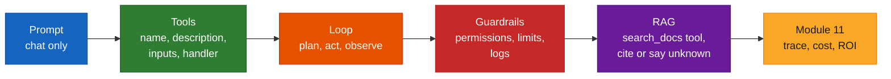

---

## Architecture

### 1. Chat → agent → grounded agent: one capability, one new risk each *(s.4)*

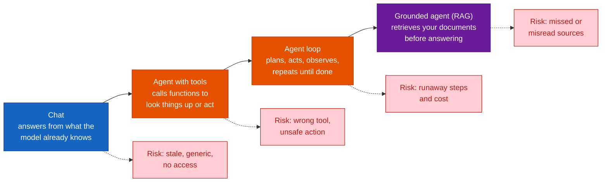

### 2. Where the Copilot SDK fits *(s.5)*, with the real wiring **[Beyond the deck]**

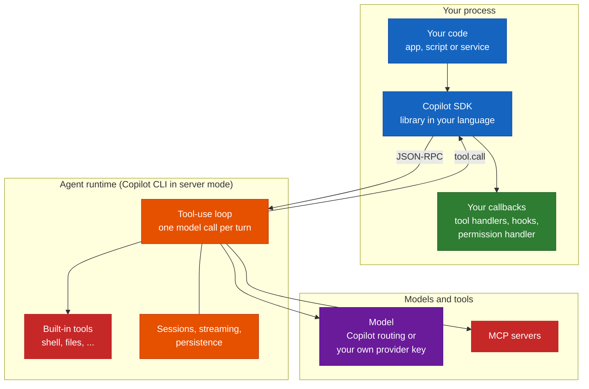

The red **built-in tools** box is the one to watch: by default it is offered to the model unless you narrow it (currency row 6).

### 3. Anatomy of a single agent *(s.6)*

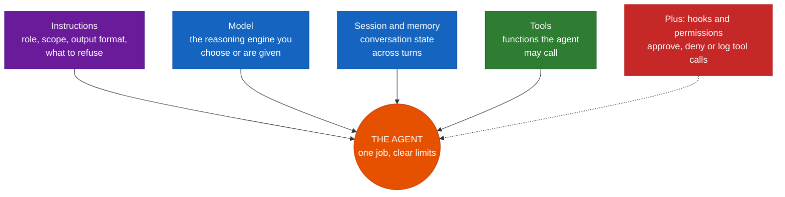

| Deck part | Real SDK parameter (Python) |
|---|---|
| Instructions | `system_message={"mode": "append", "content": "…"}` (or `"replace"` / `"customize"`) |
| Model | `model="gpt-5"`, or with BYOK `model=…` **plus** `provider={…}` (model is then required) |
| Session & memory | the `session` object; `create_session` / `resume_session`; persistence needs your own `session_id` |
| Tools | `tools=[…]` and `available_tools=[…]` |
| Hooks and permissions | `hooks={…}` and `on_permission_request=…` |

### 4. Wiring a tool: name, description, inputs, handler *(s.7)*

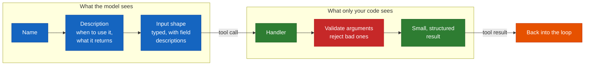

### 5. The execution loop *(s.8)* and who does what **[Beyond the deck]**

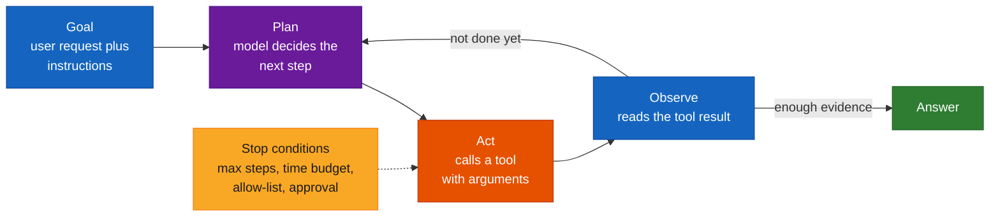

Who actually performs each step (from the SDK's `agent-loop.md`; I confirmed the event order in the lab run):

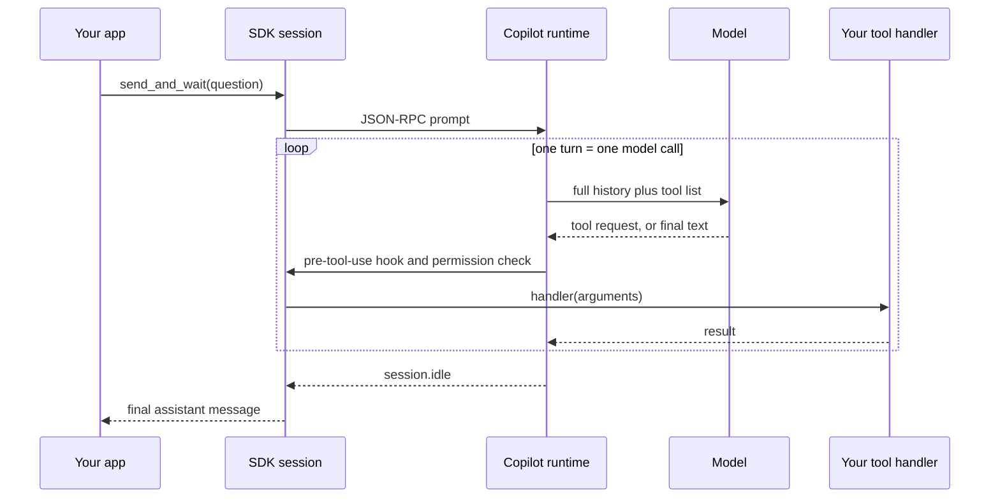

Key facts from the docs: each loop iteration is **exactly one model call** ("there are no hidden calls"), the model sees the **full history** on every call, and `session.idle` is the reliable "done" signal (`session.task_complete` is optional and best-effort).

### 6. Where to put the controls around the loop *(s.9)*, mapped to SDK knobs

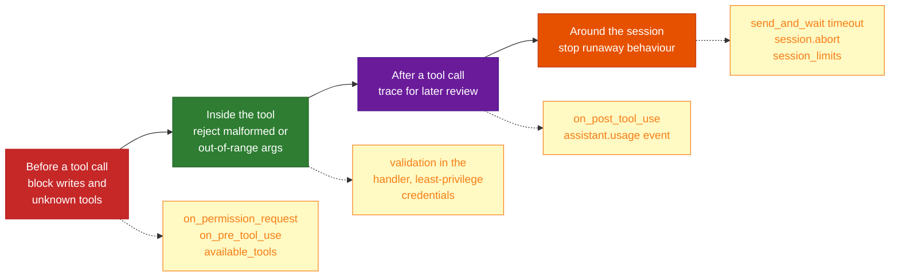

### 7. Real-world single agents *(s.10)*

| Agent | Tools (illustrative, s.10) | Human check |
|---|---|---|
| Build-failure explainer | `get_build_status`, `get_log_excerpt` | Developer reads the cause and fix |
| Release-notes drafter | `list_merged_prs`, `get_pr_summary` | Release owner edits before publishing |
| Ticket summariser | `get_ticket`, `list_comments` | Support lead confirms the summary |
| **Runbook helper** | `search_runbook` (**needs your docs**) | On-call engineer verifies each step |

"Notice the fourth one: a runbook helper is only as good as the runbooks it can read. That is the gap retrieval fills — and where we go next."

### 8. Why ground the agent *(s.11)*

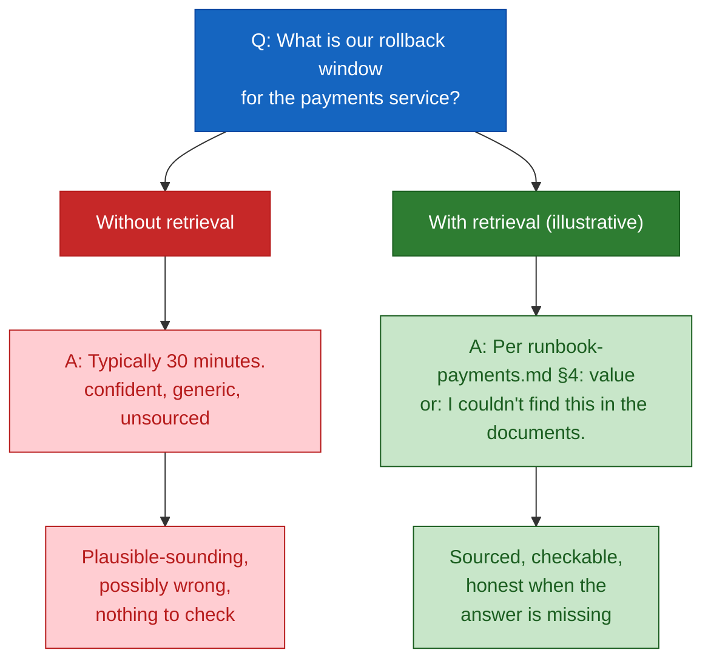

**Definition (s.11):** retrieval-augmented generation fetches relevant passages from your documents and gives them to the model as context before it answers. Real-world grounded agents: policy and process Q&A, a runbook assistant for on-call, an internal API docs helper.

### 9. The simple RAG pipeline: index once, retrieve every time *(s.12)*

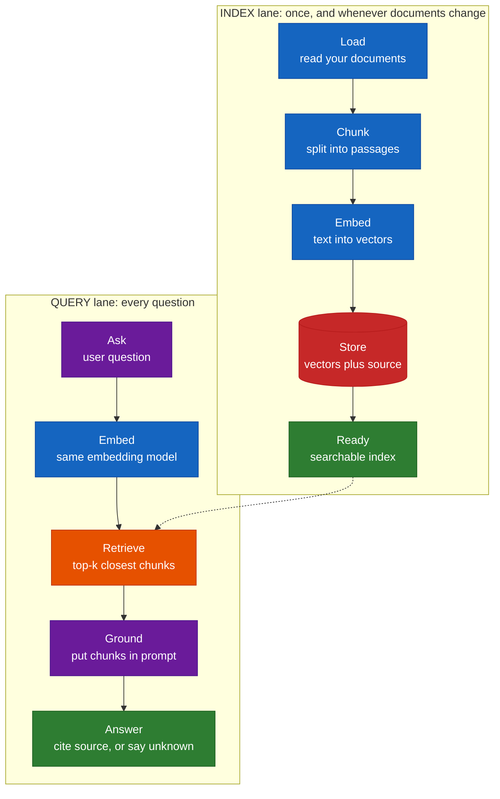

"Keep it simple first: a small document set, one embedding model, top-k retrieval and source names in the answer. Add re-ranking or hybrid search only when you can show the simple version fails."

### 10. Retrieval is just another tool *(s.13)*

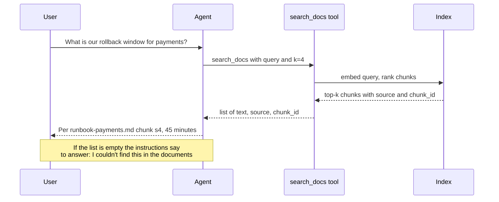

| Tuning knob *(s.13)* | Rule of thumb from the deck |
|---|---|
| **Chunk size** | "Big enough for meaning, small enough to match" |
| **Top-k** | "Enough to cover the answer, not so many that noise wins" |
| **Metadata** | "Keep file name and chunk number with every passage" |
| **Instructions** | "Answer only from results; cite sources; say if not found" |

| Two ways to call it *(s.13)* | Trade-off |
|---|---|
| **Agent decides (tool)** | Flexible; may skip retrieval when it should search |
| **Always retrieve first** | Predictable; wasteful for questions that need no documents |

Tip from the deck: "start with 'agent decides' for a tool-using agent, and log whether it searched. A missed search is a bug you can see in the trace."

### 11. Where RAG goes wrong *(s.14)*, extended with the paper's seven failure points

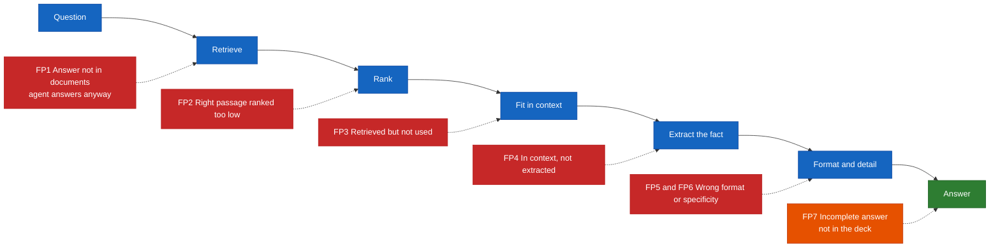

| Failure *(s.14)* | Symptom | First fix to try | Paper's name |
|---|---|---|---|
| Answer not in the documents | Agent answers anyway instead of declining | Instruct: say "not found"; test with unanswerable questions | FP1 Missing Content |
| Right passage ranked too low | Answer exists but is not retrieved | Adjust chunking, top-k; add metadata | FP2 Missed the Top Ranked Documents |
| Retrieved but not used | Passage dropped or buried in the context | Reduce noise; fewer, better chunks | FP3 Not in Context |
| In context, not extracted | Model misses or mixes up the facts | Clearer instructions; cleaner source text | FP4 Not Extracted |
| Wrong format or specificity | Too vague, too detailed or wrong shape | State the output format and level of detail | FP5 Wrong Format, FP6 Incorrect Specificity |
| *(not in the deck)* **[Beyond the deck]** | Correct but misses part of the answer | Ask for all items explicitly; check the chunk split did not cut a list in half | FP7 Incomplete |

### 12. The lab loop *(s.15)* and the lab's files **[Beyond the deck]**

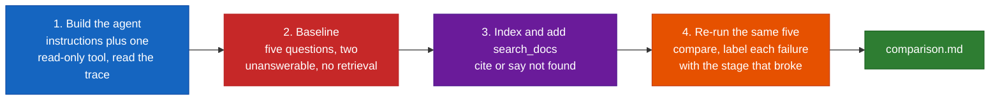

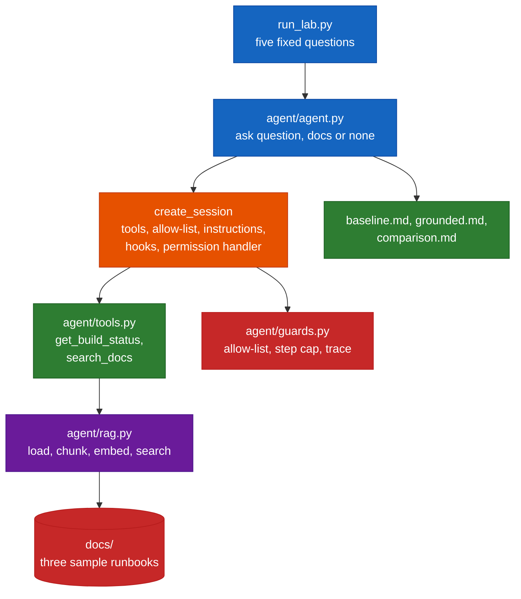

---

## Core Concepts

### Part A — From chat to agent, and where the SDK fits *(s.4–5, 15 min)*

**The analogy.** Chat is a very well-read colleague with no keys to the building. Give them **tools** and they can look things up. Give them a **loop** and they keep working until the job is done. Give them **your documents** and they stop guessing. Every step also hands them a new way to be wrong — which is why the deck insists on climbing the ladder in order.

**What the SDK is.** A library that gives your code programmatic access to "the same agent runtime behind Copilot CLI" *(s.5)*. In the repository's words: "No need to build your own orchestration — you define agent behavior, Copilot handles planning, tool invocation, file edits, and more." Under the hood every SDK talks JSON-RPC to the CLI running in server mode; the SDK starts and manages that process (or connects to one you started).

**The smallest possible agent** (real API, no tools yet — this is the SDK's own Quick Start shape):

```python
import asyncio

from copilot import CopilotClient
from copilot.session import PermissionHandler


async def main():
    async with CopilotClient() as client:                      # starts and stops the runtime
        async with await client.create_session(
            on_permission_request=PermissionHandler.approve_all,  # fine for "what is 2+2", not for tools
            model="gpt-5",
        ) as session:
            reply = await session.send_and_wait("What is 2+2?", timeout=60)
            print(reply.data.content if reply else "(no assistant message)")


asyncio.run(main())
```

> I ran the same shape against a local scripted model (Part E) but **not** against Copilot itself, so `model="gpt-5"` here is copied from the SDK docs, not something I executed.

**What you need** *(s.5, updated per currency rows 2–3)*: a supported language, a Copilot subscription *or* your own provider key (BYOK), and — for Python — Python 3.11+. Install: `pip install github-copilot-sdk`.

**BYOK in one picture.** With a custom provider the session config carries `provider={"type": "openai", "base_url": "…", "api_key": "…"}` and `model` becomes mandatory. That is also how I ran the lab with no account (a local server speaks the OpenAI chat-completions wire format).

### Part B — Anatomy of a single agent and wiring a tool *(s.6–7, 25 min)*

**Five parts, one job.** The deck's claim is that "most agent bugs trace back to one of them being vague", and its debugging order is **instructions first, tools second, model last**. Changing the model rarely fixes an unclear job.

**Instructions.** Role, scope, output format, what to refuse. In the SDK they are the session's `system_message`. Using `mode: "append"` adds your text to the runtime's own system prompt instead of replacing it; `"replace"` removes the runtime's prompt entirely (only do that deliberately).

**Wiring a tool.** The deck's pseudocode (illustrative, s.7):

```text
tool get_build_status:
  description: "Status and failing step for a build. Read-only. id looks like b-1234."
  inputs:      build_id: string (pattern b-####)
  handler:     return ci_api.status(build_id)

agent = create_agent(instructions = "Explain build failures. Use tools; never guess. Say if unsure.",
                     tools = [get_build_status])
agent.send("Why did build b-1234 fail?")
```

…and the real Python equivalent (this exact tool is in the lab, Part E):

```python
from pydantic import BaseModel, Field
from copilot import define_tool

class BuildParams(BaseModel):
    build_id: str = Field(description="Build id, looks like b-1234 (b- then four digits)")

@define_tool(description="Status and failing step for one build. Read-only. "
             "Use when the user asks why a build failed or passed. id looks like b-1234.")
async def get_build_status(params: BuildParams) -> str:
    ...
```

| Deck rule *(s.7)* | Where it shows up in the code |
|---|---|
| **One tool, one job** — narrow, clearly named | `get_build_status` does one lookup and nothing else |
| **Describe for the model** — say when to use it and what it returns | the `description=` string ("Use when the user asks why a build failed…") |
| **Typed, validated inputs** — reject bad arguments in the handler | the Pydantic model types the shape; the handler re-checks the `b-1234` pattern and returns an error the model can read |
| **Small, structured output** — return what is needed, not a dump | a three-field JSON object, not the whole CI log |
| **Reuse** — Module 07 tool rules apply unchanged | the same rules apply to an MCP server or a plain function |

**Low-level alternative.** If you prefer to write the JSON Schema yourself, the SDK also accepts `Tool(name=…, description=…, parameters={…}, handler=…)`; the handler receives a `ToolInvocation` and returns a `ToolResult`.

### Part C — The loop, guardrails and use cases *(s.8–10, 15 min)*

**The loop.** Goal → Plan → Act → Observe → repeat → Answer. In SDK terms: your `send` starts it; the **runtime** keeps calling the model, executing the tools the model asks for and feeding the results back; the **model** decides when it has enough evidence to reply; the runtime then emits **`session.idle`**.

**Why limits matter.** "Every loop turn calls a model, and tool-heavy agents use far more of your budget than a single prompt." One user message often becomes several model calls (the SDK docs give a four-turn example: search, read, read more, answer).

**The four stop conditions, mapped to what the SDK really offers:**

| Deck stop condition *(s.8)* | Built-in? | How to get it |
|---|---|---|
| **Tool allow-list** | Yes | `available_tools=["get_build_status", "search_docs"]` — "Custom tool names must be explicitly included or they will be hidden from the model." |
| **Approval needed** | Yes | `on_permission_request` handler (approve / reject), or an `on_pre_tool_use` hook returning `"ask"` |
| **Time budget** | Yes, per request | `send_and_wait(prompt, timeout=…)` (default 60 s); on timeout you still need to decide whether to `abort()` |
| **Maximum steps** | **No built-in knob found** | Count tool calls in `on_pre_tool_use`, deny past N, then abort (the lab's `Guard`) |
| **Cost** | Experimental | `session_limits={"max_ai_credits": N}` — a *soft* cap checked after each model response, so one response can overshoot **[Beyond the deck]** |

**The four control points** *(s.9)* and the code that implements each in the lab:

| Control point | Deck wording | Lab code |
|---|---|---|
| **Before a tool call** | "Permission hook: approve, deny or ask a human" → "Block writes and unknown tools" | `Guard.on_permission_request` and `Guard.pre_tool_use` |
| **Inside the tool** | "Validate inputs; least-privilege credentials" → "Reject malformed or out-of-range args" | the regex check in `get_build_status`; `ge=1, le=8` on `k` in `search_docs` |
| **After a tool call** | "Log the call and result; filter sensitive data" → "Trace for later review" | `Guard.post_tool_use` and `Guard.trace` (the lab logs the *size* of each result, not the content) |
| **Around the session** | "Step, time and cost limits; isolated workspace" → "Stop runaway behaviour" | step cap + `abort()`, the `timeout`, and `available_tools` hiding shell and file tools |

> **Same principle as Modules 07–09:** least privilege, a human at the risky steps, and a record of what happened *(s.9)*.

**Hook details worth knowing** (Python, SDK 1.0.22):

- `on_pre_tool_use(input, invocation)` receives `{"toolName", "toolArgs", …}` and may return `{"permissionDecision": "allow" | "deny" | "ask", "permissionDecisionReason": "…", "modifiedArgs": …, "additionalContext": "…"}`.
- `on_post_tool_use` fires **only on success**; use `on_post_tool_use_failure` to observe failures.
- Hooks run **inline** — the SDK docs say to keep them fast.

> **Pitfall I hit while testing — abort from inside a hook.** My first step-cap awaited `session.abort()` *inside* `on_pre_tool_use`. The runtime did stop calling the model, but `send_and_wait` never saw `session.idle` and waited for the full timeout. Scheduling the abort as a task (`asyncio.get_running_loop().create_task(session.abort())`) so the hook can return first made `session.idle` arrive immediately. The passing variant is what `test_runaway_loop_is_stopped_by_the_step_cap` exercises.

**Use cases** *(s.10)*: four small jobs — see Architecture §7. The deck's advice is one narrow job, two or three tools, and a named human who checks the result. The fourth (runbook helper) is the bridge to RAG.

### Part D — Grounding the agent with RAG *(s.11–14, 25 min)*

**The analogy.** A closed-book exam versus an open-book exam. Retrieval lets the agent open *your* book — but an open-book student can still look in the wrong chapter, skim past the answer, or copy it down wrong. The failure-point table (Architecture §11) is the list of ways that happens.

**The two lanes** *(s.12)*. **Index lane** (once, and whenever the documents change): load → chunk → embed → store → ready. **Query lane** (every question): ask → embed with the *same* model → retrieve top-k → ground (put chunks in the prompt) → answer, citing the source or saying it is unknown.

**The lab's `rag.py`, step by step:**

| Stage | What the code does | Why |
|---|---|---|
| Load | reads every `*.md` in `docs/` | small document set first |
| Chunk | one chunk per `## ` section; the heading stays in the chunk; id = section number (`s4`) | a runbook section is a natural unit of meaning, and `runbook-payments.md` + `s4` is a precise citation |
| Embed | **hashed bag-of-words vector**, 4096 dimensions, L2-normalised | **[Beyond the deck]** runs with no model, key or network, so the lab works offline. It is a *stand-in*, not a semantic embedding |
| Store | vectors kept in a list next to their `Chunk(text, source, chunk_id)` | "Keep vectors + source" *(s.12)* |
| Retrieve | cosine similarity, top-k, **minimum score 0.15** | the threshold is what lets an unanswerable question return nothing |

> **A stand-in embedding changes what you can learn.** A hashed bag-of-words only matches shared *words*; a real embedding model also matches paraphrases ("how long can I undo a release" ↔ "rollback window"). So the chunk-size and top-k lessons transfer, the score values do not. In the lab, two unanswerable questions scored 0.135 and 0.12 against irrelevant chunks — the first from the shared word "payments", the second from a **hash collision** ("approval" and "region" landed in the same bucket) — while the three answerable questions scored 0.387 to 0.539. The 0.15 threshold sits in that gap. With a real embedding model you must calibrate your own threshold on your own question set, which is exactly the deck's "RAG quality is measured, not assumed."

**Retrieval is a tool** *(s.13)*. The agent decides when to call `search_docs`; the instructions decide what it does with the result. The instruction text the lab uses (deck: "Answer only from results; cite sources; say if not found"):

```text
For questions about our procedures, limits, windows or contacts, call search_docs and
answer ONLY from its results. Cite the source file and chunk id. If search_docs returns
nothing relevant, say you could not find it in the documents.
```

**Two safety nets for "not found"** — this is the deck's first failure row. The lab layers them: the retriever returns `[]` when nothing clears the threshold (a *structural* signal), and the instructions tell the model what to do with an empty result (a *behavioural* one). As in Module 09, instructions alone are advice; the structural signal makes the right behaviour easy.

**Optional provider citations [Beyond the deck].** `enable_citations=True` asks the provider to attach citation metadata to `assistant.message` events when the response is grounded in citable material. The SDK marks it experimental, coverage varies by provider (Anthropic, OpenAI, or `client` for citations the runtime synthesises from tool output), and a response may contain none. I did not test it.

### Part E — Lab: build the agent, then ground it *(s.15, 35 min)*

**Goal (s.15):** "Build a code-based agent with one tool, add a simple retrieval step over a small document set, and compare grounded with ungrounded answers." **Done when:** "`comparison.md` shows each question grounded vs ungrounded, whether sources were cited, and at least one failure traced to a pipeline stage."

The four steps *(s.15)*:

1. From the starter template, create an agent with clear instructions and one read-only tool. Run it on one question and read the trace.
2. **Baseline:** ask five questions about the sample documents, including two they cannot answer. Save the answers without retrieval.
3. **Index** the documents (load, chunk, embed, store). Add a `search_docs` tool that returns passages with source names, and update the instructions to cite or say "not found".
4. **Re-run** the same five questions. Compare with the baseline and label each failure with the point where it broke.

**Everything below was run.** The files are the lab's real source, byte-identical to what I tested. Set up once:

```bash
python3 -m venv .venv && source .venv/bin/activate     # Windows: .venv\Scripts\activate
pip install github-copilot-sdk pytest                   # Python 3.11+
python -m copilot download-runtime                      # optional: otherwise fetched on first use
mkdir -p lab10/agent lab10/docs lab10/tests && cd lab10
touch agent/__init__.py tests/__init__.py
```

#### Step 0 — the sample documents (`docs/`)

Three tiny runbooks. **All values are invented.** Section 4 of the payments runbook plays the role of the deck's "runbook-payments.md §4".

`docs/runbook-payments.md`

```md
# Payments service runbook

## 1. Purpose

This runbook covers on-call actions for the payments service. It is a sample document set for the Module 10 lab; the values are invented.

## 2. Health checks

The service exposes `/healthz` and `/readyz`. A failing `/readyz` for more than two minutes means the instance is removed from the load balancer automatically.

## 3. Deploys

Deploys run from the `main` pipeline and go out to one region at a time. A deploy is paused automatically if the error rate rises above 2 percent.

## 4. Rollback

The rollback window for the payments service is 45 minutes after a deploy completes. Inside the window, run the `rollback-payments` pipeline with the previous release tag. After 45 minutes, do not roll back: ship a hotfix and roll forward, because database migrations may no longer be reversible.

## 5. Escalation

Page the payments on-call engineer first. If there is no acknowledgement within 10 minutes, page the engineering manager on call.
```

`docs/runbook-checkout.md`

```md
# Checkout service runbook

## 1. Purpose

On-call actions for the checkout service. Sample content for the Module 10 lab; values are invented.

## 2. Severity levels

Sev1 means customers cannot complete a purchase. Sev2 means purchases are slow or degraded. Sev3 means a non-customer-facing problem.

## 3. Sev1 response

For a Sev1 on checkout, page the checkout on-call engineer and the incident commander at the same time. Open a channel named after the incident and post a status update every 15 minutes until the incident is resolved.

## 4. Feature flags

Checkout features are behind flags. To disable a feature during an incident, set its flag to off in the flag console. Record the change in the incident channel.
```

`docs/incident-policy.md`

```md
# Incident policy

## 1. Scope

Applies to every production incident. Sample content for the Module 10 lab; values are invented.

## 2. Post-incident review

A written review is required for every Sev1 and Sev2 incident. The review is due within five working days of resolution and must name one owner for each follow-up action.

## 3. Evidence retention

Incident logs and chat transcripts are kept for 18 months after the incident closes.

## 4. Communication

Customer-facing updates are written by the incident commander and approved by the support lead before they are posted.
```

#### Step 1 — one read-only tool (`agent/tools.py`)

```python
"""The two tools: one read-only lookup (Step 1) and retrieval (Step 3)."""
import json
import re

from pydantic import BaseModel, Field

from copilot import define_tool

# Stand-in for a CI API. Replace with a real read-only client.
BUILDS = {
    "b-1234": {"status": "failed", "failing_step": "unit-tests"},
    "b-1235": {"status": "passed", "failing_step": "none"},
}


class BuildParams(BaseModel):
    build_id: str = Field(description="Build id, looks like b-1234 (b- then four digits)")


@define_tool(
    description="Status and failing step for one build. Read-only. "
    "Use when the user asks why a build failed or passed. id looks like b-1234.",
    skip_permission=False,
)
async def get_build_status(params: BuildParams) -> str:
    if not re.fullmatch(r"b-\d{4}", params.build_id):  # typed + validated in the handler
        return json.dumps({"error": f"build_id must look like b-1234, got {params.build_id!r}"})
    build = BUILDS.get(params.build_id)
    if build is None:
        return json.dumps({"error": f"no build {params.build_id}"})
    return json.dumps({"build_id": params.build_id, **build})


class SearchParams(BaseModel):
    query: str = Field(description="What to look up in the runbooks, in plain words")
    k: int = Field(default=4, ge=1, le=8, description="How many passages to return")


def make_search_tool(index):
    @define_tool(
        name="search_docs",
        description="Search the team runbooks and policies. Returns passages with source file "
        "and chunk id. Use for any question about our procedures, limits, windows or contacts. "
        "Returns [] when nothing relevant exists.",
    )
    async def search_docs(params: SearchParams) -> str:
        hits = index.search(params.query, k=params.k)
        return json.dumps([{k: h[k] for k in ("text", "source", "chunk_id")} for h in hits])

    return search_docs
```

`search_docs` is wired in at Step 3; both tools live in this file so the diff between baseline and grounded is one line in `agent.py`.

#### Step 1 — the controls (`agent/guards.py`)

```python
"""Controls around the loop: allow-list, permission handler, step cap, trace."""
import asyncio

from copilot.rpc import PermissionDecisionApproveOnce, PermissionDecisionReject
from copilot.session_events import PermissionRequestCustomTool


class Guard:
    def __init__(self, allowed, max_tool_calls=4):
        self.allowed = set(allowed)
        self.max_tool_calls = max_tool_calls
        self.trace = []          # one dict per tool call: what, args, decision, result size
        self.session = None      # set after create_session so we can abort a runaway
        self.tripped = False

    # Before a tool call: approve, deny, or stop the run.
    async def pre_tool_use(self, hook_input, invocation):
        name, args = hook_input["toolName"], hook_input.get("toolArgs")
        entry = {"tool": name, "args": args, "decision": "allow"}
        if name not in self.allowed:
            entry["decision"] = "deny: not on allow-list"
        elif sum(1 for t in self.trace if t["decision"] == "allow") >= self.max_tool_calls:
            entry["decision"] = "deny: step cap"
            self.tripped = True
        self.trace.append(entry)
        if entry["decision"] == "allow":
            return {"permissionDecision": "allow"}
        if self.tripped and self.session is not None:
            asyncio.get_running_loop().create_task(self.session.abort())
        return {"permissionDecision": "deny", "permissionDecisionReason": entry["decision"]}

    # After a tool call: record how big the result was (log, don't dump).
    async def post_tool_use(self, hook_input, invocation):
        for entry in reversed(self.trace):
            if entry["tool"] == hook_input["toolName"] and "result_chars" not in entry:
                entry["result_chars"] = len(str(hook_input.get("toolResult")))
                break

    # Permission handler: only our own custom tools, only by name.
    def on_permission_request(self, request, invocation):
        if isinstance(request, PermissionRequestCustomTool) and request.tool_name in self.allowed:
            return PermissionDecisionApproveOnce()
        return PermissionDecisionReject(feedback="Not permitted for this agent")
```

#### Step 1 — the agent (`agent/agent.py`)

```python
"""Build one agent session: instructions + tools + guardrails. `ask()` runs one question."""
import os
from dataclasses import dataclass

from copilot import CopilotClient

from .guards import Guard
from .rag import Index
from .tools import get_build_status, make_search_tool

BASE = (
    "You explain build failures for our engineers. Use tools; never guess. "
    "Say if unsure. Keep answers to three sentences."
)
GROUNDED = (
    " For questions about our procedures, limits, windows or contacts, call search_docs "
    "and answer ONLY from its results. Cite the source file and chunk id. "
    "If search_docs returns nothing relevant, say you could not find it in the documents."
)


@dataclass
class Answer:
    text: str
    trace: list


def _provider():
    url = os.environ.get("LAB_PROVIDER_URL")  # offline runs only; unset = Copilot sign-in
    return {"type": "openai", "base_url": url, "api_key": "unused"} if url else None


async def ask(client, question, docs=None, max_tool_calls=4, timeout=60.0):
    tools, instructions = [get_build_status], BASE
    if docs:
        tools.append(make_search_tool(Index.build(docs)))
        instructions += GROUNDED
    guard = Guard([t.name for t in tools], max_tool_calls=max_tool_calls)
    kwargs = {"model": os.environ.get("LAB_MODEL", "gpt-5")}
    if _provider():
        kwargs["provider"] = _provider()
    async with await client.create_session(
        on_permission_request=guard.on_permission_request,
        tools=tools,
        available_tools=[t.name for t in tools],   # hide every built-in tool (shell, files, ...)
        system_message={"mode": "append", "content": instructions},
        hooks={"on_pre_tool_use": guard.pre_tool_use, "on_post_tool_use": guard.post_tool_use},
        **kwargs,
    ) as session:
        guard.session = session
        try:
            reply = await session.send_and_wait(question, timeout=timeout)
            text = reply.data.content if reply else "(no assistant message)"
            if guard.tripped:
                text = f"(stopped: step cap of {max_tool_calls} tool calls reached)"
        except Exception as exc:  # timeout, abort after the step cap, ...
            text = f"(stopped: {type(exc).__name__}: {exc})"
    return Answer(text, guard.trace)


def new_client():
    return CopilotClient()
```

Three details worth pointing out:

- `available_tools=[t.name for t in tools]` is the line that **removes every built-in tool** from the model's view.
- `docs=None` is the baseline; `docs="docs"` builds the index, adds `search_docs` and appends the grounding instructions. The only thing that changes between the two runs is retrieval.
- If `LAB_PROVIDER_URL` is unset, no `provider` is passed and the session uses your Copilot sign-in. `LAB_MODEL` lets you override the model name.

#### Step 2 and 4 — the index (`agent/rag.py`)

```python
"""Simple RAG index: load -> chunk -> embed -> store, then retrieve top-k.

The "embedding" is a hashed bag-of-words vector so the lab runs with no model,
no key and no network. Swap `embed()` for a real embedding model later; nothing
else in this file changes.
"""
import hashlib
import math
import re
from dataclasses import dataclass
from pathlib import Path

DIM = 4096
STOP = {"the", "a", "an", "is", "of", "to", "for", "and", "or", "in", "on", "what", "our", "do", "does", "how", "who", "are", "we", "it", "this", "that", "with", "at", "be", "by", "as", "from"}


@dataclass(frozen=True)
class Chunk:
    text: str
    source: str
    chunk_id: str


def tokens(text):
    return [t for t in re.findall(r"[a-z0-9]+", text.lower()) if t not in STOP]


def embed(text):
    vec = [0.0] * DIM
    for tok in tokens(text):
        vec[int(hashlib.md5(tok.encode()).hexdigest(), 16) % DIM] += 1.0
    norm = math.sqrt(sum(v * v for v in vec)) or 1.0
    return [v / norm for v in vec]


def load(folder):
    return {p.name: p.read_text(encoding="utf-8") for p in sorted(Path(folder).glob("*.md"))}


def chunk(source, text):
    """One chunk per '## ' section, heading kept so the chunk says where it is from."""
    parts = re.split(r"(?m)^(?=## )", text)
    out = []
    for part in parts:
        part = part.strip()
        if part.startswith("## "):
            number = re.match(r"## (\d+)\.", part)
            cid = f"s{number.group(1)}" if number else f"c{len(out)}"
            out.append(Chunk(part, source, cid))
    return out


class Index:
    def __init__(self, chunks):
        self.chunks = chunks
        self.vectors = [embed(c.text) for c in chunks]  # store: vectors + source live together

    @classmethod
    def build(cls, folder):
        chunks = [c for name, text in load(folder).items() for c in chunk(name, text)]
        return cls(chunks)

    def search(self, query, k=4, min_score=0.15):
        q = embed(query)
        scored = [(sum(a * b for a, b in zip(q, v)), c) for v, c in zip(self.vectors, self.chunks)]
        scored.sort(key=lambda s: s[0], reverse=True)
        return [
            {"text": c.text, "source": c.source, "chunk_id": c.chunk_id, "score": round(s, 3)}
            for s, c in scored[:k]
            if s >= min_score
        ]
```

#### Step 2–4 — the driver (`run_lab.py`)

```python
"""Lab driver: five fixed questions, ungrounded then grounded, written to baseline.md,
grounded.md and comparison.md.   python run_lab.py            -> uses your Copilot sign-in
                                 python run_lab.py --offline  -> scripted local model (plumbing only)"""
import asyncio
import os
import sys
import threading

from agent.agent import ask, new_client

QUESTIONS = [  # (question, expected source or None when the docs cannot answer it)
    ("What is our rollback window for the payments service?", "runbook-payments.md"),
    ("Who do we page for a Sev1 on checkout?", "runbook-checkout.md"),
    ("How long do we keep incident logs?", "incident-policy.md"),
    ("What is the CPU limit of the payments pod?", None),
    ("What is the refund approval limit?", None),
]


def verdict(expected, answer_text):
    said_not_found = "couldn't find" in answer_text.lower() or "could not find" in answer_text.lower()
    if expected is None:
        return "OK (declined)" if said_not_found else "CHECK: answered an unanswerable question"
    if expected in answer_text:
        return "OK (cited)"
    return "CHECK: no citation" if not said_not_found else "CHECK: declined but docs have it"


async def run_all():
    rows = []
    async with new_client() as client:
        for q, expected in QUESTIONS:
            base = await ask(client, q)
            grounded = await ask(client, q, docs="docs")
            rows.append((q, expected, base, grounded))
    return rows


def write(rows):
    for name, idx in (("baseline.md", 2), ("grounded.md", 3)):
        with open(name, "w", encoding="utf-8") as f:
            f.write(f"# {name[:-3].title()} answers\n\n")
            for r in rows:
                f.write(f"## {r[0]}\n\n{r[idx].text}\n\nTool calls: {[t['tool'] for t in r[idx].trace]}\n\n")
    with open("comparison.md", "w", encoding="utf-8") as f:
        f.write("| # | Question | Expected | Baseline | Grounded | Searched? | Verdict | Failure stage (you fill in) |\n")
        f.write("|---|----------|----------|----------|----------|-----------|---------|-----------------------------|\n")
        for i, (q, expected, base, grounded) in enumerate(rows, 1):
            short = lambda s: s.replace("\n", " ").replace("|", "/")[:90]
            searched = "yes" if any(t["tool"] == "search_docs" for t in grounded.trace) else "NO"
            f.write(f"| {i} | {q} | {expected or 'not in docs'} | {short(base.text)} | {short(grounded.text)} "
                    f"| {searched} | {verdict(expected, grounded.text)} | |\n")


if __name__ == "__main__":
    if "--offline" in sys.argv:
        import mock_model
        threading.Thread(target=mock_model.serve().serve_forever, daemon=True).start()
        os.environ["LAB_PROVIDER_URL"] = "http://127.0.0.1:8765/v1"
        os.environ["LAB_MODEL"] = "mock-model"
    write(asyncio.run(run_all()))
    print(open("comparison.md", encoding="utf-8").read())
```

Run it against **your Copilot sign-in** (this spends your own usage allowance; each question is run twice, so ten sessions):

```bash
python run_lab.py
```

Fill the **Failure stage** column of `comparison.md` yourself, using the paper's names (FP1 … FP7) and the pipeline stages (load, chunk, embed, retrieve, ground, answer). The `Verdict` column is only a hint: it checks for a citation or a "couldn't find", not for whether the answer is *right*.

#### Offline mode: a scripted model (`mock_model.py`) **[Beyond the deck]**

I did not want to spend your Copilot allowance without asking, so I ran the lab against a **scripted local server that speaks the OpenAI chat-completions format**, using the SDK's BYOK `provider=` option. It is **not a language model**: it calls a tool if one fits the question and otherwise says "Typically 30 minutes." It proves the **plumbing** — tools, loop, hooks, permissions, retrieval, citations in the output — and says nothing about how a real model behaves.

<details>
<summary><code>mock_model.py</code> (click to expand)</summary>

```python
"""Scripted OpenAI-compatible /v1/chat/completions server for offline lab runs.

It is NOT a language model. It exists so the SDK plumbing (tools, loop, hooks,
permissions, retrieval) can be exercised with no account, no cost and no network.
Rules:
  * last message is a tool result -> write a final answer from it
  * last message is the user       -> call a tool if one fits, else answer from "memory"
"""
import json
import re
import sys
import time
from http.server import BaseHTTPRequestHandler, ThreadingHTTPServer

LOG = []
LOOP_FOREVER = False   # runaway mode: keep calling a tool whatever it returns
TOOLS_SEEN = []        # tool names the runtime offered on each request


def _tool_names(body):
    return {t["function"]["name"] for t in body.get("tools", [])}


def _text_of(content):
    if isinstance(content, list):
        return " ".join(p.get("text", "") for p in content if isinstance(p, dict))
    return content or ""


def decide(body):
    """Return ('tool', name, args) or ('text', answer)."""
    msgs = body.get("messages", [])
    last = msgs[-1]
    names = _tool_names(body)
    TOOLS_SEEN.append(sorted(names))
    if LOOP_FOREVER and "get_build_status" in names:
        return ("tool", "get_build_status", {"build_id": "b-1234"})
    if last["role"] == "tool":
        data = _text_of(last.get("content"))
        try:
            parsed = json.loads(data)
        except ValueError:
            return ("text", data)
        if isinstance(parsed, list):  # search_docs result
            if not parsed:
                return ("text", "I couldn't find this in the documents.")
            top = parsed[0]
            return ("text", f"Per {top['source']} (chunk {top['chunk_id']}): {top['text']}")
        if "error" in parsed:
            return ("text", f"The tool refused: {parsed['error']}")
        return ("text", f"Build {parsed['build_id']} is {parsed['status']}; failing step: {parsed['failing_step']}.")
    user = re.sub(r"<current_datetime>.*?</current_datetime>", "", _text_of(last.get("content")), flags=re.S).strip()
    m = re.search(r"\bb-\d+\b", user)
    if m and "get_build_status" in names:
        return ("tool", "get_build_status", {"build_id": m.group(0)})
    if "build" in user.lower() and "get_build_status" in names:
        return ("tool", "get_build_status", {"build_id": "not-an-id"})
    if "search_docs" in names:
        return ("tool", "search_docs", {"query": user})
    return ("text", "Typically 30 minutes.")  # confident, generic, unsourced


def completion(body):
    kind, *rest = decide(body)
    if kind == "tool":
        name, args = rest
        msg = {"role": "assistant", "content": None, "tool_calls": [
            {"id": f"call_{len(LOG)}", "type": "function",
             "function": {"name": name, "arguments": json.dumps(args)}}]}
        finish = "tool_calls"
    else:
        msg = {"role": "assistant", "content": rest[0]}
        finish = "stop"
    return msg, finish


class Handler(BaseHTTPRequestHandler):
    def log_message(self, *a):
        pass

    def _send(self, code, obj):
        raw = json.dumps(obj).encode()
        self.send_response(code)
        self.send_header("Content-Type", "application/json")
        self.send_header("Content-Length", str(len(raw)))
        self.end_headers()
        self.wfile.write(raw)

    def do_GET(self):
        if self.path.endswith("/models"):
            return self._send(200, {"object": "list", "data": [{"id": "mock-model", "object": "model"}]})
        self._send(404, {"error": "not found"})

    def do_POST(self):
        body = json.loads(self.rfile.read(int(self.headers.get("Content-Length", 0))) or b"{}")
        LOG.append(self.path)
        if not self.path.endswith("/chat/completions"):
            print("unhandled POST", self.path, file=sys.stderr)
            return self._send(404, {"error": "unsupported"})
        msg, finish = completion(body)
        base = {"id": "chatcmpl-mock", "object": "chat.completion", "created": int(time.time()), "model": "mock-model"}
        usage = {"prompt_tokens": 10, "completion_tokens": 5, "total_tokens": 15}
        if body.get("stream"):
            self.send_response(200)
            self.send_header("Content-Type", "text/event-stream")
            self.end_headers()
            delta = dict(msg)
            if "tool_calls" in delta:
                delta["tool_calls"] = [dict(tc, index=0) for tc in delta["tool_calls"]]
            chunks = [
                {**base, "object": "chat.completion.chunk", "choices": [{"index": 0, "delta": delta, "finish_reason": None}]},
                {**base, "object": "chat.completion.chunk", "choices": [{"index": 0, "delta": {}, "finish_reason": finish}], "usage": usage},
            ]
            for c in chunks:
                self.wfile.write(f"data: {json.dumps(c)}\n\n".encode())
            self.wfile.write(b"data: [DONE]\n\n")
            return
        self._send(200, {**base, "choices": [{"index": 0, "message": msg, "finish_reason": finish}], "usage": usage})


def serve(port=8765):
    srv = ThreadingHTTPServer(("127.0.0.1", port), Handler)
    return srv


if __name__ == "__main__":
    serve().serve_forever()
```

</details>

```bash
python run_lab.py --offline        # no account, no cost, no network
```

#### What the offline run produced

`comparison.md` (long cells trimmed by the script):

| # | Question | Expected | Baseline | Grounded | Searched? | Verdict |
|---|----------|----------|----------|----------|-----------|---------|
| 1 | What is our rollback window for the payments service? | runbook-payments.md | Typically 30 minutes. | Per runbook-payments.md (chunk s4): ## 4. Rollback … | yes | OK (cited) |
| 2 | Who do we page for a Sev1 on checkout? | runbook-checkout.md | Typically 30 minutes. | Per runbook-checkout.md (chunk s3): ## 3. Sev1 response … | yes | OK (cited) |
| 3 | How long do we keep incident logs? | incident-policy.md | Typically 30 minutes. | Per incident-policy.md (chunk s3): ## 3. Evidence retention … | yes | OK (cited) |
| 4 | What is the CPU limit of the payments pod? | not in docs | Typically 30 minutes. | I couldn't find this in the documents. | yes | OK (declined) |
| 5 | What is the refund approval limit? | not in docs | Typically 30 minutes. | I couldn't find this in the documents. | yes | OK (declined) |

The scripted baseline answers the same confident, unsourced "Typically 30 minutes." to everything — a caricature of the left panel of s.11, not a measurement. The grounded column is real in one sense: **the sources and chunk ids come from the retrieval code running through the real SDK loop**. The correct answer for question 1 is "45 minutes" from `runbook-payments.md` §4.

#### Tests (`tests/`) — 29 passing

Run with `python -m pytest -q` from `lab10/`. The first two files are pure unit tests; the third runs the real SDK and runtime against the scripted server (about 20 seconds).

`tests/test_rag.py`

```python
import pytest

from agent.rag import Index, chunk

ANSWERABLE = [
    ("What is our rollback window for the payments service?", "runbook-payments.md", "s4"),
    ("Who do we page for a Sev1 on checkout?", "runbook-checkout.md", "s3"),
    ("How long do we keep incident logs?", "incident-policy.md", "s3"),
]
UNANSWERABLE = ["What is the CPU limit of the payments pod?", "What is the refund approval limit?"]


@pytest.fixture(scope="module")
def index():
    return Index.build("docs")


def test_chunk_one_per_section_with_stable_ids():
    text = "# T\n\nintro\n\n## 1. A\n\nalpha\n\n## 2. B\n\nbeta\n"
    got = chunk("x.md", text)
    assert [(c.source, c.chunk_id) for c in got] == [("x.md", "s1"), ("x.md", "s2")]
    assert got[1].text.startswith("## 2. B")


@pytest.mark.parametrize("question,source,cid", ANSWERABLE)
def test_answerable_question_ranks_right_chunk_first(index, question, source, cid):
    top = index.search(question)[0]
    assert (top["source"], top["chunk_id"]) == (source, cid)


@pytest.mark.parametrize("question", UNANSWERABLE)
def test_unanswerable_question_returns_nothing(index, question):
    assert index.search(question) == []


def test_every_hit_carries_source_and_chunk_id(index):
    for hit in index.search("rollback", k=4):
        assert hit["source"].endswith(".md") and hit["chunk_id"].startswith("s")


def test_k_limits_results(index):
    assert len(index.search("incident", k=1, min_score=0)) == 1


def test_threshold_zero_returns_noise_that_default_filters(index):
    q = UNANSWERABLE[0]
    assert index.search(q, min_score=0) and index.search(q) == []
```

`tests/test_guards.py`

```python
import asyncio

from copilot.rpc import PermissionDecisionApproveOnce, PermissionDecisionReject
from copilot.session_events import PermissionRequestCustomTool, PermissionRequestShell
from copilot.tools import ToolInvocation

from agent.guards import Guard
from agent.tools import get_build_status


def run(coro):
    return asyncio.run(coro)


def pre(guard, name, args=None):
    return run(guard.pre_tool_use({"toolName": name, "toolArgs": args}, {}))


def test_allow_listed_tool_is_allowed():
    g = Guard(["get_build_status"])
    assert pre(g, "get_build_status", {"build_id": "b-1234"})["permissionDecision"] == "allow"


def test_unknown_tool_is_denied_and_traced():
    g = Guard(["get_build_status"])
    out = pre(g, "shell")
    assert out["permissionDecision"] == "deny"
    assert g.trace[-1]["decision"] == "deny: not on allow-list"


def test_step_cap_denies_after_n_allowed_calls():
    g = Guard(["t"], max_tool_calls=2)
    decisions = [pre(g, "t")["permissionDecision"] for _ in range(3)]
    assert decisions == ["allow", "allow", "deny"]
    assert g.tripped


def test_denied_calls_do_not_use_up_the_cap():
    g = Guard(["t"], max_tool_calls=1)
    pre(g, "shell")
    assert pre(g, "t")["permissionDecision"] == "allow"


def test_post_hook_records_result_size():
    g = Guard(["t"])
    pre(g, "t")
    run(g.post_tool_use({"toolName": "t", "toolResult": "12345"}, {}))
    assert g.trace[0]["result_chars"] == 5


def test_permission_handler_approves_only_listed_custom_tools():
    g = Guard(["get_build_status"])
    ok = PermissionRequestCustomTool(tool_description="d", tool_name="get_build_status")
    other = PermissionRequestCustomTool(tool_description="d", tool_name="other")
    assert isinstance(g.on_permission_request(ok, {}), PermissionDecisionApproveOnce)
    assert isinstance(g.on_permission_request(other, {}), PermissionDecisionReject)


def test_permission_handler_rejects_shell():
    g = Guard(["get_build_status"])
    shell = PermissionRequestShell(
        can_offer_session_approval=False, commands=[], full_command_text="rm -rf /",
        has_write_file_redirection=False, intention="x", possible_paths=[], possible_urls=[],
    )
    assert isinstance(g.on_permission_request(shell, {}), PermissionDecisionReject)


def call(build_id):
    inv = ToolInvocation(tool_name="get_build_status", arguments={"build_id": build_id})
    return run(get_build_status.handler(inv)).text_result_for_llm


def test_tool_rejects_malformed_id_in_the_handler():
    assert "must look like b-1234" in call("not-an-id")


def test_tool_reports_unknown_build():
    assert "no build" in call("b-9999")


def test_tool_returns_small_structured_result():
    assert '"failing_step": "unit-tests"' in call("b-1234")
```

`tests/test_lab.py`

```python
from run_lab import QUESTIONS, verdict


def test_five_questions_two_unanswerable():
    assert len(QUESTIONS) == 5 and sum(e is None for _, e in QUESTIONS) == 2


def test_verdict_cited_answer_is_ok():
    assert verdict("runbook-payments.md", "Per runbook-payments.md (chunk s4): 45 minutes") == "OK (cited)"


def test_verdict_flags_missing_citation():
    assert verdict("runbook-payments.md", "Typically 30 minutes.").startswith("CHECK: no citation")


def test_verdict_flags_wrong_decline():
    assert verdict("runbook-payments.md", "I couldn't find this in the documents.").startswith("CHECK: declined")


def test_verdict_unanswerable_must_decline():
    assert verdict(None, "I couldn't find this in the documents.") == "OK (declined)"
    assert verdict(None, "The limit is 2 CPUs.").startswith("CHECK: answered")
```

`tests/test_e2e_offline.py`

```python
"""Runs the real SDK + runtime against the scripted local model (no account, no cost)."""
import asyncio
import os
import threading

import pytest

import mock_model
from agent.agent import ask, new_client


@pytest.fixture(scope="module", autouse=True)
def server():
    srv = mock_model.serve()
    threading.Thread(target=srv.serve_forever, daemon=True).start()
    os.environ["LAB_PROVIDER_URL"] = "http://127.0.0.1:8765/v1"
    os.environ["LAB_MODEL"] = "mock-model"
    yield
    srv.shutdown()


def run(question, **kw):
    async def go():
        async with new_client() as client:
            return await ask(client, question, **kw)
    return asyncio.run(go())


def test_only_our_tools_are_offered_to_the_model():
    run("Why did build b-1234 fail?")
    assert mock_model.TOOLS_SEEN[-1] == ["get_build_status"]


def test_baseline_has_no_sources():
    a = run("What is our rollback window for the payments service?")
    assert "runbook" not in a.text and a.trace == []


def test_grounded_answer_cites_source_and_chunk():
    a = run("What is our rollback window for the payments service?", docs="docs")
    assert "runbook-payments.md (chunk s4)" in a.text and "45 minutes" in a.text
    assert [t["tool"] for t in a.trace] == ["search_docs"]


def test_unanswerable_question_says_not_found():
    a = run("What is the CPU limit of the payments pod?", docs="docs")
    assert "couldn't find" in a.text


def test_runaway_loop_is_stopped_by_the_step_cap():
    mock_model.LOOP_FOREVER = True
    try:
        before = len(mock_model.LOG)
        a = run("Why did build b-1234 fail?", max_tool_calls=3, timeout=30)
    finally:
        mock_model.LOOP_FOREVER = False
    assert a.text == "(stopped: step cap of 3 tool calls reached)"
    assert sum(t["decision"] == "allow" for t in a.trace) == 3
    assert len(mock_model.LOG) - before <= 4
```

**Defect injection.** To check the tests actually bite, I broke the code six ways, one at a time. Each change failed at least one test:

| Injected defect | Caught by |
|---|---|
| allow-list check removed from `pre_tool_use` | `test_unknown_tool_is_denied_and_traced` |
| step-cap off-by-one (`>` instead of `>=`) | `test_step_cap_denies_after_n_allowed_calls` |
| retrieval threshold set to 0 | `test_unanswerable_question_returns_nothing` |
| score filter ignored | `test_unanswerable_question_returns_nothing` |
| permission handler approves *any* custom tool | `test_permission_handler_approves_only_listed_custom_tools` |
| build-id validation removed | `test_tool_rejects_malformed_id_in_the_handler` |

#### What the end-to-end run showed about the SDK

- **The allow-list works.** With `available_tools=["get_build_status"]` the model was offered exactly `['get_build_status']` — no shell, no file tools (`test_only_our_tools_are_offered_to_the_model`).
- **Hooks and permission handler fire for custom tools**, and the permission request arrives as a `PermissionRequestCustomTool` carrying `tool_name`.
- **A bad argument reaches the handler**, which returns a readable error (`build_id must look like b-1234, got 'not-an-id'`) that the model can use.
- **The step cap stops a runaway loop.** With a model that keeps calling the tool regardless of results and a cap of 3: three calls allowed, the fourth denied, and the runtime made **4 model calls** in total (the fourth model response is the one whose tool request was denied) and **none after the abort** — `session.idle` arrived at once once the abort was scheduled outside the hook.
- **The runtime adds a `<current_datetime>…</current_datetime>` prefix** to the user's message. A real model ignores it; my scripted model had to strip it before using the text as a search query.
- **I did not run this against Copilot's models.** Whether a real model calls `search_docs` when it should, cites faithfully, or declines on an empty result is exactly what the lab's real run is for.

#### Debrief questions (use after the real run)

1. Which questions did the baseline get *confidently wrong*, and which did it get right by luck?
2. For each grounded failure, which stage broke: **chunking** (answer split across chunks), **retrieval** (right chunk ranked low or filtered out), **grounding** (chunk retrieved but ignored), **extraction** (in context, misread), or **format/specificity**?
3. Did the agent search every time it should have? Look at `Searched?` and at `trace`. "A missed search is a bug you can see in the trace."
4. Raise `min_score` to 0.3, then lower it to 0. Which question flips first? What does that tell you about threshold calibration?
5. Change the chunker to split every 200 characters. What breaks, and at which stage?

### Part F — Best practices and wrap-up *(s.16–17, 5 min)*

| Do this *(s.16)* | Avoid this *(s.16)* |
|---|---|
| Give the agent one narrow job and few tools | Hand the agent broad tools or write access on day one |
| Write tool descriptions and typed inputs for the model | Change the model before fixing unclear instructions |
| Set step, time and permission limits before running | Let the loop run with no step or cost limit |
| Log every tool call so behaviour can be reviewed | Dump whole documents into the prompt |
| Cite sources and say "not found" when retrieval is empty | Judge RAG quality from one good-looking answer |
| Keep a fixed question set and re-run it after changes | Add re-ranking and hybrid search before the simple version fails |

**Golden rule (s.16):** "an agent is code that spends money and takes actions — treat it with the same review, limits and logging as any other production code."

**Extra pitfalls from the SDK docs and my testing [Beyond the deck]:**

| Pitfall | Why it bites |
|---|---|
| Relying on the default tool set | It is "similar to `--allow-all`"; narrow it with `available_tools` and a strict permission handler |
| `PermissionHandler.approve_all` in anything but a throwaway | It approves ordinary requests automatically, and it raises if managed settings are on |
| Forgetting custom tools in `available_tools` | They are silently hidden from the model |
| Hook dict keys in the wrong case | Kwargs are `snake_case` (`on_pre_tool_use`), dict keys are `camelCase` (`permissionDecision`) |
| `await session.abort()` inside a hook | `send_and_wait` waits for the whole timeout (see Part C) |
| Treating `session_limits` as a hard cap | It is a soft cap checked after model calls, and experimental |
| Judging RAG by the top answer only | Use the fixed question set, including unanswerable questions |
| Trusting the instruction "say not found" alone | Add a structural signal — an empty retrieval result — so the model has nothing to be tempted by |

**Handoff to Module 11** *(s.17)*: "Trace what your agents do, find token and cost leakage, and connect AI-assisted work to quality, cost and ROI." The SDK already gives you the raw material: the `assistant.usage` event per model call, `session.usage.getMetrics` for totals, and optional OpenTelemetry (`pip install "github-copilot-sdk[telemetry]"`). The lab's `Guard.trace` is a miniature version of what Module 11 does properly.

---

## Outcomes — "What you can do now" *(s.17)*

- [ ] Explain how chat, tools, the loop and retrieval build on each other
- [ ] Describe where the Copilot SDK sits and what it needs to run
- [ ] Wire a well-described, validated tool into a single agent
- [ ] Place limits and approval hooks around the execution loop
- [ ] Build a simple index and retrieval step as an agent tool
- [ ] Compare grounded with ungrounded answers and trace failures

---

## Glossary

| Term | Meaning |
|---|---|
| **Agent** | A model plus instructions, tools and a session, run in a loop until it can answer or a limit stops it |
| **Copilot SDK** | Library (Node.js, Python, Go, .NET, Rust, Java) giving code programmatic access to the Copilot CLI agent runtime over JSON-RPC |
| **Runtime** | The Copilot CLI in server mode: runs the loop, built-in tools, sessions and streaming |
| **Session** | One conversation's state in the runtime; created with `create_session` |
| **Tool** | A function the model may call: name, description, typed inputs, handler |
| **Turn** | One model call and its consequences; one user message usually causes several |
| **`session.idle`** | Event meaning the loop has ended and the agent is ready for the next message |
| **Hook** | A callback the SDK invokes at a lifecycle point (before/after a tool call, session start, …) |
| **Permission handler** | Callback that approves or rejects each tool action |
| **BYOK** | "Bring your own key": use your own model provider instead of Copilot's models |
| **RAG** | Retrieval-augmented generation: fetch relevant passages from your documents and give them to the model before it answers |
| **Chunk** | A passage of a document, the unit that is embedded and retrieved |
| **Embedding** | A vector representing a text; similar texts get similar vectors |
| **Top-k** | The k highest-scoring chunks returned for a query |
| **Grounded** | Answer based on retrieved passages, with sources |
| **FP1–FP7** | The seven RAG failure points from Barnett et al. (2024) |
| **AI Credits** | GitHub's usage-based billing unit for Copilot since 2026-06-01 |

---

## References

### Course sources
- `presentations/Module10_Code_Agents_Copilot_SDK_RAG.pdf`: the source deck
- Earlier guides in this folder: [Module 03](./module-03-prompt-engineering-context-engineering.md), [Module 07](./module-07-mcp-workflows-custom-server.md), [Module 08](./module-08-pr-automation-quality-gates-llm-judge.md), [Module 09](./module-09-rovo-studio-no-code-agents.md)

### GitHub Copilot SDK
- [github/copilot-sdk](https://github.com/github/copilot-sdk): the repository; README has the FAQ on status, languages, bundled CLI, default tools and billing
- [Getting Started](https://github.com/github/copilot-sdk/blob/main/docs/getting-started.md): the SDK's own tutorial, all languages
- [Python README](https://github.com/github/copilot-sdk/blob/main/python/README.md): `define_tool`, permission handling, hooks, custom providers (BYOK)
- [The agent loop](https://github.com/github/copilot-sdk/blob/main/docs/features/agent-loop.md): turns, `session.idle` vs `session.task_complete`, who triggers each turn
- [Hooks](https://github.com/github/copilot-sdk/blob/main/docs/features/hooks.md): pre/post tool use, permission control, auditing, best practices
- [Session limits](https://github.com/github/copilot-sdk/blob/main/docs/features/session-limits.md): the experimental AI Credits soft cap
- [Usage and billing metrics](https://github.com/github/copilot-sdk/blob/main/docs/features/usage-and-billing.md): `assistant.usage` and the usage RPC methods
- [Citations](https://github.com/github/copilot-sdk/blob/main/docs/features/citations.md): the experimental provider-citation option
- [Bring your own key](https://github.com/github/copilot-sdk/blob/main/docs/auth/byok.md): custom providers and their limits
- [OpenTelemetry](https://github.com/github/copilot-sdk/blob/main/docs/observability/opentelemetry.md): built-in telemetry config (Module 11 link)
- [`github-copilot-sdk` on PyPI](https://pypi.org/project/github-copilot-sdk/): the Python package
- [Copilot SDK cookbook](https://github.com/github/awesome-copilot/tree/main/cookbook/copilot-sdk): short recipes (error handling, multiple sessions, persisting sessions) in .NET, Node.js, Python, Go and Java

### RAG
- Lewis et al. (2020), [Retrieval-Augmented Generation for Knowledge-Intensive NLP Tasks](https://arxiv.org/abs/2005.11401): the paper that introduced RAG
- Barnett et al. (2024), [Seven Failure Points When Engineering a Retrieval Augmented Generation System](https://arxiv.org/abs/2401.05856): the research behind slide 14; FP1–FP7 as used in this guide

### Billing
- [GitHub Copilot is moving to usage-based billing](https://github.blog/2026-05-01-github-copilot-is-moving-to-usage-based-billing/): the 2026-06-01 change from premium requests to AI Credits
- [Models and pricing for GitHub Copilot](https://docs.github.com/en/copilot/reference/copilot-billing/models-and-pricing): per-token prices; "1 AI credit = $0.01 USD"

### Not verified / caveats
- **I did not run anything against Copilot's models.** The lab ran through the real SDK and runtime against a scripted local model, so tool wiring, hooks, permissions, retrieval and the step cap are tested; real-model behaviour (does it search, cite, decline?) is not.
- The `model="gpt-5"` value in snippets is copied from the SDK docs; I did not check it is available on your plan.
- The embedding is a hashed bag-of-words stand-in. Chunk-size and top-k lessons transfer; similarity scores and the 0.15 threshold do not.
- `session_limits`, `enable_citations`, `set_tools` and the usage RPC methods are marked experimental by the SDK; I did not run them.
- Tested on macOS with Python 3.13, `github-copilot-sdk` 1.0.22 and runtime v1.0.98. Windows, Go, .NET, Node.js, Rust and Java were not tried.
- The deck's starter template and sample document set are not in this repository; the lab's files are my own stand-ins with the same layout as s.15.
- All sample runbook values (45-minute rollback window, 18-month retention, …) are invented.
- The GitHub billing post does not mention the SDK or CLI by name; the link to SDK billing is the SDK README's own statement.
