# Observability, ROI & Governance — Comprehensive Guide

> **Module 11 · Day 4 · 1.5 hours · Concepts + analysis lab · Primary tool: a trace viewer (Agent Prism) + an ROI worksheet**
> Source: `presentations/Module11_Observability_ROI_Governance.pdf` (18 slides). Slide numbers below are written *(s.N)*.
> Material that is not in the deck is marked **[Beyond the deck]**. Deck content labelled "illustrative" stays illustrative, and so does every number in this guide's worked examples.

---

## Overview

> *"See what your agents actually do, understand where the tokens go, prove whether the work is worth it, and put governance around it — the practical monitoring layer that connects AI-assisted engineering to quality, cost and value."* *(s.1)*

> **Why this matters (s.3):** "Adoption without measurement is a belief, not a result. This module gives you the evidence leadership will ask for."

The module asks **four questions, in order** *(s.4)*: **What did the agent do?** (observability) → **What did it cost?** (token economics) → **Was it worth it?** (ROI) → **Who decides, and who answers?** (governance). "Each answer unlocks the next. Skip one and the next is guesswork." The through-line: "the same trace data feeds all four answers. Collect it once, early, and every later question gets cheaper to answer."

### Time budget *(s.2)*

| # | Block | Min | Slides (my mapping) |
|---|---|---|---|
| 1 | Observability & Traces | 15 | 5–8 |
| 2 | Token Economics | 15 | 9–10 |
| 3 | ROI & Business Value | 15 | 11 |
| 4 | Governance & Leadership Reporting | 10 | 12–14 |
| 5 | **Lab: Trace, Cost, Decide** | 30 | 15 |
| 6 | Best Practices & Wrap-up | 5 | 16–17 |
| | **Total** | **90** | |

The deck gives the minutes and one-line descriptions per block, not slide ranges. The slide ranges above are my reading of those descriptions.

### Where this sits in the 12-module journey *(s.3)*

| Link | Connection |
|---|---|
| **M07 → M11** | "MCP tools and servers are spans you can trace and govern" ([Module 07 guide](./module-07-mcp-workflows-custom-server.md)) |
| **M08 → M11** | "Judge scores and review outcomes are quality signals" ([Module 08 guide](./module-08-pr-automation-quality-gates-llm-judge.md)) |
| **M09–10 → M11** | "The studio and code agents are what you now observe" ([Module 09](./module-09-rovo-studio-no-code-agents.md), [Module 10](./module-10-code-agents-copilot-sdk-simple-rag.md)) |
| **M11 → M12** | "Your capstone adoption plan needs cost, value and risk evidence" (2 hours: one adoption plan "with evidence on quality, cost and risk", s.17) |

### ⚠ Currency check (as of 2026-10-16)

The deck is mostly concepts, so little of it is *wrong*. What changes under your feet is the tooling and the numbers around it. Everything below was read from the projects' own repositories and docs (Agent Prism cloned at commit `4fd371b`, 2026-10-08; OpenTelemetry GenAI conventions at `f3c6d0c`, 2026-10-14; Copilot SDK at `206b49e`, 2026-10-15) or run on my machine.

| # | Topic | Deck says | What the sources say now | What to do |
|---|---|---|---|---|
| 1 | **What Agent Prism is** *(s.6, s.1)* | "Trace viewer", "the programme's trace sandbox with sample runs" | Agent Prism is an **open-source library of React components** from Evil Martians for visualising agent traces. The README carries "⚠️ **Alpha Release:** This library is under active development. APIs may change." The npm packages `@evilmartians/agent-prism-data` and `-types` are at **1.0.0** (registry modified 2026-10-08). It displays traces. It does not collect, store, price or alert on them. | Treat it as the *viewer* layer. Collection, storage, cost and dashboards are yours. The programme's sandbox is not in this repository. |
| 2 | **The four views** *(s.6)* | Tree view, Timeline view, Details panel, Sequence replay | The README lists a **Trace List**, a **Tree View** (search, expand/collapse), a **Details panel** and a responsive layout. A **timeline bar** is drawn *inside each span row* (`SpanCardTimeline`), not as a separate Gantt view. I found **no "replay" feature anywhere in the repository** (`grep -ri replay` over all packages: no matches). | Expect three views plus per-row timeline bars from the open-source library. If the sandbox has step-by-step replay, it is the sandbox's own feature. Ask the facilitator. |
| 3 | **"Traces use the OpenTelemetry model"** *(s.5)* | Spans from "your SDK agent, tools and MCP servers can sit in one view" | True in principle. Agent Prism has an **OTLP/JSON adapter** and a **Langfuse adapter**, and recognises `gen_ai.*` (OpenTelemetry GenAI) and `llm.*`/`retrieval.*` (OpenInference) attributes. The GenAI conventions have **moved** to their own repository (`open-telemetry/semantic-conventions-genai`; the old opentelemetry.io page says "This page has moved") and the span pages are marked **Status: Development**. Attribute names can still change. | Pin versions. Expect to re-check attribute names when you upgrade. |
| 4 | **Cost on a span** *(s.5: "Each span can carry … Cost")* | Cost shown per span | Agent Prism does **not compute cost**. It reads `gen_ai.usage.cost`, `gen_ai.usage.input_cost` and `gen_ai.usage.output_cost` if your spans carry them, and shows token counts from `gen_ai.usage.input_tokens` / `output_tokens`. The README calls `gen_ai.usage.cost` a custom attribute. | Put cost on spans yourself, or (as the lab does) compute it from tokens × the prices on your contract. |
| 5 | **Your Module 10 agent can emit traces today** **[Beyond the deck]** *(s.6: "the first step is making the agent emit traces at all")* | Not shown | The Copilot SDK has built-in OpenTelemetry: pass `telemetry={…}` to `CopilotClient` to send **OTLP over HTTP** or write a **JSON-lines file**. I ran the Module 10 agent that way (Part E). Findings: one question produced **123 span lines and 15 metric lines**, of which only **4 spans** are the agent, model-call and tool-call spans (`invoke_agent`, `chat <model>` ×2, `execute_tool`). The other 119 are mostly `session.timing.*` internals, plus a few session-lifecycle spans and an `external_tool` span. The file is **not OTLP**, so a viewer needs a conversion step. The runtime leaves span status **UNSET**, which Agent Prism draws as **"warning"**, not "success". | Filter on `gen_ai.operation.name`, convert, and don't read the yellow status dots as problems. |
| 6 | **Content capture hides tool names** **[Beyond the deck]** *(s.5 shows "Tool · search_docs")* | Readable tool names | With `capture_content` **off** (my run's setting), custom tool names are replaced by a **SHA-256 hash** (`sha256("search_docs")` = `911bf176…`; I checked) and tool arguments, results, prompts and system instructions are absent. With it **on**, the names come back, and so do `gen_ai.tool.call.arguments`, `gen_ai.tool.call.result`, `gen_ai.input.messages` and `gen_ai.system_instructions`. | Decide deliberately. Content on makes traces debuggable and makes trace files sensitive (they now hold prompts, runbook text, possibly customer data). |
| 7 | **Where cost data comes from** *(s.11: "Trace usage data, billing export")* | Generic | Copilot moved to **AI Credits** billing on 2026-06-01 (see the Module 10 guide). In the SDK docs, the per-call `assistant.usage` field `cost` is still described as a **"premium request multiplier"**. Accumulated AI-credit cost is `session.usage.getMetrics` → `totalNanoAiu`, marked **experimental**, with a note to verify the nano-AI-unit conversion against GitHub's billing docs. The span attribute `github.copilot.cost` has no documented unit and read `0.0` in my runs (a scripted local model, so nothing was billed). | Don't put an unverified field into an ROI sheet. Use token counts × prices you can show, and reconcile with the billing export. |
| 8 | **Prompt caching vs summarising** *(s.9: "Summarise older turns; reuse a stable prompt prefix with caching")* | Both listed as the first fix for the same leak | They can **work against each other**. OpenAI's docs: "Summarization, compaction, or context truncation can change the prefix and reset cache reuse" and advise comparing **total input cost before and after**. Anthropic's docs: the cache covers the prefix in the order tools → system → messages, so a breakpoint on content that changes every request means no hits. Cache reads are billed at a fraction of base input (0.1× by default on Anthropic, with model-specific exceptions), and cache **writes** cost *more* than base (1.25× for 5 minutes). | Measure the combination. Don't assume the two fixes add up. |
| 9 | **NIST AI RMF** *(s.13: "voluntary", four functions as a left-to-right row)* | Govern → Map → Measure → Manage, with arrows | "Voluntary" is right ("intended for voluntary use"). Two nuances. **(a)** NIST describes GOVERN as "a cross-cutting function that is infused throughout AI risk management", whereas MAP, MEASURE and MANAGE "can be applied in AI system-specific contexts and at specific stages of the AI lifecycle", and "functions may be performed in any order". The arrows are a teaching simplification. **(b)** NIST's page says AI RMF 1.0 (released 2023-01-26) "is being revised as part of the White House AI Action Plan", with no date. A **Generative AI Profile** (NIST-AI-600-1) was released 2024-07-26. | Draw GOVERN as a bar spanning the other three (as in Architecture §9), not just the first box in a row. Re-check the NIST page before quoting a version in your capstone. |
| 10 | **GitHub's own adoption data** **[Beyond the deck]** *(s.14: "Adoption: who uses which workflows, how often")* | Generic | GitHub provides **Copilot usage metrics**: dashboards and REST "report" endpoints at enterprise and organisation level (e.g. `organization-28-day/latest`, `users-1-day`), none labelled preview. The docs say lines of code are "a directional view", the ROI figures in the dashboard are "estimates rather than exact financial results" (dashboard only, not in the API), activity from some surfaces (Copilot Chat on github.com, mobile) is excluded, and data can lag up to two UTC days. | Use it for the **Adoption** tile. It does not replace *your* cost-per-accepted-output. |
| 11 | **Self-hosted model** *(s.10)* | "A lever to discuss, not a recommendation" | The Copilot SDK can point at your own endpoint with BYOK (`provider=`): OpenAI-compatible servers (Ollama, Foundry Local, vLLM, LiteLLM…) and Azure/Anthropic. The SDK docs add that with BYOK, **usage is tracked by your provider, not GitHub Copilot**, and premium requests don't count against Copilot quotas. The Module 10 lab ran through this path against a scripted stand-in. I did **not** run any real small model. | Use BYOK as the *mechanism* to try the lever. Measure quality on your own question set before believing a cost number. |
| 12 | **Starter assets** *(s.15: "sample traces", "ROI worksheet", "sample telemetry", "self-hosted SLM demo")* | Provided in class | None of them is in this repository, and `labs/` has no `module-11` folder yet. | Part E is a **self-contained stand-in** with the s.15 file names (`trace-findings.md`, `before-after.md`, `roi-worksheet.md`, `decision.md`). Swap in the programme's own files if you have them. |

---

## Quick Start

1. **Ask four questions in order** *(s.4)*: what did it do → what did it cost → was it worth it → who decides. Skip one and the next is guesswork.
2. **A trace is a tree of timed steps (spans)** *(s.5)*. A typical agent run: one *agent run* span containing *LLM call* spans (plan, read result, answer) and *tool* spans (`search_docs`, `get_build_status`). Each span can carry **duration, tokens in/out, cost, input & output, status/error**.
3. **A viewer is a pipeline** *(s.6)*: agent emits OpenTelemetry spans → a converter maps them to a UI schema → components render **tree**, **timeline**, **details**, **replay**. In your own projects "the first step is making the agent emit traces at all."
4. **Five failure patterns have a visible shape** *(s.7)*: **loop** (same tool again and again), **retry storm** (repeated failures, growing context), **wrong tool** (a tool that cannot answer), **empty retrieval** (nothing found, answered anyway), **bloated payload** (one step swallows the tokens).
5. **Six signals per workflow** *(s.8)*: accepted-output rate, override & edit rate, failure & retry rate, latency per run, tokens per run, **cost per accepted output**. Define them *before* collecting. Tokens and speed are easy to count. Acceptance and rework show real value. Set thresholds from **your own baseline**.
6. **Five token leaks** *(s.9)*: context accumulation, unbounded retries, unfiltered tool payloads, one big model for everything, giant static prompt. **Find the costly step in the trace before fixing it.**
7. **Four levers** *(s.10)*: trim context, cache & reuse, route by task, self-hosted SLM/LLM. "Pick the cheapest one that solves the problem you measured."
8. **ROI = (tokens + tooling + human review time) ÷ accepted outputs kept at production quality** *(s.11)*. Count accepted, not generated, and include the humans. State your assumptions.
9. **Every workflow ends in one of four places** *(s.12)*: **Scale · Tune · Restrict · Retire**. "Retire is a success too."
10. **Governance = Govern, Map, Measure, Manage** *(s.13)*, voluntary and scaled to each workflow's risk. You already started: governance record (M07), ownership (M09), inventory, traces, judge scores, escalation rules, an off switch.
11. **Leadership gets one page** *(s.14)*: adoption, quality, cost, value, risk & incidents, decisions needed. Every tile has a metric, a trend and an owner.
12. **Golden rule (s.16):** "If you cannot trace what an agent did, price what it cost and show what it was worth, you cannot responsibly scale it."

---

## Visual Summary

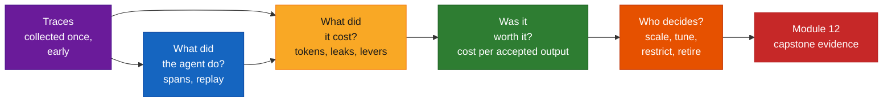

---

## Architecture

### 1. One trace store, four answers *(s.4)*

The deck's through-line, drawn as data flow. The same spans answer every question. Only the *question* changes.

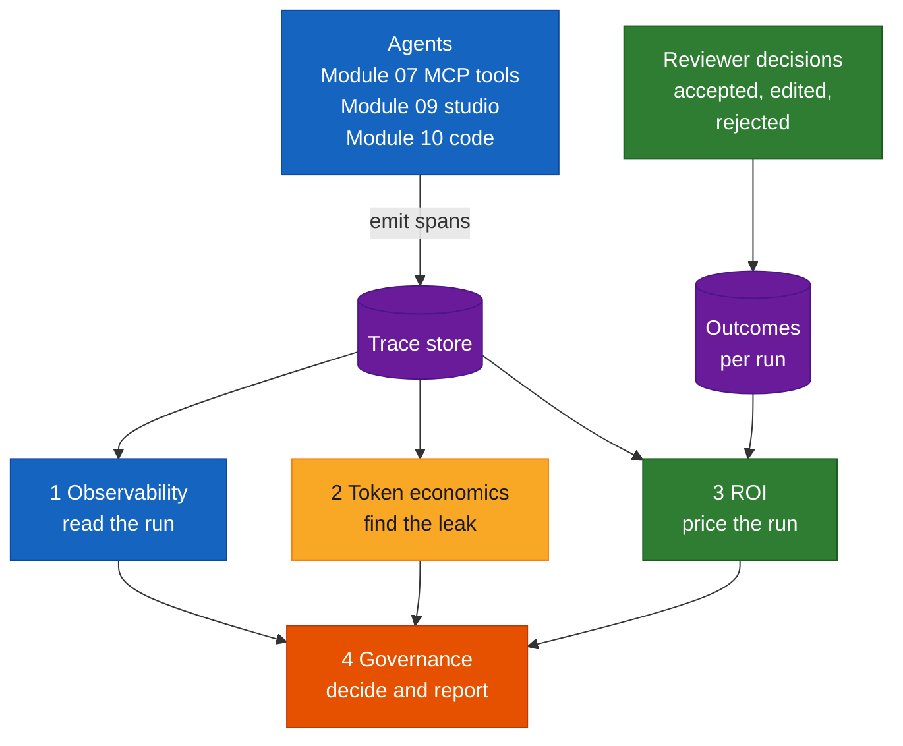

Note the second input. **Traces alone cannot tell you whether an output was accepted.** Reviewer decisions have to come from somewhere else (a PR review result, a thumbs-up, a ticket status). That is why s.11's first row says "Traces plus reviewer decisions."

### 2. An agent run as a trace *(s.5)*, in the deck's own shape

```
STEP (SPAN)                  TIME →
Agent run                    ████████████████████████████████████████████
  LLM call · plan            ██████
  Tool · search_docs                   ████
  LLM call · read result                   ██████
  Tool · get_build_status                        █████████
  LLM call · answer                                       ████████████████
```

*Illustrative shape, not real data (s.5).* The same run as a tree:

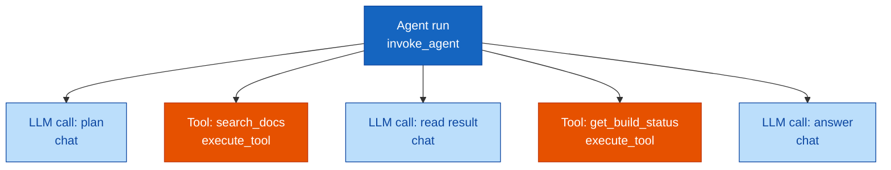

The second line of each label is the OpenTelemetry GenAI operation name (`gen_ai.operation.name`) that a real span would carry **[Beyond the deck]**. Each span "can carry" five things:

| Carries | OpenTelemetry GenAI attribute (names as of 2026-10, status *Development*) |
|---|---|
| Duration | start and end timestamps on the span |
| Tokens in / out | `gen_ai.usage.input_tokens`, `gen_ai.usage.output_tokens` |
| Cost | none in the spec. Agent Prism reads `gen_ai.usage.cost` (custom) |
| Input & output | `gen_ai.input.messages`, `gen_ai.output.messages`, `gen_ai.tool.call.arguments`, `gen_ai.tool.call.result` (only when content capture is on) |
| Status / error | span status (OK, ERROR, UNSET) |

### 3. The viewer pipeline *(s.6)* with the real parts named **[Beyond the deck]**

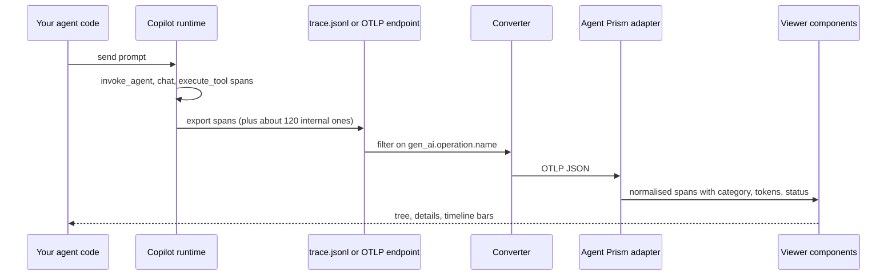

The deck's three boxes map like this:

| Deck box | In practice |
|---|---|
| "Agent emits OpenTelemetry spans" | `CopilotClient(telemetry={...})` for a Copilot SDK agent, or any OTel-instrumented code |
| "Converter maps them to a UI schema" | `openTelemetrySpanAdapter.convertRawDocumentsToSpans(otlpDoc)` from `@evilmartians/agent-prism-data` |
| "Components render the views" | `TraceViewer`, `TraceList`, `TreeView`, `DetailsView`. They are **copied into your project** (`npx degit evilmartians/agent-prism/packages/ui/src/components …`), not installed as a package |

Agent Prism needs React 19+, Tailwind CSS 3 and TypeScript. That is a front-end project, so for a Python-only team the practical routes are the public demo, the Storybook, or a small internal page.

### 4. What the Copilot runtime really emits for one question **[Beyond the deck]**

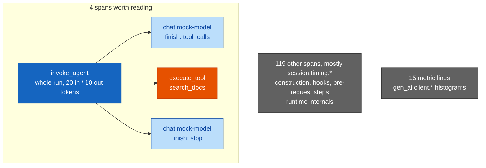

Counts are from one real run of the Module 10 agent against the scripted local model (`mock-model`, so token counts are the stand-in's, not a language model's). Lesson for s.7 and s.9: **raw traces are noisy, and "find the step" starts with filtering.**

### 5. Reading a trace: symptom → pattern → first fix *(s.7, s.9)*

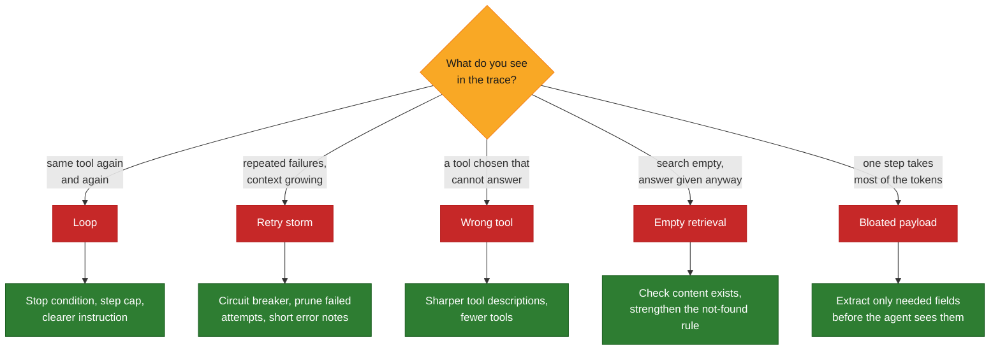

The "first fix" boxes on the right come from the deck's likely-cause column (s.7) and first-fix column (s.9). The deck gives causes, not fixes, for *wrong tool* ("vague tool descriptions or too many tools") and *empty retrieval* ("missing content or weak 'not found' rule"). I turned those causes into fixes.

### 6. Where the tokens go, and the levers *(s.9–10)*

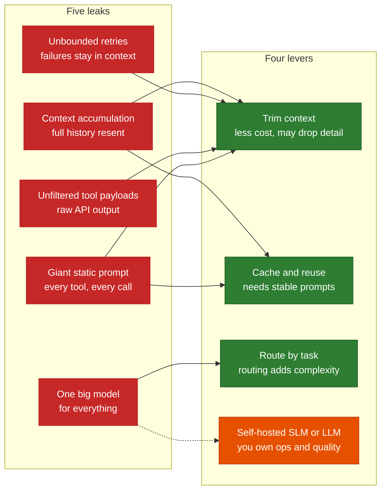

The leak-to-lever arrows are my pairing, based on the deck's first-fix column and lever descriptions. The deck doesn't draw them. The dashed arrow to the self-hosted lever is deliberate: the deck says it is "a lever to discuss, not a recommendation."

### 7. ROI: cost per accepted output *(s.11)*

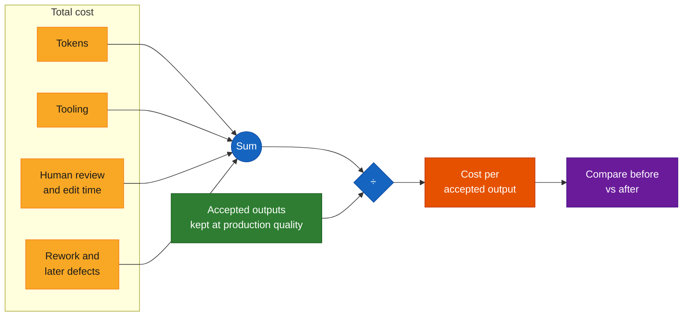

The deck's formula (s.11) puts "tokens + tooling + human review time" in the numerator. Its worksheet adds *rework and later defects* and *time saved vs the manual way* as inputs. I show rework in the numerator because that is where the worksheet's "Missing costs that arrive weeks later" warning bites.

### 8. The four decisions *(s.12)*

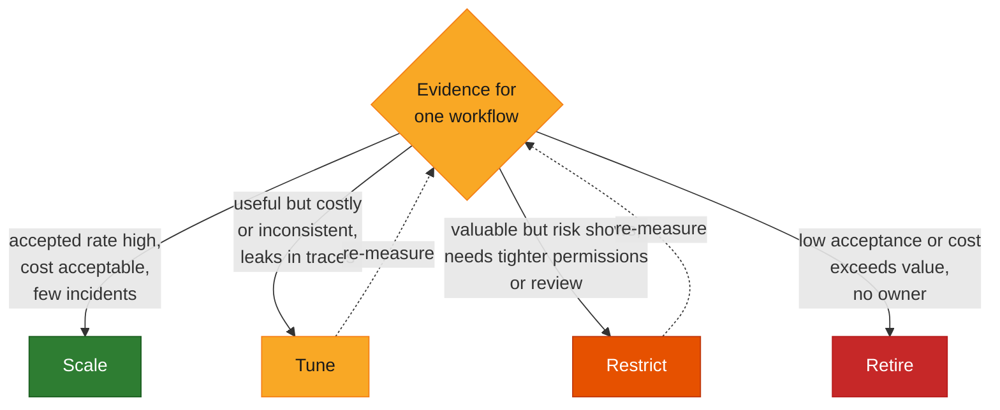

The deck's examples (all labelled *illustrative*): **Scale** — build-failure explainer used by more teams. **Tune** — release-notes drafter with a bloated tool payload. **Restrict** — triage agent with write access limited to drafts. **Retire** — runbook helper reading stale documents. The dashed "re-measure" loops are my addition: tune and restrict only mean something if you measure again afterwards.

### 9. AI governance: four functions *(s.13)*, drawn the way NIST describes them

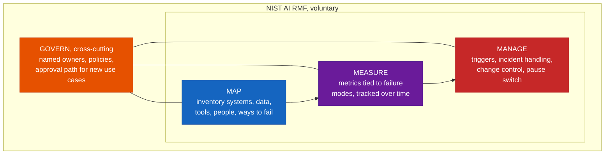

What you "already started" *(s.13)*:

| Function | Already in this programme | Where |
|---|---|---|
| **Govern** | Governance record (M07), ownership (M09) | [Module 07](./module-07-mcp-workflows-custom-server.md), [Module 09](./module-09-rovo-studio-no-code-agents.md) |
| **Map** | Server and agent inventory, handover pack | M07, M09 |
| **Measure** | Traces, judge scores, override rate | this module, [Module 08](./module-08-pr-automation-quality-gates-llm-judge.md) |
| **Manage** | Escalation rules (M08), off switch | M08, [Module 10](./module-10-code-agents-copilot-sdk-simple-rag.md) step cap |

Keep it proportionate *(s.13)*: "the framework is voluntary and no one is 'certified' against it. Use it as a checklist for gaps, scaled to the risk of each workflow."

### 10. A one-page leadership report *(s.14)*

```
┌──────────────────────────────────────────────────────────────────────────────┐
│  AI WORKFLOWS — ONE PAGE            Period: <month>     Owner: <name>        │
├───────────────┬───────────────┬───────────────┬──────────────────────────────┤
│ ADOPTION      │ QUALITY       │ COST          │  Every tile:                 │
│ who uses which│ accepted rate │ token + tool  │    metric · trend · owner    │
│ workflows,    │ override rate │ cost, cost per│                              │
│ how often     │ defects later │ accepted out. │                              │
├───────────────┼───────────────┼───────────────┤                              │
│ VALUE         │ RISK &        │ DECISIONS     │  A number with no owner and  │
│ time saved vs │ INCIDENTS     │ NEEDED        │  no decision attached is     │
│ measured      │ policy except.│ scale / tune /│  decoration. (s.14)          │
│ baseline      │ open findings │ restrict /    │                              │
│               │               │ retire + why  │                              │
└───────────────┴───────────────┴───────────────┴──────────────────────────────┘
```

Layout only. The deck shows six tiles and no numbers. "Agree the cadence and thresholds with the people who will act on them."

### 11. The lab loop *(s.15)*

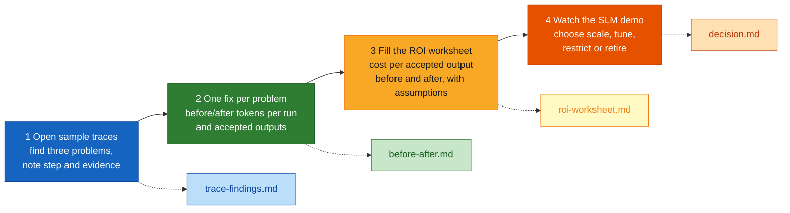

**Done when** *(s.15)*: "Each finding cites a step in a trace, the ROI sheet shows its assumptions, and decision.md gives a clear call with evidence."

---

## Core Concepts

### Part A — Observability and traces *(s.5–8, 15 min)*

#### A1. A trace is the run, a span is a step *(s.5)*

> *Analogy.* A trace is a **flight recorder** for one agent run. The final answer tells you where the plane landed. The recorder tells you every turn it took to get there, how long each leg lasted and what each leg cost in fuel.

OpenTelemetry's own definitions: "A span represents a unit of work or operation", recording its name, start and end times and parent span ID, and a trace gives "the big picture of what happens when a request is made to an application."

Reading order for any trace: **(1)** total duration and tokens at the root, **(2)** the widest bar, **(3)** repeated names, **(4)** anything red or yellow, **(5)** only then open a single span's input and output.

#### A2. Four ways to look at the same trace *(s.6)*

| View (deck) | What it shows | Use it to |
|---|---|---|
| **Tree view** | Parent-child hierarchy; "highlights problem patterns and collapses repeats" | See the loop or the fan-out at a glance |
| **Timeline view** | Gantt-style flow: "bottlenecks, concurrency and cost building up" | Find the slow or costly step |
| **Details panel** | Each step's input, output, cost, performance attributes | Check *why* a step misbehaved |
| **Sequence replay** | "Step-by-step playback to follow decisions and spot circular logic" | Walk a bad run slowly |

See Currency row 2 for what the open-source library actually has.

#### A3. Failure patterns *(s.7)*

| Pattern | What you see | Likely cause (deck) | A number that points at it **[Beyond the deck]** |
|---|---|---|---|
| **Loop** | Same tool called again and again | Missing stop condition or unclear instruction | One tool name ≥ N times in a run (the lab uses N = 4) |
| **Retry storm** | Repeated failures with growing context | Bad tool error or no circuit breaker | ≥ 3 failed tool spans in a run |
| **Wrong tool** | A tool chosen that cannot answer | Vague tool descriptions or too many tools | **None.** A human reads the call against the question |
| **Empty retrieval** | Search returns nothing, the agent answers anyway | Missing content or weak "not found" rule | A search tool span whose result is `[]`. Then read the answer |
| **Bloated payload** | One step swallows most of the tokens | Raw tool output pasted into context | One step adds ≥ 60% of all tokens added in the run (and ≥ 2,000) |

The right-hand column is the lab's rule of thumb. **Every threshold is a starting point.** The deck says to "set thresholds from your own baseline" (s.8), and I have no baseline for your agents.

*Real-world use (s.7):* "when a build-failure agent from Module 10 felt slow and costly, the trace is where you find which of these five it was." The Module 10 lab already guards against two of them. Its step cap answers *loop*, and its "say you could not find it" instruction answers *empty retrieval*. The trace is how you check those guards work.

#### A4. Quality and control signals *(s.8)*

| Signal | Defined as (deck) | Kind | Where it comes from |
|---|---|---|---|
| **Accepted output rate** | Share of outputs a human accepts as-is or with light edits | Value | Reviewer decisions, not traces |
| **Override & edit rate** | How often people change or reject the result | Value | Reviewer decisions |
| **Failure & retry rate** | Runs that error, loop or need re-running | Control | Traces |
| **Latency per run** | Time from request to usable answer | Control | Traces (the root span's duration) |
| **Tokens per run** | Input and output tokens, split by step | Control | Traces |
| **Cost per accepted output** | Total cost ÷ outputs that were accepted | Value | Traces + decisions + prices |

"Careful with proxies": tokens and speed are easy to count. Acceptance and rework are what show real value. Track both kinds. Notice that **three of the six signals cannot be read off a trace alone**. If nothing records acceptance, you can still watch cost, but you cannot say whether it was worth it.

> *Analogy.* Latency and tokens are the **car's dashboard**. Acceptance and rework are whether you **arrived**. A fast, cheap trip to the wrong city is still wrong.

---

### Part B — Token economics *(s.9–10, 15 min)*

#### B1. Why small habits compound *(s.9)*

"Agents resend context on every step, so small habits compound." The lab's loop run shows this in numbers: six model calls whose input grows 900 → 2,400 tokens. The run sends **9,900** input tokens in total, though it only adds about 2,200 tokens of new content (the prompt plus five small tool results), because each call re-reads everything before it.

| Leak | What happens | First fix (deck) |
|---|---|---|
| **Context accumulation** | Full history is resent at every call | Summarise older turns, reuse a stable prompt prefix with caching |
| **Unbounded retries** | Failed attempts and error traces stay in context | Circuit breaker, prune failed attempts, short deterministic error notes |
| **Unfiltered tool payloads** | Raw API responses pasted into the prompt | Extract only the fields the agent needs before it sees them |
| **One big model for everything** | Costly model on trivial steps | Route simple steps to smaller models (watch routing overhead) |
| **Giant static prompt** | Every tool and edge case on every call | Inject only the tools and rules the current step needs |

**"Find it before fixing it":** use the trace to see which step carries the tokens. "Optimising a step that costs little is effort wasted."

#### B2. Finding the step that carries the tokens **[Beyond the deck]**

A trace gives each *model call's* input size, but the cost usually comes from the *tool step before it*. The lab estimates it: a call's **added tokens** = its input − the previous call's input − the previous call's output. That assumes the full history is resent each time, which is the leak the deck describes. The surplus is whatever the step in between put into context.

```
Sample run "c" (invented):          model call    input tokens    added since last call
                                    1 plan              700              700
         tool: list_commits  ──►    2                14,750           14,000   ◄── 94% of everything added
                                    3                15,350              200
```

The tool span itself shows only a short duration (900 ms). **The cost is invisible on the tool's own row and shows up on the next model call.** That is the single most useful reading skill in this module. It is also why the viewer's Details panel (input and output) matters.

#### B3. Cost and control levers *(s.10)*

| Lever | Idea | Gain (deck) | Cost (deck) |
|---|---|---|---|
| **Trim context** | Send less per call | Less cost, faster | May drop needed detail |
| **Cache & reuse** | Reuse stable prompt prefixes | Pay once for repeated text | Needs stable prompts |
| **Route by task** | Smaller model for simple steps | Lower cost per step | Routing adds complexity |
| **Self-hosted SLM / LLM** | Run a model in your own environment | More control over data and cost shape | You own ops, updates and quality |

"Each lever trades something. Pick the cheapest one that solves the problem you measured." And for the last one: "the self-hosted SLM demo is a lever to discuss, not a recommendation. Whether it pays off depends on volume, quality needs and who runs it."

**Caching has a catch** **[Beyond the deck]** (Currency row 8). Both big providers document it the same way: the cache matches an **exact prefix**, so instructions, tool definitions and reference text should come first and stay byte-identical, with anything that changes (timestamps, user data) last. Cache reads are cheaper than base input, but cache writes cost *more* than base. And summarising or truncating history changes the prefix. That can reset the cache, so "summarise older turns" and "reuse a stable prefix" can fight each other. Compare **total input cost before and after**. Don't assume the two fixes add up.

**Self-hosted lever, mechanically** **[Beyond the deck]**: the Copilot SDK takes a `provider=` option (BYOK), so the Module 10 agent can be pointed at an OpenAI-compatible endpoint you run. In Module 10's offline lab that was a scripted local server. The SDK docs list Ollama, Foundry Local, vLLM and LiteLLM as OpenAI-compatible examples, and note that BYOK usage is tracked by *your* provider and does not count against Copilot quotas. That last part matters for ROI: **your cost sheet needs a new line (hosting) and loses another (Copilot allowance).** Whether answer quality survives is exactly what the Module 10 question set can test.

---

### Part C — ROI and business value *(s.11, 15 min)*

#### C1. The formula, the worksheet, the traps *(s.11)*

**Cost per accepted output = (tokens + tooling + human review time) ÷ accepted outputs kept at production quality.** "Count what was accepted, not what was generated, and include the humans."

| Input | Where it comes from (deck) | Watch out for (deck) |
|---|---|---|
| Runs and accepted outputs | Traces plus reviewer decisions | Counting generated output as accepted |
| Token and tool cost per run | Trace usage data, billing export | Ignoring failed and retried runs |
| Human review and edit time | Short time sampling, reviewer notes | Treating review as free |
| Time saved vs the manual way | A measured baseline, not a guess | Using an optimistic estimate |
| Rework and later defects | Bug and revert records | Missing costs that arrive weeks later |

"Be honest about uncertainty: an estimate built from measured inputs and stated assumptions beats a confident number nobody can trace."

#### C2. Splitting costs into "per run" and "per accepted" **[Beyond the deck]**

The deck's worksheet mixes two kinds of cost. Separating them makes the traps visible:

| Paid on **every run**, accepted or not | Paid only **when the output is kept** |
|---|---|
| Tokens, tooling | Light editing |
| Reading and judging the output (review) | Rework and defects that surface later (expected value) |

That is why "ignoring failed and retried runs" and "treating review as free" both **flatter** the number: they drop costs from the left column. And it gives a break-even you can state in one sentence: *the acceptance rate below which this workflow loses money, holding the per-run costs fixed.* The lab computes it.

#### C3. A worked example, and what it teaches **[Beyond the deck]**

The numbers below are **invented**. `roi_example.py` models the deck's own "scale" example, the build-failure explainer. Before the fix each run drags a 14,000-token commit list through the loop. After the fix, a filter cuts the input per run from 30,000 to 9,000 tokens.

| | Runs | Accepted | Acceptance | Token cost / run | Total cost | **Cost / accepted** | Net vs manual | Break-even acceptance |
|---|---|---|---|---|---|---|---|---|
| Before | 200 | 120 | 60% | 0.066 | 1155.12 | **9.63** | 1844.88 | 15% |
| After | 200 | 120 | 60% | 0.024 | 1146.72 | **9.56** | 1853.28 | 15% |

Assumptions (all invented, all in `roi_example.py`): prices 2.0 and 8.0 per million input and output tokens (placeholders, not any model's price), 3 review minutes per run, 4 edit minutes per accepted output, 0.50 rework per accepted output, 60 per hour, 25 minutes per task by hand.

**The lesson is in the shape, not the figures.** A 64% cut in token cost per run (input tokens down 70%) barely moves cost per accepted output (9.63 → 9.56), because with review priced in, **human time dominates** — here the 3 minutes of review per run costs about 3.00 against 0.066 of tokens. The sweeps in the script show what does move it: review time (1 → 10 minutes per run takes cost per accepted output from 6.22 to 21.22) and acceptance rate (90 → 150 accepted of 200 takes it from 11.24 to 8.54). That is the deck's warning made concrete: *"Report token savings while ignoring rework"* (s.16, avoid list). Whether your numbers look like this depends entirely on your review time and prices. Measure them.

Two more things the example is careful about. It **states the assumption that acceptance does not change after the fix**, which is the thing you must go and check. And it never counts generated output as accepted (the tests prove the number gets flattered if you do).

---

### Part D — Governance and leadership reporting *(s.12–14, 10 min)*

#### D1. Scale, tune, restrict or retire *(s.12)*

| Decision | When (deck) | Illustrative example (deck) | Evidence that supports it **[Beyond the deck]** |
|---|---|---|---|
| **Scale** | Accepted rate high, cost per output acceptable, few incidents | Build-failure explainer used by more teams | Acceptance and cost trend stable over several periods |
| **Tune** | Useful but costly or inconsistent, leaks visible in traces | Release-notes drafter with a bloated tool payload | A named leak in `trace-findings.md` and a before/after |
| **Restrict** | Valuable but risk shows, needs tighter permissions or review | Triage agent with write access limited to drafts | Policy exceptions, an incident, or an over-broad tool |
| **Retire** | Low acceptance or cost exceeds value, no owner | Runbook helper reading stale documents | Acceptance below break-even, or nobody to own it |

"**Retire is a success too:** stopping a workflow that does not pay off frees budget and attention for the ones that do. Make it a normal outcome, not a failure." The practical way to make it normal is a **review date** on every workflow (s.16: "Let a workflow run with no owner or review date" is on the avoid list).

#### D2. The four functions of AI governance *(s.13)*

The deck's table is in Architecture §9. Two reading notes. First, **GOVERN comes first only in the sense that policies and owners must exist before the rest means anything.** NIST describes it as cross-cutting. Second, the frame is a **gap-finding checklist**, not an audit. Ask of each live workflow: is there a named owner and an approval path (Govern)? Is it in the inventory with its data and tools (Map)? Are there metrics tied to its failure modes (Measure)? Are there triggers, an escalation route and a pause switch (Manage)?

#### D3. Leadership reporting *(s.14)*

"Fewer, better-defined measures. Every tile has an owner and a next step." The six tiles map back onto the signals you already defined:

| Tile | Fed by |
|---|---|
| **Adoption** | Who uses which workflows, how often. For Copilot itself, GitHub's usage-metrics dashboard and API (Currency row 10) |
| **Quality** | Accepted rate, override rate, defects found later |
| **Cost** | Token and tool cost, cost per accepted output |
| **Value** | Time saved vs measured baseline, rework avoided |
| **Risk & incidents** | Policy exceptions, incidents, open findings |
| **Decisions needed** | Scale, tune, restrict or retire, with evidence |

*Report trends and decisions, not dashboards.* "A number with no owner and no decision attached is decoration."

GitHub's own documentation is a useful reminder about the *Value* tile. It calls lines of code "a directional view" and its dashboard ROI figures "estimates rather than exact financial results". Present yours the same way.

---

### Part E — Lab: trace, cost, decide *(s.15, 30 min)* **[Beyond the deck]**

The deck's lab uses the programme's **sample traces, sample telemetry, ROI worksheet and a self-hosted SLM demo**. None is in this repository (Currency row 12), so here is a stand-in with the same four output files. Everything runs offline in plain Python (3.10+ syntax, tested on 3.13). **All sample data is invented.**

**What the stand-in has, and doesn't:**

| Deck lab step | Stand-in |
|---|---|
| 1. Find three problems in sample traces | Six invented runs in OTLP/JSON, five with a planted pattern, one **wrong-tool** run that no script flags. `run_lab.py` writes `trace-findings.md` |
| 2. One fix each; before/after tokens per run and accepted outputs | You write `before-after.md`. `roi_example.py` shows the shape |
| 3. Fill the ROI worksheet, cost per accepted before and after, state assumptions | `tracelab/roi.py` + `roi_example.py`. You replace the invented inputs and write `roi-worksheet.md` |
| 4. Watch the SLM demo, choose scale/tune/restrict/retire | Not reproducible here. You write `decision.md` from the template below |
| (extra) Your own agent's traces | Part E step 5: the Module 10 agent emits real spans, `sdk_to_otlp.py` converts them |

#### Step 0 — set up

```bash
mkdir lab11 && cd lab11
python -m venv .venv && source .venv/bin/activate      # Windows: .venv\Scripts\activate
pip install pytest
mkdir tracelab tests viewer-check traces
touch tracelab/__init__.py tests/__init__.py
```

Then create each file below. Use the paths shown. Nothing else is needed: the code uses only the standard library.

#### Step 1 — the trace loader (`tracelab/spans.py`)

It reads both OTLP/JSON and the Copilot runtime's JSON-lines file into one small `Span` shape, and drops the runtime's `session.timing.*` spans.

`tracelab/spans.py`

```python
"""Load agent traces into one small shape. Reads OTLP/JSON (what trace viewers take) and the
JSON-lines file the Copilot runtime writes with telemetry={"exporter_type": "file", ...}."""
import json
import re
from dataclasses import dataclass, field

ERROR = 2  # OpenTelemetry status code for "error"


@dataclass
class Span:
    trace_id: str
    id: str
    parent: str | None
    name: str
    kind: str                 # agent | llm | tool | other
    start_ms: float
    end_ms: float
    tokens_in: int = 0
    tokens_out: int = 0
    error: bool = False
    tool: str | None = None
    attrs: dict = field(default_factory=dict)

    @property
    def ms(self):
        return self.end_ms - self.start_ms


KINDS = {"invoke_agent": "agent", "chat": "llm", "text_completion": "llm",
         "execute_tool": "tool", "retrieval": "tool"}


def _span(trace_id, sid, parent, name, start_ms, end_ms, attrs, status):
    op = attrs.get("gen_ai.operation.name")
    tool = attrs.get("gen_ai.tool.name")
    if tool and re.fullmatch(r"[0-9a-f]{64}", tool):   # runtime hides names unless capture_content=True
        tool = "hashed-" + tool[:8]
    return Span(trace_id, sid, parent or None, name, KINDS.get(op, "other"), start_ms, end_ms,
                int(attrs.get("gen_ai.usage.input_tokens", 0) or 0),
                int(attrs.get("gen_ai.usage.output_tokens", 0) or 0),
                status == ERROR or status == "STATUS_CODE_ERROR", tool, attrs)


def _otlp_value(v):
    for key in ("stringValue", "intValue", "doubleValue", "boolValue"):
        if key in v:
            return int(v[key]) if key == "intValue" else v[key]
    return None


def load_otlp(doc):
    """OTLP/JSON: {"resourceSpans": [{"scopeSpans": [{"spans": [...]}]}]}"""
    out = []
    for rs in doc.get("resourceSpans", []):
        for ss in rs.get("scopeSpans", []):
            for s in ss.get("spans", []):
                attrs = {a["key"]: _otlp_value(a["value"]) for a in s.get("attributes", [])}
                out.append(_span(s["traceId"], s["spanId"], s.get("parentSpanId"), s["name"],
                                 int(s["startTimeUnixNano"]) / 1e6, int(s["endTimeUnixNano"]) / 1e6,
                                 attrs, s.get("status", {}).get("code")))
    return out


def load_sdk_jsonl(lines):
    """One JSON object per line; keep spans, drop metrics and the runtime's session.timing.* noise."""
    out = []
    for line in lines:
        r = json.loads(line)
        if r.get("type") != "span" or "gen_ai.operation.name" not in r["attributes"]:
            continue
        to_ms = lambda t: t[0] * 1e3 + t[1] / 1e6
        out.append(_span(r["traceId"], r["spanId"], r.get("parentSpanId"), r["name"],
                         to_ms(r["startTime"]), to_ms(r["endTime"]), r["attributes"],
                         r["status"]["code"]))
    return out


def load_file(path):
    with open(path, encoding="utf-8") as f:
        text = f.read()
    if text.lstrip().startswith('{"type"'):
        return load_sdk_jsonl(text.splitlines())
    return load_otlp(json.loads(text))


def by_trace(spans):
    runs = {}
    for s in spans:
        runs.setdefault(s.trace_id, []).append(s)
    return {k: sorted(v, key=lambda s: s.start_ms) for k, v in runs.items()}
```

#### Step 1 — the sample runs (`tracelab/make_samples.py`)

Six **invented** runs. Read the steps list for each, because it is the answer key.

`tracelab/make_samples.py`

```python
"""Writes six INVENTED sample runs as OTLP/JSON into traces/. Not real data (s.5: 'illustrative shape').
Step tuples:  ("llm", ms, tokens_in, tokens_out)
              ("tool", name, ms, arguments, result, failed)"""
import json
import os

SEARCH = lambda q, res, ms=140: ("tool", "search_docs", ms, json.dumps({"query": q}), res, False)
BUILD = lambda ms=80: ("tool", "get_build_status", ms, json.dumps({"build_id": "b-1234"}), '{"status": "failed"}', False)
HIT = '[{"source": "runbook-payments.md", "chunk_id": "s4"}]'

RUNS = {
    "run-a-healthy": [
        ("llm", 900, 800, 60), SEARCH("rollback window", HIT), ("llm", 1100, 1500, 90), BUILD(),
        ("llm", 1300, 1750, 120)],
    "run-b-loop": [
        ("llm", 900, 900, 40), BUILD(), ("llm", 700, 1200, 30), BUILD(), ("llm", 700, 1500, 30), BUILD(),
        ("llm", 700, 1800, 30), BUILD(), ("llm", 700, 2100, 30), BUILD(), ("llm", 700, 2400, 30)],
    "run-c-bloated": [
        ("llm", 800, 700, 50),
        ("tool", "list_commits", 900, json.dumps({"range": "v1.2..v1.3"}), "<14000 tokens of raw commits>", False),
        ("llm", 2600, 14750, 400), BUILD(60), ("llm", 2400, 15350, 300)],
    "run-d-retry-storm": [
        ("llm", 800, 800, 50),
        ("tool", "create_issue", 300, json.dumps({"label": "bug!"}), '{"error": "422 invalid label"}', True),
        ("llm", 600, 900, 40),
        ("tool", "create_issue", 300, json.dumps({"label": "bug "}), '{"error": "422 invalid label"}', True),
        ("llm", 600, 1000, 40),
        ("tool", "create_issue", 300, json.dumps({"label": "Bug"}), '{"error": "422 invalid label"}', True),
        ("llm", 900, 1100, 90)],
    "run-e-empty-retrieval": [
        ("llm", 900, 800, 60), SEARCH("refund approval limit", "[]", 90), ("llm", 1000, 1000, 120)],
    "run-f-wrong-tool": [   # asks about a policy, calls the build tool: no number shows it
        ("llm", 900, 800, 60),
        ("tool", "get_build_status", 80, json.dumps({"build_id": "b-0000"}), '{"error": "no build b-0000"}', True),
        ("llm", 1000, 950, 110)],
}


def _attr(k, v):
    key = "intValue" if isinstance(v, int) and not isinstance(v, bool) else "stringValue"
    return {"key": k, "value": {key: str(v) if key == "intValue" else v}}


def to_otlp(trace_id, steps, t0_ms=1_800_000_000_000):
    spans, t, n = [], t0_ms, 0

    def add(name, start, dur, attrs, parent, error=False):
        nonlocal n
        n += 1
        spans.append({"traceId": trace_id, "spanId": f"{n:016x}", "parentSpanId": parent, "name": name,
                      "startTimeUnixNano": str(start * 1_000_000), "endTimeUnixNano": str((start + dur) * 1_000_000),
                      "attributes": [_attr(k, v) for k, v in attrs.items()],
                      "status": {"code": 2 if error else 1}})
        return spans[-1]

    root = add("invoke_agent", t, 0, {"gen_ai.operation.name": "invoke_agent"}, "")
    for st in steps:
        if st[0] == "llm":
            _, ms, tin, tout = st
            add("chat sample-model", t, ms, {"gen_ai.operation.name": "chat", "gen_ai.request.model": "sample-model",
                                              "gen_ai.usage.input_tokens": tin, "gen_ai.usage.output_tokens": tout},
                root["spanId"])
        else:
            _, name, ms, args, res, failed = st
            add(f"execute_tool {name}", t, ms, {"gen_ai.operation.name": "execute_tool", "gen_ai.tool.name": name,
                                                "gen_ai.tool.call.arguments": args, "gen_ai.tool.call.result": res},
                root["spanId"], failed)
        t += ms + 5
    root["endTimeUnixNano"] = str(t * 1_000_000)
    return {"resourceSpans": [{"scopeSpans": [{"spans": spans}]}]}


def main(out="traces"):
    os.makedirs(out, exist_ok=True)
    for i, (name, steps) in enumerate(RUNS.items(), 1):
        with open(os.path.join(out, f"{name}.json"), "w", encoding="utf-8") as f:
            json.dump(to_otlp(f"{i:032x}", steps), f, indent=1)


if __name__ == "__main__":
    main()
```

#### Step 1 — the pattern finder (`tracelab/analyze.py`)

`tracelab/analyze.py`

```python
"""Spot the deck's failure patterns (s.7) and token leaks (s.9) in a trace.
Thresholds are starting points. Set yours from your own baseline (s.8)."""
from dataclasses import dataclass

LOOP_MIN = 4        # same tool (same arguments, when captured) this many times in one run
RETRY_MIN = 3       # this many failed tool calls in one run
BLOAT_SHARE = 0.6   # one step adds this share of all the tokens added during the run ...
BLOAT_MIN_TOKENS = 2000  # ... and added at least this many tokens
GROWTH_RATIO = 2.5  # last call's input vs first call's input


@dataclass
class Finding:
    pattern: str
    step: str       # which span to open in the viewer
    evidence: str


def llm_calls(spans):
    return [s for s in spans if s.kind == "llm"]


def added_tokens(spans):
    """Approximation: input tokens a call added beyond the previous call's input + output.
    Assumes the full history is resent each call. The surplus is whatever the step between them
    put into context, which is usually a tool result."""
    calls, rows, prev = llm_calls(spans), [], None
    for c in calls:
        added = c.tokens_in if prev is None else max(0, c.tokens_in - prev.tokens_in - prev.tokens_out)
        producer = None
        if prev is not None:
            between = [s for s in spans if s.kind == "tool" and prev.end_ms <= s.start_ms < c.start_ms]
            producer = between[-1] if between else None
        rows.append((c, added, producer))
        prev = c
    return rows


def totals(spans):
    calls = llm_calls(spans)
    return {"llm_calls": len(calls), "tool_calls": sum(s.kind == "tool" for s in spans),
            "tokens_in": sum(c.tokens_in for c in calls), "tokens_out": sum(c.tokens_out for c in calls),
            "ms": max((s.end_ms for s in spans), default=0) - min((s.start_ms for s in spans), default=0)}


def find_patterns(spans):
    out, tools = [], [s for s in spans if s.kind == "tool"]

    groups = {}
    for t in tools:
        groups.setdefault((t.tool, t.attrs.get("gen_ai.tool.call.arguments")), []).append(t)
    for (name, args), g in groups.items():
        if len(g) >= LOOP_MIN:
            out.append(Finding("loop", f"tool {name}", f"called {len(g)}x" + (" with identical arguments" if args else "")))

    failed = [t for t in tools if t.error]
    if len(failed) >= RETRY_MIN:
        out.append(Finding("retry storm", f"tool {failed[0].tool}", f"{len(failed)} failed tool calls in one run"))

    for t in tools:
        res = t.attrs.get("gen_ai.tool.call.result")
        if res is not None and str(res).strip() in ("", "[]", "{}", "null"):
            out.append(Finding("empty retrieval", f"tool {t.tool}", "tool returned nothing; check the answer says so"))

    calls = llm_calls(spans)
    rows = added_tokens(spans)
    total_added = sum(a for _, a, _ in rows)
    bloated = False
    if len(calls) >= 2 and total_added:
        call, added, src = max(rows[1:], key=lambda r: r[1])   # row 0 is the prompt itself
        if added >= BLOAT_MIN_TOKENS and added / total_added >= BLOAT_SHARE:
            bloated = True
            out.append(Finding("bloated payload", f"tool {src.tool}" if src else "a step before a model call",
                               f"one step added {added} tokens, {added / total_added:.0%} of everything added in the run"))
    if not bloated and len(calls) >= 4 and calls[0].tokens_in and calls[-1].tokens_in / calls[0].tokens_in >= GROWTH_RATIO:
        out.append(Finding("context growth", "every model call after the first",
                           f"input grew {calls[0].tokens_in} to {calls[-1].tokens_in} tokens across {len(calls)} calls"))
    return out   # 'wrong tool' needs a human: nothing in the numbers says a tool could not answer
```

Points worth pausing on:

- `added_tokens` is the Part B2 estimate. `find_patterns` attributes a bloat to the *tool before* the expensive call.
- Loop detection uses **identical arguments** when they were captured (content capture on), and only the tool name otherwise. Without arguments, a legitimate fan-out (five different build ids) looks like a loop. The test `test_loop_needs_identical_arguments_when_they_are_captured` pins that.
- The last line is a comment, not an omission: **wrong tool is not detectable from numbers.**

`tracelab/report.py`

```python
"""Turn findings into trace-findings.md (lab step 1) with the deck's first fix beside each (s.9)."""
from .analyze import find_patterns, totals
from .spans import by_trace

FIRST_FIX = {
    "loop": "Add a stop condition and a step cap (Module 10 guard); say when to stop in the instructions",
    "retry storm": "Circuit breaker; short deterministic error text; prune failed attempts from context",
    "empty retrieval": "Strengthen the 'not found' rule; check whether the content exists at all",
    "bloated payload": "Extract only the fields the agent needs before it sees the tool output",
    "context growth": "Summarise older turns; keep a stable prompt prefix so it can be cached",
}


def render(files):
    """files: {run name: [Span, ...]} -> markdown"""
    lines = ["# Trace findings", "",
             "| Run | Model calls | Tool calls | Tokens in / out | Seconds |", "|---|---|---|---|---|"]
    found = []
    for name, spans in files.items():
        for trace in by_trace(spans).values():
            t = totals(trace)
            lines.append(f"| {name} | {t['llm_calls']} | {t['tool_calls']} | {t['tokens_in']} / {t['tokens_out']} | {t['ms'] / 1000:.1f} |")
            found += [(name, f) for f in find_patterns(trace)]
    lines += ["", "| Run | Pattern | Step to open in the viewer | Evidence | First fix |", "|---|---|---|---|---|"]
    for name, f in found:
        lines.append(f"| {name} | {f.pattern} | {f.step} | {f.evidence} | {FIRST_FIX[f.pattern]} |")
    lines += ["", "Not detected by this script: **wrong tool**. Read the tool calls against the question yourself.", ""]
    return "\n".join(lines)
```

`run_lab.py`

```python
"""python run_lab.py [trace files...]  ->  trace-findings.md
With no arguments it reads traces/*.json (made by python -m tracelab.make_samples)."""
import glob
import os
import sys

from tracelab.report import render
from tracelab.spans import load_file

paths = sys.argv[1:] or sorted(glob.glob("traces/*.json"))
if not paths:
    sys.exit("no traces found: run  python -m tracelab.make_samples  first")
md = render({os.path.splitext(os.path.basename(p))[0]: load_file(p) for p in paths})
with open("trace-findings.md", "w", encoding="utf-8") as f:
    f.write(md)
print(md)
```

Run it:

```bash
python -m tracelab.make_samples
python run_lab.py
```

Expected output (this is what the script printed when I ran it):

```text
# Trace findings

| Run | Model calls | Tool calls | Tokens in / out | Seconds |
|---|---|---|---|---|
| run-a-healthy | 3 | 2 | 4050 / 270 | 3.5 |
| run-b-loop | 6 | 5 | 9900 / 190 | 4.9 |
| run-c-bloated | 3 | 2 | 30800 / 750 | 6.8 |
| run-d-retry-storm | 4 | 3 | 3800 / 220 | 3.8 |
| run-e-empty-retrieval | 2 | 1 | 1800 / 180 | 2.0 |
| run-f-wrong-tool | 2 | 1 | 1750 / 170 | 2.0 |

| Run | Pattern | Step to open in the viewer | Evidence | First fix |
|---|---|---|---|---|
| run-b-loop | loop | tool get_build_status | called 5x with identical arguments | Add a stop condition and a step cap (Module 10 guard); say when to stop in the instructions |
| run-b-loop | context growth | every model call after the first | input grew 900 to 2400 tokens across 6 calls | Summarise older turns; keep a stable prompt prefix so it can be cached |
| run-c-bloated | bloated payload | tool list_commits | one step added 14000 tokens, 94% of everything added in the run | Extract only the fields the agent needs before it sees the tool output |
| run-d-retry-storm | retry storm | tool create_issue | 3 failed tool calls in one run | Circuit breaker; short deterministic error text; prune failed attempts from context |
| run-e-empty-retrieval | empty retrieval | tool search_docs | tool returned nothing; check the answer says so | Strengthen the 'not found' rule; check whether the content exists at all |

Not detected by this script: **wrong tool**. Read the tool calls against the question yourself.
```

**Your job for lab step 1:** don't just accept the table. Open each flagged run (script, viewer or JSON) and **write down the step and the evidence in your own words** in `trace-findings.md` (the deck's "done when" is "each finding cites a step in a trace"). Then read `run-f-wrong-tool` yourself. The script is silent on it. Which tool should have been called?

#### Step 2 — see them in a viewer (optional)

The loader makes the same files viewable in Agent Prism. This tiny script prints what the library's own OTLP adapter makes of a trace. Run it to check that your file is understood before you build a UI:

`viewer-check/check.mjs`

```javascript
// node check.mjs ../traces/run-c-bloated.json   (after: npm install @evilmartians/agent-prism-data @evilmartians/agent-prism-types)
// Prints what Agent Prism's own OTLP adapter makes of a trace: category, tokens, status per span.
import fs from "node:fs";
import { openTelemetrySpanAdapter, getTotalTokens } from "@evilmartians/agent-prism-data";

for (const file of process.argv.slice(2)) {
  const spans = openTelemetrySpanAdapter.convertRawDocumentsToSpans(JSON.parse(fs.readFileSync(file, "utf8")));
  const show = (s, depth = 0) => {
    const tokens = s.tokenUsage ? getTotalTokens(s.tokenUsage) : "-";
    console.log(`${"  ".repeat(depth)}${s.title} | ${s.type} | tokens ${tokens} | ${s.status}`);
    (s.children ?? []).forEach((c) => show(c, depth + 1));
  };
  console.log(file);
  spans.forEach((s) => show(s));
}
```

```bash
cd viewer-check
npm init -y && npm install @evilmartians/agent-prism-data@1.0.0 @evilmartians/agent-prism-types@1.0.0
node check.mjs ../traces/run-b-loop.json
```

I ran it on Node 25 with these package versions. Output for the loop run, first lines:

```text
../traces/run-b-loop.json
invoke_agent | agent_invocation | tokens - | success
  sample-model - chat sample-model | llm_call | tokens 940 | success
  execute_tool get_build_status | tool_execution | tokens - | success
  sample-model - chat sample-model | llm_call | tokens 1230 | success
  execute_tool get_build_status | tool_execution | tokens - | success
  sample-model - chat sample-model | llm_call | tokens 1530 | success
  ...
```

Categories (`agent_invocation`, `llm_call`, `tool_execution`) come from the `gen_ai.operation.name` attribute, and a chat span's tokens are input + output (900 + 40 = 940). **I did not run the React components or upload a file to the public demo** (agent-prism.evilmartians.io; the README says it can "visualize and debug your own agent traces"). Trying that is up to you.

#### Step 3 — price the run (`tracelab/roi.py`)

`tracelab/roi.py`

```python
"""Cost per accepted output (s.11). Every input is an explicit assumption you must fill in."""
from dataclasses import dataclass, replace


@dataclass(frozen=True)
class Scenario:
    runs: int                    # every run, including failed and retried ones
    accepted: int                # outputs kept at production quality (not outputs generated)
    tokens_in_per_run: float
    tokens_out_per_run: float
    price_in_per_m: float        # currency per million input tokens (your contract, not a default)
    price_out_per_m: float
    tooling_per_run: float       # hosting, vector store, API calls
    review_min_per_run: float    # a human looks at every output, including the ones thrown away
    edit_min_per_accepted: float
    rework_per_accepted: float   # defects and reverts that arrive later (expected cost)
    hourly_rate: float
    manual_min_per_task: float   # measured baseline for doing the task by hand

    @property
    def token_cost_per_run(self):
        return (self.tokens_in_per_run * self.price_in_per_m + self.tokens_out_per_run * self.price_out_per_m) / 1e6

    @property
    def fixed_per_run(self):     # paid whether or not the output is accepted
        return self.token_cost_per_run + self.tooling_per_run + self.review_min_per_run / 60 * self.hourly_rate

    @property
    def per_accepted(self):      # paid only when the output is kept
        return self.edit_min_per_accepted / 60 * self.hourly_rate + self.rework_per_accepted

    @property
    def total_cost(self):
        return self.runs * self.fixed_per_run + self.accepted * self.per_accepted

    @property
    def cost_per_accepted(self):
        return self.total_cost / self.accepted if self.accepted else None

    @property
    def value_per_accepted(self):
        return self.manual_min_per_task / 60 * self.hourly_rate

    @property
    def net(self):
        return self.accepted * self.value_per_accepted - self.total_cost

    @property
    def acceptance_rate(self):
        return self.accepted / self.runs

    @property
    def breakeven_acceptance(self):
        """Acceptance rate at which net = 0, other per-run inputs held fixed. None = never breaks even."""
        margin = self.value_per_accepted - self.per_accepted
        return self.fixed_per_run / margin if margin > 0 else None


def sweep(s, field, values):
    """What happens to cost per accepted output if one assumption is wrong? Returns [(value, cost)]."""
    return [(v, replace(s, **{field: v}).cost_per_accepted) for v in values]
```

`roi_example.py`

```python
"""Worked before/after for one invented workflow. Every number below is made up: replace them with
your own measured baseline before you show anyone (s.16: do not quote sample numbers as results)."""
from tracelab.roi import Scenario, sweep

BEFORE = Scenario(runs=200, accepted=120, tokens_in_per_run=30_000, tokens_out_per_run=700,
                  price_in_per_m=2.0, price_out_per_m=8.0,      # placeholder prices, not any model's
                  tooling_per_run=0.01, review_min_per_run=3, edit_min_per_accepted=4,
                  rework_per_accepted=0.50, hourly_rate=60, manual_min_per_task=25)
# The fix from trace-findings.md: filter the 14,000-token commit list down to the fields needed.
# Same runs; we assume acceptance does not change. State that assumption in the worksheet, then check it.
AFTER = Scenario(**{**BEFORE.__dict__, "tokens_in_per_run": 9_000})


def row(label, s):
    be = s.breakeven_acceptance
    return (f"| {label} | {s.runs} | {s.accepted} | {s.acceptance_rate:.0%} | {s.token_cost_per_run:.3f} "
            f"| {s.total_cost:.2f} | {s.cost_per_accepted:.2f} | {s.net:.2f} | {be:.0%} |")


if __name__ == "__main__":
    print("| | Runs | Accepted | Acceptance | Token cost per run | Total cost | Cost per accepted | Net vs manual | Break-even acceptance |")
    print("|---|---|---|---|---|---|---|---|---|")
    print(row("Before", BEFORE))
    print(row("After", AFTER))
    print("\nIf review takes longer than assumed (cost per accepted output after the fix):")
    for minutes, cost in sweep(AFTER, "review_min_per_run", [1, 3, 6, 10]):
        print(f"  review {minutes:>2} min/run -> {cost:.2f}")
    print("\nIf more outputs were accepted (same runs, same cost per run):")
    for n, cost in sweep(AFTER, "accepted", [90, 120, 150]):
        print(f"  accepted {n:>3} of {AFTER.runs} -> {cost:.2f}")
```

```bash
python roi_example.py
```

Expected output (as printed when I ran it):

```text
| | Runs | Accepted | Acceptance | Token cost per run | Total cost | Cost per accepted | Net vs manual | Break-even acceptance |
|---|---|---|---|---|---|---|---|---|
| Before | 200 | 120 | 60% | 0.066 | 1155.12 | 9.63 | 1844.88 | 15% |
| After | 200 | 120 | 60% | 0.024 | 1146.72 | 9.56 | 1853.28 | 15% |

If review takes longer than assumed (cost per accepted output after the fix):
  review  1 min/run -> 6.22
  review  3 min/run -> 9.56
  review  6 min/run -> 14.56
  review 10 min/run -> 21.22

If more outputs were accepted (same runs, same cost per run):
  accepted  90 of 200 -> 11.24
  accepted 120 of 200 -> 9.56
  accepted 150 of 200 -> 8.54
```

**Your job for lab steps 2–3:** replace every number in `roi_example.py` with something you can defend (prices from your contract, review minutes from a short time sample, manual minutes from a measured baseline). **Then write `roi-worksheet.md`: each input, where it came from, and your confidence in it.** The deck's "done when" asks the ROI sheet to show its assumptions. If you cannot source an input, say so in the sheet. That is a finding.

#### Step 4 — decide (`decision.md`)

Use the evidence, not a feeling. A template to copy (my wording; the deck specifies only "a clear call with evidence"):

```markdown
# Decision: <workflow name>

- **Owner:** <named person>    **Next review date:** <date>
- **Decision:** Scale | Tune | Restrict | Retire

## Evidence
- Trace findings: <run id, step, pattern> (link to trace-findings.md rows)
- Cost per accepted output: before <x>, after <y>. Assumptions: see roi-worksheet.md
- Acceptance and override rate: <numbers, and how they were measured>
- Risks or incidents: <policy exceptions, open findings, or "none recorded">

## Reasons
<three sentences. What would change your mind?>

## Conditions
<what must be true to keep this decision, e.g. step cap enabled, tool restricted to drafts>
```

#### Step 5 — your own agent's traces (the real thing)

This is the deck's "the first step is making the agent emit traces at all", done on the **Module 10** agent. In that lab's `agent/agent.py`, replace `new_client()`'s body with:

```python
def new_client():
    return CopilotClient(telemetry={
        "exporter_type": "file",         # or "otlp-http" with "otlp_endpoint": "http://localhost:4318"
        "file_path": "trace.jsonl",
        "capture_content": True,         # tool names, arguments and results become readable. See the warning below.
    })
```

Run the lab (offline works), then:

```bash
python -m tracelab.sdk_to_otlp trace.jsonl trace-otlp.json
python run_lab.py trace.jsonl
```

`tracelab/sdk_to_otlp.py`

```python
"""Convert the Copilot runtime's JSON-lines trace file to OTLP/JSON so a viewer can open it.
python -m tracelab.sdk_to_otlp trace.jsonl out.json"""
import json
import sys


def convert(lines):
    spans = []
    for line in lines:
        r = json.loads(line)
        if r.get("type") != "span" or "gen_ai.operation.name" not in r["attributes"]:
            continue
        nanos = lambda t: str(t[0] * 10**9 + t[1])
        attrs = []
        for k, v in r["attributes"].items():
            if isinstance(v, bool):
                attrs.append({"key": k, "value": {"boolValue": v}})
            elif isinstance(v, int):
                attrs.append({"key": k, "value": {"intValue": str(v)}})
            elif isinstance(v, float):
                attrs.append({"key": k, "value": {"doubleValue": v}})
            else:
                attrs.append({"key": k, "value": {"stringValue": v if isinstance(v, str) else json.dumps(v)}})
        spans.append({"traceId": r["traceId"], "spanId": r["spanId"], "parentSpanId": r.get("parentSpanId", ""),
                      "name": r["name"], "startTimeUnixNano": nanos(r["startTime"]),
                      "endTimeUnixNano": nanos(r["endTime"]), "attributes": attrs, "status": r["status"]})
    return {"resourceSpans": [{"scopeSpans": [{"spans": spans}]}]}


if __name__ == "__main__":
    with open(sys.argv[1], encoding="utf-8") as src, open(sys.argv[2], "w", encoding="utf-8") as dst:
        json.dump(convert(src), dst, indent=1)
```

What I saw when I did this on one grounded question (scripted local model, so token counts are the stand-in's): the loader kept 4 spans of 123 (1 agent, 2 model calls, 1 tool call), the analyzer reported **no patterns**, and Agent Prism's adapter read the converted file with the right categories (but status "warning", Currency row 5).

> ⚠ **Content capture is a governance decision, not a debugging toggle.** With `capture_content: True` the trace file holds system instructions, prompts, model output, tool arguments and tool results. In Module 10's lab that means runbook text. In a real workflow it can mean customer data. Treat the file as sensitive, keep it off shared drives, and set a retention period. With it **off**, the tool names are hashed (the loader labels them `hashed-<8 hex>`) and the analyzer loses the argument and result checks, so loop detection falls back to the tool name alone and the empty-retrieval check goes quiet.

**Not covered:** I did not run the OTLP/HTTP exporter, did not pass a `traceparent` into your own spans (the SDK docs call that "an advanced feature"), and did not run against Copilot's real models.

#### The tests

```bash
python -m pytest -q
```

`tests/test_spans.py`

```python
import json

import pytest

from tracelab.spans import by_trace, load_otlp, load_sdk_jsonl
from tracelab.make_samples import RUNS, to_otlp

HASH = "911bf17675ea868ed7da531536bd0e072772dc2c1051cba430e29d30db2cd4cf"


def sdk_line(name, op, span_id, parent=None, status=0, **attrs):
    return json.dumps({"type": "span", "traceId": "t1", "spanId": span_id, "parentSpanId": parent, "name": name,
                       "startTime": [100, 0], "endTime": [100, 5_000_000], "status": {"code": status},
                       "attributes": {**({"gen_ai.operation.name": op} if op else {}), **attrs}})


def test_otlp_kinds_tokens_and_tool_names():
    spans = load_otlp(to_otlp("a" * 32, RUNS["run-a-healthy"]))
    assert [s.kind for s in spans] == ["agent", "llm", "tool", "llm", "tool", "llm"]
    llm = [s for s in spans if s.kind == "llm"]
    assert (llm[0].tokens_in, llm[0].tokens_out) == (800, 60)
    assert [s.tool for s in spans if s.kind == "tool"] == ["search_docs", "get_build_status"]


def test_otlp_error_status_is_read():
    spans = load_otlp(to_otlp("b" * 32, RUNS["run-d-retry-storm"]))
    assert sum(s.error for s in spans if s.kind == "tool") == 3
    assert not any(s.error for s in spans if s.kind == "llm")


def test_durations_are_milliseconds():
    spans = load_otlp(to_otlp("c" * 32, RUNS["run-a-healthy"]))
    assert [s.ms for s in spans if s.kind == "llm"] == pytest.approx([900, 1100, 1300], abs=0.01)


def test_sdk_file_drops_timing_noise_and_metrics():
    lines = [sdk_line("session.timing.x", None, "1"),
             json.dumps({"type": "metric", "name": "gen_ai.client.operation.duration"}),
             sdk_line("invoke_agent", "invoke_agent", "2"),
             sdk_line("chat m", "chat", "3", parent="2", **{"gen_ai.usage.input_tokens": 10, "gen_ai.usage.output_tokens": 5})]
    spans = load_sdk_jsonl(lines)
    assert [s.kind for s in spans] == ["agent", "llm"]
    assert spans[1].tokens_in == 10 and spans[1].ms == pytest.approx(5)


def test_hashed_tool_name_is_labelled_not_mistaken_for_a_name():
    spans = load_sdk_jsonl([sdk_line(f"execute_tool {HASH}", "execute_tool", "4", **{"gen_ai.tool.name": HASH})])
    assert spans[0].tool == "hashed-911bf176"


def test_sdk_error_status():
    spans = load_sdk_jsonl([sdk_line("execute_tool x", "execute_tool", "5", status=2, **{"gen_ai.tool.name": "x"})])
    assert spans[0].error


def test_by_trace_groups_and_orders():
    a = load_otlp(to_otlp("a" * 32, RUNS["run-a-healthy"]))
    e = load_otlp(to_otlp("e" * 32, RUNS["run-e-empty-retrieval"]))
    runs = by_trace(e + a)
    assert set(runs) == {"a" * 32, "e" * 32}
    assert all(r == sorted(r, key=lambda s: s.start_ms) for r in runs.values())
```

`tests/test_analyze.py`

```python
import pytest

from tracelab import analyze
from tracelab.analyze import added_tokens, find_patterns, totals
from tracelab.make_samples import RUNS, to_otlp
from tracelab.spans import load_otlp


def spans_for(name):
    return load_otlp(to_otlp("f" * 32, RUNS[name]))


@pytest.mark.parametrize("run,expected", [
    ("run-a-healthy", []),
    ("run-b-loop", ["loop", "context growth"]),
    ("run-c-bloated", ["bloated payload"]),
    ("run-d-retry-storm", ["retry storm"]),
    ("run-e-empty-retrieval", ["empty retrieval"]),
])
def test_each_sample_shows_exactly_its_patterns(run, expected):
    assert [f.pattern for f in find_patterns(spans_for(run))] == expected


def test_wrong_tool_is_not_detected_by_numbers():
    # Documents the limit: a human has to read this one. If you teach the script to catch it, change this test.
    assert find_patterns(spans_for("run-f-wrong-tool")) == []


def test_bloat_points_at_the_tool_that_caused_it():
    f = find_patterns(spans_for("run-c-bloated"))[0]
    assert f.step == "tool list_commits" and "14000" in f.evidence


def test_added_tokens_attributes_the_jump_to_the_step_between_calls():
    rows = added_tokens(spans_for("run-c-bloated"))
    assert [a for _, a, _ in rows] == [700, 14000, 200]
    assert rows[1][2].tool == "list_commits"


def test_loop_threshold_is_a_boundary():
    spans = spans_for("run-b-loop")
    tools = [s for s in spans if s.kind == "tool"]
    assert len(tools) == analyze.LOOP_MIN + 1
    kept = [s for s in spans if s.kind != "tool" or s in tools[: analyze.LOOP_MIN - 1]]
    assert "loop" not in [f.pattern for f in find_patterns(kept)]


def test_loop_needs_identical_arguments_when_they_are_captured():
    spans = spans_for("run-b-loop")
    for i, s in enumerate(t for t in spans if t.kind == "tool"):
        s.attrs["gen_ai.tool.call.arguments"] = f'{{"n": {i}}}'
    assert "loop" not in [f.pattern for f in find_patterns(spans)]


def test_small_runs_are_not_called_bloated():
    spans = spans_for("run-c-bloated")
    for s in spans:
        if s.kind == "llm":
            s.tokens_in //= 100
    assert "bloated payload" not in [f.pattern for f in find_patterns(spans)]


def test_a_short_run_with_a_huge_payload_is_still_bloated():
    spans = spans_for("run-e-empty-retrieval")          # two model calls, one tool call
    calls = [s for s in spans if s.kind == "llm"]
    calls[1].tokens_in = calls[0].tokens_in + calls[0].tokens_out + 5000   # the tool dumped 5,000 tokens
    assert [f.pattern for f in find_patterns(spans)] == ["empty retrieval", "bloated payload"]


def test_one_model_call_has_nothing_to_compare_and_does_not_crash():
    spans = [s for s in spans_for("run-a-healthy") if s.kind != "llm"] + [s for s in spans_for("run-a-healthy") if s.kind == "llm"][:1]
    assert find_patterns(spans) == []


def test_totals():
    t = totals(spans_for("run-a-healthy"))
    assert (t["llm_calls"], t["tool_calls"], t["tokens_in"], t["tokens_out"]) == (3, 2, 4050, 270)
```

`tests/test_roi.py`

```python
import pytest

from roi_example import AFTER, BEFORE
from tracelab.roi import Scenario, sweep

S = Scenario(runs=10, accepted=5, tokens_in_per_run=1_000_000, tokens_out_per_run=0, price_in_per_m=1.0,
             price_out_per_m=0.0, tooling_per_run=0.5, review_min_per_run=30, edit_min_per_accepted=60,
             rework_per_accepted=2.0, hourly_rate=10, manual_min_per_task=180)


def test_hand_checked_numbers():
    assert S.token_cost_per_run == 1.0
    assert S.fixed_per_run == 1.0 + 0.5 + 5.0          # tokens + tooling + 30 min of review at 10/h
    assert S.per_accepted == 10.0 + 2.0                # 60 min of editing + rework
    assert S.total_cost == 10 * 6.5 + 5 * 12.0         # 125
    assert S.cost_per_accepted == 25.0
    assert S.value_per_accepted == 30.0
    assert S.net == 5 * 30.0 - 125.0


def test_nothing_accepted_has_no_cost_per_accepted_not_zero():
    assert Scenario(**{**S.__dict__, "accepted": 0}).cost_per_accepted is None


def test_counting_generated_as_accepted_flatters_the_number():
    flattered = Scenario(**{**S.__dict__, "accepted": S.runs})
    assert flattered.cost_per_accepted < S.cost_per_accepted


def test_review_time_is_not_free():
    free = Scenario(**{**S.__dict__, "review_min_per_run": 0})
    assert free.cost_per_accepted < S.cost_per_accepted


def test_failed_runs_cost_money_even_when_nothing_more_is_accepted():
    more_failures = Scenario(**{**S.__dict__, "runs": 20})
    assert more_failures.total_cost > S.total_cost and more_failures.accepted == S.accepted


def test_breakeven_acceptance_gives_zero_net():
    rate = S.breakeven_acceptance
    at = Scenario(**{**S.__dict__, "accepted": S.runs * rate})
    assert at.net == pytest.approx(0)
    assert rate == pytest.approx(6.5 / (30.0 - 12.0))


def test_no_breakeven_when_each_accepted_output_costs_more_than_it_saves():
    assert Scenario(**{**S.__dict__, "manual_min_per_task": 60}).breakeven_acceptance is None


def test_sweep_changes_one_assumption_only():
    out = dict(sweep(S, "review_min_per_run", [0, 30, 60]))
    assert out[30] == S.cost_per_accepted and out[0] < out[30] < out[60]


def test_worked_example_fix_only_touches_tokens():
    assert AFTER.runs == BEFORE.runs and AFTER.accepted == BEFORE.accepted
    assert AFTER.token_cost_per_run < BEFORE.token_cost_per_run
    assert AFTER.cost_per_accepted < BEFORE.cost_per_accepted
```

`tests/test_report.py`

```python
import json

import pytest

from tracelab.make_samples import RUNS, to_otlp
from tracelab.report import FIRST_FIX, render
from tracelab.sdk_to_otlp import convert
from tracelab.spans import load_otlp, load_sdk_jsonl


def test_report_lists_each_finding_with_its_fix():
    md = render({n: load_otlp(to_otlp(f"{i:032x}", s)) for i, (n, s) in enumerate(RUNS.items(), 1)})
    for pattern, fix in FIRST_FIX.items():
        assert f"| {pattern} |" in md and fix in md
    assert "run-a-healthy | loop" not in md
    assert "wrong tool" in md.lower()


def test_converted_sdk_trace_reads_back_the_same():
    lines = [json.dumps({"type": "span", "traceId": "t", "spanId": "2", "parentSpanId": "1", "name": "chat m",
                         "startTime": [100, 5], "endTime": [100, 9_000_005], "status": {"code": 2},
                         "attributes": {"gen_ai.operation.name": "chat", "gen_ai.usage.input_tokens": 7,
                                        "gen_ai.usage.output_tokens": 3, "gen_ai.response.finish_reasons": ["stop"]}}),
             json.dumps({"type": "span", "traceId": "t", "spanId": "9", "name": "session.timing.x",
                         "startTime": [100, 0], "endTime": [100, 0], "status": {"code": 0}, "attributes": {}})]
    direct = load_sdk_jsonl(lines)
    via_otlp = load_otlp(convert(lines))
    assert len(direct) == len(via_otlp) == 1
    assert (direct[0].tokens_in, direct[0].tokens_out, direct[0].error) == (via_otlp[0].tokens_in, via_otlp[0].tokens_out, via_otlp[0].error) == (7, 3, True)
    assert direct[0].ms == pytest.approx(9) and via_otlp[0].ms == pytest.approx(9, abs=0.01)
```

Expected: `32 passed`. Some of these tests encode decisions you might disagree with, on purpose:

- `test_wrong_tool_is_not_detected_by_numbers` documents a **limit**. If you teach the script to catch it, change the test.
- `test_small_runs_are_not_called_bloated` pins the 2,000-token floor, so a tiny run with one relatively large step isn't called bloated.
- `test_counting_generated_as_accepted_flatters_the_number` and `test_review_time_is_not_free` are the deck's two worksheet traps (s.11) as executable checks.

#### Debrief questions

1. For the loop run, which view would have shown the problem fastest: tree, timeline or details? Why?
2. In `run-c-bloated`, the tool step took 0.9 seconds. Why is the *next* model call where the cost shows?
3. What would make `analyze.py` call a *healthy* run "bloated"? Which threshold would you change, and what data would you want first?
4. In the worked example, token cost per run fell 64% and cost per accepted output barely moved. What would have to be true in *your* workflow for tokens to matter more?
5. Which ROI inputs have no source today? Who could produce them?
6. Name one workflow where "retire" is plausible. What would make it a normal outcome instead of an awkward one?
7. Would you turn content capture on in production? Who would have to agree?

---

### Part F — Best practices and wrap-up *(s.16–17, 5 min)*

| ✅ Do this | ❌ Avoid this |
|---|---|
| Make every agent emit traces from day one | Judge an agent from a few good-looking runs |
| Find the costly step in the trace before optimising | Count generated output as if it were accepted |
| Measure cost per accepted output, including human time | Report token savings while ignoring rework |
| Set baselines before you claim improvement | Quote sample or vendor numbers as your own results |
| Give every workflow an owner and a scale/tune/restrict/retire review | Let a workflow run with no owner or review date |
| Report trends and decisions on one page | Treat retiring a workflow as a failure |

**Golden rule (s.16):** "If you cannot trace what an agent did, price what it cost and show what it was worth, you cannot responsibly scale it."

Notice that "quote sample or vendor numbers as your own results" applies to **this guide**. Every figure in the lab, including the 9.63 and the 94%, is invented, so replace them before they leave your laptop.

---

## Outcomes — "What you can do now" *(s.17)*

| Outcome | Where it comes from |
|---|---|
| Read agent traces and recognise common failure patterns | Part A3, lab step 1 |
| Choose quality and control signals for a workflow | Part A4 |
| Find where tokens leak and pick the right lever | Part B |
| Estimate cost per accepted output with stated assumptions | Part C, lab step 3 |
| Decide to scale, tune, restrict or retire with evidence | Part D1, lab step 4 |
| Map your controls to Govern, Map, Measure and Manage | Part D2, Architecture §9 |

**Today's path (s.17):** Observe → Cost → Value → Decide → Govern. **Next: Module 12** (2 hours): "Bring the whole journey together in one adoption plan, with evidence on quality, cost and risk." The course outline lists "Agent Prism monitoring design, ROI model, and 90-day adoption roadmap" among the capstone deliverables, so keep your `trace-findings.md`, `roi-worksheet.md` and `decision.md`.

---

## Glossary

| Term | Meaning here |
|---|---|
| **Trace** | One agent run as a tree of timed steps |
| **Span** | One step in a trace: a model call, a tool call, the whole run |
| **OpenTelemetry (OTel)** | The open standard for traces, metrics and logs. Agent traces use its GenAI conventions |
| **OTLP** | The OpenTelemetry wire format. Viewers like Agent Prism accept its JSON form |
| **GenAI semantic conventions** | OpenTelemetry's agreed attribute names for model and agent spans (`gen_ai.*`). Status: Development |
| **Agent Prism** | An open-source React library that turns OTel/Langfuse traces into tree and detail views. Alpha |
| **Token** | The unit models read and write. The unit most cost is priced in |
| **AI Credit** | GitHub Copilot's billing unit since 2026-06-01. 1 credit = $0.01 (per GitHub's pricing page) |
| **Prompt caching** | Provider feature that charges less for a repeated prompt prefix |
| **Accepted output** | An output a human kept at production quality, as-is or lightly edited |
| **Cost per accepted output** | Total cost (tokens, tooling, human time, rework) ÷ accepted outputs |
| **Break-even acceptance** | The acceptance rate at which net value is zero, other per-run inputs fixed |
| **Retry storm / loop / bloated payload** | Trace patterns from s.7 |
| **NIST AI RMF** | A voluntary framework with four functions: Govern, Map, Measure, Manage |
| **BYOK** | "Bring your own key": the Copilot SDK talking to a model provider you choose, including self-hosted ones |
| **SLM** | Small language model. The deck's self-hosted lever |

---

## References

### Course sources
- `presentations/Module11_Observability_ROI_Governance.pdf`: the source deck
- `courseOutline/NIIT_Honeywell_AI_Champions_Software_Engineering_v2.pdf`: where Module 11 and Module 12 are described
- Earlier guides in this folder: [Module 07](./module-07-mcp-workflows-custom-server.md), [Module 08](./module-08-pr-automation-quality-gates-llm-judge.md), [Module 09](./module-09-rovo-studio-no-code-agents.md), [Module 10](./module-10-code-agents-copilot-sdk-simple-rag.md)

### Agent Prism
- [evilmartians/agent-prism](https://github.com/evilmartians/agent-prism): the repository. README covers installation, data adapters, supported attributes and the alpha notice
- [Live demo](https://agent-prism.evilmartians.io): the public trace viewer
- [Storybook](https://storybook.agent-prism.evilmartians.io): the components in isolation
- [Evil Martians post introducing AgentPrism](https://evilmartians.com/chronicles/debug-ai-fast-agent-prism-open-source-library-visualize-agent-traces): background from the authors
- [`@evilmartians/agent-prism-data` on npm](https://registry.npmjs.org/@evilmartians/agent-prism-data): the data package's registry metadata (the npmjs.com page blocks automated fetches)

### OpenTelemetry
- [Traces concept page](https://opentelemetry.io/docs/concepts/signals/traces/): definitions of trace and span
- [GenAI semantic conventions repository](https://github.com/open-telemetry/semantic-conventions-genai): the current home of the `gen_ai.*` conventions (spans, agent spans, MCP, metrics). The `docs/gen-ai/` folder holds the pages
- [opentelemetry.io GenAI page](https://opentelemetry.io/docs/specs/semconv/gen-ai/): a pointer page that says the content has moved

### Copilot SDK and billing
- [OpenTelemetry in the Copilot SDK](https://github.com/github/copilot-sdk/blob/main/docs/observability/opentelemetry.md): `TelemetryConfig`, file and OTLP exporters, content capture, trace-context propagation
- [Usage and billing metrics](https://github.com/github/copilot-sdk/blob/main/docs/features/usage-and-billing.md): `assistant.usage`, `session.usage.getMetrics` (experimental)
- [Bring your own key](https://github.com/github/copilot-sdk/blob/main/docs/auth/byok.md): custom and self-hosted providers, and BYOK limitations
- [github/copilot-sdk](https://github.com/github/copilot-sdk): the repository
- [GitHub Copilot is moving to usage-based billing](https://github.blog/2026-05-01-github-copilot-is-moving-to-usage-based-billing/): the 2026-06-01 change to AI Credits
- [Models and pricing for GitHub Copilot](https://docs.github.com/en/copilot/reference/copilot-billing/models-and-pricing): per-token prices and the credit definition

### Adoption data from GitHub
- [GitHub Copilot usage metrics](https://docs.github.com/en/copilot/concepts/copilot-usage-metrics/copilot-metrics): dashboards, APIs, what is measured and the caveats quoted above
- [REST API endpoints for Copilot usage metrics](https://docs.github.com/en/rest/copilot/copilot-usage-metrics): the enterprise and organisation report endpoints

### Prompt caching
- [OpenAI: Prompt caching](https://developers.openai.com/api/docs/guides/prompt-caching): exact-prefix rule, usage fields, the summarisation warning
- [Anthropic: Prompt caching](https://platform.claude.com/docs/en/build-with-claude/prompt-caching): prefix order, breakpoints, usage fields, read and write pricing

### Governance
- [NIST AI Risk Management Framework](https://www.nist.gov/itl/ai-risk-management-framework): the framework page: voluntary use, dates, the Generative AI Profile
- [NIST AI 100-1: AI RMF 1.0](https://nvlpubs.nist.gov/nistpubs/ai/NIST.AI.100-1.pdf): the document with the four functions and the "GOVERN is cross-cutting" text
- [NIST AI 600-1: Generative AI Profile](https://nvlpubs.nist.gov/nistpubs/ai/NIST.AI.600-1.pdf): the companion profile for generative AI. I opened it and read only the title page (July 2024)

### Not verified / caveats
- **Nothing here was run against Copilot's real models.** The traces from the Module 10 agent came from the real SDK and runtime against a scripted local model, so token counts and `github.copilot.cost` (0.0) are the stand-in's, and no real cost was observed.
- **Every number in the sample traces, ROI example, thresholds and leadership layout is invented**, and the sample traces are hand-written, not captured. The thresholds (4 repeats, 3 failures, 60% / 2,000 tokens, 2.5× growth) are starting points. I have no baseline for your agents.
- **Agent Prism:** I read the repository (alpha notice, adapters, categories) and ran its data adapter on Node 25. I did **not** run the React components, the demo site or the Storybook, and I found no sequence-replay feature in the repository. The programme's sandbox may differ.
- **The span/status behaviour** (UNSET shown as "warning") comes from reading the adapter and running it. It may change in a later version.
- **OpenTelemetry GenAI conventions** are marked "Development" in the repository I read. Attribute names in this guide can change.
- **`github.copilot.cost` and `assistant.usage.cost`** have unclear units today (the SDK docs call the latter a premium-request multiplier). `session.usage.getMetrics` is experimental, and I did not run it. I did not verify the nano-AI-unit conversion.
- **Pricing facts for prompt caching** (0.1× reads, 1.25× writes) are quoted from the providers' pages as they read on 2026-10-16. They vary by model and change. The Anthropic page was read only through its first 100,000 characters.
- **Telemetry content capture:** I ran with it on and off and compared attributes. I did not test other exporters or the `otlp-http` path. The SDK docs name an extra, `copilot-sdk[telemetry]`, for context propagation. That does not match the PyPI package name (`github-copilot-sdk`), and I did not need it.
- **NIST:** the page text I fetched lists the four function names only as image alt text. The function descriptions are from the AI 100-1 PDF. I read only the GenAI Profile's title page. NIST's page says AI RMF 1.0 is being revised, so check the current version before citing it.
- **GitHub usage metrics:** I read the concept and REST pages, not the individual endpoint schemas, and did not call the API.
- Tested on macOS with Python 3.13 and Node 25. The code uses `X | None` syntax, so Python 3.10 or newer is required. Windows was not tried.
- The deck's sample traces, ROI worksheet, token-economics template and self-hosted SLM demo are not in this repository. The lab files are my own stand-ins with the s.15 file names.
