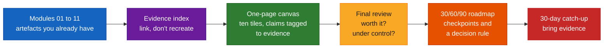
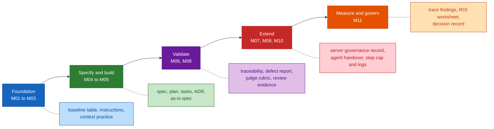
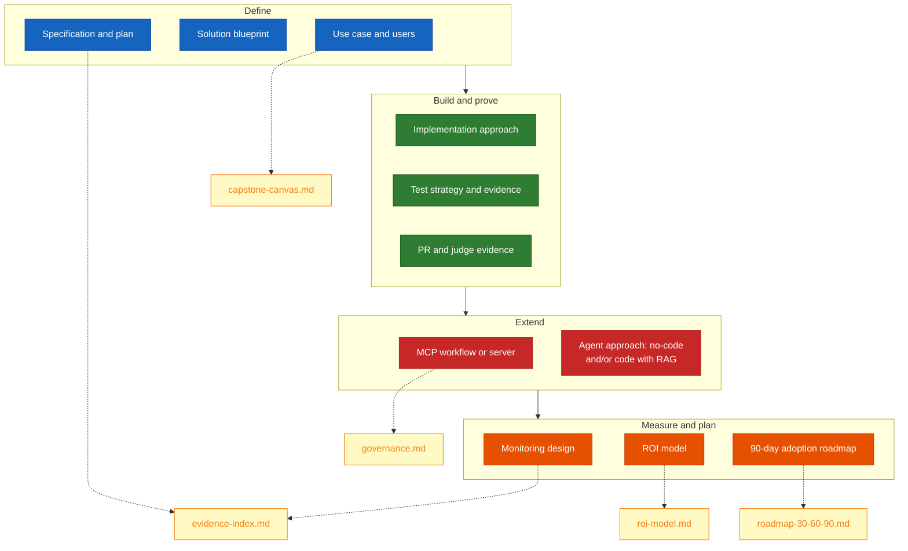
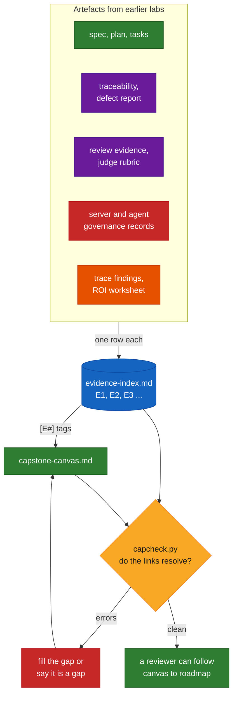
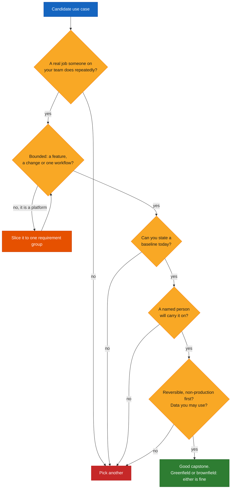
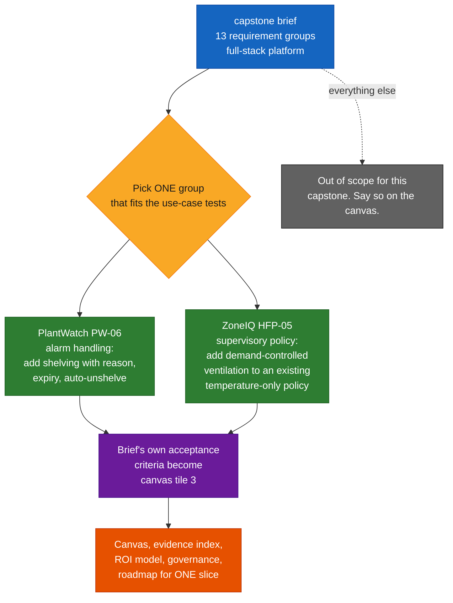
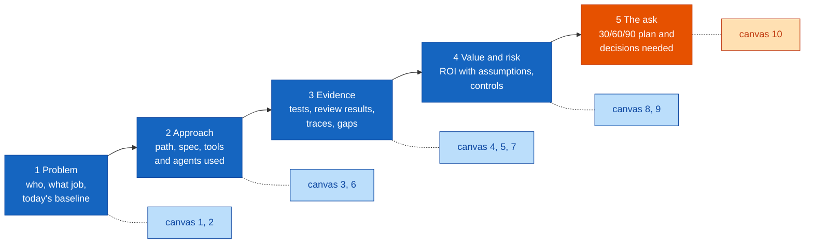
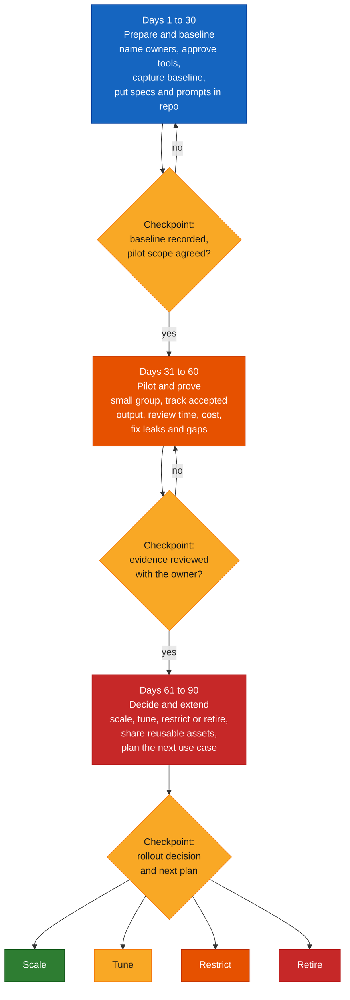
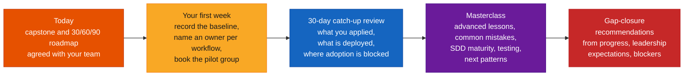

# Honeywell Capstone & Adoption Roadmap — Comprehensive Guide

> **Module 12 · Day 4 · 2 hours · Capstone working session · Primary tool: a one-page capstone canvas + a rubric**
> Source: `presentations/Module12_Capstone_Adoption_Roadmap.pdf` (18 slides). Slide numbers below are written *(s.N)*.
> Material that is not in the deck is marked **[Beyond the deck]**. The deck's rubric is labelled "illustrative" *(s.11)* and stays that way here.

---

## Overview

> *"Bring the whole journey together: one real use case taken end to end, with evidence on quality, cost and risk — and a 30/60/90-day plan to carry it into your teams."* *(s.1)*

> **The capstone principle (s.3):** "Integrate, don't restart. Link the artefacts you already made; spend the time on the gaps and on the business case."

This module builds nothing new. It asks you to **assemble** what Modules 01–11 already produced into one use case, one canvas and one plan, and to defend it on two questions every reviewer will ask: *is it worth it, and is it under control?* *(s.13)* The deck's own advice for the room: "Credibility comes from honesty: leaders trust a plan that names its gaps more than one that claims none" *(s.12)*.

### Time budget *(s.2)*

| # | Block | Min | Slides (my mapping) |
|---|---|---|---|
| 1 | Journey Recap & Best Practices | 20 | 3–6 |
| 2 | Capstone Brief & Canvas | 15 | 7–9 |
| 3 | **Lab: Build Your Capstone** | 45 | 10 |
| 4 | Present & Evaluate | 25 | 11–13 |
| 5 | The 30/60/90-Day Roadmap | 10 | 14 |
| 6 | Next Steps & Wrap-up | 5 | 15–17 |
| | **Total** | **120** | |

The deck gives minutes and one-line descriptions per block, not slide ranges. The ranges are my reading of those descriptions.

### Where this sits in the 12-module journey *(s.3–4)*

| Layer (s.4) | Modules | What you now have | Guide |
|---|---|---|---|
| **Foundation** | 01–03 | Advanced Copilot use, context and prompt practices, a baseline | [01](./module-01-course-objectives-genai-llm-recap.md) · [02](./module-02-github-copilot-recap-advanced-features.md) · [03](./module-03-prompt-engineering-context-engineering.md) |
| **Specify & build** | 04–05 | Spec Kit specs, greenfield and brownfield paths | [04](./module-04-spec-driven-development-github-spec-kit.md) · [05](./module-05-sdd-greenfield-brownfield-modernization.md) |
| **Validate** | 06 · 08 | Spec-derived tests, PR gates and an LLM judge | [06](./module-06-test-strategy-validation.md) · [08](./module-08-pr-automation-quality-gates-llm-judge.md) |
| **Extend** | 07 · 09–10 | An MCP server, no-code and code agents with RAG | [07](./module-07-mcp-workflows-custom-server.md) · [09](./module-09-rovo-studio-no-code-agents.md) · [10](./module-10-code-agents-copilot-sdk-simple-rag.md) |
| **Measure & govern** | 11 | Traces, cost, ROI and governance controls | [11](./module-11-observability-roi-governance.md) |

"Look back before you look ahead: you have a spec, a test strategy, quality gates, tools, agents and a way to measure them." *(s.4)*

### ⚠ Currency check (as of 2026-10-16)

This is the module where the deck meets **the repository's own capstone material**, and they do not fully agree. The deck is a short, generic working session. The repo's `capstone/` folder holds two long platform briefs. Everything below was read from those files, the course outline, and GitHub's docs, and I checked each file reference.

| # | Topic | Deck says | What the repo and sources say | What to do |
|---|---|---|---|---|
| 1 | **Scope of the use case** *(s.7, s.9)* | "One use case, end to end", "bounded: a feature, a change or one workflow". **Avoid:** "a whole platform or a multi-team programme" | `capstone/` has two briefs, **ZoneIQ** (HVAC fleet platform, 737 lines, requirements `HFP-01…13`) and **PlantWatch** (plant asset and alarm platform, 699 lines, `PW-01…13`). Each is a **full-stack system** (API, database, web front end) with a 12-slice build map, and each says every requirement must get its own `spec → plan → tasks` chain. That is a platform in the deck's sense. | Don't try to deliver a whole brief in a 45-minute lab. **Slice one requirement group** and treat the brief as the parent spec (Architecture §6). |
| 2 | **The rubric** *(s.11)* | Seven criteria, "**Illustrative rubric:** confirm the final criteria and scoring with your facilitators before presenting" | Each brief's §15 has a **different, ten-dimension** rubric. Neither rubric contains the other: the deck scores *Governance & risk* and the briefs don't. The briefs score *Observability*, *Architecture integrity* and *Functional completeness* and the deck doesn't. | Ask your facilitators which rubric applies. The mapping table in Architecture §7 shows what to cover to satisfy both. |
| 3 | **Module numbers in the briefs** | M10 = Copilot SDK and RAG. M11 = observability, ROI and governance (combined) | The briefs' build maps and learning objectives treat **Agent Prism observability as Module 10 and ROI as Module 11** ("10 Agent Prism on the … assistant", "11 ROI"). In the deck and the course outline (v2), Module 10 is the Copilot SDK and RAG, and observability, ROI and governance are **one** module, 11. | Read "Module 10" in a brief as the observability work, now in Module 11, and "Module 11" as the ROI work, also Module 11. |
| 4 | **Testing approach** | Deck: "Test evidence — strategy, results, gaps" (no tool named) | The briefs require **Testcontainers** (real PostgreSQL in tests). The course outline says Module 6 "now validates using mocks, stubs and lightweight test doubles, removing infrastructure setup time without weakening the testing method". Module 06's guide only points to Testcontainers as an optional tool. | If you slice a brief, say which test approach you used and why. Don't leave a reviewer guessing which document governs. |
| 5 | **Files the briefs point to** | n/a | Both briefs reference **five files that are not in this repository**: `HVAC_Fleet_Platform_Build_Map.md`, `PlantWatch_Asset_Alarm_Platform_Build_Map.md`, `HVAC_Edge_Air_Quality_Optimizer_Requirements.md` (the embedded-track brief, source of the register map that ZoneIQ's adapter consumes), `guides/foundation-phase-modules-01-04.md` and `guides/build-validate-phase-modules-05-08.md`. I searched the whole repo. This guide set uses one guide per module instead. | Pick **PlantWatch** if you want a use case that doesn't depend on the missing embedded brief. Ask for the build maps if you want the slice-by-slice plan. |
| 6 | **Six adoption signals vs the six baseline measures** *(s.15)* | "Six signals from the post-training assessment framework. Capture a baseline now." | Module 01's guide asked you to baseline six measures: cycle time, quality, PR review time, **testing effort**, token usage, AI cost. The s.15 six are cycle time, PR review time, regression & defects, **reusable skill & spec adoption**, token spend discipline, early ROI signals. *Testing effort* has no counterpart, and *reusable skill & spec adoption* has **no baseline from Module 01**. The outline lists the same six as the post-training framework. | Treat the sets as overlapping, not identical. Baseline the new one now, and keep *testing effort* if it matters to you. |
| 7 | **What GitHub's own data can baseline** **[Beyond the deck]** *(s.15)* | Generic | GitHub's usage-metrics reference has `pull_requests.median_minutes_to_merge` and a repo-level `pull_request_review_times` (medians and p90 for ready-to-first-review and so on). But the review-times data **"builds forward from its release and isn't backfilled: PRs that became ready for review before September 21, 2026 are excluded"**. `ai_credits_used` appears in **per-user reports only**. Skill metrics (`distinct_skill_use_count`) cover **Copilot CLI skills only**. Token counts appear only for Copilot CLI and the Copilot app. GitHub's measuring-success page covers adoption and engagement, and I found nothing in it about a pre-pilot baseline. | Compute your *baseline* from your own PR and issue history. Use GitHub's data to track the trend afterwards. |
| 8 | **Evidence you cite may have aged** *(s.13: "every number … should point to a trace, a record or a stated assumption")* | n/a | Some earlier modules' currency findings affect what you can honestly claim in a capstone (for example: the Copilot SDK has no built-in step cap, Agent Prism is alpha, a Copilot review is not an approval by default). | Part A3 lists the ones that matter most, with links to the full tables. |
| 9 | **Module 12's deck has no tool to install** | "Primary tool: capstone canvas + rubric" | The canvas, the evidence index and the rest are **five markdown files**. The deck's starter files, if any, are not in the repo, and `labs/` has no `module-12` folder. | Part E gives templates with the s.10 file names, plus a small checker that tests the *form* of your files. |

---

## Quick Start

1. **Integrate, don't restart** *(s.3)*. Link the artefacts you made. Spend your time on gaps and the business case.
2. **You have five layers** *(s.4)*: foundation, specify & build, validate, extend, measure & govern. The capstone uses all five.
3. **Eight habits outlast the tools** *(s.5)*: specs before code · tests from the spec · least privilege · evidence in review · drafts before autonomy · limits and logs · count accepted work · name an owner. In your review, ask "which habit does each artefact demonstrate, and which habit is missing?"
4. **Eleven pieces in four groups** *(s.7)*: **Define** (use case & users, solution blueprint, specification & plan), **Build & prove** (implementation approach, test strategy & evidence, PR & judge evidence), **Extend** (MCP workflow or server, agent approach), **Measure & plan** (monitoring design, ROI model, 90-day roadmap).
5. **One page, ten tiles** *(s.8)*: use case & users · path · spec & criteria · test evidence · quality gates · tools & agents · monitoring · ROI model · risks & governance · 30/60/90 roadmap. "If it does not fit on one page, it is not yet clear enough to adopt."
6. **Choose small and real** *(s.9)*: a repeated job, bounded, measurable today, ownable, safe to start. Avoid a platform, no baseline, day-one production writes, data you may not use, or "it demos well".
7. **The lab makes five files** *(s.10)*: `capstone-canvas.md`, `evidence-index.md`, `roi-model.md`, `governance.md`, `roadmap-30-60-90.md`. **Done when** a reviewer can follow the canvas from use case to roadmap, every claim links to evidence, and the ROI model lists its assumptions.
8. **Seven criteria, "strong work shows evidence, not just a working demo"** *(s.11)*, though the rubric is illustrative: confirm it.
9. **Present in five parts** *(s.12)*: Problem → Approach → Evidence → Value & risk → The ask. Show one failure, say what you did not measure, make the ask specific and small.
10. **Two reviewer questions** *(s.13)*: is it worth it (baseline, cost, value, assumptions), and is it under control (ownership, access, approvals, control)?
11. **A 30/60/90 roadmap is a template to adapt** *(s.14)*: prepare & baseline → pilot & prove → decide & extend, each with a checkpoint. "The dates are a frame, not a rule."
12. **Review adoption on six signals, baseline first** *(s.15)*. Then expect a 30-day catch-up, a masterclass and gap-closure recommendations *(s.16)*.
13. **Golden rule (s.6):** "Adoption is a series of small, measured decisions — not a launch event."

---

## Visual Summary



---

## Architecture

### 1. Five layers of AI-assisted engineering *(s.4)*, with the evidence each one leaves behind



The file names in the second row are the ones the earlier guides' labs name (Module 01's baseline table, Module 04's `spec.md` / `plan.md` / `tasks.md`, Module 05's ADR and as-is spec, Module 06's `traceability.md` and `defect-report.md`, Module 07's server `governance.md`, Module 08's `judge-rubric.md` and `review-evidence.md`, Module 09's `handover.md`, Module 11's `trace-findings.md`, `roi-worksheet.md` and `decision.md`). Yours may be named differently. The point is that **most of the capstone is a link away.**

### 2. Eleven pieces, four groups *(s.7)*, and the files that carry them



The deck lists **eleven pieces** *(s.7)*, a **ten-tile canvas** *(s.8)* and **five lab files** *(s.10)*. They are three views of the same thing, not three lists to reconcile. The dotted lines show where each piece mostly lives. The governance record is the one place the canvas tile "Risks & governance" gets its detail, and the deck's pieces don't name governance at all, though "the final review covers the business case, governance controls and an enterprise rollout roadmap" *(s.7)*.

### 3. The one-page canvas *(s.8)*, with evidence tags

```
┌─────────────────┬─────────────────┬─────────────────┬─────────────────┬─────────────────┐
│ 1 USE CASE &    │ 2 PATH          │ 3 SPEC &        │ 4 TEST          │ 5 QUALITY       │
│   USERS         │ greenfield or   │   CRITERIA      │   EVIDENCE      │   GATES         │
│ who benefits,   │ brownfield      │ acceptance      │ strategy,       │ PR checks and   │
│ what job        │                 │ criteria,traced │ results, gaps   │ judge     [E#]  │
│                 │                 │           [E#]  │           [E#]  │                 │
├─────────────────┼─────────────────┼─────────────────┼─────────────────┼─────────────────┤
│ 6 TOOLS &       │ 7 MONITORING    │ 8 ROI MODEL     │ 9 RISKS &       │10 30/60/90      │
│   AGENTS        │ traces, signals,│ baseline, cost, │   GOVERNANCE    │   ROADMAP       │
│ MCP, no-code,   │ limits          │ assumptions     │ owner, access,  │ actions and     │
│ code + RAG [E#] │           [E#]  │           [E#]  │ approvals       │ checkpoints     │
└─────────────────┴─────────────────┴─────────────────┴─────────────────┴─────────────────┘
  Fill top-left to bottom-right (s.8). Gaps you find on the way are the capstone's most useful output.
```

The `[E#]` marks are mine **[Beyond the deck]**: each is a pointer to one row of `evidence-index.md`. The six tiles that make factual claims (3, 4, 5, 6, 7, 8) need at least one. The deck's rule behind it is "every claim links to evidence" *(s.10)* and "every number in the business case should point to a trace, a record or a stated assumption" *(s.13)*.

### 4. How evidence flows into the canvas



### 5. Choosing the use case *(s.9)*



The five questions are the deck's "a good choice is…" list *(s.9)*, in order. The "slice it" loop is my addition **[Beyond the deck]**. The deck's other avoid-items (no baseline, production write access on day one, data you may not use, "chosen only because it demos well") appear as the "no" branches. And: "A brownfield change with regression protection often shows more of what you learned than a new application does." *(s.9)*

### 6. Slicing one of the repo's capstone briefs **[Beyond the deck]**

The repository's `capstone/` briefs describe whole systems. Each brief contains a ready-made slice: its own build map names a **brownfield change** (module "05b") on top of an existing slice.



What I verified in the briefs, and what I did not:

| Item | Verified |
|---|---|
| PlantWatch `PW-06` — alarm handling, including "Shelve an alarm with a **mandatory reason** and an **expiry time**… **Auto-unshelve on expiry**… Shelving beyond a configured maximum duration requires Supervisor approval" | Read in `capstone/PlantWatch_Asset_Alarm_Platform_Requirements.md` §7 |
| Its build map's "05b: brownfield: add alarm shelving with mandatory reason + expiry + auto-unshelve to the existing alarm service without breaking evaluation or acknowledge" | Read in §14 |
| The §10 acceptance criterion: "Shelving requires a reason and an expiry; a shelved alarm auto-unshelves on expiry; extended shelving without Supervisor approval is refused — each proven by a test." | Read in §10 |
| ZoneIQ's analogue: "05b brownfield: add demand-controlled ventilation to an existing temperature-only optimization policy without breaking comfort control" | Read in §14 of the HVAC brief |
| That a PlantWatch or ZoneIQ codebase **exists** for you to change | **Not verified.** The repo holds the briefs, not an implementation. The brief says the earlier slices are built across Modules 01–05. If you didn't build them, a brownfield slice has nothing to start from |

That last row is the practical limit: a "brownfield change" needs an existing codebase. If you have none, slice a *greenfield* group instead (for example PlantWatch's `PW-05`, the alarm evaluation engine, which the brief says must be "pure and independently unit-testable"), or use a workflow from your own team, which is what the deck asks for in the first place.

### 7. Two rubrics, one set of evidence *(s.11 vs the briefs' §15)*

| Deck criterion *(s.11)* | Brief dimension *(§15)* | Cover it with |
|---|---|---|
| **Spec & traceability** — "acceptance criteria are clear and every artefact traces back to them" | Spec-driven discipline | Canvas tile 3; E-rows for spec, plan, tasks, traceability |
| **Test evidence** — "tests derive from the spec; results and gaps are shown honestly" | Test rigor · Contract correctness · Brownfield discipline | Tile 4; the failing-first run, the gaps list; a regression report if brownfield |
| **Quality & PR controls** — "gates and review are defined; humans own approval" | PR quality | Tile 5; the judge run and the escalation decision |
| **Tools & agent design** — "narrow tools, sensible limits, drafts before autonomy" | Agentic practice | Tile 6; allow-list, permissions, approval points, failure handling |
| **Governance & risk** — "owner, access, approvals and an off switch are documented" | **— (no matching dimension)** | `governance.md` |
| **Measurement & ROI** — "baseline, cost per accepted output and assumptions are stated" | ROI & adoption judgment | `roi-model.md` |
| **Roadmap realism** — "small, owned steps with checkpoints and a decision rule" | ROI & adoption judgment | `roadmap-30-60-90.md` |
| **— (no matching criterion)** | **Observability** — traces and a token/cost view tied to a KPI | Tile 7 (the deck's canvas has it. Its rubric doesn't) |
| **— (none)** | **Architecture integrity** — no layering violation, contracts documented first | Tile 3 / the brief's own architecture section |
| **— (none)** | **Functional completeness** — "all of Section 7 implemented" | Not achievable for a slice. State your scope instead |

If your reviewers use the briefs' rubric, **Functional completeness** is the one a slice cannot satisfy, so agree with them in advance that a slice is acceptable. The briefs say a capstone that "skips the spec/plan/tasks trail, the traceability matrix, the brownfield evidence, or the release-readiness self-audit is **not** done". The deck says "Strong work shows evidence, not just a working demo." Those two sentences agree.

### 8. The five-part storyline *(s.12)* and what each part cites



The tile numbers are my mapping from the deck's part descriptions *(s.12)* to its canvas *(s.8)*. The deck's three tips: **"Show one failure and what you learned"**, **"Say what you did not measure"**, **"Make the ask specific and small."**

### 9. The 30/60/90-day roadmap *(s.14)* as a decision path



The deck's phases, actions and checkpoints are in the boxes. The loop-back arrows on the first two checkpoints are mine: a checkpoint that cannot fail isn't a checkpoint. The four outcomes at day 90 are Module 11's decisions ([Module 11 guide](./module-11-observability-roi-governance.md), Architecture §8). The deck itself says only "Checkpoint: rollout decision and next plan."

### 10. After today *(s.16)*



---

## Core Concepts

### Part A — Journey recap and best practices *(s.3–6, 20 min)*

#### A1. Look back before you look ahead *(s.4)*

> *Analogy.* You are not packing a new suitcase. You are **emptying your pockets onto a table** and arranging what is already there. Most of today is spent noticing what is missing.

| Layer | You now have *(deck)* | A file or record that proves it **[Beyond the deck]** |
|---|---|---|
| **Foundation** (M01–03) | "Advanced Copilot use; context and prompt practices" | Your `.github/copilot-instructions.md`; the six baseline measures from [Module 01](./module-01-course-objectives-genai-llm-recap.md) |
| **Specify & build** (M04–05) | "Spec Kit specs; greenfield and brownfield paths" | `spec.md`, `plan.md`, `tasks.md`; the ADR or the small as-is spec |
| **Validate** (M06, M08) | "Spec-derived tests; PR gates and LLM-as-judge" | `traceability.md`, `defect-report.md`; `judge-rubric.md`, `review-evidence.md` |
| **Extend** (M07, M09–10) | "MCP server; no-code and code agents with RAG" | The server's governance record; `handover.md`; the Module 10 agent and its `comparison.md` |
| **Measure & govern** (M11) | "Traces, cost, ROI and governance controls" | `trace-findings.md`, `roi-worksheet.md`, `decision.md` |

If a row is empty for *you*, that is a gap, and gaps are "the capstone's most useful output" *(s.8)*.

#### A2. Eight habits *(s.5)*

"The tools will change. These habits will not." The deck's closing instruction: "in your capstone review, ask which habit each artefact demonstrates, and which habit is missing."

| Habit | Module | The deck's wording | Where it shows up in your evidence **[Beyond the deck]** |
|---|---|---|---|
| **Specs before code** | M04–05 | Agree acceptance criteria first; trace work back to them | `spec.md` with numbered criteria, written before the code |
| **Tests from the spec** | M06 | Derive tests from criteria; see them fail first | `traceability.md`; the failing-first run in `defect-report.md` |
| **Least privilege** | M07 | Give agents and tools only what the job needs | The server's governance record; the agent's tool allow-list |
| **Evidence in review** | M08 | Comments with location, evidence and confidence | `review-evidence.md`; the judge's output |
| **Drafts before autonomy** | M09 | Start agents at suggest or draft; a person decides | `handover.md`: the autonomy level chosen, and who approves |
| **Limits and logs** | M10 | Step, cost and permission limits; log every tool call | The agent's step cap, `available_tools`, and its trace ([Module 10](./module-10-code-agents-copilot-sdk-simple-rag.md)) |
| **Count accepted work** | M11 | Measure cost per accepted output, not output volume | `roi-worksheet.md` ([Module 11](./module-11-observability-roi-governance.md)) |
| **Name an owner** | All | Every workflow has an owner and a review date | `governance.md`: owner and review date |

#### A3. Re-check before you cite old evidence **[Beyond the deck]**

Capstone claims are only as good as the evidence under them, and a few earlier findings change what you can honestly say. Full tables are in each guide's *Currency check*.

| If your capstone says… | Re-check | Where |
|---|---|---|
| "The agent stops after N steps" | The Copilot SDK has **no built-in max-steps option**. The Module 10 lab implements the cap in a hook. Say which you used | [Module 10](./module-10-code-agents-copilot-sdk-simple-rag.md), row 5 |
| "The agent only has our tools" | A new SDK session is offered the CLI's built-in tools by default (shell, files). Narrowing needs `available_tools` | Module 10, row 6 |
| "Copilot reviewed it, so it's approved" | A Copilot review is a comment, not an approval, unless your organisation turns approvals on, which is a governance decision | [Module 08](./module-08-pr-automation-quality-gates-llm-judge.md), row 1 |
| "The agent runs with the right permissions" | A studio agent may run as the user or as the agent's own account. Record which, and why | [Module 09](./module-09-rovo-studio-no-code-agents.md), row 1 |
| "We monitor it in Agent Prism" | Agent Prism is an **alpha** viewer. It does not collect or price traces. Trace content may be off, and then tool names are hashed | [Module 11](./module-11-observability-roi-governance.md), rows 1, 5, 6 |
| "Cost per run is X credits" | Which field? The SDK's per-call `cost` is documented as a premium-request multiplier. Credits are experimental. Prefer tokens × prices you can show | Module 11, row 7 |
| "The MCP server is governed" | Where the config lives and what org policy allows varies by VS Code build and by admin | [Module 07](./module-07-mcp-workflows-custom-server.md), rows 1, 3 |

#### A4. Best practices for taking this into your teams *(s.6)*

| ✅ Do this | ❌ Avoid this |
|---|---|
| Start with one bounded use case and a measured baseline | Roll out every tool to every team at once |
| Keep specs, tests and prompts in the repository, versioned | Treat AI output as accepted because it looks right |
| Keep a human approving every merge and risky action | Grant broad access or auto-approve write actions early |
| Reuse approved MCP servers and agents before building new ones | Report speed gains without rework and cost |
| Record owner, permissions and an off switch for each workflow | Leave workflows with no owner or review date |
| Review scale, tune, restrict or retire on a schedule | Wait for perfection before piloting anything |

**Golden rule (s.6):** "Adoption is a series of small, measured decisions — not a launch event."

---

### Part B — The capstone brief and canvas *(s.7–9, 15 min)*

#### B1. Eleven pieces, one use case *(s.7)*

"Eleven pieces in four groups. Most already exist from earlier labs — link them, then fill the gaps." The final review "covers the business case, governance controls and an enterprise rollout roadmap — so evidence and risk matter as much as the demo."

| Group | Piece | Usually already exists from | Usually a gap |
|---|---|---|---|
| **Define** | Use case & users | — | Often: *which real person* does the job today |
| | Solution blueprint | M05 ADR / architecture notes | If you slice a brief, how the slice sits inside it |
| | Specification & plan | M04 Spec Kit chain | Acceptance criteria written *before* the code |
| **Build & prove** | Implementation approach | M05 | — |
| | Test strategy & evidence | M06 | Gaps list, stated honestly |
| | PR & judge evidence | M08 | The escalation decision |
| **Extend** | MCP workflow or server | M07 | Governance record, permissions |
| | Agent approach (no-code and/or code with RAG) | M09, M10 | Limits, handover, the "say you don't know" test |
| **Measure & plan** | Monitoring design | M11 | **Usually missing**: what you trace, which signals, which limits |
| | ROI model | M11 | A *measured* baseline, not a guess |
| | 90-day adoption roadmap | — | Decision rule, owners, capacity |

The "usually exists / usually a gap" columns are my reading, not the deck's. Check them against your own folders.

#### B2. The canvas, tile by tile *(s.8)*

| # | Tile | The deck's one-liner | A good entry says… **[Beyond the deck]** |
|---|---|---|---|
| 1 | Use case & users | Who benefits, what job | A named team and the repeated task, in one sentence |
| 2 | Path | Greenfield or brownfield | Which, and the one reason that matters |
| 3 | Spec & criteria | Acceptance criteria, traced | Numbered criteria and where the spec lives `[E#]` |
| 4 | Test evidence | Strategy, results, gaps | What ran, what failed first, what is not covered `[E#]` |
| 5 | Quality gates | PR checks and judge | What is checked, who approves `[E#]` |
| 6 | Tools & agents | MCP, no-code, code + RAG | Each tool's limits, and the autonomy level `[E#]` |
| 7 | Monitoring | Traces, signals, limits | Which signals you track and the step/cost limits you set `[E#]` |
| 8 | ROI model | Baseline, cost, assumptions | Cost per accepted output before and after, one line `[E#]` |
| 9 | Risks & governance | Owner, access, approvals | Pointer to `governance.md`, plus the top one or two risks |
| 10 | 30/60/90 roadmap | Actions and checkpoints | Pointer to the roadmap file, plus the decision rule |

"Fill it in this order: top-left to bottom-right follows the journey." And "If it does not fit on one page, it is not yet clear enough to adopt."

#### B3. Choosing a use case *(s.9)*

| A good choice is… | Avoid… | A quick test **[Beyond the deck]** |
|---|---|---|
| A real job someone on your team does repeatedly | A whole platform or a multi-team programme | Can you name the person, and how often they do it? |
| Bounded: a feature, a change or one workflow | No baseline and no way to measure it | Could you describe it in two sentences? |
| Measurable: you can state a baseline today | Needs production write access on day one | Is there a number you can write down *now*? |
| Ownable: a named person will carry it on | Depends on data you may not use | Who is that person, and have they agreed? |
| Safe to start: reversible, non-production first | Chosen only because it demos well | If it goes wrong, can you undo it by Friday? |

*Greenfield or brownfield: either is fine.* "A brownfield change with regression protection often shows more of what you learned than a new application does." See Architecture §6 for slicing the repo's briefs, and its limit (a brownfield change needs an existing codebase).

---

### Part C — Lab: build your capstone *(s.10, 45 min)* **[Beyond the deck]**

The deck's four steps, and the five files it names *(s.10)*:

| Step *(deck)* | Output | My time split (the deck gives none) |
|---|---|---|
| 1. Pick the use case and path using the criteria. Fill the top of the canvas: users, acceptance criteria and the baseline you can state today | `capstone-canvas.md` tiles 1–3 | 10 min |
| 2. Build an evidence index that links, not recreates, your spec, test strategy, PR and judge results, and MCP and agent artefacts | `evidence-index.md` | 10 min |
| 3. Complete monitoring design, ROI model (assumptions stated) and the governance record: owner, access, approvals, off switch | `roi-model.md`, `governance.md`, tiles 4–9 | 15 min |
| 4. Draft the 30/60/90 roadmap and rehearse the five-part presentation with your team | `roadmap-30-60-90.md` | 10 min |

**Done when** *(s.10)*: "A reviewer can follow the canvas from use case to roadmap, every claim links to evidence, and the ROI model lists its assumptions."

The deck's starter files, if there are any, are not in this repo (Currency row 9). Here are templates with the same file names, and a checker for **form only**.

#### What the checker does, and what it doesn't

| It checks | It cannot check |
|---|---|
| All ten canvas tiles exist, in order, and are filled (no `TODO`) | Whether a claim is **true** |
| Tiles 3–8 each carry an `[E#]` tag, and each tag exists in the index | Whether the evidence actually **supports** the claim |
| Each evidence row is filled and a relative path **exists on disk** (URLs are listed as "not checked") | Whether a URL still resolves, or whether the file says what the row claims |
| The ROI model has a baseline, says "accepted", and lists ≥ 3 assumptions each with a "changes if:" clause | Whether the numbers are right (review that against Module 11's worksheet) |
| `governance.md` has owner, review date (a real date, not yet passed), access, approvals, off switch | Whether the access really is least privilege |
| The roadmap has three phases, each with actions and a checkpoint, and a decision rule naming scale/tune/restrict/retire | Whether the checkpoints are realistic |

A pass means a reviewer **can follow the trail**. It does not mean the trail leads somewhere good. The deck's "done when" is about following, so this is a fair first filter and nothing more.

#### Step 0: set up

```bash
mkdir lab12 && cd lab12
python -m venv .venv && source .venv/bin/activate      # Windows: .venv\Scripts\activate
pip install pytest
mkdir tests && touch tests/__init__.py
```

Create the five markdown templates, then the checker and its tests. Python 3.10+ (uses only the standard library).

#### Step 1: `capstone-canvas.md`

`capstone-canvas.md`

```markdown
# Capstone canvas

One page. Fill it top-left to bottom-right (the order of the headings). Every claim in a section that needs
evidence carries a tag like [E3] that points to a row in evidence-index.md. Say what you did not measure.

## Use case & users
TODO who benefits, and what repeated job they do today (name one real person or team)

## Path
TODO greenfield or brownfield, and why this one

## Spec & criteria
TODO the acceptance criteria, numbered, and where the spec lives [E?]

## Test evidence
TODO strategy, results, and the gaps you know about [E?]

## Quality gates
TODO PR checks and the LLM judge: what they check, who approves [E?]

## Tools & agents
TODO MCP server or tools, no-code and/or code agent, RAG source, and each one's limits [E?]

## Monitoring
TODO traces, signals and limits you set up [E?]

## ROI model
TODO cost per accepted output, before and after, in one sentence [E?]

## Risks & governance
TODO owner, access, approvals, off switch (details in governance.md)

## 30/60/90 roadmap
TODO three checkpoints and the decision rule (details in roadmap-30-60-90.md)
```

#### Step 2: `evidence-index.md`

`evidence-index.md`

```markdown
# Evidence index

Link to what you already made. Do not recreate it here. One row per piece of evidence.
Location is a path relative to this folder, or a URL.

| ID | What it shows | Location | From module |
|----|---------------|----------|-------------|
| E1 | TODO e.g. the reviewed spec with numbered acceptance criteria | TODO ../path/to/spec.md | 04 |
| E2 | TODO e.g. test results, including the failing-first run | TODO ../path/to/test-report | 06 |
```

Where to look for rows: the table in Part A1 lists the files earlier labs produce. **One row per artefact, and link, don't copy.** Locations are paths relative to this folder (so `../` is normal), or URLs.

#### Step 3: `roi-model.md` and `governance.md`

`roi-model.md`

```markdown
# ROI model

Reuse your Module 11 worksheet. Link, don't invent: every number should point to a trace, a record or an
assumption listed below.

## Baseline
TODO how the work is done today, measured: what you measured, over what period, from which records

## Cost per accepted output
TODO before: x. After: y. Total cost = tokens + tooling + human review and edit time + rework, divided by outputs
accepted at production quality. Show the arithmetic or link to roi-worksheet.md.

## Assumptions
- TODO an assumption — changes if: TODO what would change it
- TODO an assumption — changes if: TODO what would change it
- TODO an assumption — changes if: TODO what would change it
```

`governance.md`

```markdown
# Governance record

- **Owner:** TODO a named person
- **Review date:** TODO YYYY-MM-DD, in the future
- **Access:** TODO least privilege: which tools and data the agent can touch, read or write
- **Approvals:** TODO what a human approves before it takes effect (merges, risky actions)
- **Off switch:** TODO how to stop it, and who may
```

Reuse, don't redo: your Module 11 worksheet and break-even acceptance ([Module 11 guide](./module-11-observability-roi-governance.md), Part C and Part E) are the ROI model's source, and your Module 07 server record and Module 09 handover are the governance record's. The deck says "link, don't invent" *(s.13)*.

#### Step 4: `roadmap-30-60-90.md`

`roadmap-30-60-90.md`

```markdown
# 30/60/90-day adoption roadmap

Dates are a frame, not a rule: move the checkpoints to fit your release cycle and who has capacity.

**Decision rule:** TODO what evidence at day 90 means scale, tune, restrict or retire

## Days 1-30: Prepare & baseline
- TODO name owners and approve tools
- TODO capture the baseline for the use case
**Checkpoint:** TODO baseline recorded, pilot scope agreed

## Days 31-60: Pilot & prove
- TODO run the workflow with a small group
- TODO track accepted output, review time, cost
**Checkpoint:** TODO evidence reviewed with the owner

## Days 61-90: Decide & extend
- TODO scale, tune, restrict or retire the workflow
- TODO share reusable specs, skills and servers
**Checkpoint:** TODO rollout decision and next plan
```

#### Step 5: check the form

`capcheck.py`

```python
"""Form check for the five capstone files (s.10). It can tell you a file is empty, unlinked or out of date.
It cannot tell you a claim is true. Run:  python capcheck.py [folder] [--today YYYY-MM-DD]"""
import datetime
import os
import re
import sys

CANVAS = ["Use case & users", "Path", "Spec & criteria", "Test evidence", "Quality gates",
          "Tools & agents", "Monitoring", "ROI model", "Risks & governance", "30/60/90 roadmap"]
NEEDS_EVIDENCE = ["Spec & criteria", "Test evidence", "Quality gates", "Tools & agents", "Monitoring", "ROI model"]
GOVERNANCE = ["Owner", "Review date", "Access", "Approvals", "Off switch"]
PHASES = [(r"Days\s*1\s*[-–]\s*30", "Days 1-30"), (r"Days\s*31\s*[-–]\s*60", "Days 31-60"),
          (r"Days\s*61\s*[-–]\s*90", "Days 61-90")]
TODO = re.compile(r"\bTODO\b")


def sections(text):
    """{heading: body} for every '## ' heading."""
    parts = re.split(r"^## +(.+?) *$", text, flags=re.M)
    return {parts[i]: parts[i + 1].strip() for i in range(1, len(parts) - 1, 2)}


def blank(body):
    return not body.strip() or bool(TODO.search(body))


def read(folder, name, problems):
    path = os.path.join(folder, name)
    if not os.path.exists(path):
        problems.append(("error", name, "file is missing"))
        return None
    with open(path, encoding="utf-8") as f:
        return f.read()


def check_evidence(text, folder, problems):
    rows = {}
    for line in text.splitlines():
        cells = [c.strip() for c in line.strip().strip("|").split("|")]
        if len(cells) >= 3 and re.fullmatch(r"E\d+", cells[0]):
            if cells[0] in rows:
                problems.append(("error", "evidence-index.md", f"{cells[0]} appears twice"))
            rows[cells[0]] = cells
            what, where = cells[1], cells[2]
            if blank(what) or blank(where):
                problems.append(("error", "evidence-index.md", f"{cells[0]} is not filled in"))
            elif re.match(r"https?://", where):
                problems.append(("info", "evidence-index.md", f"{cells[0]} is a URL: not checked"))
            elif not os.path.exists(os.path.join(folder, where)):
                problems.append(("error", "evidence-index.md", f"{cells[0]} points to {where!r}, which does not exist"))
    if not rows:
        problems.append(("error", "evidence-index.md", "no evidence rows (| E1 | what | where | module |)"))
    return rows


def check_canvas(text, evidence, problems):
    secs, used = sections(text), set()
    for h in CANVAS:
        if h not in secs:
            problems.append(("error", "capstone-canvas.md", f"missing section '{h}'"))
        elif blank(secs[h]):
            problems.append(("error", "capstone-canvas.md", f"'{h}' is empty or still has TODO"))
    order = [h for h in secs if h in CANVAS]
    if order != [h for h in CANVAS if h in order]:
        problems.append(("warn", "capstone-canvas.md", "sections are out of order (fill top-left to bottom-right)"))
    if "Path" in secs and not re.search(r"greenfield|brownfield", secs["Path"], re.I):
        problems.append(("error", "capstone-canvas.md", "'Path' must say greenfield or brownfield"))
    for h in NEEDS_EVIDENCE:
        tags = re.findall(r"\[(E\d+)\]", secs.get(h, ""))
        used.update(tags)
        if h in secs and not blank(secs[h]) and not tags:
            problems.append(("error", "capstone-canvas.md", f"'{h}' makes claims with no [E#] evidence tag"))
        for t in tags:
            if t not in evidence:
                problems.append(("error", "capstone-canvas.md", f"'{h}' cites {t}, which is not in the evidence index"))
    for t in sorted(set(evidence) - used):
        problems.append(("warn", "evidence-index.md", f"{t} is never cited by the canvas"))


def check_roi(text, problems):
    secs = sections(text)
    for h in ("Baseline", "Cost per accepted output", "Assumptions"):
        if h not in secs:
            problems.append(("error", "roi-model.md", f"missing section '{h}'"))
        elif blank(secs[h]):
            problems.append(("error", "roi-model.md", f"'{h}' is empty or still has TODO"))
    cost = secs.get("Cost per accepted output", "")
    if cost and not blank(cost) and "accepted" not in cost.lower():
        problems.append(("error", "roi-model.md", "cost section never says 'accepted': count accepted, not generated"))
    bullets = [l[2:].strip() for l in secs.get("Assumptions", "").splitlines() if l.startswith("- ")]
    if len(bullets) < 3:
        problems.append(("error", "roi-model.md", f"{len(bullets)} assumptions listed: state at least 3"))
    for b in bullets:
        m = re.search(r"changes if:\s*(.*)", b, re.I)
        if blank(b) or not m or blank(m.group(1)):
            problems.append(("error", "roi-model.md", f"assumption has no 'changes if:' clause: {b[:50]!r}"))


def check_governance(text, today, problems):
    for field in GOVERNANCE:
        m = re.search(rf"^- \*\*{re.escape(field)}:\*\*[ \t]*(.*)$", text, re.M)
        if not m or blank(m.group(1)):
            problems.append(("error", "governance.md", f"'{field}' is missing, empty or TODO"))
        elif field == "Review date":
            try:
                if datetime.date.fromisoformat(m.group(1).strip()) < today:
                    problems.append(("error", "governance.md", f"review date {m.group(1).strip()} has already passed"))
            except ValueError:
                problems.append(("error", "governance.md", "review date must look like 2026-12-01"))


def check_roadmap(text, problems):
    secs = sections(text)
    for pattern, label in PHASES:
        key = next((k for k in secs if re.search(pattern, k)), None)
        if key is None:
            problems.append(("error", "roadmap-30-60-90.md", f"missing phase '{label}'"))
            continue
        body = secs[key]
        actions = [l for l in body.splitlines() if l.startswith("- ") and not blank(l)]
        cp = re.search(r"^\*\*Checkpoint:\*\*[ \t]*(.*)$", body, re.M)
        if not actions:
            problems.append(("error", "roadmap-30-60-90.md", f"{label} has no filled-in actions"))
        if not cp or blank(cp.group(1)):
            problems.append(("error", "roadmap-30-60-90.md", f"{label} has no checkpoint"))
    rule = re.search(r"^\*\*Decision rule:\*\*[ \t]*(.*)$", text, re.M)
    if not rule or blank(rule.group(1)) or not re.search(r"scale|tune|restrict|retire", rule.group(1), re.I):
        problems.append(("error", "roadmap-30-60-90.md", "no decision rule naming scale, tune, restrict or retire"))


def run(folder, today=None):
    today, problems = today or datetime.date.today(), []
    ev = read(folder, "evidence-index.md", problems)
    evidence = check_evidence(ev, folder, problems) if ev is not None else {}
    for name, fn in (("capstone-canvas.md", lambda t: check_canvas(t, evidence, problems)),
                     ("roi-model.md", lambda t: check_roi(t, problems)),
                     ("governance.md", lambda t: check_governance(t, today, problems)),
                     ("roadmap-30-60-90.md", lambda t: check_roadmap(t, problems))):
        text = read(folder, name, problems)
        if text is not None:
            fn(text)
    return problems


if __name__ == "__main__":
    import argparse
    ap = argparse.ArgumentParser(description=__doc__.split("Run:")[0])
    ap.add_argument("folder", nargs="?", default=".")
    ap.add_argument("--today", type=datetime.date.fromisoformat, help="YYYY-MM-DD, for the review-date check")
    a = ap.parse_args()
    found = run(a.folder, a.today)
    mark = {"error": "✗", "warn": "⚠", "info": "i"}
    for level, name, msg in found:
        print(f"{mark[level]} {name}: {msg}")
    errors = sum(level == "error" for level, _, _ in found)
    print(f"\n{errors} error(s), {sum(l == 'warn' for l, _, _ in found)} warning(s). "
          "Form only: a file can pass and still be wrong.")
    sys.exit(1 if errors else 0)
```

```bash
python capcheck.py .                       # blank templates: expect errors
python capcheck.py . --today 2026-10-16    # pin the date, for the review-date check
```

On the **blank templates** it printed this (30 errors, 2 warnings):

```text
✗ evidence-index.md: E1 is not filled in
✗ evidence-index.md: E2 is not filled in
✗ capstone-canvas.md: 'Use case & users' is empty or still has TODO
✗ capstone-canvas.md: 'Path' is empty or still has TODO
✗ capstone-canvas.md: 'Spec & criteria' is empty or still has TODO
✗ capstone-canvas.md: 'Test evidence' is empty or still has TODO
✗ capstone-canvas.md: 'Quality gates' is empty or still has TODO
✗ capstone-canvas.md: 'Tools & agents' is empty or still has TODO
✗ capstone-canvas.md: 'Monitoring' is empty or still has TODO
✗ capstone-canvas.md: 'ROI model' is empty or still has TODO
✗ capstone-canvas.md: 'Risks & governance' is empty or still has TODO
✗ capstone-canvas.md: '30/60/90 roadmap' is empty or still has TODO
⚠ evidence-index.md: E1 is never cited by the canvas
⚠ evidence-index.md: E2 is never cited by the canvas
✗ roi-model.md: 'Baseline' is empty or still has TODO
✗ roi-model.md: 'Cost per accepted output' is empty or still has TODO
✗ roi-model.md: 'Assumptions' is empty or still has TODO
✗ roi-model.md: assumption has no 'changes if:' clause: 'TODO an assumption — changes if: TODO what would c'
✗ roi-model.md: assumption has no 'changes if:' clause: 'TODO an assumption — changes if: TODO what would c'
✗ roi-model.md: assumption has no 'changes if:' clause: 'TODO an assumption — changes if: TODO what would c'
✗ governance.md: 'Owner' is missing, empty or TODO
✗ governance.md: 'Review date' is missing, empty or TODO
✗ governance.md: 'Access' is missing, empty or TODO
✗ governance.md: 'Approvals' is missing, empty or TODO
✗ governance.md: 'Off switch' is missing, empty or TODO
✗ roadmap-30-60-90.md: Days 1-30 has no filled-in actions
✗ roadmap-30-60-90.md: Days 1-30 has no checkpoint
✗ roadmap-30-60-90.md: Days 31-60 has no filled-in actions
✗ roadmap-30-60-90.md: Days 31-60 has no checkpoint
✗ roadmap-30-60-90.md: Days 61-90 has no filled-in actions
✗ roadmap-30-60-90.md: Days 61-90 has no checkpoint
✗ roadmap-30-60-90.md: no decision rule naming scale, tune, restrict or retire

30 error(s), 2 warning(s). Form only: a file can pass and still be wrong.
```

The exit code is 1 when there are errors and 0 otherwise, so you can run it in a pre-commit hook or CI job on the repo that holds your capstone.

#### A worked fragment, using only what the repo can support

This is **not** a finished capstone. It shows the shape of three tiles, using the PlantWatch brief's real text (Architecture §6). Everything else (tests, traces, ROI) you must measure yourself, and I haven't invented those.

```markdown
## Use case & users
Shift operators working the alarm list in PlantWatch (requirement PW-06). Today a nuisance alarm
stays on the active list until someone acknowledges it again and again. TODO: name your team.

## Path
Brownfield: add alarm shelving (mandatory reason, expiry, auto-unshelve) to the existing alarm
service without breaking evaluation or acknowledge (the brief's own "05b" slice).

## Spec & criteria
"Shelving requires a reason and an expiry; a shelved alarm auto-unshelves on expiry; extended
shelving without Supervisor approval is refused — each proven by a test." [E1]
```

```markdown
| E1 | Acceptance criteria for shelving (section 10) | ../capstone/PlantWatch_Asset_Alarm_Platform_Requirements.md | 05 |
```

The relative path in the evidence row depends on where you put `lab12/`. The checker verifies it exists from there, which is the point.

#### The tests

```bash
python -m pytest -q
```

`tests/test_capcheck.py`

```python
import datetime
import os
import shutil
import subprocess
import sys

import pytest

import capcheck

HERE = os.path.dirname(os.path.dirname(os.path.abspath(__file__)))
TODAY = datetime.date(2026, 10, 16)

CANVAS = """# Capstone canvas

## Use case & users
Release engineers triage failed builds by hand today.

## Path
Brownfield: one change to an existing service, with regression protection.

## Spec & criteria
Six numbered acceptance criteria [E1].

## Test evidence
Tests derive from the spec. One gap: no load test [E2].

## Quality gates
PR checks plus a judge; a human approves every merge [E1].

## Tools & agents
One read-only MCP tool and one grounded agent [E1].

## Monitoring
Traces and a step cap [E2].

## ROI model
Cost per accepted output fell from 9.6 to 7.1 on assumptions in roi-model.md [E2].

## Risks & governance
Owner, access, approvals and off switch are in governance.md.

## 30/60/90 roadmap
Three checkpoints and a decision rule are in roadmap-30-60-90.md.
"""
INDEX = """# Evidence index

| ID | What it shows | Location | From module |
|----|---------------|----------|-------------|
| E1 | The reviewed spec | spec.md | 04 |
| E2 | Test and trace results | https://example.com/results | 06 |
"""
ROI = """# ROI model

## Baseline
Median 25 minutes per triage over the last 20 failures, from the CI log.

## Cost per accepted output
Before 9.6, after 7.1: total cost divided by outputs accepted at production quality.

## Assumptions
- Review takes 3 minutes per run — changes if: a time sample shows otherwise
- Acceptance stays at 60% after the fix — changes if: reviewers start rejecting more
- Manual triage stays 25 minutes — changes if: the failure mix changes
"""
GOV = """# Governance record

- **Owner:** A. Engineer
- **Review date:** 2026-12-01
- **Access:** Read-only build status; no write tools
- **Approvals:** A human approves every merge
- **Off switch:** Disable the agent in the repo settings; the team lead may
"""
ROAD = """# 30/60/90-day adoption roadmap

**Decision rule:** At day 90, acceptance above the baseline and cost below it means scale; otherwise tune.

## Days 1–30: Prepare & baseline
- Name owners and approve tools
**Checkpoint:** Baseline recorded

## Days 31-60: Pilot & prove
- Run with a small group
**Checkpoint:** Evidence reviewed with the owner

## Days 61-90: Decide & extend
- Decide scale, tune, restrict or retire
**Checkpoint:** Rollout decision
"""


@pytest.fixture
def folder(tmp_path):
    files = {"capstone-canvas.md": CANVAS, "evidence-index.md": INDEX, "roi-model.md": ROI,
             "governance.md": GOV, "roadmap-30-60-90.md": ROAD, "spec.md": "# spec\n"}
    for name, text in files.items():
        (tmp_path / name).write_text(text, encoding="utf-8")
    return tmp_path


def edit(folder, name, old, new):
    p = folder / name
    text = p.read_text(encoding="utf-8")
    assert old in text, old
    p.write_text(text.replace(old, new), encoding="utf-8")


def problems(folder, level="error"):
    return [(n, m) for lv, n, m in capcheck.run(str(folder), TODAY) if lv == level]


def test_a_filled_example_has_no_errors_or_warnings(folder):
    assert [p for p in capcheck.run(str(folder), TODAY) if p[0] != "info"] == []


def test_url_evidence_is_reported_as_not_checked_not_as_verified(folder):
    infos = [m for lv, _, m in capcheck.run(str(folder), TODAY) if lv == "info"]
    assert infos == ["E2 is a URL: not checked"]


def test_the_blank_templates_fail_in_every_file():
    found = capcheck.run(HERE, TODAY)
    files = {n for lv, n, _ in found if lv == "error"}
    assert files == {"capstone-canvas.md", "evidence-index.md", "roi-model.md", "governance.md", "roadmap-30-60-90.md"}


def test_missing_file_is_an_error(folder):
    os.remove(folder / "governance.md")
    assert ("governance.md", "file is missing") in problems(folder)


def test_a_claim_without_an_evidence_tag_is_an_error(folder):
    edit(folder, "capstone-canvas.md", "Tests derive from the spec. One gap: no load test [E2].", "Tests derive from the spec.")
    assert any("'Test evidence' makes claims with no [E#]" in m for _, m in problems(folder))


def test_citing_an_id_that_is_not_in_the_index_is_an_error(folder):
    edit(folder, "capstone-canvas.md", "Traces and a step cap [E2].", "Traces and a step cap [E9].")
    assert any("cites E9" in m for _, m in problems(folder))


def test_evidence_pointing_at_a_missing_file_is_an_error(folder):
    os.remove(folder / "spec.md")
    assert any("E1 points to 'spec.md'" in m for _, m in problems(folder))


def test_unused_evidence_is_a_warning_not_an_error(folder):
    (folder / "extra.md").write_text("x")
    edit(folder, "evidence-index.md", "| E2 |", "| E3 | Extra | extra.md | 07 |\n| E2 |")
    assert problems(folder) == []
    assert ("evidence-index.md", "E3 is never cited by the canvas") in problems(folder, "warn")


def test_duplicate_and_unfilled_evidence_rows(folder):
    edit(folder, "evidence-index.md", "| E2 |", "| E1 | TODO | spec.md | 04 |\n| E2 |")
    msgs = [m for _, m in problems(folder)]
    assert "E1 appears twice" in msgs and "E1 is not filled in" in msgs


def test_path_must_choose_greenfield_or_brownfield(folder):
    edit(folder, "capstone-canvas.md", "Brownfield: one change", "One change")
    assert any("greenfield or brownfield" in m for _, m in problems(folder))


def test_out_of_order_sections_warn(folder):
    text = (folder / "capstone-canvas.md").read_text(encoding="utf-8")
    monitoring = "## Monitoring\nTraces and a step cap [E2].\n\n"
    assert monitoring in text
    moved = text.replace(monitoring, "").replace("## Use case & users", monitoring + "## Use case & users")
    (folder / "capstone-canvas.md").write_text(moved, encoding="utf-8")
    assert problems(folder) == []
    assert any("out of order" in m for _, m in problems(folder, "warn"))


def test_two_assumptions_are_not_enough(folder):
    edit(folder, "roi-model.md", "- Manual triage stays 25 minutes — changes if: the failure mix changes\n", "")
    assert any("2 assumptions listed" in m for _, m in problems(folder))


def test_an_assumption_must_say_what_would_change_it(folder):
    edit(folder, "roi-model.md", " — changes if: a time sample shows otherwise", "")
    assert any("no 'changes if:' clause" in m for _, m in problems(folder))


def test_cost_must_count_accepted_outputs(folder):
    edit(folder, "roi-model.md", "total cost divided by outputs accepted at production quality", "total cost divided by outputs")
    assert any("never says 'accepted'" in m for _, m in problems(folder))


def test_a_review_date_in_the_past_is_an_error_and_today_is_fine(folder):
    edit(folder, "governance.md", "2026-12-01", "2026-10-15")
    assert any("already passed" in m for _, m in problems(folder))
    edit(folder, "governance.md", "2026-10-15", "2026-10-16")
    assert problems(folder) == []


def test_a_malformed_review_date_is_an_error(folder):
    edit(folder, "governance.md", "2026-12-01", "next quarter")
    assert any("must look like" in m for _, m in problems(folder))


def test_every_governance_field_is_required(folder):
    edit(folder, "governance.md", "- **Off switch:** Disable the agent in the repo settings; the team lead may\n", "")
    assert ("governance.md", "'Off switch' is missing, empty or TODO") in problems(folder)


def test_roadmap_needs_a_checkpoint_in_every_phase(folder):
    edit(folder, "roadmap-30-60-90.md", "**Checkpoint:** Evidence reviewed with the owner", "")
    assert ("roadmap-30-60-90.md", "Days 31-60 has no checkpoint") in problems(folder)


def test_roadmap_needs_a_decision_rule_that_names_a_decision(folder):
    edit(folder, "roadmap-30-60-90.md", "means scale; otherwise tune.", "means we carry on.")
    assert any("no decision rule" in m for _, m in problems(folder))


def run_cli(folder, *extra):
    return subprocess.run([sys.executable, os.path.join(HERE, "capcheck.py"), str(folder), *extra],
                          capture_output=True, text=True)


def test_exit_code_follows_errors(folder):
    ok = run_cli(folder, "--today", "2026-10-16")
    assert ok.returncode == 0 and "0 error(s)" in ok.stdout
    assert run_cli(HERE).returncode == 1
    late = run_cli(folder, "--today", "2027-01-01")
    assert late.returncode == 1 and "already passed" in late.stdout
```

Expected: `20 passed`. Notable ones:

- `test_a_filled_example_has_no_errors_or_warnings` is the "good" case, so the checker doesn't just reject everything.
- `test_the_blank_templates_fail_in_every_file` checks the templates you were handed *can't* pass untouched.
- `test_url_evidence_is_reported_as_not_checked_not_as_verified` keeps the checker honest about what it didn't check.
- `test_a_review_date_in_the_past_is_an_error_and_today_is_fine` pins the boundary on "Leave workflows with no owner or review date" *(s.6)*.

#### Rehearse, then debrief

Rehearse the five-part storyline *(s.12)* in the time you're given, with the canvas open and nothing else. Then ask:

1. Which tile has an `[E#]` you're least sure supports the claim? Open the file. Does it?
2. What **did you not measure**? Is it written on the canvas?
3. Which of the eight habits has **no artefact** in your index?
4. What is the one failure you would show, and what changed because of it?
5. Is your ask *specific and small* enough that someone could say yes in the room?
6. If a reviewer uses the other rubric (Architecture §7), what would they mark you down on?

---

### Part D — Present and evaluate *(s.11–13, 25 min)*

#### D1. How the capstone is evaluated *(s.11)*

"Seven criteria. Strong work shows evidence, not just a working demo." **Illustrative rubric: confirm the final criteria and scoring with your facilitators before presenting.**

| Criterion | Strong work shows *(deck)* | Evidence a reviewer can open **[Beyond the deck]** |
|---|---|---|
| **Spec & traceability** | Acceptance criteria are clear and every artefact traces back to them | Numbered criteria; the traceability file; tags on canvas tile 3 |
| **Test evidence** | Tests derive from the spec; results and gaps are shown honestly | The failing-first run; a visible **gaps** list |
| **Quality & PR controls** | Gates and review are defined; humans own approval | The PR template, the judge rubric and run, the approver's name |
| **Tools & agent design** | Narrow tools, sensible limits, drafts before autonomy | Allow-list, step and cost limits, the autonomy level and who approves |
| **Governance & risk** | Owner, access, approvals and an off switch are documented | `governance.md` |
| **Measurement & ROI** | Baseline, cost per accepted output and assumptions are stated | `roi-model.md`, each assumption with "changes if:" |
| **Roadmap realism** | Small, owned steps with checkpoints and a decision rule | `roadmap-30-60-90.md` |

Read side by side with the repo briefs' rubric in Architecture §7.

#### D2. A five-part storyline *(s.12)*

| Part | Say *(deck)* | Cite | A common slip **[Beyond the deck]** |
|---|---|---|---|
| **1 Problem** | Who, what job, today's baseline | Canvas 1–2, the baseline | Starting with the demo |
| **2 Approach** | Path, spec, tools and agents used | Canvas 3, 6 | Listing every tool you touched |
| **3 Evidence** | Tests, review results, traces, gaps | Canvas 4, 5, 7 | Showing only the passes |
| **4 Value & risk** | ROI with assumptions; controls | Canvas 8, 9 | A single confident number |
| **5 The ask** | 30/60/90 plan and decisions needed | Canvas 10 | An ask nobody can say yes to |

"Lead with the problem and the evidence; keep the demo short."

#### D3. The final review: is it worth it, and is it under control? *(s.13)*

| **Business case** *(deck)* | A reviewer will ask… **[Beyond the deck]** | **Governance controls** *(deck)* | A reviewer will ask… |
|---|---|---|---|
| **Baseline**: how the work is done today, measured | "Measured how, over what period?" | **Ownership**: a named owner and review date | "Who is it, and when is the review?" |
| **Cost**: tokens, tools and human review time | "Is review time in there?" | **Access**: least privilege for tools and agents | "What can it touch? Read or write?" |
| **Value**: time saved and rework avoided, from evidence | "Where does the saving come from? What about rework?" | **Approvals**: humans approve merges and risky actions | "What happens if nobody is watching?" |
| **Assumptions**: written down, with what would change them | "What would make this number wrong?" | **Control**: monitoring, limits and an off switch | "Show me the off switch." |

**Link, don't invent** *(s.13)*: "every number in the business case should point to a trace, a record or a stated assumption — reuse the Module 11 worksheet." The checker's "changes if:" rule is that sentence made mechanical.

---

### Part E — The roadmap and how adoption will be reviewed *(s.14–16, 15 min)*

#### E1. A template to adapt *(s.14)*

| Phase | Focus | Actions *(deck)* | Checkpoint *(deck)* |
|---|---|---|---|
| **Days 1–30** | Prepare & baseline | Name owners and approve tools · Capture the baseline for the use case · Put instructions, specs and prompts in the repo | Baseline recorded, pilot scope agreed |
| **Days 31–60** | Pilot & prove | Run the workflow with a small group · Track accepted output, review time, cost · Fix leaks and gaps found in traces and review | Evidence reviewed with the owner |
| **Days 61–90** | Decide & extend | Scale, tune, restrict or retire the workflow · Share reusable specs, skills and servers · Plan the next use case from the evidence | Rollout decision and next plan |

"Adapt it: the dates are a frame, not a rule. Move the checkpoints to match your release cycle and who has capacity."

**A decision rule** **[Beyond the deck]**: the rubric asks for "a decision rule" *(s.11)* and the roadmap slide shows checkpoints but no rule. A shape that works, with **thresholds you must take from your own baseline** *(s.15: "targets come from your own history")*:

| If at day 90… | Then |
|---|---|
| Acceptance is at or above your target **and** cost per accepted output is at or below it **and** no open policy exceptions | **Scale** |
| Acceptance is fine but cost is above target, and a named leak shows in the traces | **Tune** (name the leak) |
| Value is clear but a risk finding or an over-broad permission shows | **Restrict** |
| Acceptance is below the break-even rate from your ROI model, or the owner is gone | **Retire** |

The break-even acceptance rate is the one from Module 11's worksheet ([Module 11 guide](./module-11-observability-roi-governance.md), Part C2). It gives "retire" an objective floor. And per Module 11: "Retire is a success too."

#### E2. Six signals for adoption review *(s.15)*

"Six signals from the post-training assessment framework. Capture a baseline now." "Baseline first: you can only show a change against a starting point. Record today's values before the pilot begins; targets come from your own history."

| Signal *(deck)* | What it is *(deck)* | Module 01 baseline? **[Beyond the deck]** | What GitHub's data can and can't give you |
|---|---|---|---|
| **Feature implementation cycle time** | Time from accepted spec to merged change | Yes (#1, but its clock starts at "ticket-ready", not "accepted spec": **pick one definition**) | `median_minutes_to_merge` measures **PR time to merge**, not time from spec |
| **PR review time** | Time and rounds needed to review a change | Yes (#3) | Repo-level `pull_request_review_times` exists, but **only for PRs ready after 2026-09-21**. Compute your baseline from your own PR history |
| **Regression & defect signals** | Escaped defects and regressions after release | Yes (#2) | Not GitHub's. Your bug tracker and CI history |
| **Reusable skill & spec adoption** | How many teams reuse the shared assets | **No** | `distinct_skill_use_count` covers **Copilot CLI skills only**. Count references to shared specs and MCP servers yourself |
| **Token spend discipline** | Usage against limits; leaks found and fixed | Yes (#5) | `ai_credits_used` is in **per-user reports only**; token counts are for the CLI and the Copilot app only. Your own traces fill the gap ([Module 11](./module-11-observability-roi-governance.md)) |
| **Early ROI signals** | Cost per accepted output in piloted workflows | Yes (#6) | Not GitHub's. Your ROI worksheet |

Module 01's **#4 testing effort** has no counterpart in this list. GitHub's usage-metrics docs also say their dashboard ROI figures are "estimates rather than exact financial results" and lines of code a "directional view", the same honesty the deck asks of you.

#### E3. Next steps and support *(s.16)*

"You leave with a plan; the programme includes follow-up to help it stick."

| Step | What happens *(deck)* |
|---|---|
| **Today** | Capstone and 30/60/90 roadmap agreed with your team |
| **30-day catch-up review** | What you applied, what is deployed, where adoption is blocked |
| **Masterclass** | Advanced lessons, common mistakes, SDD maturity, testing, next patterns |
| **Gap-closure recommendations** | Based on progress, leadership expectations and blockers |

**Your first week** *(s.16)*: **record the baseline · name an owner per workflow · book the pilot group.** **Bring evidence** to the 30-day review: "what you applied, what you measured and where you are stuck — that is what makes the session useful."

The course outline describes the same follow-up as value-adds: a 30-day catch-up review "at no additional cost", "one complimentary masterclass after the 30-day review", the post-training assessment framework, and "short gap-closure recommendations", noting the blockers it expects to cover: "governance, tooling, brownfield adoption, testing, MCP server ownership, or agent-workflow design."

---

## Outcomes — "What you can do now" *(s.17)*

| Outcome | Where it comes from |
|---|---|
| Take one use case end to end with spec, tests, review and tools | Parts B and C |
| Choose and present a capstone with a clear storyline | Part B3, Part D2 |
| Build a credible business case with stated assumptions | Part C (`roi-model.md`), Part D3 |
| Document governance controls: owner, access, approvals, off switch | `governance.md`, Part D3 |
| Write a 30/60/90-day roadmap with checkpoints and decisions | Part E1 |
| Name the signals you will use to review adoption | Part E2 |

**The journey in five words (s.17):** Specify → Build → Validate → Extend → Govern. **Next: your 30-day catch-up review.** There is no Module 13. What comes next is your own pilot.

---

## Glossary

| Term | Meaning here |
|---|---|
| **Capstone canvas** | The one-page, ten-tile summary of one use case end to end *(s.8)* |
| **Evidence index** | A table linking each claim in the canvas to an artefact you already made. Link, don't recreate |
| **Evidence tag `[E#]`** | A pointer from a canvas claim to a row of the evidence index (this guide's convention) |
| **Greenfield / brownfield** | New build / change to an existing system. Either is a fine capstone *(s.9)* |
| **Slice** | One requirement group taken from a larger brief and treated as the capstone's whole scope |
| **Rubric** | The seven illustrative criteria on s.11. Confirm with your facilitators |
| **Baseline** | A measured starting value, recorded before the pilot. Targets come from your own history *(s.15)* |
| **Accepted output** | An output a human kept at production quality |
| **Decision rule** | The evidence that means scale, tune, restrict or retire at day 90 |
| **Checkpoint** | The end-of-phase review that decides what happens next *(s.14)* |
| **Catch-up review** | The programme's 30-day follow-up on what you applied and where you're blocked *(s.16)* |
| **Gap-closure recommendations** | Short, targeted advice from the programme based on your progress and blockers *(s.16)* |

---

## References

### Course and repository sources
- `presentations/Module12_Capstone_Adoption_Roadmap.pdf`: the source deck
- `courseOutline/NIIT_Honeywell_AI_Champions_Software_Engineering_v2.pdf`: describes Module 12, the capstone deliverables and the post-training follow-up
- `capstone/HVAC_Fleet_Platform_Requirements.md` and `capstone/PlantWatch_Asset_Alarm_Platform_Requirements.md`: the two platform capstone briefs (dated 2026-09-03)
- Earlier guides in this folder: [01](./module-01-course-objectives-genai-llm-recap.md), [02](./module-02-github-copilot-recap-advanced-features.md), [03](./module-03-prompt-engineering-context-engineering.md), [04](./module-04-spec-driven-development-github-spec-kit.md), [05](./module-05-sdd-greenfield-brownfield-modernization.md), [06](./module-06-test-strategy-validation.md), [07](./module-07-mcp-workflows-custom-server.md), [08](./module-08-pr-automation-quality-gates-llm-judge.md), [09](./module-09-rovo-studio-no-code-agents.md), [10](./module-10-code-agents-copilot-sdk-simple-rag.md), [11](./module-11-observability-roi-governance.md)

### GitHub documentation (adoption data)
- [GitHub Copilot usage metrics](https://docs.github.com/en/copilot/concepts/copilot-usage-metrics/copilot-metrics): dashboards, APIs, what is measured and the caveats quoted above
- [Data available in Copilot usage metrics](https://docs.github.com/en/copilot/reference/copilot-usage-metrics/copilot-usage-metrics): the field reference for the pull-request, skill, agent and spend metrics
- [REST API endpoints for Copilot usage metrics](https://docs.github.com/en/rest/copilot/copilot-usage-metrics): the enterprise and organisation report endpoints
- [Measuring the success of a GitHub Copilot trial](https://docs.github.com/en/copilot/tutorials/roll-out-at-scale/measure-success): GitHub's own goals, timeframes and feedback suggestions for a rollout

### Not verified / caveats
- **Nothing in the lab depends on running AI.** `capcheck.py` and its tests are plain Python, tested on macOS with Python 3.13 (`pytest`): 20 tests pass, and ten single-line defects injected into the checker were each caught by a test.
- **The checker tests form, not truth.** A file can pass and still be wrong. It does not fetch URLs, so URL evidence is listed as "not checked".
- **The rubric is the deck's own illustrative one.** I do not know which rubric your facilitators will apply. The comparison with the briefs' rubric is my reading of two documents.
- **The briefs:** I read both briefs' overview, learning objectives, build map, rubric and the PlantWatch functional requirements `PW-05`/`PW-06`, acceptance criteria and agent requirement. I read ZoneIQ's overview, learning objectives, build map and rubric, but not all of its functional requirements. I did not find an implementation of either platform in the repository.
- **Five files the briefs reference do not exist in this repository** (Currency row 5). They may exist elsewhere.
- **The mapping of slides to time blocks** is mine. The lab's time split is mine too.
- **GitHub metrics:** I read the first 100,000 of about 116,000 characters of the field-reference page, so there may be metrics (for example for custom instructions) that I did not see. I did not call the API.
- **The module-to-file table (Part A1, A2)** uses file names from earlier guides' labs. Your own files may be named differently.
- **"Few teams have all of that in one place" (s.4)** is the deck's claim. I have no evidence for or against it.
- The deck's starter files for the lab, if any, are not in this repository.
